# 化学机器学习的预测误差从何而来？区分噪声、偏差与方差才能选对改进方法

## 本文信息

- **标题**：表征化学机器学习中的不确定性
- **作者**：Esther Heid、Charles J. McGill、Florence H. Vermeire、William H. Green
- **发表期刊**：Journal of Chemical Information and Modeling
- **发表时间**：2023年6月20日
- **DOI**：https://doi.org/10.1021/acs.jcim.3c00373
- **单位**：美国麻省理工学院（MIT）、美国弗吉尼亚联邦大学、奥地利维也纳工业大学、比利时鲁汶大学
- **引用格式**：Heid, E.; McGill, C. J.; Vermeire, F. H.; Green, W. H. Characterizing Uncertainty in Machine Learning for Chemistry. *Journal of Chemical Information and Modeling* 2023, *63* (13), 4012–4029. https://doi.org/10.1021/acs.jcim.3c00373
- **代码与数据**：
  - 论文实验与作图脚本：https://github.com/cjmcgill/characterizing_uncertainty_scripts
  - 贝叶斯ensemble误差分解与预测工具：https://github.com/cjmcgill/ensemble_projection
  - 人工构建的无噪声分子焓数据集：https://doi.org/10.5281/zenodo.7626488
  - Chemprop：https://github.com/chemprop/chemprop；SchNetPack：https://github.com/atomistic-machine-learning/schnetpack
  - QM9：https://moleculenet.org/datasets-1

## 摘要

> 近年来，机器学习模型的不确定性表征因其对模型可靠性、稳健性、安全性和主动学习的重要意义而受到关注。本文将总不确定性分为数据噪声造成的**偶然不确定性**（aleatoric uncertainty）与模型不足造成的**认知不确定性**（epistemic uncertainty），并进一步将后者拆分为模型偏差与模型方差。针对化学性质预测中性质类型多样、化学空间庞大等特点，本文系统研究了数据噪声、模型偏差与方差对预测误差的影响。通过对分子性质数据集开展受控实验，揭示了数据噪声水平、样本量、模型架构、分子表示、集成模型数量及数据划分带来的重要变化规律。研究发现：**测试集噪声可能掩盖模型实际达到的更高预测精度**；预测广延性质时，保留分子尺寸信息的模型聚合方式至关重要；模型集成能够可靠地降低由模型方差造成的误差，并量化这一部分不确定性。本文还针对不同误差来源提出了改进预测模型的一般性建议。

### 核心结论

- **数据噪声、模型偏差与模型方差需要分别诊断**。它们都会造成预测误差，但对应的数据清理、分子表示改进、增大训练集和ensemble策略各不相同。
- **测试集本身的噪声可能形成表观误差下限**。在添加标准差为1 kcal/mol的随机噪声后，测试RMSE最终接近1 kcal/mol，即使模型对无噪声真实值的预测仍在改善。
- **分子性质的物理属性决定模型聚合方式**。预测焓等广延性质时，求和聚合通常优于平均聚合；模型在相似尺寸分子上的高分可能掩盖外推缺陷。
- **Ensemble主要处理模型方差**。当误差由数据稀疏、错误特征或实验噪声主导时，各子模型预测一致仍可能同时预测错误；校准曲线可以识别这种情况。
- **数据划分直接决定评价结论的可信度**。同一分子在不同温度下进入训练集和测试集，足以把观测MAE从约1.22降至约0.53 kcal/mol。

## 背景

化学机器学习已经被广泛用于溶解度、毒性、热力学性质和反应能垒等预测。评估模型时，我们常把注意力放在RMSE、MAE或相关系数上；但同样大小的误差可能有完全不同的来源。例如，实验测量本身不稳定、训练集缺少相应化学骨架、模型输入丢失关键信息，或者不同随机初始化产生了不同结果，最终都会表现为预测偏离真值。

其中常见的概念是**偶然不确定性**（aleatoric uncertainty）与**认知不确定性**（epistemic uncertainty）。前者与数据的随机性、测量条件等有关，后者反映模型现有知识和表达能力的不足。本文进一步沿用偏差—方差分析，把认知不确定性拆分为模型偏差（bias）和模型方差（variance）。本文讨论的bias指系统性的**模型预测偏差**，并非单独指统计估计量的传统偏差定义。

| 误差来源 | 直观含义 | 常见成因 | 优先考虑的改进措施 |
| --- | --- | --- | --- |
| 数据噪声（aleatoric） | 相同条件下，数据本身存在波动或测量差异 | 实验误差、记录错误、不同实验条件 | 数据质控、重复测量、显式建模异方差 |
| 模型偏差（epistemic） | 模型系统性学偏了，或无法表达目标规律 | 化学空间覆盖不足、输入特征缺失、架构不合适 | 增加代表性数据、改进特征及模型结构 |
| 模型方差（epistemic） | 换一个初始化或训练过程，预测会发生变化 | 有限数据下的参数不确定性、训练随机性 | 适度增大数据或模型、采用ensemble |

### 关键科学问题

- **怎样识别模型误差的主导来源**？单一的测试集误差很难区分数据、模型表达与训练随机性的贡献。误判原因会把计算资源花在收效甚微的方向上。
- **分子机器学习有哪些特殊的误差机制**？化学空间具有大量稀有结构，分子大小与某些性质直接相关，模型输入的二维或三维信息也会影响预测极限。
- **Ensemble给出的不确定性能代表真实错误吗**？多个模型之间预测分歧小，有时意味着训练稳定，也可能意味着它们共有系统性偏差。如何评价其可信度，是风险筛选和主动学习的重要问题。

### 创新点

- 构建了近**790万条分子记录的人工焓数据集**，通过已知的基团加和规则计算标签，使研究者能够分别引入并研究噪声、数据覆盖和模型随机性。
- 在受控实验中系统改变训练样本数、隐藏层大小、分子表示、聚合方式与ensemble规模，并结合贝叶斯推断估计**方差与非方差误差的贡献**。
- 将误差分解与实际建模决策联系起来，利用QM9展示**广延/强度性质与readout设计**、分子尺寸外推及数据泄漏如何影响预测结果。

## 研究内容

### 1.研究设计：先建立一个能算出真实答案的数据集

作者借鉴Benson基团加和法（Group Additivity），假设分子的焓可以近似表示为各个局部化学基团贡献之和。整个构建过程分为四步。

1. **定义局部基团**。 以分子中的每个非氢原子为中心，取其周围一个化学键距离内的原子与键，作为一种局部基团。例如，对于C–C–O结构，分别以末端C、中间C和O为中心，会得到不同的局部化学环境。相同的局部结构在不同分子中可以重复出现。

2. **用QM9拟合基团贡献**。 QM9包含约13.4万个分子的量子化学计算数据，其中包括298 K下的焓。作者统计各分子包含哪些局部基团，以及相应基团出现多少次，然后使用岭回归（Ridge Regression）拟合各基团的焓贡献系数。

   其基本思想可以写为：

   $$
   H_{\mathrm{GA}}(m)=\sum_g n_g(m)c_g
   $$

   其中，$n_g(m)$表示分子$m$中第$g$种基团出现的次数，$c_g$是从QM9数据中拟合得到的贡献系数。例如，某分子包含3个A基团和2个B基团，其人工焓就按照$3c_A+2c_B$计算。

   为了保证拟合数据充足，作者只保留QM9中至少出现100次的局部基团，并且只使用完全由这些基团构成的分子参与拟合。最终将拟合系数保留到0.001 kcal/mol。该模型只考虑一个化学键范围内的局部贡献，未加入额外的环张力、对称性或长程相互作用修正项。

3. **扩展到GDB-11，生成数百万个标签**。 GDB-11包含约2640万个由C、N、O、F和H构成、最多含11个重原子的分子。作者逐个识别这些分子的局部基团，只要某个分子包含QM9拟合阶段未覆盖的基团，就将其排除。

   最终得到**7,906,815个分子**。对于这些分子，直接按照第二步拟合的基团贡献系数求和，便能生成对应的人工焓标签，无须再对数百万个分子逐一开展量子化学计算。

4. **用确定性标签研究模型误差**。这里有个关键区别：QM9提供的焓是量子化学计算结果，而最终790余万个分子的标签是基团加和公式的输出。即使基团加和公式无法准确还原真实分子焓，只要系数固定，同一个分子的计算结果就是确定的。

这样，作者得到一个规模大、标签几乎无随机噪声、目标函数完全由局部二维分子结构决定的数据集。通过人为加入不同幅度的噪声、改变训练样本量或模型架构，就能在受控条件下研究数据噪声、模型偏差和模型方差分别如何影响预测性能。

> 本文能用受控实验分离噪声、偏差与方差，关键在于**用基团加和公式生成近790万条确定性标签**：同一个分子的标签固定，研究者才能干净地单独加入噪声、或抽走数据覆盖来观察各类误差的变化。

| 项目 | 本文设置 |
| --- | --- |
| 人工数据 | GDB-11中约790万分子，目标为基团加和焓，默认近似无噪声 |
| 人工数据测试集 | 固定随机保留10%，共790,681条 |
| QM9数据 | 焓、0 K和298 K内能、HOMO–LUMO能隙等性质 |
| QM9测试集 | 固定保留10%，共13,083条 |
| 模型 | 二维有向消息传递神经网络d-MPNN、Morgan指纹＋前馈网络FFNN、三维SchNet |
| 重复训练 | 典型ensemble为5个子模型，共用数据划分，改变模型随机初始化 |
| 模型选择 | 由验证集选择最多200个epoch内的最优模型 |

模型比较时，d-MPNN通过图消息传递得到原子或键表示，再将其汇总为分子向量；FFNN直接读取Morgan指纹；SchNet利用原子类型与三维坐标，通过连续滤波卷积学习原子环境。本文通过改变数据与模型设置，观察误差曲线及其来源如何变化。

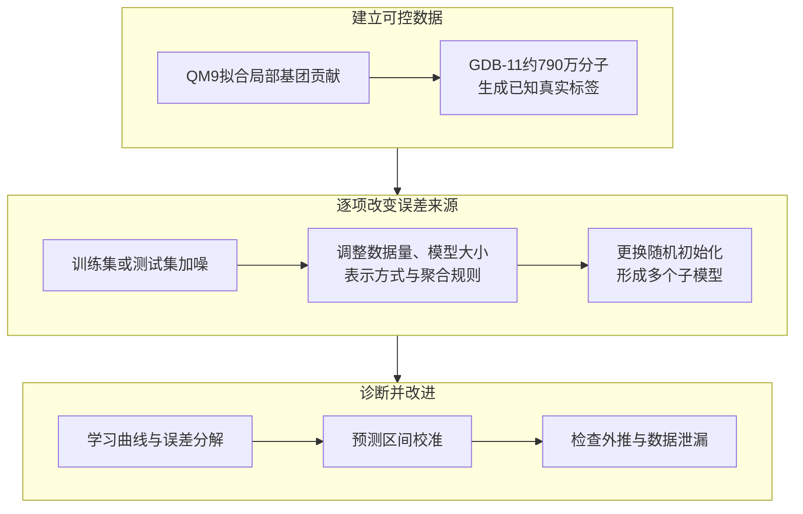

### 2.数据噪声如何造成看似无法逾越的误差下限？

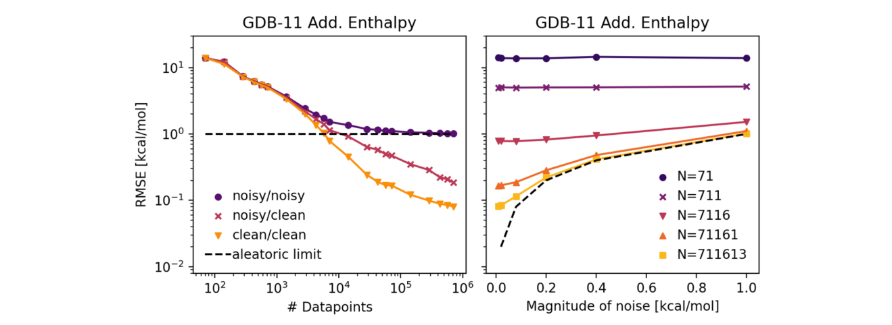

**图1：训练集与测试集中的随机噪声如何影响RMSE**。
- 左图比较无噪声训练/测试（clean/clean）、有噪声训练/无噪声测试（noisy/clean）和有噪声训练/有噪声测试（noisy/noisy）；加入的高斯噪声标准差为1 kcal/mol。黑色虚线是测试噪声对应的偶然误差下限。
- 右图改变噪声标准差与训练集规模。数据量较大时，RMSE逐渐靠近由测试集噪声决定的水平；样本少时，偏差和方差仍主导误差。

最有启发性的对照是左图的**noisy/clean与noisy/noisy使用完全相同的训练模型**，只有测试集是否带噪声的区别。对干净测试目标的预测仍随训练数据增加而变好，但带噪声测试集的RMSE最终停在约1 kcal/mol。这个平台反映了**评价标签的噪声水平**，可能掩盖真实预测函数已经学得更准的事实。

> 测试集噪声设定的精度下限，会让**模型真正学到的进步在评测中“看不见”**，从而误导我们对“该不该继续改模型”的判断。

如果噪声只进入训练集，更多数据仍可帮助模型平均掉随机误差；测试集噪声则会直接限制观测到的精度。论文进一步改变高斯、均匀、双曲及双峰噪声分布，发现当均值和标准差相同且噪声在各样本间同分布时，总体学习曲线基本一致。

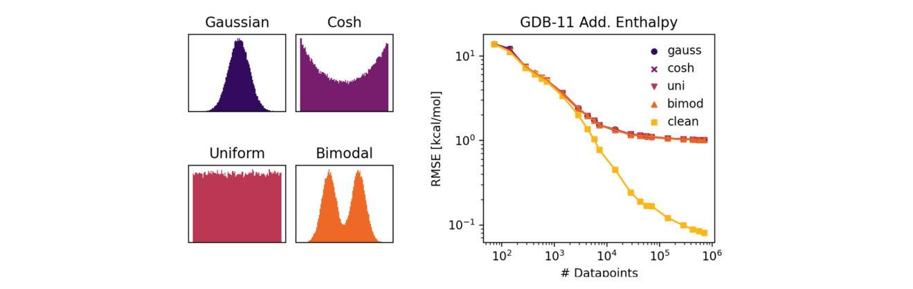

**图2：不同形状的随机噪声分布及其对学习曲线的影响**。左侧展示四种标准差均为1 kcal/mol的噪声分布，右侧显示对应的RMSE随数据规模变化的曲线。不同曲线基本重合，说明该实验中噪声尺度比具体分布形状更重要。

### 3.系统性噪声：为什么预测均值和方差有时比ensemble好？

实际数据中的误差经常随分子结构而变。比如某类含氮化合物的实验测量不稳定，模型就可能从分子特征识别这一规律。**均值—方差估计**（mean–variance estimation，MVE）在一个目标上同时预测均值 $\mu(x)$ 和方差 $\sigma^2(x)$，以此描述预测分布及其噪声尺度。

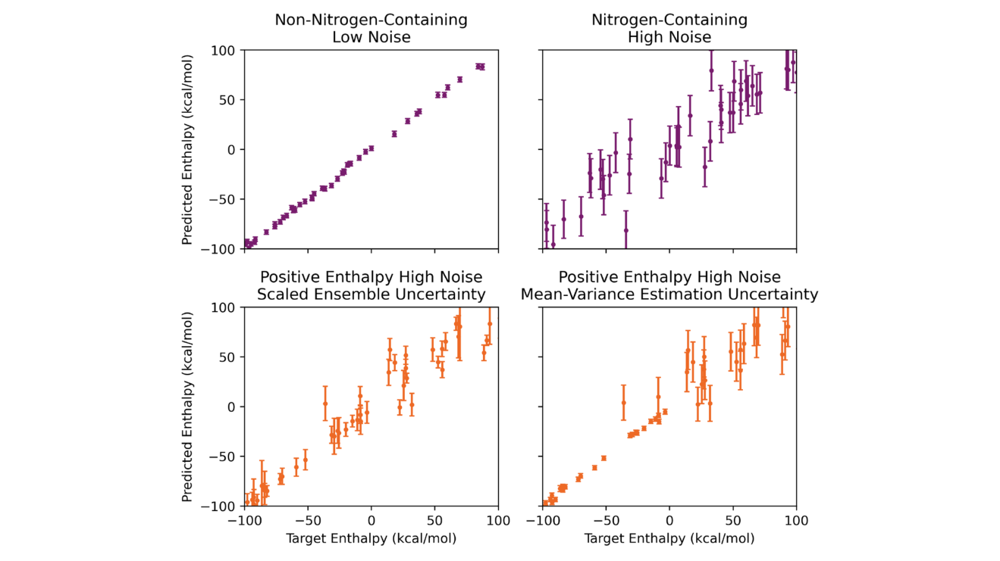

**图3：两种系统性噪声模式下的预测与不确定性估计**。
- 上排（紫色）：非含氮与含氮分子的噪声标准差分别为2和20 kcal/mol。MVE给出的平均预测标准差分别约为2.35和20.0 kcal/mol，与对应测试RMSE的2.12和20.0 kcal/mol接近。
- 下排（橙色）：按原始焓的正负划分低噪声与高噪声区域，噪声标准差同样为2与20 kcal/mol。左图是按平均尺度校准的ensemble标准差，右图是MVE的标准差。

在下排的例子中，ensemble给出的低、高噪声组平均不确定性分别约为**10.6和11.5 kcal/mol**，区分能力较弱；MVE则分别约为**2.4和19.5 kcal/mol**。这说明当噪声随可学习的输入特征变化时，显式预测噪声方差能更好地区分高风险样本。如果噪声来自模型输入中完全缺失的实验条件，例如未记录的仪器差异，模型也缺乏识别它的依据。

> 当噪声随可学习的输入特征变化时，**显式预测方差的MVE比ensemble更能区分高风险样本**；若噪声来自模型根本没输入的条件，再聪明的模型也缺乏识别依据。

### 4.模型偏差与方差：数据量、模型规模各影响什么？

在无噪声人工数据上，可以将ensemble的剩余误差进一步分析为模型偏差与方差。本文使用贝叶斯ensemble projection：把不同随机初始化的子模型预测看作某个潜在预测分布的样本，推断**当ensemble规模趋于很大时仍会剩余多少误差**。由于这套人工数据近似无噪声，剩余的非方差误差可以用于估计模型偏差。

其核心出发点是，单个样本的ensemble预测为

$$
\bar y(x)=\dfrac{1}{M}\sum_{m=1}^{M}\hat y_m(x)
$$

其中$M$是子模型数量。模型间标准差反映随机初始化造成的预测分散程度，而实际误差 $|\bar y(x)-y(x)|$ 还包含模型共有的系统性偏离。利用贝叶斯推断可以估计后者在理论上无限大ensemble中的剩余量，再分析当前误差中由有限ensemble造成的贡献。

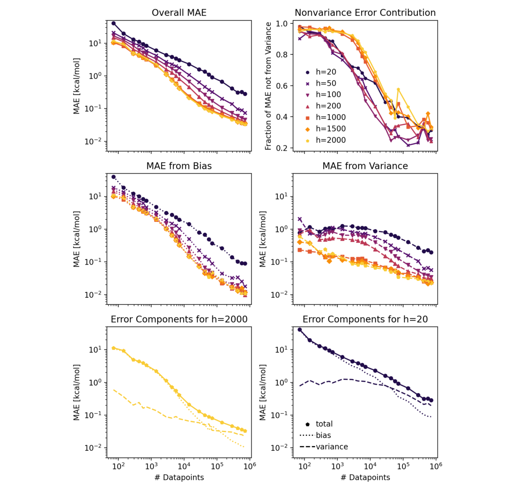

**图4：不同样本量与隐藏层规模下，总MAE及偏差、方差贡献的变化**。
- 上排左侧为总MAE，右侧为非方差误差占比。不同颜色表示隐藏层大小$h=20$至2000。
- 中排分别是模型偏差贡献与模型方差贡献。底排进一步展示大模型（$h=2000$）和小模型（$h=20$）的误差来源；本实验的人工目标近似无噪声，因此非方差误差主要归于偏差。

训练样本很少时，**模型偏差占主导**：模型尚未充分覆盖化学结构规律，增大ensemble的潜在收益有限。样本量不断增加，偏差下降得更快，方差在总误差中的相对比例逐渐上升。本文人工数据的示例中，方差贡献从小样本区的约5%–10%，增加到大样本区的约60%–80%。

模型过小也会造成显著偏差，例如隐藏层宽度 $h=20$ 落后于较大模型；增大到约1000后改善逐渐减弱。由此可以把改进顺序与误差来源对应起来：**偏差大时先查数据覆盖、模型与特征；方差占比高时再考虑增加ensemble模型数**。

> 改进顺序要跟着误差来源走：**偏差大时先查数据覆盖与模型结构**，方差占比升高后再靠ensemble收敛，而不是一上来就堆子模型。

### 5.化学任务的特殊性：分子大小、二维三维与特征工程

分子性质分为广延性质（extensive property）和强度性质（intensive property）。**广延性质通常随体系大小近似增加**，例如分子焓和总能量；强度性质对分子大小的依赖较弱，例如HOMO–LUMO能隙。对原子表示进行求和（sum）可以保留总量信息，取平均（mean/avg）则倾向于描述每个原子的平均环境。

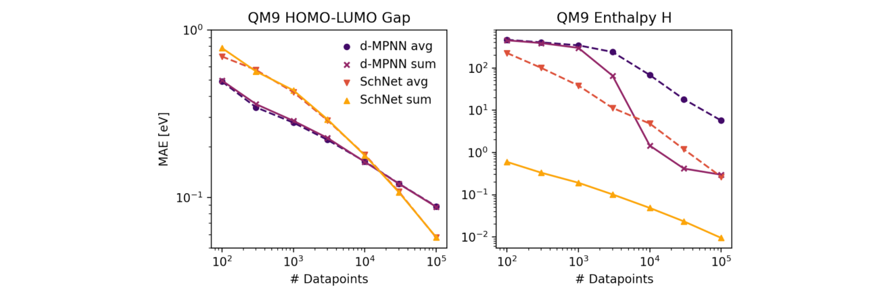

**图5：d-MPNN与SchNet采用平均或求和聚合时，预测不同分子性质的学习曲线**。左图实际为QM9的HOMO–LUMO能隙，右图为298 K焓；实线表示sum，虚线表示avg。两种聚合方式对能隙表现接近，预测焓时sum更好。原文Figure 5的英文图注将左右性质顺序写反，此处按图内标题说明。

这还解释了为什么三维SchNet在焓预测上优于部分二维模型：焓受三维构象影响，而SchNet使用原子坐标；同时，SchNet的原子贡献初始化也利用了目标性质的统计量，有利于学习加和规律。因此图中的模型差距也包含**输入信息与初始化策略**的影响。

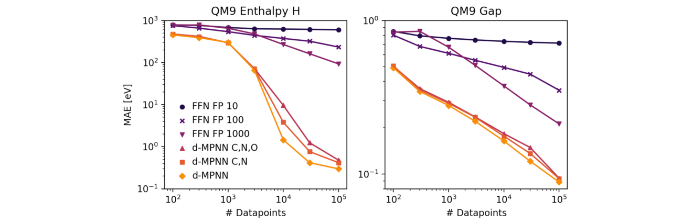

**图6：不同分子输入特征对QM9焓与HOMO–LUMO能隙预测的影响**。本文比较了长度为10、100和1000的Morgan指纹＋FFNN，以及正常特征的d-MPNN；另将N错误表示为C，或将N、O都表示为C，人工制造信息缺失。左图为焓，右图为能隙。

**输入缺失的信息越多，模型往往越难学准**。只有10位的Morgan指纹造成严重的信息损失，即使增加数据仍受限制。部分受损的图特征则可能通过邻近结构线索和更多训练数据恢复一定预测能力。

针对具体任务增加物理化学特征也很有效：在QM9焓预测中，为d-MPNN加入环大小的one-hot特征，在10万个样本时使MAE从**0.30 eV降低到0.19 eV**。这提醒我们，模型可以自己学习复杂特征，但**与预测目标相关的结构信息仍值得显式提供**。

> 预测焓等广延性质时，**聚合方式必须保留分子尺寸信息**：sum优于mean；与目标相关的结构特征仍值得显式提供，不能全指望模型自己学会。

### 6.增加ensemble数量：精度提高多少，不确定性可靠多少？

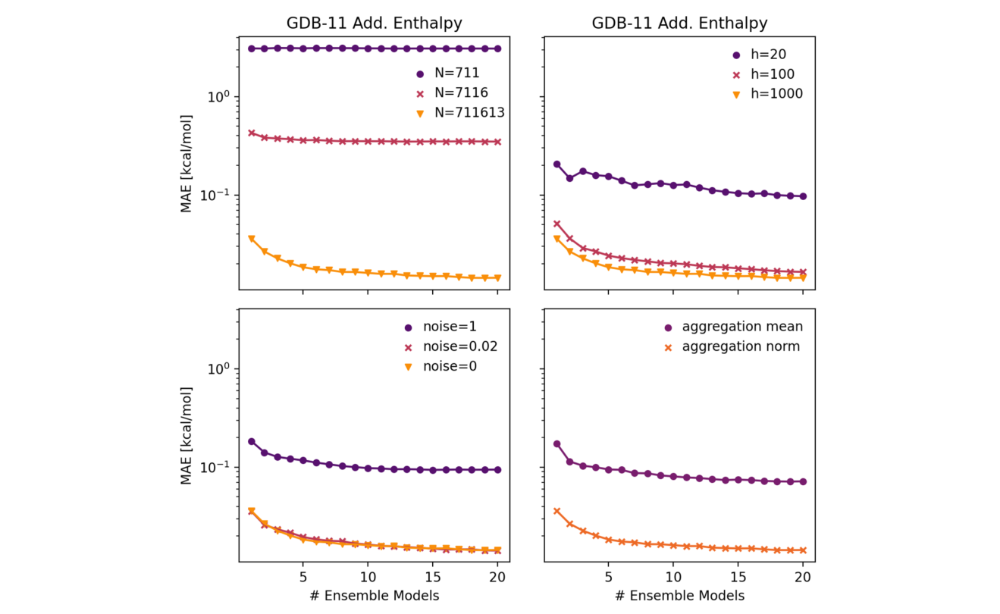

**图7：不同数据量、模型大小、训练噪声和聚合方式下，MAE随ensemble规模变化的曲线**。四组实验分别改变数据集大小、隐藏层宽度、训练噪声水平和mean/norm聚合方式。各曲线通常在前几个子模型加入时下降较快，随后改善趋缓。

Ensemble通过平均多个随机初始化模型的预测，削弱因训练随机性造成的方差。本文的受控实验中，增加子模型通常能降低MAE，但在小数据、高噪声或不合适聚合方式下，主要误差来自其他来源，最终改善有限。**模型数量存在收益递减**，训练成本却大致随子模型数量线性增加。

更重要的是**精度改善与不确定性校准是两个问题**。若只把子模型预测的标准差 $s(x)$ 当作预测区间宽度，大家都预测错同一个方向时，区间仍可能过窄。本文用校准曲线检验这一点：对名义覆盖概率$p$，统计真实值实际落在相应预测区间中的样本比例。理想情况下，经验覆盖率与$p$一致；曲线和对角线之间的面积称为**AUCE**（area under the calibration error curve），越接近零越好。

> 校准曲线揭示的是**模型分歧能否反映真实误差**，而不是模型是否准确；**分歧小不等于可靠**，尤其在多个模型共有系统性偏差时。

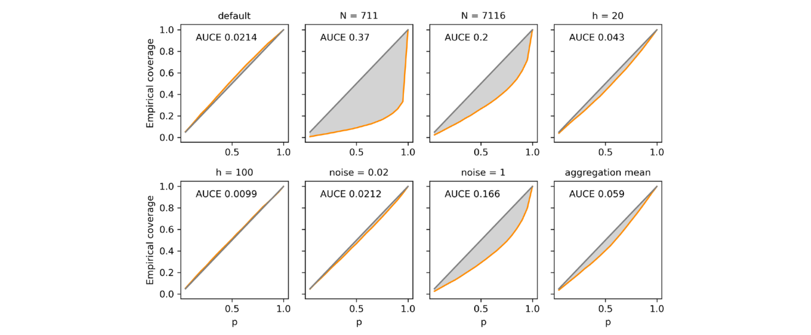

**图8：不同误差条件下，ensemble预测区间的校准曲线**。横轴为名义覆盖概率$p$，纵轴为实际覆盖比例；橙线为模型结果，灰色对角线是理想校准，灰色阴影区域对应AUCE。
- 默认设置下AUCE约为0.0214，说明模型分歧能够较好指示真实误差。
- 将样本量减至711时**AUCE升至0.37**，校准变差；样本量7116时约为0.20。此时模型偏差较大，ensemble标准差难以覆盖系统性误差。
- 加入标准差为1 kcal/mol的噪声时，**AUCE升至约0.166**，进一步说明预测分歧对数据噪声的反映有限。

这对主动学习尤其重要。通过ensemble分歧挑选待测分子，主要能发现参数不确定性较高的样本；对多个模型共同存在的盲区，还需要结合**化学空间覆盖、适用域和独立数据验证**进行判断。

### 7.测试集选得不对，模型的好成绩也可能是假象

模型在随机划分上获得较低误差，仍需看部署时面对的分子是否与测试集相似。本文用QM9做了两个很直观的实验：一个考察**分子大小的分布外外推**，另一个考察**同一分子不同温度造成的数据泄漏**。

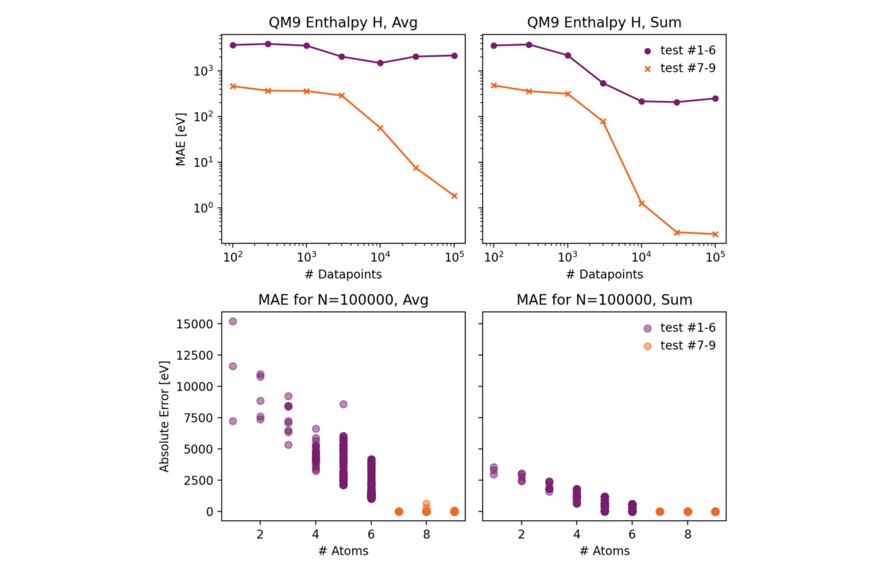

**图9：在7–9个非氢原子的分子上训练，并在相同尺寸或1–6个非氢原子的分子上测试时，聚合方式对焓预测的影响**。上排为不同样本规模的MAE，下排展示使用10万个训练样本时，各分子大小对应的绝对误差；紫色代表较小分子测试集，橙色代表与训练集相近尺寸的测试集。

当训练和测试分子的大小相似，mean和sum聚合都可能取得可接受的误差；换成非氢原子数较少的分子时，**mean聚合的预测误差可比相近尺寸分子高出多个数量级**。模型实际上借助了训练集狭窄的分子尺寸分布，间接推断总量；进入尺寸不同的分子空间后，缺少可扩展的加和结构就暴露了出来。

> 一个在训练尺寸分布上表现良好的聚合方式，可能在尺寸外推时完全失效；**评估聚合方式不能只看训练域内的误差**。

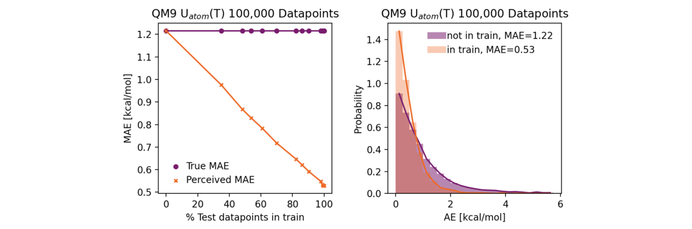

**图10：同一分子以不同温度出现造成的数据泄漏**。左图展示测试集中0%至100%样本在训练集中存在同分子、异温度记录时，观测MAE（橙线）逐渐低于独立测试MAE（紫线）；右图比较泄漏样本（in train）和完全独立样本（not in train）的绝对误差分布。

这个实验把QM9中0 K和298 K的内能作为同一预测任务，以温度为额外输入。若直接按数据记录随机划分，同一分子可能在训练集中以0 K出现，又在测试集中以298 K出现。**独立分子上的MAE约为1.22 kcal/mol，而泄漏样本约为0.53 kcal/mol**；泄漏比例增加会显著抬高整体测试成绩。

类似问题也可能出现在正逆反应同时入库、同一溶质出现在不同溶剂中、同一化合物具有多个实验条件记录时。合理的划分单位应与真正希望外推的对象一致。例如预测新分子，可按分子或骨架分组；预测未来实验，则可考虑时间划分；预测新溶质—溶剂组合，还需分别考虑溶质与溶剂的覆盖情况。

### 8.如何针对误差来源选择改进方法？

本文的实验提供了一套实用的诊断顺序。首先查看学习曲线：增加数据时误差是否仍下降？再比较重复测量、数据覆盖、模型结构和ensemble分歧，最后用真正独立的测试集检查结论。

| 观察到的现象 | 优先排查 | 可能有效的措施 |
| --- | --- | --- |
| 数据量增加但测试RMSE停在固定水平 | 测试标签噪声和重复测量误差 | 建立更高质量的独立测试集，复核异常标签 |
| 不同化学类别的残差散布差别很大 | 与结构或实验条件相关的异方差 | 将可观测条件加入输入，比较MVE与普通回归模型 |
| 小数据集上不同模型都表现一般 | 化学空间覆盖不足、模型偏差 | 补充代表性样本、调整表征和模型容量 |
| 不同seed预测分歧很大 | 模型方差、训练不稳定 | 增加数据、比较模型规模，评估适量ensemble |
| 模型很一致，但区间仍经常漏掉真值 | 共有偏差或未被刻画的数据噪声 | 检查校准曲线、AUCE与独立测试集 |
| 随机划分表现很好，真实新骨架很差 | 分布外外推或数据泄漏 | 使用分组、骨架或时间划分，并检查重复实体 |
| 预测总能量、焓时随分子尺寸偏离 | readout丢失分子大小信息 | 优先验证sum等保留广延性的聚合方式 |

实际选择时还有两个重要指标：**sharpness**衡量预测区间平均有多窄，**dispersion**衡量模型能否区分高风险和低风险样本。单纯把所有不确定性乘上一个校准系数，虽然可以改善某些覆盖率指标，却可能使不同样本的风险仍然难以区分。

> 实用诊断顺序很直接：**先加数据看误差是否还降**，再查覆盖、结构与ensemble分歧，最后用独立测试集校验；单纯给不确定性乘校准系数，未必让不同样本的风险变得可区分。

## 关键结论与批判性总结

本文最大的价值，是把化学机器学习中的预测误差与下一步该采取的改进措施联系起来。**清洗数据、补充化学特征、改变聚合方式、增加训练样本和训练更多seed**，针对的是不同问题。模型的预测性能和不确定性估计也应分别验证，尤其要检查测试集是否代表真实应用场景。

需要注意，本文大部分定量误差分解建立在**人工、可精确计算的基团加和目标**上，因而能够较清楚地分离偏差与方差。真实化学数据中的实验噪声、采样偏差、分布外结构和模型选择常常相互影响；误差分解在实际应用中仍需结合数据来源与验证协议判断。对于分子性质预测，这篇文章留下的最实用原则是：**先找准模型在哪些样本上、因为什么原因出错，再决定怎样改模型**。

> 本文的误差分解之所以可操作，是因为它把“模型为什么错”对应到了**具体的改进动作**：噪声对应数据质控，覆盖不足对应补数据，方差对应 ensemble——而不是只报告一个总误差数字。
