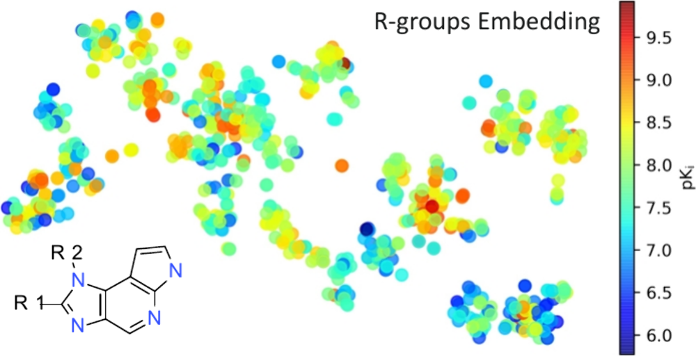
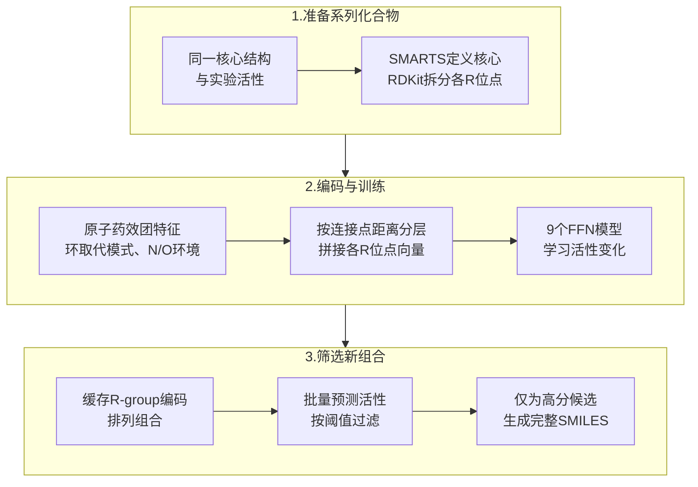
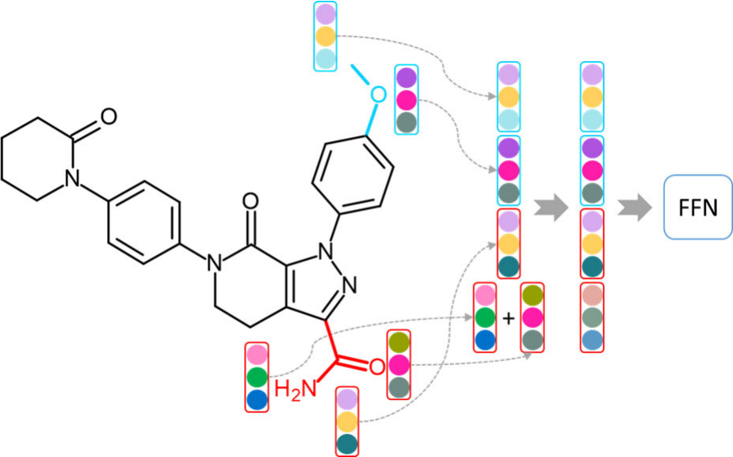
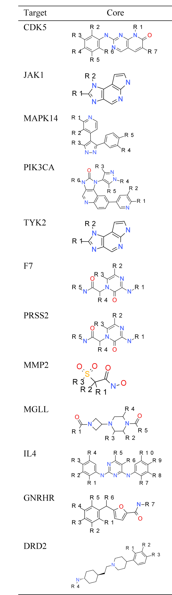
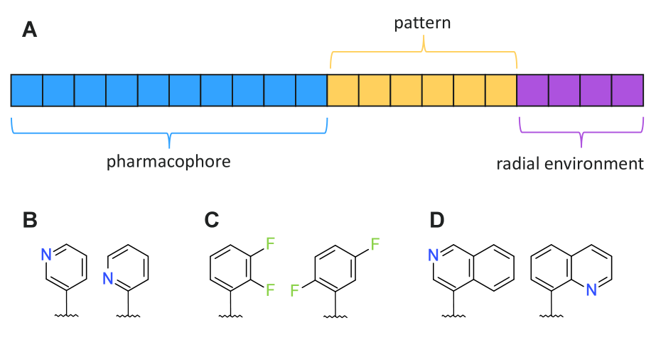
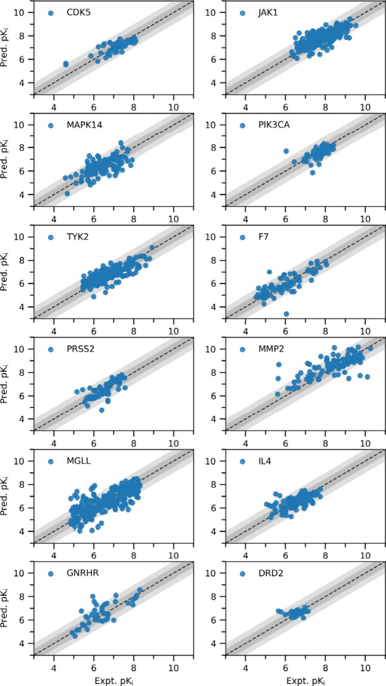
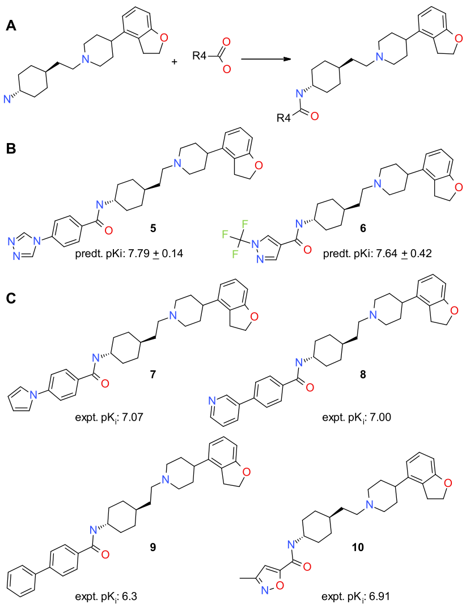
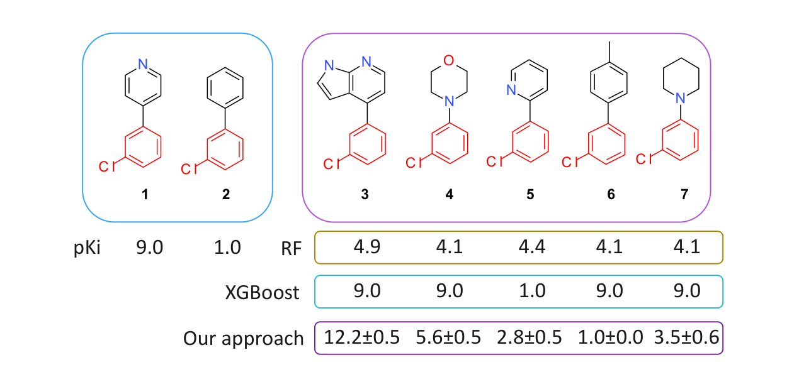

# AIR——基于取代基编码的药物活性预测与大规模R-group探索工具

## 本文信息

- **标题**：药物化学中的AI辅助R基团探索
- **发表期刊**：Journal of Chemical Information and Modeling
- **发表时间**：2025年2月17日
- **DOI**：https://doi.org/10.1021/acs.jcim.4c02326
- **单位**：阿斯利康（AstraZeneca）生物制药研发部药物化学团队，瑞典哥德堡
- **作者**：Zhao, H.; Kwapień, K.; Nittinger, E.; Tyrchan, C.; Nilsson, M.; Berglund, S.; Czechtizky, W.
- **引用格式**：Zhao, H.; Kwapień, K.; Nittinger, E.; Tyrchan, C.; Nilsson, M.; Berglund, S.; Czechtizky, W. AI-Augmented R-Group Exploration in Medicinal Chemistry. *J. Chem. Inf. Model.* **2025**， *65* (5), 2251–2255. https://doi.org/10.1021/acs.jcim.4c02326
- **代码与数据**：AIR GitHub仓库：https://github.com/WIMNZhao/AIR

## 摘要

> 随着可用合成砌块和生成式AI的发展，如何在广阔的化学空间中高效探索R基团仍是一项挑战。本文开发了一种改进的Free-Wilson QSAR模型，利用**以原子为中心的药效团特征**对R基团进行嵌入，并通过显式考虑原子位置来区分R基团的位置异构体。该方法在12个公开数据集上持续表现出良好的预测能力。作者将其整合为开源程序，展示了传统Free-Wilson分析以及对尚未探索的R基团化学空间进行筛选的应用。



### 核心结论

- **让R-group成为可迁移的化学特征向量**：AIR按原子药效团属性、连接点距离及环内邻近环境编码取代基，能够比较训练集中未出现过的新R-group。
- 12个靶标的测试集MAE（平均绝对误差）为**0.23–0.54**个$pK_i$单位（中位数0.38）；与Chemprop、MolCLR相比总体有优势，与随机森林、XGBoost则基本处于相近水平。
- **在R-group空间直接筛选组合**：PRSS2约105万个候选组合，AIR用2.5 min完成预测；文中传统分子枚举加随机森林预测共耗时30 min。
- **从已有取代基组合扩展到新砌块**：DRD2案例利用15,522个Enamine羧酸试剂衍生的R4候选，提出了两个待实验验证的分子设计。

## 背景：为什么要单独研究R-group？

药物化学中的先导优化经常围绕一个相对固定的核心骨架展开：保留负责主要结合的结构，在不同位置替换甲基、芳环、含氮杂环、酰胺等**R基团**（R-group，取代基），寻找活性、选择性和成药性质更好的组合。系列化合物可以共享一个core，但不同R位点上的改动，往往对应不同的蛋白相互作用。

经典的**Free-Wilson分析**正是为这类任务设计的。它先把分子拆成共同核心与各位置取代基，再用线性模型估计各取代基对活性的贡献。直观地说，某个位置换成吡啶环，模型就给该取代基一个经验贡献；多个位置共同变化时，把各项贡献相加。

Free-Wilson本身是线性可加模型，但随着合成砌块库扩大，出现两个实际问题：一方面，**同一位置从未出现过的取代基没有可用的经验系数**；另一方面，分别替换两个R基团产生的效果常有耦合，仅靠线性相加难以描述。若改用整分子QSAR模型，往往还需要先构建海量完整分子的SMILES和指纹，增加筛选开销。

### 关键科学问题

- **如何表征未知的R-group**？模型需要理解取代基中氢键受体、供体及其他药效团的结构位置，使相似取代基有相近表示，同时区分氮原子位于邻位、间位或对位的异构体。
- **如何迅速筛选数百万个取代基组合**？核心骨架固定时，大量候选共享相同的R-group。重复组装整个分子并计算整分子指纹会造成额外开销。
- **如何保持足够的活性预测能力**？在小至数百个化合物的同系系列中，能否取得与常用机器学习模型相当的准确度，是方法实用性的关键。

> 三个关键问题归结为一句话：**传统Free-Wilson能给已知取代基算系数，却给不了没出现过的R-group，也算不清多位点之间的耦合**。

### 创新点

AIR（AI-Augmented R-group Exploration）将Free-Wilson的R位点分解与**连续的R-group结构表征**结合：每个位置输入的是根据其内部结构算出的特征，而非某个取代基的独立类别编号。随后用前馈神经网络学习多位点组合与活性之间的非线性关系，并缓存R-group编码以提高枚举速度，对**结构系列清晰、存在多个可替换位置的先导优化项目**尤为适合。

> 把“在固定骨架上换取代基”直接变成模型输入，是AIR方法学上最贴近药物化学家工作流的一点。

## 研究内容

### AIR的方法：从R-group到活性预测

AIR围绕“固定核心 + 可替换R-group”的先导优化场景展开，下面分方法构建、基准评测、组合筛选效率、新砌块外推与编码设计动机几个部分说明。



#### 1. 按共同核心拆分R位点

确定一组化合物共享的核心结构，以SMARTS描述，再利用RDKit的R-group decomposition将各分子拆成core和标记位置的R1、R2等。**相同的R位点在全系列中必须有一致的映射**，后续每个位置才有可比较的特征向量。

例如，图1用Apixaban作为示意：核心骨架用黑色表示，甲氧基和伯酰胺取代基分别用蓝色、红色表示。AIR将这些取代基**单独编码，再拼接成为整个分子的输入**。



**图1**：AIR基于R-group的QSAR模型示意。每个R基团的原子先转换为药效团和拓扑特征；原子特征按距核心连接点的键数排列，同一距离上的原子特征相加，最终将各R位点的向量送入前馈神经网络（FFN）预测活性。

图1只画了一个分子。主文Table 1还列出12个数据集各自的核心骨架与R位点编号，拆出来的R-group就挂在这些标着R1、R2的位置上。



**表1的Core列**：12个数据集的核心骨架与取代位点编号。可替换位置数随靶标而变，CDK5标到R7，IL4标到R10，DRD2只有R1–R4；骨架上标R的位置就是取代基接入点。

#### 2. 给每个原子建立药效团与拓扑特征

取代基内各原子**先按预设SMARTS子结构匹配成二进制位**，再拼接一段**杂原子环境的计数向量**，三类特征如下：

- **原子药效团性质**：疏水性、可电离性、氢键供体、氢键受体和手性等，表达该原子可能提供的化学相互作用，对应图4A的蓝色段。
- **环上取代模式**：一组专门针对环上取代排布设计的SMARTS模式，把邻位与对位二取代这类相对位置编码成二进制位，对应图4A的黄色段，用来区分元素组成相同但连接位置不同的异构体。
- **N/O的径向环境**：对R-group内的氮、氧原子，统计相隔2键和3键的**邻近原子数**，得到一段计数向量而非二进制位，对应图4A的紫色段，用来区分杂原子在环上位置变化造成的区域异构体。只统计N和O，因为二者极性强、B与P在药物化学中罕见，而硫偏亲脂、其环内异构体可借其他特征区分。

径向环境特征可以表示为：

$$
R_D(i)=\sum_{j\ne i}\mathbf{1}\big[d(i,j)=D\big],\qquad D\in\{2,3\}
$$

其中，$d(i,j)$是取代基内部原子$i$与$j$的**最短键路径长度**；指示函数在二者距离等于$D$时取1，否则取0。这样，同样含有一个环内氮原子的两个位置异构体，也可能得到不同的局部环境特征。

#### 3. 按原子距连接点的远近组织向量

在一个R-group内部，AIR进一步计算各原子距离核心锚定点的拓扑距离。距离为1的原子放在第一层，距离为2的放在第二层，以此类推。**对于同一层的多个原子，把原子特征逐维相加，再将不同距离层的向量依次拼接**：

$$
\mathbf r_i=\left[\sum_{j:d_j=1}\mathbf a_j,\ \sum_{j:d_j=2}\mathbf a_j,\ \ldots,\ \sum_{j:d_j=D_i}\mathbf a_j\right]
$$

$\mathbf a_j$代表原子$j$的编码，$d_j$是它到核心连接点的键数，$D_i$是第$i$个R位点在训练数据中观察到的最大拓扑距离。较短的R-group以零向量补齐；**超出训练集最大距离的更远端原子不会被显式编码**。这里的距离指键连接网络上的相对位置，不是三维坐标。

> 所以，每个位点就是一个$r_i$向量。



**图4**：AIR的原子特征编码方案。

- （A）原子向量由药效团特征（蓝）、环上取代模式（黄）和N/O径向环境特征（紫）组成。
- （B）通过氮原子相对于连接点的拓扑距离，区分吡啶环位置异构体。
- （C）通过环上取代模式，区分邻位和对位二取代基。
- （D）对于普通局部特征难以区分的稠环异构体，引入N的径向环境统计。

> AIR的编码只吃**二维拓扑与预设化学特征**，因此便宜、无需蛋白结构；代价是它**不直接建模真实三维结合模式**，活性判断建立在一维/二维SAR经验上。

#### 4. 拼接各R位点，用前馈网络预测活性

传统Free-Wilson模型一般写成：

$$
\hat y=\beta_0+\sum_i\beta_{i,R_i}
$$

其中，$\beta_{i,R_i}$表示位置$i$放置取代基$R_i$带来的活性贡献，整个模型假设各位点贡献可加。AIR改为：

$$
\hat y=f_\theta(\mathbf r_1,\mathbf r_2,\ldots,\mathbf r_n)
$$

这里的$f_\theta$是小型前馈神经网络，能够学习各R位点之间的组合效应。**网络输入保留了每个R-group的位置信息**，因此同一化学片段接在不同位置，可以对预测产生不同影响。

主文Table 1和SI使用的统一评测配置如下：

| 项目 | 配置 |
| --- | --- |
| 输入 | 各R位点按顺序拼接的结构编码 |
| 模型 | 单隐藏层前馈神经网络，ReLU激活，单一输出 |
| 隐藏层宽度 | 128个神经元 |
| 训练 | Adam优化器，100个epoch，初始学习率$3\times10^{-4}$ |
| 模型集成 | 9个不同随机种子，预测值取均值 |
| 不确定性指标 | 9个模型预测结果的标准差 |
| 数据划分 | 每个系列随机划分80%训练集、20%测试集 |

> 评测统一用128神经元前馈网络、9个随机种子集成；预测标准差反映的是**集成分歧**，并非校准后的误差区间，当作误差区间前还需验证其校准程度。

### 12个数据集上的模型表现

作者评估了**11个专利来源的同系化合物系列**，涵盖激酶、丝氨酸蛋白酶、金属蛋白酶、脂肪酶、细胞因子受体及GPCR；另从ChEMBL收集了DRD2系列，共12个数据集。每个系列单独训练一个AIR模型，**与整分子Morgan指纹加随机森林（RF）、XGBoost比较**。



**图2**：AIR在12个数据集测试集上的$pK_i$预测结果。横轴为实验$pK_i$，纵轴为预测$pK_i$；蓝点对应分子，误差棒表示9个模型预测的标准差。所有数据集均采用80:20随机划分。

**表1**：12个数据集的测试集预测结果。**左三列为MAE**（单位$pK_i$的log单位，越小越好），**右三列为Pearson相关系数**$r$（越高越好）；三种模型使用相同的训练/测试划分，每列最优值加粗。

| 靶标 | 分子数 | RF | XGBoost | AIR | RF | XGBoost | AIR |
| --- | ---: | ---: | ---: | ---: | ---: | ---: | ---: |
| CDK5 | 228 | 0.37 | 0.38 | **0.36** | 0.77 | **0.80** | 0.78 |
| JAK1 | 921 | **0.38** | 0.42 | 0.39 | **0.74** | 0.71 | **0.74** |
| MAPK14 | 606 | **0.49** | 0.51 | 0.52 | **0.65** | 0.58 | 0.55 |
| PIK3CA | 304 | 0.31 | **0.26** | 0.27 | 0.56 | 0.58 | **0.61** |
| TYK2 | 921 | **0.38** | 0.42 | 0.40 | **0.79** | 0.76 | 0.78 |
| F7 | 364 | 0.44 | **0.32** | 0.38 | 0.81 | **0.88** | 0.85 |
| PRSS2 | 339 | 0.31 | **0.25** | 0.28 | 0.71 | **0.78** | 0.72 |
| MMP2 | 542 | 0.52 | 0.53 | **0.51** | **0.72** | 0.71 | 0.70 |
| MGLL | 1228 | **0.54** | 0.59 | 0.55 | **0.75** | 0.69 | 0.73 |
| IL4 | 648 | 0.33 | **0.29** | **0.29** | 0.64 | **0.71** | **0.71** |
| GNRHR | 196 | **0.50** | 0.58 | 0.62 | **0.76** | 0.64 | 0.61 |
| DRD2 | 171 | **0.23** | 0.26 | 0.27 | **0.23** | −0.15 | −0.27 |

从整体结果看，**AIR与RF、XGBoost基本处于同一精度范围**。但就这12个同系系列而言，**RF与XGBoost整体优于AIR**：MAE上AIR仅在CDK5和MMP2两个系列单独最低（另与XGBoost在IL4并列最低），更多系列的最低MAE由RF（6个）或XGBoost（4个）取得；Pearson相关系数上，AIR也仅在PIK3CA单独最高、在JAK1与IL4并列最高。与Chemprop和MolCLR的比较显示，AIR在多数系列上具备竞争力（SI Table S1给出完整数据）。

这里不同系列之间的表现也呈现出差异。例如，在PIK3CA、F7、PRSS2和IL4等系列中，**XGBoost的MAE低于AIR**；而DRD2虽然由RF取得了全表最低的MAE（0.23），但AIR在该测试集上的Pearson相关系数仅为−**0.27**（预测与实验活性呈负相关），说明**AIR对DRD2的外推不仅不可靠，方向甚至可能相反**。

> 关键提醒：**MAE小不等于外推可靠**。在这12个同系系列里，RF与XGBoost整体并不比AIR差，DRD2上AIR的相关系数甚至为负。

### 编码、数据量和标签扰乱的对照

SI还比较了几种影响因素：

- **R-group编码方式**：与各位点使用64-bit Morgan指纹的R-ECFP4模型相比，AIR在12个系列中的8个取得更低MAE，说明显式加入药效团和位置结构这一设计在多数系列中有效。
- **训练数据量**：SI Table S3将训练比例设为20%、40%、60%、80%。多数系列随训练数据增加而改善，但不同模型、不同靶标的变化并非完全单调。
- **y-scrambling**：将训练标签随机打乱后再预测，测试集的相关性大多接近零。CDK5在SI Table S2中仍有$r=0.53$这一例外，因此这项检查应结合具体数据集解读。

> 随机划分测的是**同系系列内的SAR插值**，不是跨骨架、跨新R-group的迁移；要评估后者，得靠外部划分加实验验证。

### 百万级枚举：为什么AIR能筛得更快？

传统整分子QSAR筛选先把各R位点的组合连接成真实分子，再生成SMILES、检查结构并计算分子指纹。**候选数目很大时，前面这些准备操作也会成为耗时步骤**。

AIR把R-group作为计算基本单元：先对各位置的**独特取代基编码一次并缓存**，随后直接拼接缓存向量，让模型预测组合活性。只有预测值达到预设阈值的候选，才进一步组装为完整分子并写出合法SMILES。

作者以PRSS2的339个已知配体为例，对各位点进行组合，得到**1,049,664**个候选。测试记录如下：

| 流程 | 时间 |
| --- | ---: |
| 构建约105万个有效SMILES | 18 min |
| 随机森林进行活性预测 | 12 min |
| AIR直接在R-group空间预测 | **2.5 min** |

因此，本例中AIR相对“完整枚举＋RF”流程**约快12倍**。实际时间也取决于硬件、化学系列、候选组合数量及合法结构检查成本。

> 效率增益的关键不在网络更快，而在**R-group编码复用与延后生成完整分子**。

对于跨越多个R位点的成环取代基，程序还需要检查组合是否合法。例如R2和R3可能属于同一个并环结构，不能把它们当作完全独立的两个取代基自由拼装。**这一步保证最终生成的化学结构有效**。

### DRD2案例：从已有取代基组合走向新合成砌块

AIR还可以使用**在训练集中从未出现过、但能够计算R-group编码的新取代基**。作者选择DRD2系列展示这一点，先检查已有R-group重新组合得到的候选，再进一步引入Enamine羧酸试剂库中的新基团。

在已知取代基组合中，模型预测未出现在训练集的化合物1，其$pK_i$约为7.28，与已知最强活性化合物3（实验$pK_i=7.28$）接近。作者进一步利用相关matched molecular pair（匹配分子对）分析，**为这一预测提供SAR参照**。

接着，研究利用虚拟酰胺偶联，在指定R4位点探索**15,522**个新取代基，并选出化合物5和6。两者分别被预测为$pK_i=7.79\pm0.14$和$7.64\pm0.42$。



**图3**：AIR辅助设计新的R基团组合。

- （A）通过虚拟酰胺偶联，在现有骨架上引入新R4基团。
- （B）从虚拟候选中选出的化合物5和6，以及模型预测的$pK_i$。
- （C）已合成、具有实验活性的近邻化合物7–10，用于解释对5和6的SAR判断。

其中，5与已知化合物7的形状接近，主要将吡咯替换为1,2,4-三唑，引入额外的氢键受体；8与9的匹配分子对显示，在相关芳环间位放置氢键受体可能提高活性。6则与10具有相似形状，其三氟甲基可能提高脂溶性，影响活性。这些比较说明了AIR如何将**模型预测与药物化学家的局部SAR推断**结合。

> 5和6是**预测出的下一轮候选**，论文只给了预测值与近邻实验参照，**尚未实测**；能否成药仍待合成验证。

### 为什么要设计这样的取代基编码？

SI Figure S2还给了一个直观的思想实验：蓝色框里两个训练样本共用氯代苯基核心，只差一个环上氮原子，接4-吡啶基的化合物1（$pK_i=9.0$）能与激酶hinge主链形成关键氢键，接苯基的化合物2（$pK_i=1.0$）则缺少这一相互作用。只用这两个样本训练，再预测紫色框里5个新取代基：7-氮杂吲哚、吗啉、另一吡啶基异构体、对甲苯基和哌啶基，**观察模型能否凭结构信息区分潜在活性**。这一思想实验检验的正是**表征的化学区分能力**。



**图S2**：取代基编码与化学直觉的思想实验。左边的两个样本作为训练参考，右边五个新取代基分别由RF、XGBoost和AIR预测。AIR对不同杂环的预测差异更符合作者依据hinge氢键提出的定性判断。

> 同一思想实验也暴露**小样本外推的风险**：AIR给化合物3的预测（约12.2）已超出训练点标签范围，说明筛选时要同时看适用域、预测分歧和实验判断。

### 如何运行开源AIR？

程序以Python实现，主要依赖RDKit，**提供模型训练、活性预测和Free-Wilson式组合筛选三个入口**。仓库自带DRD2示例和以SMARTS定义的核心，README给出的操作顺序如下：

```bash
# 配置环境
conda create -n air -c conda-forge rdkit
conda activate air
git clone https://github.com/WIMNZhao/AIR.git
cd AIR
pip install -r requirements.txt

# 用仓库示例训练、预测、筛选组合
cd data/drd2
python ../../r_fit.py
python ../../r_predict.py
python ../../r_FW.py
```

其中，`r_fit.py`用于训练模型，`r_predict.py`预测测试分子，`r_FW.py`在已训练模型上执行R-group组合筛选。README建议在Free-Wilson分析前用全部可用系列化合物重新训练，以充分利用现有SAR数据；程序将满足阈值的候选写出为`r_gen.smi`。核心SMARTS的写法需要遵循仓库示例。

完整用法与数据：https://github.com/WIMNZhao/AIR。

## 关键结论与批判性总结

AIR的特色在于**让模型输入与药物化学中的R-group替换操作保持一致**。通过编码药效团类型、杂原子位置和拓扑环境，它将固定核心系列中的每个取代基表示为可计算的特征，并借助缓存实现快速组合筛选。对先导化合物系列明确、可合成R-group丰富的项目，这是一条成本较低、便于接入现有工作流的路线。

从12个公开系列看，AIR**真正突出的附加价值在于未知取代基的结构化表示与百万级组合筛选效率**，而非单纯预测精度，因为它的预测能力与RF、XGBoost等传统方法大体相当。模型仍以每个系列单独训练为主，随机划分结果支持同系化合物内的预测能力；面向全新化学空间时，DRD2案例提供了合理的候选设计思路。

论文自身还有几处值得留意：

- **卖点与验证不匹配**：主张能比较训练集里未出现过的新R-group，但12个系列多为随机划分，测试取代基大多在训练集中见过；真正涉及新基团的DRD2案例只有计算预测，没有实测。
- **参数前后不一致**：正文方法段写前馈网络为16个隐藏神经元，表1脚注与SI则写128个。
- **基线对比不完全对等**：RF与XGBoost用默认超参，AIR经过调参并做9个随机种子集成，优势可能被放大。
- **只评估亲和力**：引言把选择性和药代等列为先导优化目标，模型实际只预测$pK_i$。

> AIR的附加价值能否落地，最终取决于新候选的**实验验证**，而非仅看同系系列内的预测误差。
