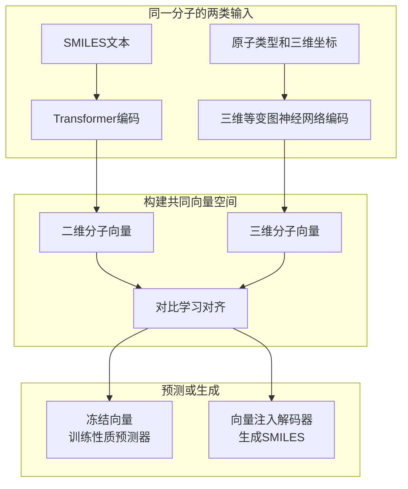
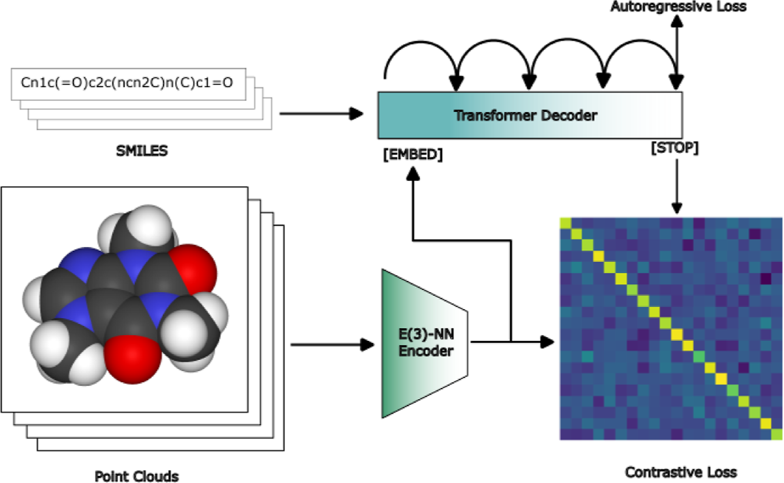
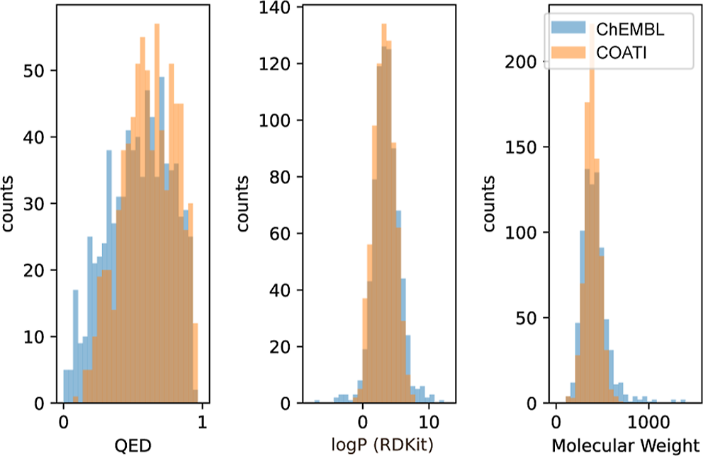
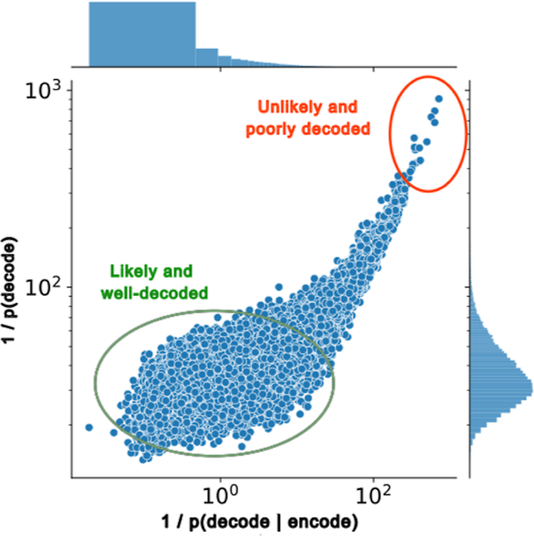
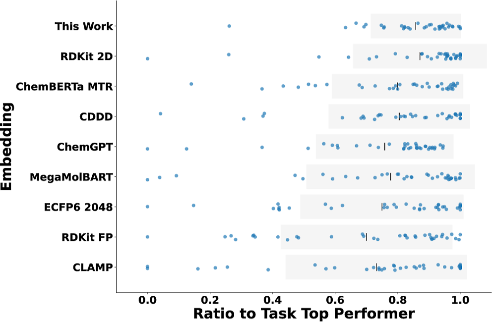
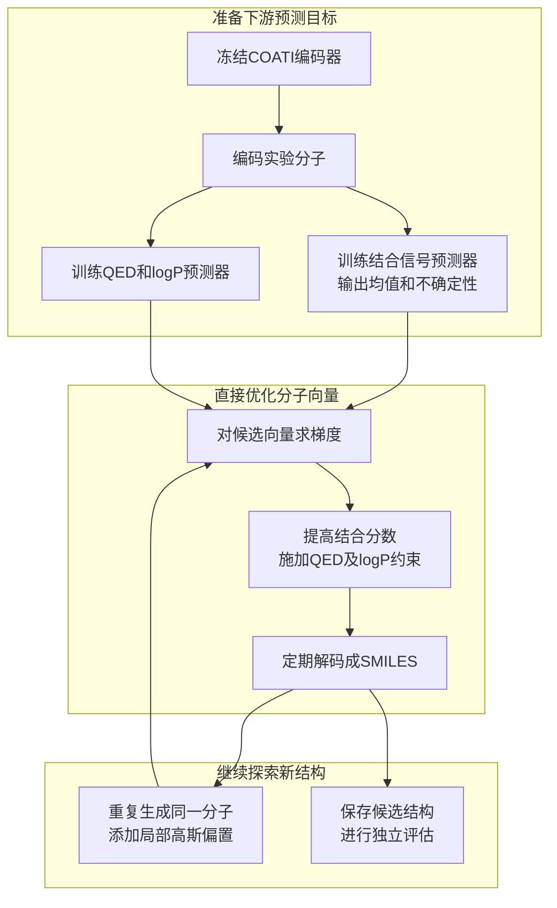
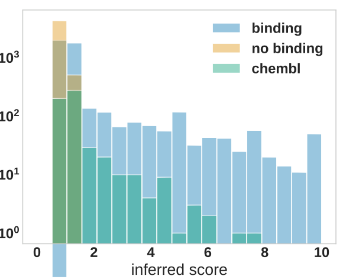
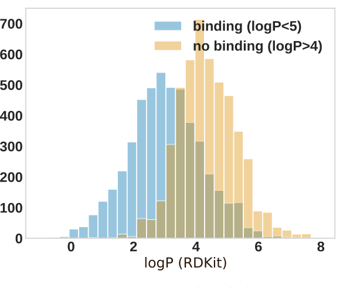
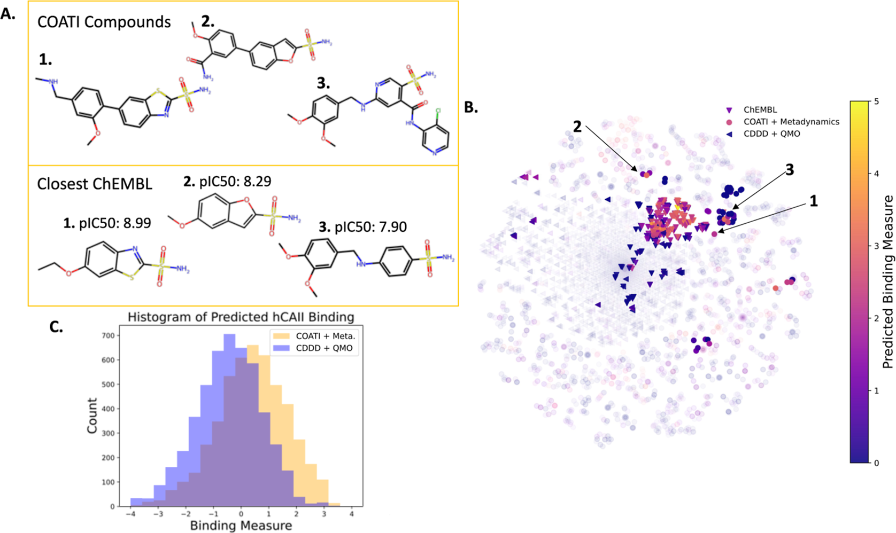

# COATI——将分子二维与三维结构映射到可生成的化学空间

## 本文信息

- **标题**：COATI：用于表示和探索化学空间的多模态对比预训练
- **作者**：Benjamin Kaufman、Edward C. Williams、Carl Underkoffler、Ryan Pederson、Narbe Mardirossian、Ian Watson、John Parkhill
- **发表期刊**：Journal of Chemical Information and Modeling
- **发表时间**：2024年2月5日
- **DOI**：[https://doi.org/10.1021/acs.jcim.3c01753](https://doi.org/10.1021/acs.jcim.3c01753)
- **单位**：Terray Therapeutics, Inc.，美国
- **引用格式**：Kaufman, B.; Williams, E. C.; Underkoffler, C.; Pederson, R.; Mardirossian, N.; Watson, I.; Parkhill, J. COATI: Multimodal Contrastive Pretraining for Representing and Traversing Chemical Space. *J. Chem. Inf. Model.* **2024**, *64*, 1145–1157. https://doi.org/10.1021/acs.jcim.3c01753
- **代码与数据**：[COATI官方GitHub](https://github.com/terraytherapeutics/COATI)：https://github.com/terraytherapeutics/COATI；代码、检查点及部分公开数据可获取，**Terray自有实验结合测定数据未公开**。

## 摘要

> 成功开发一种小分子药物，需要在几乎无限的分子空间中解决复杂的多参数优化问题。生成模型为改进药物发现与设计提供了机会。本文认为，要让生成式优化比穷举生成分子再进行虚拟筛选更有用，需要**四个相互配合的要素**：大规模定量分子结构与活性数据、**能够从向量还原真实可用分子的可逆表示**、**可微分且能量化不确定性的平滑回归模型**，以及同时优化目标性质的算法。Terray Therapeutics在12个月内收集了20亿条小分子与治疗靶标的定量结合测定数据，推动了依托实验数据的多参数分子优化。本文提出**COATI**（Contrastive Optimization for Accelerated Therapeutic Inference），一种面向类药化学空间的预训练多模态编码器—解码器模型。它**对比学习构建共同向量空间，无须人工指定性质特征**，并可与下游结构模型结合。**COATI兼具定长、可解码、自编码、较好回归表现和较低计算开销等性质**。最后，本文**借鉴元动力学（metadynamics）提出生成优化算法**，利用自有数据库中的一部分碳酸酐酶数据设计兼顾效力、溶解度和类药性的候选分子，为整合式小分子生成与优化提供了方法基础。

### 核心结论

- **同一套分子向量既能用于预测，也能还原成结构**：COATI将SMILES和三维点云编码到共同的定长空间，下游可用向量训练性质模型，也可将其解码为新的SMILES。
- **对比学习与分子生成联合训练**：二维与三维表示对齐的同时，模型保留自回归解码能力；只练习重建SMILES，并不能保证潜在空间适合平滑搜索。
- **线性探针预测具有竞争力**：冻结COATI嵌入后，只需简单模型即可在结合和ADMET任务中取得与其他表征相近或更好的结果；传统ECFP6与RDKit描述符在不少任务上仍然很强。
- **实验结合数据可用于生成优化**：针对人碳酸酐酶II（hCAII），优化器在分子向量空间中寻找满足类药性定量估计（QED）与 $\log P$ 约束的候选；其新生成分子的结合能力尚待实验确认。

## 背景

传统虚拟筛选往往先枚举或生成大量分子，再预测靶标结合与成药性指标，逐步淘汰不合适的结构。先导化合物优化通常还要求改善多个相互牵制的性质。如果先随机生成、后统一筛选，**大量计算会耗在明显不符合要求的候选上**。

一种替代路线是将分子压缩到连续向量空间，在向量上训练可微分的性质预测器，再沿梯度寻找更好的候选，最后把优化后的向量还原成分子结构。难点是：向量既要包含预测所需的信息，也必须**稳定地解码为化学上有效的分子**。

> **可逆表示的核心张力**：向量要同时装下预测所需的信息、又能稳定解码回有效分子，这两件事往往相互牵制——重重建的分子未必对应好预测的表示。

SMILES易于大规模获取，但同一分子可能有多种合法写法；三维构象提供几何信息，却会随构象改变。COATI尝试让这两类输入指向共同的分子表示，并在这一空间内完成预测与生成。

### 关键科学问题

- **怎样对齐二维和三维分子表示**：相同分子的不同SMILES写法或不同构象应形成一致的身份表示，同时保留区分不同分子的有效信息。
- **怎样兼顾重建和预测**：善于还原字符串的编码器，未必能构建适合性质预测与连续优化的潜在空间；跨模态对比训练能否改善这一点？
- **能否避免为每个新目标重新训练生成器**：冻结通用分子表示后，另行训练带不确定性估计的性质预测器，就能在原来的向量空间中优化新任务。

### 创新点

- **二维—三维对齐和SMILES解码端到端联合训练**：让三维编码器、文本Transformer与对比损失、自回归损失共同形成可解码的分子表示。
- **将通用表征与靶标特异性预测分开**：预训练无需依赖目标蛋白活性标签，下游利用冻结嵌入和实验数据训练可微分回归器。
- **借鉴元动力学（metadynamics）处理局部最优问题**：在已反复访问的向量区域加入高斯偏置，使生成优化继续探索其他化学结构。

### 与已有分子表示的区别

**表1：COATI与本文选取的相关模型在预训练和生成能力上的功能对比**。表中列出本文实际比较的模型版本与功能设计，符号“✓”表示本文将其归为支持该项功能；这不代表对当前软件版本的全面评测。

| 功能   | COATI | CLAMP | CDDD | MegaMolBART | ChemGPT | ChemBERTa MTR |
| ------------- | ----- | ----- | ---- | ----------- | ------- | ------------- |
| 固定维度嵌入向量 | ✓ | ✓ | ✓| —  | —   | —|
| 可生成分子| ✓ | — | ✓| ✓  | ✓   | —|
| 预训练不使用性质标签| ✓ | — | —| ✓  | ✓   | —|
| 对比学习损失| ✓ | ✓ | —| —  | —   | —|
| 接收文本输入| ✓ | ✓ | ✓| ✓  | ✓   | ✓|
| 接收三维输入| ✓ | — | —| —  | —   | —|

表1反映的主要设计取舍是：COATI把**固定维度、可解码、跨模态输入和无性质标签预训练**放在同一个模型中。后文的实际测试将分别检查这些设计是否带来预期收益。

## 研究内容

### 1. COATI的整体架构：二维文本与三维点云共享一套向量

COATI包含两条编码路径。文本分支用Transformer处理SMILES并自回归生成字符串；三维分支将原子类别和坐标输入E(3)等变图神经网络（E(3)-GNN）。每条分支输出分子向量，对比学习负责**拉近同一分子的二维、三维表示**。

**图1：COATI的联合预训练架构**。SMILES进入Transformer，分子三维点云进入E(3)-GNN；编码向量通过特殊的`[EMBED]`标记注入Transformer的解码序列。模型同时优化跨模态对比损失和预测后续token的自回归损失；训练时也可以注入SMILES自身生成的向量。

本文主要使用256维嵌入。作者指出，在原生E(3)-GNN点云编码器上把点嵌入维度提高到256以上会遇到初始化问题、导致训练失败，因此256维是该编码器架构下可稳定训练的维度，**这一限制来自编码器而非模型整体**：SI Table S1中Barlow_Venti的潜在维度已达384（其点云编码器仍是256维），作者还提到审查期间改用表达能力更强的类Allegro三维编码器的更替版本，已能成功训练512维模型。

另外，本文所用的E(3)等变编码器在构造上会**丢弃手性信息**，这套三维表示无法区分对映异构体；作者指出可以改用SE(3)等变编码器，或在编码器上附加手性球张量不变量来补回。

两条分支映射到同一向量空间，但其输出无需逐元素完全相等。编码器与解码器端到端联合训练，梯度会穿过`[EMBED]`标记的生成过程回传；作者提到这一步在其实验中是训练能够成立的必要条件，拆成两段训练则无法收敛。

### 2. 训练流程：一边对齐表示，一边学习还原分子

每个训练样本包含同一分子的SMILES和三维构象。Transformer以`[STOP]`位置的隐藏向量作为文本表示，三维编码器经线性映射给出点云表示。约90%的文本样本加上`[EMBED]`标记；其中一半注入SMILES编码向量，另一半注入三维编码向量，再让Transformer完成字符串预测。

| 训练目标   | 主要操作  | 实际作用   |
| ------ | -------------------------------- | ------------------- |
| 对比学习   | 匹配同一分子的文本和点云表示，并对照其他分子  | **让两类输入在共享空间内互相对应** |
| 自回归学习  | 根据已有token及注入的向量，预测后续SMILES token | **从潜在向量解码成分子结构**|
| 联合反向传播 | 两项损失同时更新编码器和解码器| 兼顾潜在空间结构与有效分子生成 |

本文比较了InfoNCE与Barlow Twins（文中简称Barlow）两种对比损失。前者直接提升匹配样本的余弦相似度，同时压低不匹配样本的相似度；后者对跨模态向量的特征相关矩阵施加约束，鼓励对应维度相关并减少冗余。**Barlow训练速度较快，未见明显表示质量损失**，后续重点展示Barlow_Closed模型。

$$
\mathcal{L}_{\mathrm{InfoNCE}} = -\dfrac{1}{2b}\sum_{i}^{b}\left[\ln\dfrac{\exp\left(z_{s,i}^{\mathrm{T}} z_{p,i}\right)}{\sum_{j}\exp\left(z_{s,i}^{\mathrm{T}} z_{p,j}\right)} + \ln\dfrac{\exp\left(z_{p,i}^{\mathrm{T}} z_{s,i}\right)}{\sum_{j}\exp\left(z_{p,i}^{\mathrm{T}} z_{s,j}\right)}\right]
$$

#### 公式的通俗解释

$z_{s,i}$与$z_{p,i}$分别是同一分子第$i$个样本的SMILES向量和三维点云向量，$b$为批次大小。前一个分式是“给定SMILES，从整批点云中认出自己那一个”的交叉熵，后一个分式反过来由点云认SMILES，两者取平均构成对称损失。外层取负号后，最小化该损失等价于最大化括号内的对数似然，作用就是抬高匹配对的余弦相似度、压低其余$b-1$个不匹配对的相似度。

自回归损失还有一个已知缺陷：同一个分子可以有多种合法SMILES写法，模型生成的字符串只要与训练集中的写法不一致就会被惩罚，哪怕分子本身是正确的。作者尝试过引入分子性质信息的辅助损失（文中称Descriptor Decoding），结果**降低了训练稳定性**，最终没有采用。

### 3. 数据来源、构象处理与训练规模

用于表征预训练的是**超过1.4亿条SMILES—几何结构配对数据**，来自ChEMBL、GEOM-Drugs、TensorMol、Mcule、ZINC22，以及5400万个由Enamine砌块目录组合枚举出的分子。GEOM-Drugs与TensorMol使用DFT构象，其他数据主要由RDKit生成构象并以MMFF94s优化，其中TensorMol有相当一部分结构明显偏离平衡构型。作者有意混合不同质量的几何结构，以提高模型对多来源输入的适应性。

训练使用PyTorch和AdamW，运行于两台DGX节点上的16张A100 80GB GPU；256维模型的总batch size约为2048。**batch size还会直接影响对比学习的效果**：两种对比损失都依赖批内统计，但方式不同。InfoNCE把同批内的其他分子当作负例；Barlow损失则通过约束批内跨模态特征的交叉相关矩阵来减少冗余，并不需要显式负样本。若把批次压到单行，两项损失都取不到批内对照信息，这与常规语言模型靠梯度累积用小批次微调的做法不同，所以作者把batch size开到硬件允许的最大值，并认为大批次训练更稳定。

训练增强包含SMILES随机化、填充中间片段及数据来源token等。预训练集按SMILES的MD5哈希范围划分，**这种划分不能等同于严格的骨架（scaffold）拆分**。

训练以近似收敛为目标，通常需要迭代约70亿个token才停止，判断依据是留出集上的有效性与同构统计，而不是固定的epoch数。超参数空间很大、单个模型训练成本不低，作者把算力集中到256维这一档模型上，未做大规模超参数搜索；本文报告的因此不是该架构充分调参后的上限。

| 规模| 具体用途  |
| ------------------ | ----------------------------------------- |
| 超过1.4亿条SMILES—3D配对 | COATI的**分子表征预训练**数据 |
| 超过20亿条结合测定| Terray平台在本文所述时期收集的实验数据总量，**并未全部用于本文生成案例** |
| 1,307,908条分子结合测定   | hCAII生成案例使用的实验数据子集，用于训练下游结合预测器   |

### 4. 分子生成：有效SMILES与还原原分子是两回事

COATI可从SMILES或点云得到向量，再将向量注入解码器生成SMILES。表现较好的模型生成有效率超过98%；补充材料中Barlow_Closed在SMILES自编码测试上的**有效SMILES比例**为98.7%，**严格规范SMILES（canonical SMILES）匹配率**为91.4%。前者只要求字符串能被解析为有效分子，后者还要求还原出输入分子。

只训练自回归损失的Autoreg_Only消融模型给出一个反向例子：有效比例约97.3%、规范SMILES匹配率约98.0%，**还原原分子的比例反而比Barlow_Closed更高**。这说明自编码指标本身并不能反映潜在空间是否适合插值和优化，两类指标要分开看。

补充材料还给出一个用SELFIES替代SMILES的变体（SELFIES_Barlow）：它的生成有效率是100%，但规范SMILES匹配率只有约74.8%。SELFIES在设计上保证了解码分子的有效性，因此有效率不能充分反映模型的结构重建能力；它明显更低的还原率说明，换一种表示并没有换来更好的可解码性。

通过`[SET][chembl_mols][SMILES]`等数据来源提示，COATI还能生成具有相应数据库统计特征的分子。模型并未把QED、 $\log P$ 或分子量直接作为这一实验的条件，但生成结果的这些性质分布与ChEMBL样本接近。

**图2：ChEMBL来源提示下生成分子的性质分布**。从左至右比较QED、RDKit $\log P$ 和分子量；蓝色为ChEMBL样本，橙色为COATI生成样本。分布相近意味着模型学到了集合的统计特征，不能据此证明单个分子具有实验验证的成药性。

训练集中**罕见分子的准确重建更难**。无条件生成概率很低的ChEMBL分子，通常在给定对应向量后也具有较低的解码概率；训练数据的覆盖范围会影响可探索的化学空间。

**图3：带向量与不带向量时的分子生成难度相关**。横轴是给定嵌入向量时生成该分子的负对数似然，纵轴是不提供嵌入向量时的负对数似然（图中两个轴都以生成概率的倒数表示、取对数刻度）；越靠右上，说明分子越难生成和重建，图中还展示了两个量各自的边缘分布。低似然尾部的分子分子量普遍很大，用同一把尺子比较似然并不公平。

### 5. 性质预测：冻结表示，只比较向量的信息量

为了检验分子表示本身包含多少可供预测的信息，本文冻结各模型的嵌入向量，再为每个嵌入单独拟合一个**线性探针**（linear probe）。这样比较的只是向量里有多少信息能被线性读出，**减少了下游预测器差异带来的干扰**；原文只说明使用线性回归，探针的具体实现与调参未完整披露。对照方法包括CDDD、ChemBERTa MTR、ChemGPT、MegaMolBART、CLAMP、ECFP6、RDKit指纹与RDKit 2D描述符。

**评测集由作者自行构建**：公开的真实回归数据集普遍在1000个数据点以下，规模小、噪声大，难以拉开不同表示的差距。为扩大覆盖范围，作者把公开ADMET任务与Terray平台的结合测定合并，构建了**36项任务**，一端是小样本高噪声，另一端是工业规模数据。

#### 29个公开ADMET任务：覆盖吸收、分布、代谢、排泄与毒性

其中24个来自Therapeutic Data Commons（TDC），5个来自MoleculeNet。规模跨度极大：最小的DILI只有475个分子，最大的hERG Central Inhibition超过30万个，多数任务落在几百到一万出头。指标也不统一：

- **分类任务用AUROC**，如Ames致突变性、五种CYP450抑制（1A2、2C19、2C9、2D6、3A4）、三个hERG心脏毒性数据集、ClinTox、DILI、Pgp抑制等
- **回归任务按指标分两类**：数值误差用RMSE，如Caco-2通透性、脂水分配系数、血浆蛋白结合率、半数致死剂量、溶解度；受化学结构以外因素影响大的改用**Spearman秩相关**，如肝细胞与微粒体清除率、稳态分布容积。半衰期在原文中的评价指标并不一致（SI Table S5标为Spearman，Table S3却按RMSE给出），这里不把它当作定论

指标不一致正是图4必须归一化的原因，所以**归一化分数并不等同于某个模型的统一AUROC、相关系数或绝对误差**。

划分方式沿用各数据集自带的默认设置：本文选取的这批任务里，除Tox21为随机划分外，其余TDC与MoleculeNet任务都按**骨架划分**（见SI Table S5、S6），测试分子的骨架不出现在训练集里；Terray的结合数据则用**随机9:1划分**，两者的泛化难度并不相同。

测试分子统一用RDKit去盐（溶解度数据集除外），并剔除无法在所有嵌入方法中被嵌入的分子，因此**参与比较的分子局限于所有方法都处理得了的那些**。

#### 另外7项任务来自Terray平台：四个靶点，两种评价方式

四个靶点分别是**布鲁顿酪氨酸激酶（BTK）**、人碳酸酐酶II（hCAII），以及两个不能公开名称的Protein-1与Protein-2。BTK是B细胞受体信号通路中的核心激酶，也是B细胞恶性肿瘤的成熟靶点，已有伊布替尼等多代共价与非共价抑制剂上市。作者把这类工业规模定量结合测定称为对ADMET任务的**更实用补充**，因为后者能提供的样本量实在太少。每个靶点配两套数据与两种评价方式：

- **结合测定**：给出训练集与测试集，用**区分前2%强结合分子的灵敏度**评价；这个2%的阈值不是随手定的，而是参考了结合平台数据与独立验证结合实验之间的典型ROC曲线
- **生化活性测定**：另留一份活性数据，用**秩相关**评价；只有BTK、Protein-1与Protein-2有这份数据，hCAII的活性结果无法获得；处理后的ADMET数据集已经公开

**图4：不同分子表示在线性探针下的相对预测表现**。每个点对应一个独立任务，横坐标是相对该任务最佳结果的归一化表现；**各嵌入自上而下的排列顺序按“归一化表现的均值除以标准差”给出，不是按均值**。本文重点展示的是Barlow_Closed模型的SMILES输入表示。逐任务原始指标可查SI Table S3，按任务类型拆分的汇总结果见SI Figure S3。

COATI在任务总体比较中具有竞争力，同时保留结构解码功能。SI Table S4给出完整排序：**Tall_Closed（点云输入）以均值0.88、标准差0.14居首，本文重点展示的Barlow_Closed（SMILES输入）以0.86、0.14紧随其后**，两者都明显好于只做自回归的Autoreg_Only（0.72、0.20）。

图4的汇总结果还体现出两点。**其一是排序看稳定性而非峰值**：RDKit 2D描述符的均值0.87其实略高于Barlow_Closed的0.86，但标准差0.21对0.14，均值除以标准差的得分只有4.08对5.98，它在BACE回归等任务上出现了明显异常（RMSE 3295）。**其二是COATI并非样样领先**，结合任务尤其明显：

| 结合任务 | Barlow_Closed | 全场最佳 |
| --- | --- | --- |
| hCAII | **0.66** | 0.66（与Tall_Closed点云并列最高） |
| BTK | 0.35 | 0.42（RDKit 2D） |
| Protein-1 | 0.34 | 0.48（ECFP6 2048） |
| Protein-2 | 0.39 | 0.48（ECFP6 2048） |

hCAII是COATI的亮点，0.66为全场并列最高，传统指纹只有0.58—0.62；另三个靶点上2048位ECFP6明显更强，作者的解释是**结合数据里的变异能被图结构特征很好地解释**。只训练自回归的消融模型虽然善于还原SMILES，其下游表现却不如经过对比训练的COATI；同样基于SMILES语言模型的CDDD表现相当，作者推测它预训练时附带的性质监督提供了额外帮助，并把这一推测留待后续检验。本文内部的一项反证是：把性质监督叠加到对比训练上的FP变体，**并没有改善回归结果**。

> **性质监督的效果在本文里并不一致**：CDDD的表现被推测受益于性质监督，但把同样的监督叠到COATI上（FP变体）并没有改善回归，这一矛盾被留待后续检验。

生化活性那一路要难得多。BTK、Protein-1、Protein-2的秩相关多数落在0.1—0.5，最好的RDKit 2D在BTK上也只有0.22，ECFP6在该任务甚至是-0.10。**各表示对独立生化活性的预测普遍偏弱**，这也说明平台结合信号与实际生化活性之间仍有较大差距。

本文还**未观察到三维点云输入相对于SMILES输入的稳定优势**。可能的原因包括所用构象质量有限、这些性质对三维信息不敏感，以及跨模态对齐削弱了构象差异；本文并未分别验证这几种解释，因此不宜将它们当作已证实的机制。

### 6. 从表征走向分子设计：用实验数据训练可微分预测器

生成优化以人碳酸酐酶II（hCAII）为靶标。作者设定的使用场景是某个新性质只有不到100万条实验样本，还要同时满足多个约束。这种情况下重新微调整个生成器代价高且不灵活，本文改为**冻结预训练嵌入，只在向量空间上训练可微分回归器**，文中称之为关注点分离；这样也方便接入能给出不确定性估计的回归方法。

Terray平台通过固定于硅芯片上的组合分子微珠与荧光标记蛋白的结合信号得到定量测量。本文使用其中1,307,908条分子—结合测定记录，先用COATI将分子编码为256维向量，再训练**DUE回归器**（确定性不确定性估计，Deterministic Uncertainty Estimation，基于深核学习与诱导点高斯过程，单次前向传播即可给出预测均值与不确定性），预测结合信号的均值与不确定性；另行训练QED与 $\log P$ 的可微分预测器。

需要区分**结合信号**、实验 $\mathrm{pIC}_{50}$ 与预测的**结合分数**。COATI-DUE依据Terray平台数据预测荧光结合指标，它与ChEMBL独立实验 $\mathrm{pIC}_{50}$ 的样本外**Pearson相关系数**仅为0.23，把优化结果的高分直接读成高亲和力就是过度解读。

优化时，算法提高预测结合分数，同时约束QED大于0.5、 $\log P$ 小于5。作者使用预测均值减去不确定性来限制远离训练数据的搜索：

$$
S(\mathbf v)=\mu_{\mathrm{bind}}(\mathbf v)-\sigma_{\mathrm{bind}}(\mathbf v)
$$

其中， $\mathbf v$ 为分子向量， $\mu_{\mathrm{bind}}$ 和 $\sigma_{\mathrm{bind}}$ 分别表示结合信号的预测均值及标准差。**优化目标越偏好高均值、低不确定性的候选**，就越不容易仅凭模型在陌生区域的虚高预测进行选样。

> **用均值减不确定性来选样**：等于把搜索限制在模型比较有把握的化学区域，减少在陌生空间里被虚高预测带偏的可能。

### 7. 借鉴元动力学：避免反复生成同一个局部最优分子

只依靠梯度上升，优化轨迹很容易进入局部极大值，反复解码出同一分子。COATI借鉴分子模拟中元动力学的思路，**在已反复访问的向量区域施加高斯偏置**，推动搜索离开原来的峰值位置。本文在256维空间使用标准差为0.125的各向同性高斯偏置，生成优化共进行40,000步，梯度上升的学习率取 $2 \times 10^{-3}$。优化过程中会定期把当前向量解码成SMILES以记录轨迹，并在解码结果长时间不变时加入偏置；原文正文与补充材料对步数的记载并不一致（正文写每15次迭代解码、连续25步不变加偏置，SI写每25步解码一次）。

> **这里的元动力学只借用了增强采样的思路**：偏置加在预测性质的目标函数上，不涉及真实MD轨迹，也没有物理自由能重加权，本质是潜在空间里的启发式逃逸策略。生成出的新结构仍需独立评估。

约束以拉格朗日项加入目标函数，在整条轨迹上做不到严格成立，只能大体满足。仓库里给出了一条优化轨迹的动画（`examples/binding_meta.gif`），可以看到向量在化学空间中移动时分子结构的变化。

**图5：定向优化提高了生成分子的预测结合分数**。蓝色为以结合分数为目标的生成分子，浅橙色为只优化QED的对照，绿色为ChEMBL样本。横轴为模型推断的结合分数，纵轴为分子数量（对数刻度）；蓝色分布向更高的预测分数延伸。

**图6：优化产生的脂水分配系数分布受到约束条件影响**。蓝色为要求 $\log P$ 小于5的结合优化，浅橙色为要求 $\log P$ 大于4的QED优化对照。结合优化轨迹中**大部分样本符合约束**（94.6%的样本满足 $\log P$ 小于5），说明约束大体生效，但并非对轨迹上所有步骤都严格成立。作为对照，QED优化轨迹中只有**63**%的样本满足 $\log P$ 大于4。这一约束本就比另一个更难满足，因为 $\log P$ 小于5与高QED正相关，两个约束的目标方向相反；约束越偏离生成分布的自然范围，越难在整条轨迹上始终成立。

### 8. 与CDDD + QMO比较：独立预测器仍不等于实验验证

COATI + 元动力学与CDDD + QMO从随机抽取的五个相同起始分子出发，各跑五条轨迹；两者的起始点、回归方法和训练数据（仅Terray平台数据）保持一致，区别只在编码—解码器和梯度搜索策略。COATI的轨迹产生了更多与ChEMBL已知hCAII高活性分子相似的新结构，而这些结构并不在下游结合预测器所用的Terray平台数据中。

优化过程中若用同一个预测器兼作评价，很容易只反映该预测器在自身潜在空间里的偏好。本文另外训练了一个基于ECFP6表示的**DUE预测器**，统一给两种方法的候选打分。

> **独立预测器只负责查漏**：它只能检查生成算法有没有钻预测器的空子，终究仍是计算模型，不能替新分子的合成与生化实验背书。

**图7：两种生成优化方法及其与ChEMBL已知分子的关系**。

- **（A）**：列出COATI生成的三个代表性分子、各自在ChEMBL中基于Tanimoto相似度找到的最近邻，以及最近邻的实验 $\mathrm{pIC}_{50}$。**邻居的实验活性不能直接当作新分子的实验活性**。
- **（B）**：展示五条COATI + 元动力学轨迹、五条CDDD + QMO轨迹及独立ChEMBL hCAII数据的t-SNE分布；与ChEMBL分子的Tanimoto相似度低于0.3的点被淡化，色条为独立ECFP6-DUE模型的预测结合信号。
- **（C）**：用同一独立ECFP6-DUE预测器比较两种方法全部轨迹的预测结合信号分布；**该评估模型没有参与生成优化**。

## 关键结论与批判性总结

### 主要影响

- **学术影响**：COATI给出了一条可复用的技术路线，先把分子压成定长、可逆、跨模态对齐的向量，再让每个下游任务在这套向量上各自训练可微分的回归器。**表征学习与靶标优化由此解耦**，更换优化目标不必重新预训练生成器。
- **实用价值**：这套流程与高通量实验平台天然配套。Terray用12个月积累的20亿条定量结合测定数据，提供了让“**在向量空间里做约束优化**”真正可操作的目标函数；本文认为，生成设计与新型检测技术结合，比单纯扩大虚拟筛选用量更有实用价值。

### 局限性

- **可解码性与预测可用性之间存在张力**：把自编码的有效率当作唯一目标，会导致回归表现变差；Autoreg_Only还原率更高而下游表现更差，就是这一张力的直接证据。
- **三维输入的优势没有得到证实**：本文的方法建立在“三维结构能带来更平滑连续的化学空间”这一前提上，实测中点云表示与SMILES表示看不出稳定差异。作者给出的几种解释都未逐一验证，仍需更强的三维编码器与更干净的构象数据来判断。
- **优化结果只停留在计算层面**：预测结合信号与ChEMBL实验 $\mathrm{pIC}_{50}$ 的样本外相关系数只有0.23，新候选分子没有经过合成与湿实验确认， $\log P$ 约束也不能等同于溶解度的实验改善。
- **超参搜索与数据划分留有缺口**：受算力限制，作者没有做大规模超参数搜索，报告的不是该架构充分调参后的上限；预训练集按SMILES的MD5哈希范围划分而非骨架划分；Terray自有结合数据未发布，外部无法完整复现hCAII案例。
- **传统基线并未被整体超过**：ECFP6与RDKit描述符在部分任务上更强，实际应用仍要按目标性质、数据规模与划分方式逐项比较，不能只看跨任务汇总。

### 未来方向

- **从向量生成构象**：本文提出的一个明确方向是以这套潜在空间为条件生成分子构象，或用潜在扩散生成既满足性质要求、又贴近某个已知分子的结构。
- **替换更强的编码器与损失**：框架不绑定具体模块，作者建议进一步探索更强的三维点云编码器、其他文本表示与新的对比损失；他们也认为在三维表示上确实存在比E(3)-GNN更强的编码器。
- **扩大公开数据供给**：公开数据稀缺让不同预训练方案的优劣难以判断，本文呼吁建设更大规模的公开数据集来支撑分子编码器的开发。

补充一点后续进展：作者团队在官方GitHub仓库发布了**COATI2**（2024年3月），改用**可感知手性的三维编码器**、把嵌入维度提升到512，并以约两倍的数据量和扩展词表支持若干性质的受控生成；不过COATI2的训练脚本与三维编码器并未公开。
