---  
title: "ChemBERTa-3——用约4000美元即可复现的开源分子基础模型训练与评测框架"    
date: "2026-10-19"    
last_modified_at: "2026-10-19"    
tags: [chemberta, deepchem, molecular-representation, foundation-model, machine-learning, transformer, benchmarking, drug-discovery]    
description: "解读ChemBERTa-3如何整合DeepChem与Ray，实现分子基础模型的预训练、微调和统一评测，并分析scaffold split差异与预训练规模对结果的影响。"    
image: "https://raw.githubusercontent.com/gxf1212/mendelevium/main/assets/img/Wallpaper_compressed/wallhaven-o3gk17.jpg"    
thumbnail: "https://raw.githubusercontent.com/gxf1212/mendelevium/main/assets/img/Wallpaper_compressed/wallhaven-o3gk17.jpg"    
author: Xufan Gao    
lang: zh-CN    
---

# ChemBERTa-3——用约4000美元即可复现的开源分子基础模型训练与评测框架

## 本文信息

- **标题**：ChemBERTa-3：用于化学基础模型的开源训练框架
- **发表期刊**：Digital Discovery
- **发表时间**：2026年1月19日
- **DOI**：https://doi.org/10.1039/d5dd00348b
- **单位**：美国Deep Forest Sciences、劳伦斯利弗莫尔国家实验室、密歇根大学、加州大学伯克利分校
- **引用格式**：Singh, R.; Barsainyan, A. A.; Irfan, R.; Amorin, C. J.; He, S.; Davis, T.; Thiagarajan, A.; Sankaran, S.; Chithrananda, S.; Ahmad, W.; Jones, D.; McLoughlin, K.; Kim, H.; Bhutani, A.; Sathyanarayana, S. V.; Viswanathan, V.; Allen, J. E.; Ramsundar, B. ChemBERTa-3: An Open Source Training Framework for Chemical Foundation Models. *Digital Discovery* 2026, *5*, 662–685. https://doi.org/10.1039/d5dd00348b
- **代码与数据**：
  - GitHub项目：https://github.com/deepforestsci/chemberta3
  - DeepChem：https://github.com/deepchem/deepchem
  - 预训练模型：https://huggingface.co/DeepChem
  - 代码、数据集归档：https://doi.org/10.5281/zenodo.18235841

## 摘要

> 机器学习在计算化学中的快速发展，为分子设计、性质预测和新材料发现提供了新的方法。然而，由于化学空间规模庞大且结构复杂，构建可扩展、稳健的分子机器学习模型仍面临挑战。化学基础模型虽然前景广阔，但训练难度较高，部分模型及其训练流程也尚未完全公开。为此，本文提出ChemBERTa-3，一个用于大规模化学基础模型预训练与微调的**开源训练和基准评测框架**。该框架提供统一且可复现的预训练和微调基础设施、面向MoleculeNet任务的系统评测工具，以及公开的模型权重、训练配置与部署流程。实验表明，图模型和Transformer模型在较小规模下均表现良好，但后者更容易扩展至大规模训练。本文讨论了可复现训练中的多项挑战，包括基准评测差异和训练不稳定性，并分别在基于AWS的Ray环境和本地高性能计算集群中验证了框架的可迁移性。作者公开了主要模型权重与训练流程。

### 核心结论

- **ChemBERTa-3是一套训练与评测框架**，可在DeepChem中统一运行分子图模型和SMILES Transformer，包括预训练、微调、超参数选择、模型比较与分布式执行。
- 使用这套框架训练了多个开放权重的ChemBERTa和c3-MoLFormer模型，其中最大的MoLFormer使用约**11亿条分子训练样本**预训练；相比之下，预训练数据持续扩大带来的预测收益并不稳定。
- **scaffold split的实现方式显著影响评测结果**。DeepChem与原MoLFormer使用的划分产生不同的训练—测试结构相似性，同一模型的AUC可能明显改变。
- Transformer在本文的工程条件下更容易扩展到大规模数据；图模型预训练主要停留在**25万分子**，因此实验无法充分比较二者在相同大规模训练条件下的潜力。
- 训练仍存在优化不稳定、不同运行之间波动及复现成本高等问题，说明**开放代码、数据划分、模型权重和训练配置同样重要**。

## 背景

分子基础模型通常先在大量未标注的分子上学习通用表示，再利用相对较少的实验标签微调，预测活性、毒性、溶解度等性质。常见技术路线包括处理SMILES字符串的Transformer，以及将分子视为原子—化学键图的图神经网络。ChemBERTa、ChemBERTa-2、MoLFormer、GROVER等已经证明预训练具有实用价值，但**不同工作使用的数据规模、划分方法和训练细节并不统一**。

大模型的复现难度也容易被低估。从训练数据准备、多GPU通信，到中断恢复、超参数搜索，再到最后的测试集划分，任何一处差异都可能影响结果。即使两篇论文报告的是同一个MoleculeNet数据集，也未必使用了相同的train/validation/test样本。**模型间的性能比较，必须建立在可核对的评测条件之上**。

此前的ChemBERTa系列主要贡献是分子语言模型和权重；**本文把工作进一步延伸到了训练基础设施**。ChemBERTa-3基于开源DeepChem，并集成Ray的数据处理与分布式训练能力，使不同模型能在较统一的环境下完成训练和基准测试。

### 关键科学问题

- **如何降低分子基础模型的训练与复现门槛**？需要把数据、特征化、预训练、微调、保存与评测串成完整流程，使研究者能在不同计算资源上使用相同工具。
- **不同分子模型的比较有多大程度受评测协议影响**？即使都声称采用scaffold split，不同算法仍可能产生不同的结构分布，导致难度和指标不可直接比较。
- **扩大预训练数据一定能改善分子性质预测吗**？这一问题关系到数亿、数十亿规模预训练投入是否合理，也要求区分架构差异、数据规模和优化质量的作用。

### 创新点

- 基于DeepChem扩展`ModularTorchModel`，**支持在网络中间层定义预训练损失，并允许更灵活地重用模型组件进行微调**。
- **将Hugging Face模型、分子图特征化和Ray分布式训练接入同一套工作流**，并在AWS与本地HPC两种环境中运行。
- 重新评估MoLFormer及其他基线，**专门分析不同scaffold split的结构相似性差异**，提供配套脚本与开放模型权重。

## 研究内容

### ChemBERTa-3的整体架构与操作流程

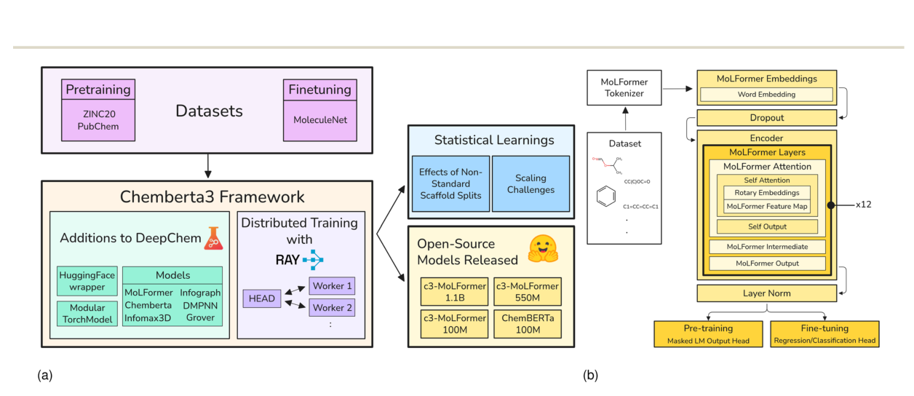

**图1：ChemBERTa-3的整体框架与c3-MoLFormer结构。**

- （a）左侧是**预训练数据、模型和微调任务在DeepChem中的统一管理**，以及Ray分布式训练与基准测试；右侧是统计分析和模型发布。
- （b）MoLFormer采用分子SMILES分词、embedding、12层Transformer编码器及任务输出层，**可切换掩码语言建模和下游分类、回归任务**。

一项典型的实验可以沿着下面的流程完成。ChemBERTa-3统一训练步骤，但**模型本身仍可分别使用SMILES或分子图输入**。

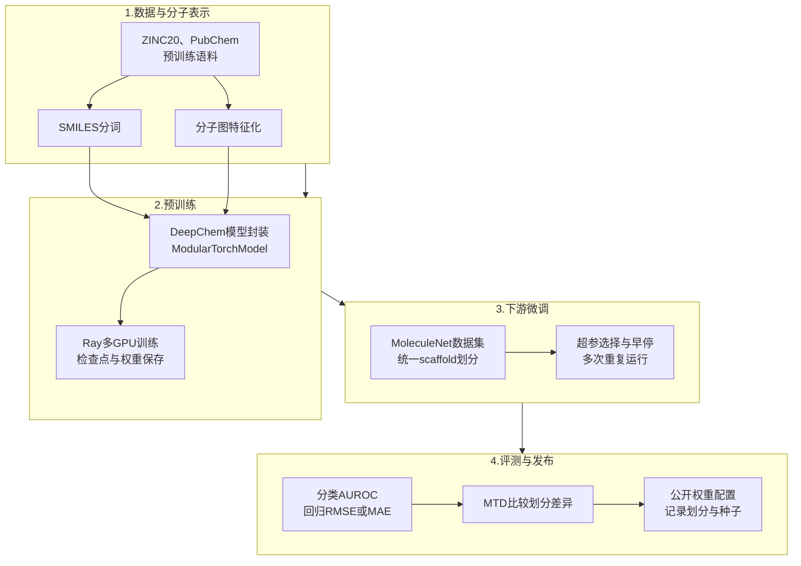

#### 框架具体添加了哪些功能？

| 组件                         | 用途                                  | 对训练流程的帮助                  |
| -------------------------- | ----------------------------------- | ------------------------- |
| `ModularTorchModel`        | 将网络分解为可复用组件，允许自定义中间层损失              | 支持不同预训练目标和选择性载入权重微调       |
| `HuggingFaceModel`         | 将Hugging Face模型与tokenizer接入DeepChem | 统一使用DeepChem的训练、预测和评测接口   |
| `RDKitConformerFeaturizer` | 生成带三维坐标的分子图，使用ETKDGv2               | 为InfoMax3D等模型提供构象输入       |
| `GroverFeaturizer`         | 构建GROVER所需的图和官能团信息                  | 支持自监督图预训练与下游任务            |
| Ray数据管线                    | 使用Ray Dataset、NPZ存储和批量迭代            | 支撑大量SMILES的处理与多机训练        |
| 分布式数据并行                    | 多GPU分别计算梯度，再进行同步                    | 扩展大规模模型预训练，配合checkpoint恢复 |

### 分布式训练怎么实现？

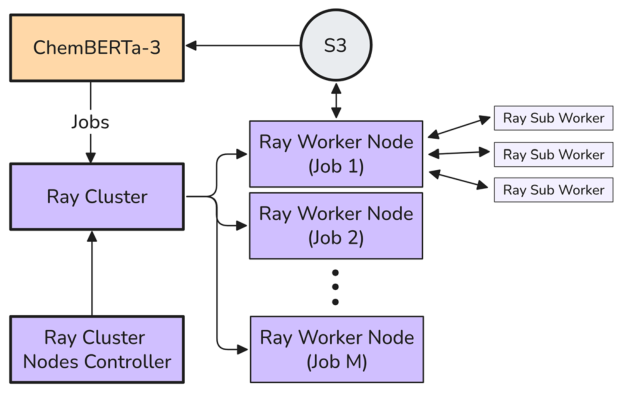

**图2：ChemBERTa-3在Prithvi环境中的Ray部署架构。**数据可由S3存储提供，任务经Ray集群调度至Worker节点，各节点再调用子任务完成处理和训练。Prithvi是基于DeepChem的商业开放核心软件套件，本文用它作为AWS上的测试环境。

模型训练使用分布式数据并行（Distributed Data Parallel，DDP）。多个GPU持有模型副本，各自处理不同的小批量样本、执行前向与反向传播，再同步梯度后更新参数。**Ray负责分布式资源调度与数据处理，DDP负责同步模型训练**，两者承担不同角色。

为了保留兼容性，数据管线将Ray数据集与DeepChem的`Dataset`接口相连，支持统一特征化、NPZ存储和`iterbatches()`批次迭代。这样**同一个模型可以部署在云端，也可以在本地集群运行**。

### 实验中比较了哪些模型？

本文不是只比较ChemBERTa的不同版本，还**将传统机器学习、图模型及多种预训练方法放进同一评测框架**。不同类别的训练规模并不完全相同，下表列出各自的输入与训练方式。

| 类别                 | 模型                         | 输入与训练方式                              |
| ------------------ | -------------------------- | ------------------------------------ |
| 传统基线               | Random Forest              | 传统监督分类或回归，不参与预训练                     |
| 图模型基线              | GCN、DMPNN                  | 直接利用有标签数据训练，DMPNN沿有向键传递信息            |
| 图预训练               | InfoGraph、InfoMax3D、GROVER | 对比学习、互信息最大化或自监督图表示学习，使用25万ZINC分子预训练  |
| SMILES Transformer | ChemBERTa                  | RoBERTa类编码器；主实验使用掩码语言建模（MLM）         |
| SMILES Transformer | c3-MoLFormer               | MoLFormer架构，由ChemBERTa-3框架重新训练，使用MLM |
| 外部参照               | MoLFormer（paper）           | 原MoLFormer论文公开的成绩，训练与评测条件与本文不完全一致      |

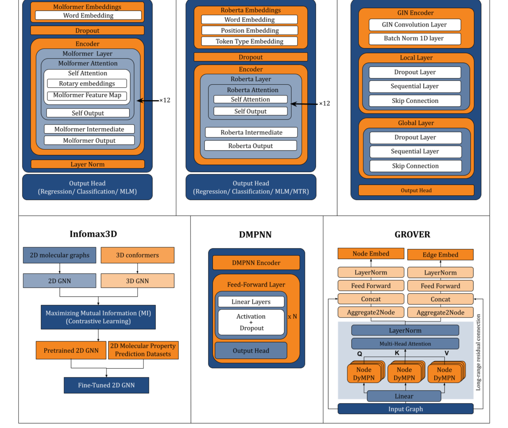

**图6：六类分子模型的网络结构示意。**

- 上排：MoLFormer和ChemBERTa均处理SMILES序列，前者使用**旋转位置编码相关的注意力结构**；InfoGraph通过局部与全局图表示的互信息学习。
- 下排：InfoMax3D对齐二维分子图与三维构象；DMPNN通过**有向化学键传递信息**；GROVER结合图消息传递、注意力与多个预训练任务。

#### 预训练数据与超参数设置

ZINC20提供约14亿个化合物，其中约13亿个可购买。本文另引入PubChem分子，构建了从千万到十亿规模的不同预训练语料。**名称中的10M、100M、550M、1.1B指训练分子数，不是模型参数量**。

| 预训练模型                      | 训练数据规模 | 数据构成                  |
| -------------------------- | -----: | --------------------- |
| ChemBERTa-MLM-10M          |  1000万 | ZINC20                |
| ChemBERTa-MLM-100M         |     1亿 | ZINC20                |
| c3-MoLFormer-10M           |  1000万 | ZINC20                |
| c3-MoLFormer-100M          |     1亿 | ZINC20                |
| c3-MoLFormer-550M          |   5.5亿 | 5亿ZINC20＋5000万PubChem |
| c3-MoLFormer-1.1B          |    11亿 | 10亿ZINC20＋1亿PubChem   |
| InfoGraph、InfoMax3D、GROVER |    25万 | ZINC子集                |

下游微调覆盖MoleculeNet中的分类与回归任务，包含BACE、BBBP、Tox21、HIV、SIDER、ClinTox，以及ESOL、FreeSolv、Lipophilicity等。统一使用scaffold split，微调最多500个epoch，并根据验证集损失早停；回归标签先进行均值和标准差归一化。多数任务运行3次，表中的`±`表示**运行结果的范围**，不能当作置信区间。

### 两种scaffold split为何会导致完全不同的结果？

scaffold split通常依据Bemis–Murcko骨架，把同一骨架的分子安排在同一数据子集，减少训练集和测试集之间过于相似的化合物。但这只是一个划分思路，**如何排序骨架组、如何分配样本，都会改变最终测试集**。

本文分别采用原MoLFormer提供的划分，以及DeepChem的`ScaffoldSplitter`。后者将分子按骨架归组，优先把较大的骨架组分配给训练集，再分配验证和测试集，比例为80%/10%/10%。作者发现，**即使名称都叫scaffold split，这两套划分仍有明显差别**。

为定量比较结构差异，作者统计最小Tanimoto距离（Minimum Tanimoto Distance，MTD），即对某个测试分子，在训练集中寻找最相似的分子，以其指纹距离反映测试集与训练集的接近程度。**MTD越大，表示测试分子与最近的训练分子越不相似**。

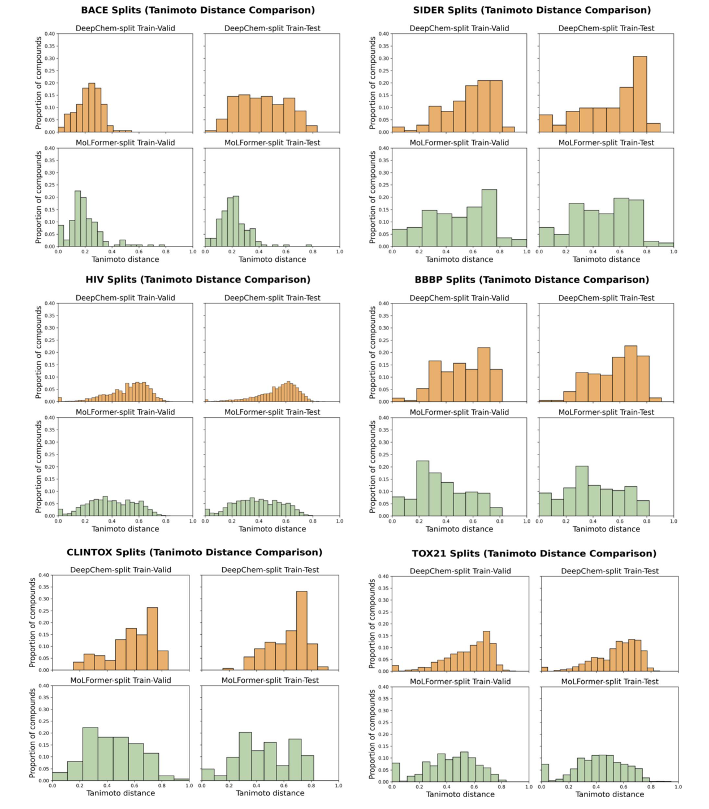

**图7：DeepChem和MoLFormer两种划分下，验证集与测试集相对于训练集的MTD分布。**

- 每个数据集均比较train–validation和train–test分布，涵盖BACE、SIDER、HIV、BBBP、ClinTox及Tox21。
- 橙色是DeepChem划分，绿色是MoLFormer划分。多数情况下，橙色分布整体更偏向较大的距离，**说明DeepChem得到的测试分子与训练集在结构上相差更大**。

在本文比较中，**DeepChem划分下AUC较低，不应直接归因于模型能力退化**。它对应的是一组更难预测的分子。作者此前在复现MoLFormer时花费数月排查结果差异，最终发现两套scaffold split并不等价。

### 实验结果一：传统随机森林仍然是重要基线

采用原MoLFormer划分时，**随机森林在BACE、HIV和SIDER三项分类任务取得最高分**，分别为0.884、0.829和0.711。ChemBERTa-MLM-100M则在BBBP和ClinTox取得0.961和0.992，原MoLFormer论文在Tox21报告0.847。

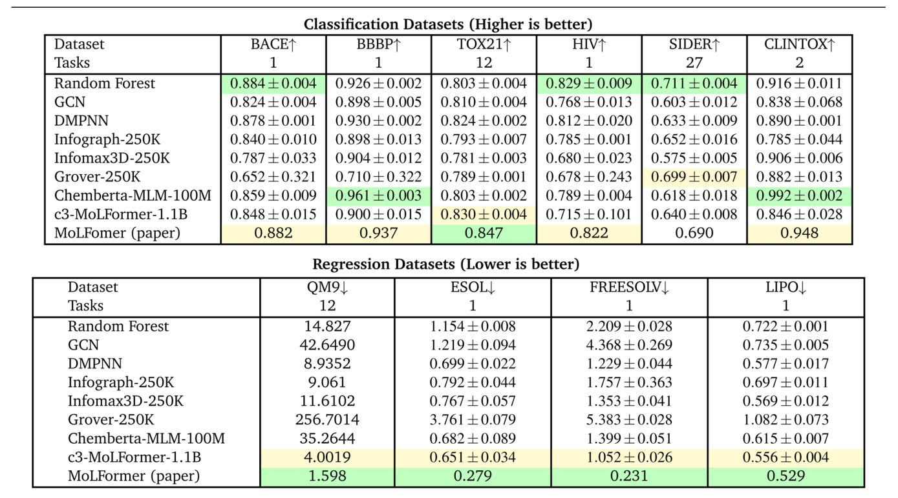

**表1：使用MoLFormer提供的scaffold split，比较分类与回归基线。**上半部分是六项分类任务的ROC-AUC（越高越好），下半部分是回归误差（越低越好）；QM9使用MAE，其余回归任务主要使用RMSE。绿色标示第一名，黄色为第二名。`MoLFormer (paper)`直接引用原论文成绩，`c3-MoLFormer`为本文训练版本。

从这一比较也能看到，**预训练并没有保证在全部下游任务中优于随机森林**。尤其在部分较小或较专门的数据集上，传统基线仍具有竞争力。对于回归任务，原MoLFormer论文报告的分数总体更好，但这些数值并非本研究从头复现的结果。

### 实验结果二：换成DeepChem划分，模型排名也会变

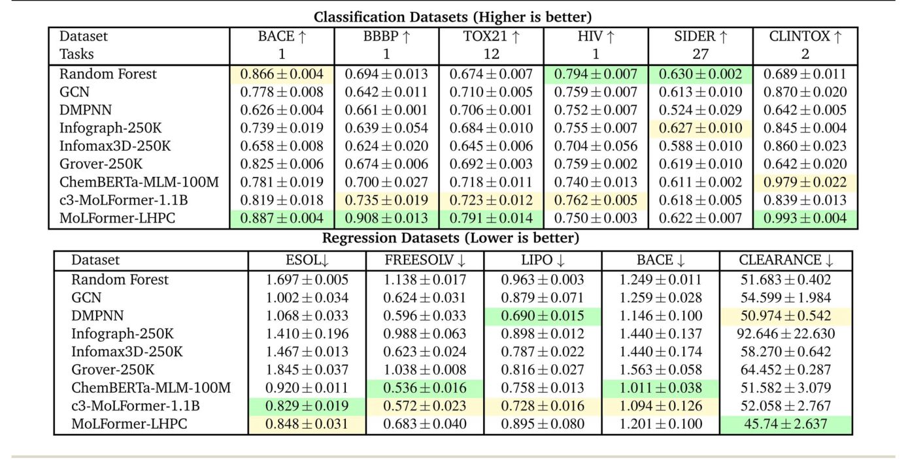

**表3：使用DeepChem的scaffold split，重新比较各类模型。**分类结果使用ROC-AUC，回归结果使用RMSE。相比表1，数据划分发生改变，另加入在本地HPC重新预训练的MoLFormer-LHPC。

| 分类任务    | 最优模型           | ROC-AUC |
| ------- | -------------- | ------: |
| BACE    | MoLFormer-LHPC |   0.887 |
| BBBP    | MoLFormer-LHPC |   0.908 |
| Tox21   | MoLFormer-LHPC |   0.791 |
| HIV     | Random Forest  |   0.794 |
| SIDER   | Random Forest  |   0.630 |
| ClinTox | MoLFormer-LHPC |   0.993 |

本地HPC训练的MoLFormer在四项分类任务中领先，但随机森林仍在HIV和SIDER胜出。回归任务中**也不是某一种架构全部占优**：c3-MoLFormer-1.1B在ESOL排名第一，ChemBERTa在FreeSolv与回归版BACE领先，DMPNN在Lipophilicity领先，而本地MoLFormer在Clearance领先。

同样的c3-MoLFormer-1.1B，云端模型在DeepChem划分下的BACE和BBBP分别得到0.819、0.735；本地HPC版本分别为0.887、0.908。这说明两套基础设施都能用于模型训练，**但训练出的模型并未在所有任务上取得相近的下游成绩**，差距来自训练优化、随机性与具体配置。

### 实验结果三：扩大预训练数据的收益有限

预训练数据量增大通常可以为模型提供更多分子结构信息，但**收益不一定随规模持续增加**。本文分别在两种scaffold split下考察了ChemBERTa和c3-MoLFormer。

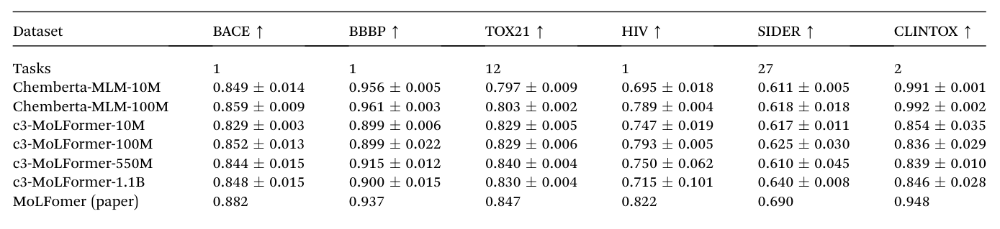

**表2：MoLFormer划分下，不同预训练数据规模的分类表现。**ChemBERTa比较1000万与1亿分子；c3-MoLFormer比较1000万、1亿、5.5亿和11亿分子。绿色、黄色分别标示最优和次优成绩；完整数值见原文表格。

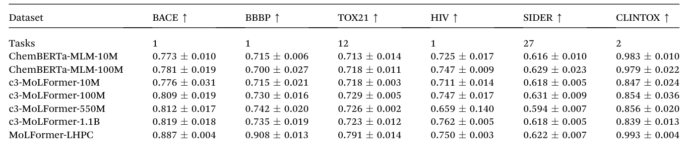

**表4：DeepChem划分下，相同模型系列的分类表现。**改变测试集后，数据规模增加带来的收益仍然有限，有些任务甚至出现回落。MoLFormer-LHPC单独列出，说明本地训练版本与云端版本的实际表现差异。

以MoLFormer划分为例，ChemBERTa从10M扩大到100M时，HIV的AUC由0.695升至0.789，BBBP由0.956升至0.961；但c3-MoLFormer扩大到1.1B后，HIV从100M版本的0.793降为0.715，BBBP也没有持续提高。**更大的预训练语料并未稳定转化为更好的下游预测**。

预训练目标、学习率、优化稳定性与微调效果都可能限制规模收益；加上图模型未在相同的十亿规模上训练，本文**没有给出图模型与Transformer在相同超大训练语料下的严格对照**。

### 模型训练成本与稳定性

训练11亿分子规模的c3-MoLFormer使用AWS的40张NVIDIA T4 GPU，采用spot实例降低费用，但**实例可能随时被回收，需要从checkpoint恢复并重新同步**。正文描述训练约10天，附录成本表统计为260小时、约4000美元。

| 实验                  |   AWS成本 | 训练或评测耗时 |
| ------------------- | ------: | ------: |
| MoLFormer 2.5亿分子预训练 | 约1000美元 |    70小时 |
| MoLFormer 5.5亿分子预训练 | 约2400美元 |   150小时 |
| MoLFormer 11亿分子预训练  | 约4000美元 |   260小时 |
| 模型基准评测              |  约150美元 |   200小时 |

本地验证则使用16个第四代AMD EPYC节点，每节点4个AMD MI300A APU，并进行了五次MoLFormer重复训练，单次训练约4天。这些成本对应论文所用的**AWS spot实例与实验条件**，换用其他硬件或地区会有明显差异。

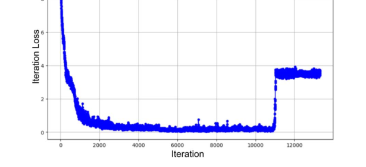

**图3：预训练过程中出现的loss突增。**学习率设置、warmup及数据异常等可能导致训练不稳定。本文通过定期保存checkpoint，在损失突增后从最近一次稳定状态恢复训练。

除了loss突增，大规模训练还可能出现NaN和梯度爆炸。作者采用两阶段预训练来提高稳定性：先在较小数据集上使用低学习率训练，得到较稳健的初始权重，再将权重用于大数据集训练。即便使用相同的输入数据与超参数，**模型结果仍可能随随机种子、数据处理与优化过程的随机性而出现波动**。

### ModularTorchModel如何支持预训练与微调？

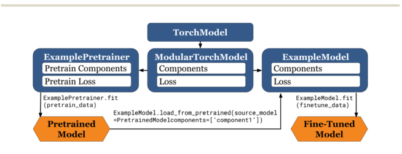

**图4：ModularTorchModel组件与权重迁移示意。**该类继承DeepChem的`TorchModel`思路，允许分别定义网络组件和损失函数，并在微调时选择性地从预训练模型加载指定组件的权重。

例如，先训练共享的分子编码器，再替换任务输出层以预测另一种化学性质。预训练阶段可以使用中间层的自监督损失；**微调时保留编码器权重，并为分类或回归任务重新定义输出和损失**。图5和图8提供了具体示例代码（见文末附图）。

相关功能也已集成到DeepChem。对于只需要调用已有预训练权重的研究，可以直接使用模型与特征化接口；**需要开展新架构或新预训练目标研究时**，`ModularTorchModel`和Ray工作流更有价值。

## 关键结论与批判性总结

- **软件贡献**：ChemBERTa-3使多种分子模型的训练、微调与评测能够在相同框架下组织，附有GitHub代码、数据归档与Hugging Face权重。对于希望自行训练分子基础模型的团队，这套基础设施比某一个单独模型的分数更有复用价值。
- **评测贡献：采用相同数据集名称并不足以保证实验可比**；训练/测试索引、scaffold split具体实现、超参数优化和重复运行结果均应记录。本文用MTD分布说明了这种差异。

- **性能结论**：随机森林、DMPNN、ChemBERTa和MoLFormer分别在不同任务占优。**预训练规模增加的收益有限**，Transformer更易扩展主要是本研究条件下的工程观察。
- **主要局限**：预训练规模对各架构并不对等；**云端与本地版本下游分数存在较大差异**；部分表格使用外部论文的参考分数，且超参数优化受到计算预算限制。

从这篇论文最值得借鉴的经验来看，**公开评测划分、训练配置和完整工作流，与公开模型权重同样重要**。在比较基础模型之前，先确定大家测的是同一批分子、用的是同一种评估协议，往往比继续扩大模型规模更有价值。

## 文献精读：逻辑结构四段法与证据分层

### 1. 逻辑拆解（每项一句话）

- **小背景**：SMILES Transformer 与分子图网络等分子基础模型已证明实用价值，但各工作的训练流程与评测协议高度不统一。
- **真问题**：即便都用“scaffold split”、同一 MoleculeNet 数据集，实际 train/test 划分与训练基础设施不同，导致模型分数不可直接比较——这是真实存在的复现与可比性难题；作者复现 MoLFormer 时确曾耗时数月才定位到划分差异，因此我承认它是真问题，而非论文凑出的伪命题。
- **课题设计**：作者设想把数据、特征化、预训练、微调、评测与分布式训练串成一套基于 DeepChem 与 Ray 的开源可复现框架，并在统一条件下重测各类模型。
- **验证方法**：用该框架重训 ChemBERTa 与 c3-MoLFormer，并引入最小 Tanimoto 距离（MTD）定量刻画两套 scaffold split 的结构差异，再对比云端 AWS 与本地 HPC 两种环境下同一模型的下游分数。

### 2. 实验证据的“成分分析”

| 证据类型 | 对应内容 | 在论证中的角色 |
| --- | --- | --- |
| **核心实验（骨架）** | MTD 分布对比（图7 及论文对应统计表）定量证明 DeepChem 与 MoLFormer 两种 scaffold split 的测试—训练结构相似性不同；统一重测的表1/表3 分类与回归成绩 | 没有它们，“分数不可比”“随机森林仍有竞争力”“规模收益有限”三个结论都站不住 |
| **求新炫技（首饰）** | Fig2 的 Prithvi/Ray 部署架构图、Fig5/Fig8 的 ModularTorchModel 代码示例 | 增强“可部署、可复现”的视觉冲击与新颖性，但剥离后结论仍成立，并非逻辑必需 |
| **交叉印证（肌肉）** | 云端 AWS 版与本地 HPC 版 MoLFormer 双环境训练（表3 与成本明细表6）；随机森林在两种划分下均于 HIV/SIDER 胜出 | 形成“框架可迁移”与“传统基线仍强”的证据闭环，提高可信度 |
| **展示工作量（体力活）** | 10M/100M/550M/1.1B 多规模预训练扫描（表2/表4）、5 次本地重复训练、6 类架构横向铺开（表5） | 系统性证明稳定性与覆盖面，属“没有功劳也有苦劳”，告诉审稿人“我尽力了” |

### 3. 批判性思考

- **规模收益归因是否被充分解释**：随机森林在 HIV（0.829）、SIDER（0.711）等任务仍超过多数预训练模型，作者把“规模收益有限”归因于预训练目标、学习率与优化稳定性，但文中没有消融或控制变量实验直接指出哪个因素主导；把“并非持续提高”外推为“预训练不一定有用”时，解释停留在可能原因罗列，缺少定量归因。
- **同模型跨环境分数差是否自洽**：同一 c3-MoLFormer-1.1B 在 DeepChem 划分下，云端 BACE/BBBP 为 0.819/0.735，本地 HPC 版为 0.887/0.908，差距约 0.07–0.17。这既支撑“框架可迁移”，又反过来削弱“分数可用于判定架构优劣”——与全文“随机森林仍强”的论断放在同一张评测表中，读者难以分辨差异来自优化还是来自架构。
- **规模结论是否过度外推**：作者把“Transformer 更易扩展到大规模”限定为“本研究条件下的工程观察”，做得较好；但“预训练规模收益有限”主要基于 11 亿 SMILES 这一条路径，而图模型只训到 25 万分子，文中明确说“未给出图模型与 Transformer 同规模严格对照”。作者已自我限定，但若只读摘要容易误读为“大模型无用”。

### 4. 一句话定性核心创新

ChemBERTa-3 的核心贡献不是又训练出一个新分子模型或刷高分数，而是**建立了一套把“分子表示模型训练—统一评测—划分差异量化（MTD）”串起来的开源可复现范式，把长期被当作隐性工程坑的“评测协议等价性”问题，提升为可测量、可比较的科学变量**。

### 5. 还能补什么（提精度）

- **控制变量归因**：固定架构与数据，仅变动预训练规模或仅变动 scaffold split，分离“规模效应”与“划分效应”对 AUC 的各自贡献，给出量化分解而非并列罗列。
- **同规模图 vs Transformer 对照**：把图模型也推到十亿规模（或把 Transformer 降到 25 万），补齐“架构 × 规模”二维对照，否则“Transformer 更易扩展”只是单轴观察。
- **误差语义澄清**：全文把 `±` 写作“运行结果的范围”而非置信区间，建议主表直接标注 3 次运行的均值 ± 标准差，并写明早停与随机种子的具体取值，提升可复现精度。
- **MTD 与难度的因果**：MTD 大意味着测试集更难，但“难”如何转化为 AUC 降幅，可补充 MTD 分箱与 AUC 的相关性分析，把“划分差异→难度→分数”的链条讲实。

## 附：原文其他图表与实现资料

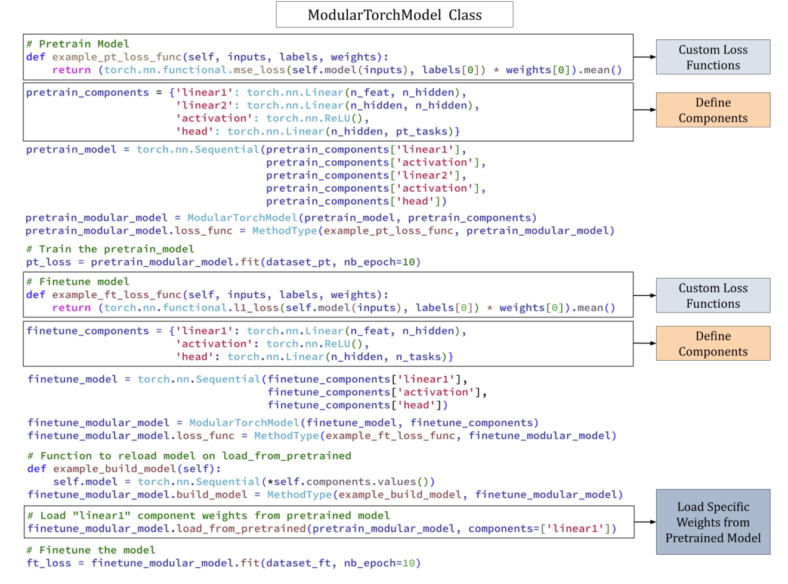

**图5：ModularTorchModel的预训练与微调示例。**展示自定义损失函数、模块化组件、训练阶段，以及在微调时读取预训练权重。详细代码和可运行环境请以项目仓库为准。

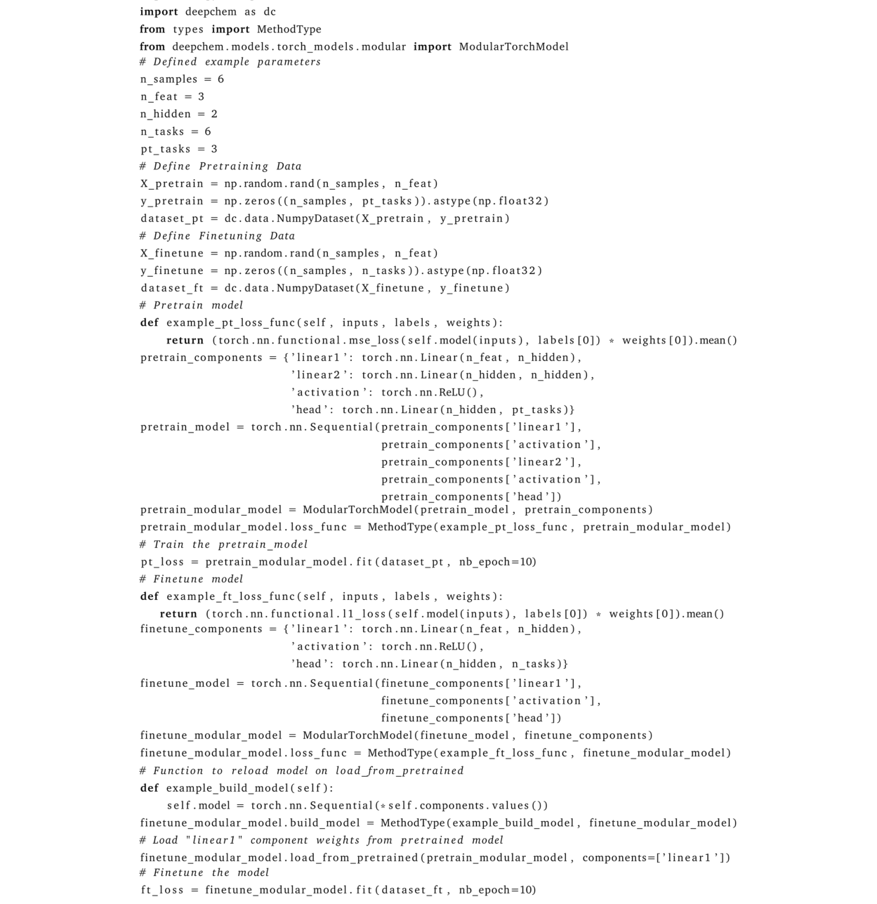

**图8：DeepChem中ModularTorchModel的完整Python示例。**对应论文附录A.7，包含构建模型、加载部分预训练参数和下游微调的主要步骤。

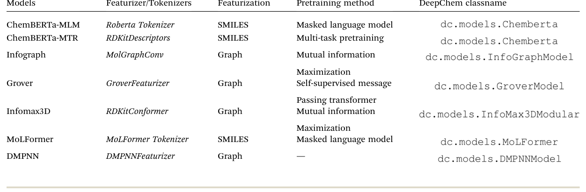

**表5：论文比较的主要架构、输入特征化器与预训练目标。**归纳ChemBERTa、InfoGraph、GROVER、InfoMax3D、MoLFormer及DMPNN的实现信息。

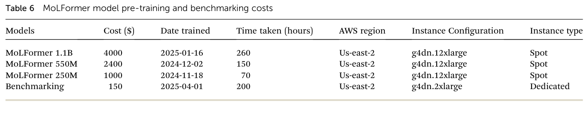

**表6：MoLFormer预训练及基准评测的云计算成本。**保留了训练日期、AWS区域与实例类型等细节，便于估算复现实验所需资源。

项目仓库提供**训练、微调和基准测试脚本**，其中专门标出部分旧目录属于legacy code，未必与现有依赖或工作流兼容。
