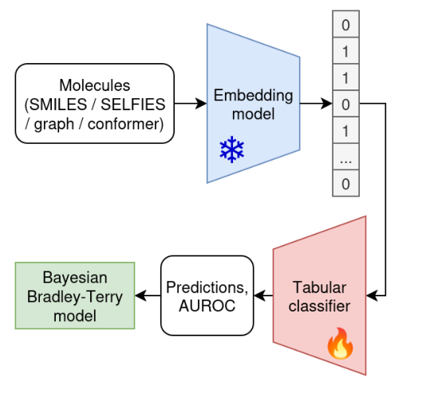
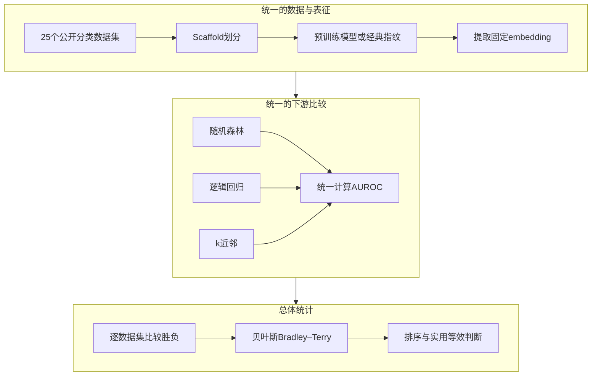
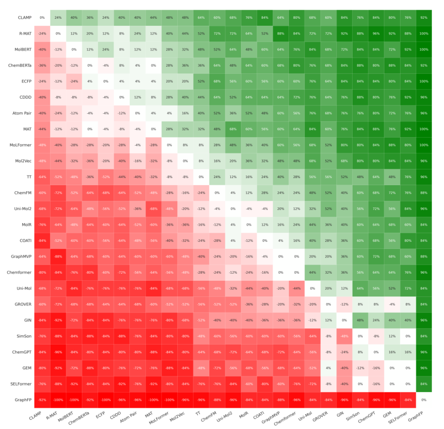
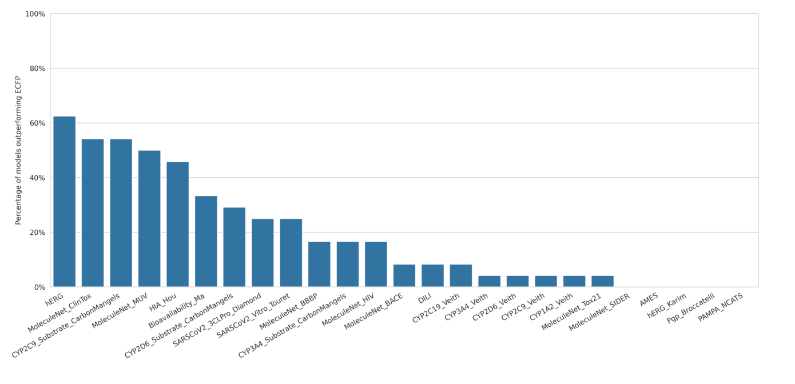
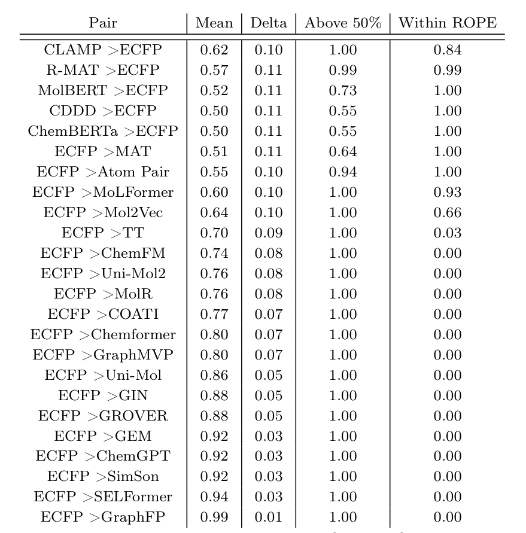

---  
title: "预训练分子表征胜过经典指纹了吗？25种模型与25个数据集的统一评测说几乎没有"  
date: "2026-10-19"  
last_modified_at: "2026-10-19"  
tags: [molecular-representation, molecular-embedding, benchmarking, ECFP, CLAMP, COATI, machine-learning, cheminformatics]  
description: "解读25种分子表征在25个分类数据集上的统一评测，介绍冻结embedding、scaffold划分和贝叶斯Bradley–Terry统计，并分析CLAMP与ECFP的表现及评价协议的局限。"  
image: "https://raw.githubusercontent.com/gxf1212/mendelevium/main/assets/img/4K_1080P_compressed/082247f3bWP.jpg"  
thumbnail: "https://raw.githubusercontent.com/gxf1212/mendelevium/main/assets/img/4K_1080P_compressed/082247f3bWP.jpg"  
author: Xufan Gao  
lang: zh-CN  
---

# 预训练分子表征胜过经典指纹了吗？25种模型与25个数据集的统一评测说几乎没有

## 本文信息

- **标题**：预训练分子嵌入模型在分子表征学习中的基准评测
- **发表平台**：arXiv（预印本，未经同行评审）
- **首次公开**：2025年8月8日（v1）
- **发表时间**：2026年2月23日（arXiv v4，本文解读版本）
- **DOI**：https://doi.org/10.48550/arXiv.2508.06199
- **单位**：AGH University of Krakow，Faculty of Computer Science，波兰
- **作者**：Mateusz Praski、Jakub Adamczyk、Wojciech Czech
- **引用格式**：Praski, M.; Adamczyk, J.; Czech, W. Benchmarking Pretrained Molecular Embedding Models for Molecular Representation Learning. *arXiv* **2026**, arXiv:2508.06199v4. https://doi.org/10.48550/arXiv.2508.06199
- **代码与数据**：[官方GitHub仓库](https://github.com/scikit-fingerprints/benchmarking_molecular_models)，包含评测代码、模型适配代码、数据处理与结果文件。

## 摘要

> 动机：预训练神经网络在化学与小分子药物设计中受到广泛关注，这些模型的嵌入已广泛用于分子化学性质预测、虚拟筛选与小样本学习。然而，文献中缺乏对这些模型嵌入的统一、大规模比较，导致它们彼此之间、以及相对于经典分子指纹的优势并不清晰。结果：本文提出了迄今为止同类模型中规模最大的比较，在统一评测框架下评估25种模型在25个数据集上的表现，涵盖不同输入模态、网络架构与预训练策略。借助专门的层次贝叶斯统计检验模型，本文得到一个令人意外的结果：**几乎所有神经模型相对基线ECFP分子指纹的提升都微乎其微，或根本没有**；只有同样基于分子指纹的CLAMP模型，**在统计上显著优于其他模型**。这些发现引发了对既有研究**评测严谨性**的担忧。本文讨论了潜在原因，提出了解决方案，并给出实用建议。

### 核心结论

- 在25个分子性质分类数据集上，**ECFP计数指纹依然是难以超越的基线**。R-MAT、MolBERT、ChemBERTa和CDDD总体表现不错，但按照作者的贝叶斯归类，与ECFP属于实用等效。
- **CLAMP排名第一**，平均AUROC为82.55%，高于ECFP的79.89%；其输入来自ECFP、RDKit和MACCS三种指纹的融合，而非单纯依靠端到端学习原子图。
- **部分预训练图神经网络表现较弱**，包括GraphFP、GEM和GraphMVP；采用化学知识引导的Transformer通常更有竞争力。
- 本文的设定聚焦于**冻结预训练embedding、重新训练传统分类器**；模型微调、连续性质回归与生成能力属于不同问题，留待专门的评测去回答。

### 创新点

- **建立了固定外部变量的统一评测协议**：通过冻结预训练embedding、统一下游分类器（随机森林、逻辑回归、k近邻）与scaffold划分，把数据划分、模型选择和调参等外部因素尽量固定，使不同预训练表征本身可在同一条件下比较。
- **规模最大的同类横向评测之一**：在25个分类数据集上系统比较25种模型与表征，覆盖经典指纹、图神经网络、图Transformer、文本及混合模型等多条技术路线。
- **引入层次贝叶斯Bradley–Terry与ROPE做概率化综合判断**：超越简单平均AUROC或平均排名，把逐数据集的胜负转化为“谁更可能胜出”以及“是否实用等效”的概率解释，并公开代码与数据便于后续扩展。
- **给出反直觉的实证结论并引发方法学反思**：揭示多数神经网络表征相对ECFP指纹提升有限，倒逼学界重新审视分子表征评测的严谨性。

## 背景

从分子结构预测性质，首先要决定怎样表示分子。经典的ECFP、Atom Pair等分子指纹根据原子连接关系提取子结构，再把这些结构信息编码成数值特征。它们计算方便，在随机森林等传统机器学习模型中有着长期而稳定的表现。

近几年，预训练分子模型提供了另一条路线：先利用大量分子结构学习通用embedding，再把这些向量交给下游模型。输入可以是SMILES字符串、分子二维图，或三维构象；学习目标则包括掩码重建、分子性质预测、对比学习及序列生成。理论上，预训练有机会把多个下游任务共享的化学信息压缩进同一套表征。

但不同模型的论文通常使用不同数据集、数据划分、下游模型甚至调参方式。一个方法的AUROC更高，可能来自更强的分类器或更宽松的划分。**比较预训练表征本身，就需要把这些外部因素尽量固定下来**。这也是本研究的出发点。

### 关键科学问题

- **预训练embedding的可迁移性**：是否真的优于经典指纹？如果相同的下游分类器在冻结embedding上仍难以超过ECFP，那么模型复杂度和预训练规模就未必转化为实际收益。
- **预训练设计的有效性**：文本Transformer、图神经网络、三维模型及多模态模型各有优势，但需要在相同的数据和评价协议中判断差异。
- **多模型多数据集的总体比较**：简单平均AUROC会受到个别数据集影响，平均名次又忽略差距大小。本文引入贝叶斯Bradley–Terry模型量化两种表征在新任务中谁更可能胜出。

### 本文的方法特点

- **统一下游训练条件**：冻结各预训练模型，提取embedding后分别训练随机森林、逻辑回归或k近邻分类器，尽量减少端到端微调策略造成的差异。
- **覆盖不同规模与性质的数据集**：25个数据集取自MoleculeNet和Therapeutics Data Commons（TDC），使用scaffold划分考察对不同化学骨架的外推。
- **增加概率化的综合统计**：在逐数据集表现之外，还使用层次贝叶斯Bradley–Terry模型，对方法之间的胜负及实用等效作出总体判断。

## 研究内容

### 1. 评测对象：25种分子表征覆盖哪些路线？

模型大致可以按输入方式和预训练思路分成四类。**25种评测对象包含经典指纹与非神经网络表征**，并非全是深度学习基础模型。

| 表征路线| 代表方法  | 主要特点  |
| ------------ | ----------------------------------------------------------------------------------------------- | ----------------------------------- |
| 经典指纹| ECFP、Atom Pair、Topological Torsion（TT）   | 直接根据子结构、原子对或路径编码，几乎没有预训练开销|
| 图神经网络   | GIN、GraphMVP、GraphFP、MolR、GEM  | 聚合原子邻居信息；GraphMVP在训练阶段利用三维信息，GEM则更为特殊，预训练与推理都需要三维构象，而其他架构推理时仅用拓扑图 |
| 图Transformer | GROVER、MAT、R-MAT、Uni-Mol、Uni-Mol2   | 使用图注意力、距离或构象信息建立分子表示 |
| 序列及混合表征 | CDDD、Chemformer、MolBERT、ChemBERTa、MoLFormer、SimSon、ChemFM、ChemGPT、SELFormer、Mol2Vec、COATI、CLAMP | 使用SMILES或SELFIES、跨模态对齐、指纹与文本融合等策略   |

其中，COATI对应此前介绍的二维—三维对比学习模型；CLAMP则采用三类分子指纹融合，并利用分子与生物活性实验描述之间的监督式对比学习构建向量。**CLAMP的优势并非一句“语言模型优于指纹”所能解释**，因为它本身就以化学指纹作为分子输入。

不同模型还包含若干变体，例如ChemBERTa的掩码语言建模（MLM）与多目标回归（MTR）预训练。本文实施了这些变体，并根据平均AUROC选取每个模型系列中的代表版本。

### 2. 统一评测流程：冻结embedding，再训练传统分类器

**图1：分子表征基准评测的完整流程。** 分子以SMILES、SELFIES、分子图或三维构象输入对应的预训练模型，获得冻结的特征向量；随后由传统分类器进行预测，用AUROC评价表现，最后交给贝叶斯Bradley–Terry模型进行多数据集汇总。

| 设置| 本文采用的方案 | 为什么这样设计|
| ----- | ------------------------------------- | ------------------------- |
| 数据集   | 18个TDC、7个MoleculeNet，共25个   | 覆盖毒性、ADME、生物活性及虚拟筛选等分类任务  |
| 训练与测试 | Scaffold-based split   | 将不同分子骨架分开，减少结构近邻造成的乐观结果   |
| 表征| 冻结embedding，不微调预训练模型   | 考察预训练向量在新任务上的直接可用性   |
| 下游模型  | Random Forest、Logistic Regression、kNN | 比较不同复杂度的传统分类器，并对其超参数调优|
| 评价指标  | AUROC   | 使不同二分类任务可以使用统一的统计指标  |
| 主要基线  | ECFP计数指纹（count fingerprint） | 保留子结构出现次数，比单纯记录是否出现的信息更丰富 |

补充材料中的实际超参数设置包括：随机森林固定500棵树，调节`min_samples_split`；逻辑回归搜索正则化强度；kNN搜索1、3、5、7、9个邻居。**MUV数据集过大，kNN在24小时内未完成，因此排除了这一组合**。结果表使用各表征在三个分类器中的最佳表现。

数据集包含数百到数万样本，个别多标签数据集更大，例如MUV包含93,087个分子和17个任务，SIDER包含27个任务。分类样本不平衡程度也很不一致，因此跨任务比较前先统一了评价指标。还要留意，**25个数据集对应着不止25个二分类标签**，MUV、SIDER和Tox21等数据集本身含多个任务。

### 3. 为什么还需要贝叶斯Bradley–Terry模型？

单纯比较平均AUROC有个问题：一个模型只在某个容易的数据集上提高很多，就可能抬高总体均值；只比较平均排名则会把极小的差距和明显的差距同样计为胜负。

贝叶斯Bradley–Terry模型（Bayesian Bradley–Terry，BBT）把**每个数据集上的模型两两胜负**视为统计观测，进而推断模型在一个新数据集上胜过另一模型的概率。例如，对于模型$i$和$j$：

$$
P(i\succ j)=\dfrac{\exp(\beta_i)}{\exp(\beta_i)+\exp(\beta_j)}
$$

其中，$\beta_i$ 表示模型 $i$ 的潜在能力参数。胜负次数越多，通常会支持更高的 $\beta_i$；层次先验和后验推断则用于表示比较的不确定性。

作者还使用**实用等效区域**（region of practical equivalence，ROPE）：如果两种方法在新任务上的胜出概率接近50%，就认为目前没有足够理由区分谁更好。本文采用的ROPE为$[0.35,0.65]$，比只在接近50%的狭窄范围内认定等效更加保守。

| 统计量  | 含义   | 读表时应注意什么|
| ------------------- | ------------------------ | ------------------------------------- |
| $\hat\pi_{ij}$ | 模型 $i$ 相对于 $j$ 的后验平均胜出概率 | 0.60 表示模型 $i$ 更有机会胜出，不表示 AUROC 提高 60% |
| $P(\pi_{ij}>0.5)$   | 两模型真实胜负倾向支持 $i$ 的后验概率| 与预测胜出概率本身是两个不同的量  |
| $P_{\mathrm{ROPE}}$ | 后验概率落入实用等效区间的比例| 接近1说明较多后验质量支持两者相近 |

这种做法把逐数据集的胜负转化为概率解释。但**BBT汇总的仍是既定评测协议下的结果**；测试划分、模型选择或评价指标的偏差，BBT本身不会自动修正。

### 4. 总体结果：CLAMP排名第一，ECFP依然强劲

**表1：25种表征的整体评测结果。** 平均排名越低越好；平均AUROC越高越好。两列衡量内容不同，排名顺序取决于综合表现，而非AUROC单一指标的高低。

| 表征   |平均排名↓ |   平均AUROC↑ |
| -------------- | -------: | ---------: |
| **CLAMP** | **5.40** | **82.55%** |
| R-MAT|6.08 |80.83% |
| MolBERT   |6.92 |80.51% |
| ChemBERTa |7.32 |79.99% |
| **ECFP（计数指纹）** | **7.52** | **79.89%** |
| CDDD |7.64 |80.60% |
| Atom Pair |7.88 |79.48% |
| MAT  |8.02 |80.18% |
| MoLFormer |9.50 |79.80% |
| Mol2Vec   |10.36 |79.55% |
| TT   |12.04 |78.12% |
| ChemFM|12.60 |78.25% |
| Uni-Mol2  |13.32 |78.11% |
| MolR |13.80 |77.84% |
| COATI|13.92 |78.02% |
| GraphMVP  |14.64 |77.18% |
| Chemformer|15.00 |77.44% |
| Uni-Mol   |16.64 |76.85% |
| GROVER|17.08 |75.68% |
| GIN  |17.28 |75.14% |
| SimSon|19.12 |73.56% |
| ChemGPT   |19.32 |74.01% |
| GEM  |19.36 |74.03% |
| SELFormer |20.04 |73.18% |
| GraphFP   |24.20 |59.67% |

按作者的汇总，CLAMP的平均AUROC比ECFP高**2.66个百分点**，R-MAT、MolBERT、ChemBERTa也位于前列。值得关注的是，CDDD的平均AUROC为80.60%，高于ECFP的79.89%，但平均排名稍低，说明**平均指标与跨数据集稳定性需要分开看**。

**表2**：采用ROPE $[0.35,0.65]$ 时，BBT对各方法与ECFP的归类。这里保留原文Table 2的分类；其与详细概率表的判定规则存在一处不一致，后文单独讨论。

| 与ECFP相比  | 表征 |
| -------- | ------------------------------------------ |
| 更好（作者报告） | CLAMP   |
| 实用等效| R-MAT、MolBERT、ChemBERTa、CDDD、Atom Pair、MAT |
| 更差  | 其余模型，包括COATI、GraphMVP、Uni-Mol等   |

COATI被归为“更差”是整体排名的概括，它在单个任务上仍可能胜过ECFP；这一排序只评冻结向量接入传统分类器的预测表现，未涵盖分子生成等其它能力。

### 5. 逐模型与逐数据集：优势究竟有多稳定？

**图2：25种表征之间的两两胜负热图。** 每格显示的是带符号的相对胜负差值（正值为纵轴多赢、负值为横轴多赢）：绿色表示纵轴模型胜出更多，红色表示横轴模型胜出更多；例如某格显示24%时，表示纵轴模型比横轴模型多赢24个百分点的数据集，并非胜率只有24%。CLAMP所在行整体偏绿，GraphFP所在行则明显偏红。

图2与总体排名的结论基本一致。CLAMP在多个不同类型的任务上有优势；GraphFP即使引入了图结构与片段级预训练目标，依然未取得令人满意的下游性能。这也说明：**图结构与片段级预训练目标，并未换来更强的固定embedding预测力**。

**图3：不同数据集上，有多少模型能够超过ECFP指纹。** 横轴对应25个数据集，纵轴是相对于ECFP胜出的模型比例。部分任务有不少模型超过基线，但不少任务只有零星模型能做到；文中报告5个数据集没有其他模型超过ECFP，另外8个数据集只有1至2个模型超过。

**表3：在多少个数据集上取得最好或近似最好的表现。** “近似最好”表示与该数据集最佳AUROC的差距不超过论文设置的近似胜出阈值。

| 表征   | 最好或近似最好数据集数 |
| --------- | ----------: |
| CLAMP|14 |
| Atom Pair | 7 |
| R-MAT| 6 |
| ChemBERTa | 5 |
| ECFP | 5 |

这里的“14个”指CLAMP在25个数据集中有14个取得第一或接近第一；它与ECFP在这些数据集上的具体差距仍要看近似胜出阈值。表3同样体现了传统Atom Pair指纹的竞争力。

### 6. 哪些预训练策略可能更有用？

较好的深度学习模型具有一个共同特点：它们往往在架构或训练目标中加入了明确的化学信息。R-MAT利用相对位置和分子图距离，MAT引入图结构相关注意力；MolBERT和ChemBERTa的部分版本通过分子性质预测任务来学习表示。

ChemBERTa的对照尤其直观。与掩码语言建模（MLM）相比，**多目标回归预训练（MTR）明显改善了冻结embedding的分类表现**。例如在10M预训练规模的模型中，MTR使平均AUROC提高约4.62个百分点，5M和77M版本也有类似趋势。

CLAMP则将**ECFP、RDKit、MACCS三类指纹拼接后输入浅层多层感知机**，并用ChEMBL中的分子活性与实验描述进行监督式对比学习。其好成绩体现了强分子先验和相关生物活性监督的价值；相比只使用结构信息自监督训练的模型，这也是一种不同的数据优势。

不过，**本文没有在同一流程中隔离这些因素做因果消融**。CLAMP的优势来自化学先验、额外标签、预训练数据与架构的共同作用，要分清各自贡献，还需要设计针对性的对照实验。

### 7. 本文的结论应该如何理解？

先明确评测范围：本文把评测收在**分子性质二分类和虚拟筛选类任务的冻结表征**上，三维构象处理、连续性质预测、结构建模与生成等能力交由其它工作考察。这一范围下的结论，承认大模型在其它任务中的价值，也无意主张在任何场景舍弃神经网络。

另有几个评测细节需要说明：

**补充材料表6：各表征相对于ECFP的BBT统计量。** `Mean`表示后验平均胜出概率，`Above 50%`表示胜出概率超过0.5的后验支持度，`Within ROPE`表示后验落在实用等效区间的比例。CLAMP一行的三个数分别为0.62、1.00和0.84。

- **最佳分类器与模型变体的选择**：按论文协议，每种表征都从随机森林、逻辑回归、k近邻三种分类器中取最佳结果，并依平均AUROC选取模型变体。论文未充分说明这一选择是否完全独立于最终测试指标；若汇总时按测试集表现挑选最优分类器或变体，就可能高估泛化性能。
- **实用等效判定存在内部不一致**：主文将CLAMP列为优于ECFP，但补充材料 Table 6 给出的 $\hat\pi_{\mathrm{CLAMP,ECFP}}=0.62$ 、$P_{\mathrm{ROPE}}=0.84$ 。按照正文写出的规则，胜出需要 $\hat\pi>0.65$ ，实用等效则需要 $P_{\mathrm{ROPE}}\ge0.95$ ；这两个条件都未满足。CLAMP的 $P(\pi>0.5)$ 为 1.00，说明后验明显偏向优于ECFP；但按照论文明确列出的ROPE与胜出阈值规则，现有统计量尚不足以将其归入“更好”，与作者的最终分类存在不一致。
- **两种“差距阈值”要分开看**：BBT 计票时，方法部分举例“差距小于1%算相当”，但正文图2与补充方法实际采用 0.01%（相差100倍），计票应以实现为准；而补充 Table 8 统计 near-win 的条件是“与最优 AUROC 相差小于 0.01”（即1个百分点），属于另一套口径，不应与前者的 BBT 计票阈值混为一谈。
- **推理与训练成本未单独量化**：作者讨论了部署与工程代价，但排名仍以AUROC为主；要把性能、计算成本与可维护性一起权衡，还需额外的量化。

作者还在讨论中给出一条定性观察：**可复现性与代码质量和模型表现强相关**。表现最好的模型往往拥有易于运行、文档完善的代码与依赖；基于scikit-fingerprints实现的分子指纹基线也十分友好。  
这提示评测结果也受工程成熟度影响，架构本身的优劣须连同实现质量一起解读。

这些问题不影响一个直观事实：**在论文报告的统一分类测试中，传统分子指纹确实非常有竞争力**。它们影响的是更进一步的判断，例如某个模型是否已按预先规定的统计标准显著优于另一个模型。

## 关键结论与批判性总结

- **应当认真对待ECFP计数指纹基线**：它计算成本低、效果稳定，尤其适合作为小样本分子分类和新embedding研究的首轮对照。作者还建议结合随机森林测试，并考虑Atom Pair指纹。
- **CLAMP和部分化学知识驱动的Transformer值得优先尝试**：CLAMP表现最好，R-MAT、MolBERT、ChemBERTa和CDDD也值得纳入候选；但具体模型是否有优势仍取决于数据集和预测任务。
- **预训练embedding的价值需要按使用方式评价**：冻结特征、微调预训练网络、端到端监督学习，以及分子生成和三维建模，是不同问题。本文强有力地提醒研究者重视简单基线，也为更完整的外推与微调评测留出空间。
- **结果可复用，但统计决策仍值得核查**：原作者公开了评测代码和数据，便于将新的分子表征加入同一流程。对于涉及模型显著性与最优选择的结论，应复核胜负阈值、ROPE规则和验证集划分。
