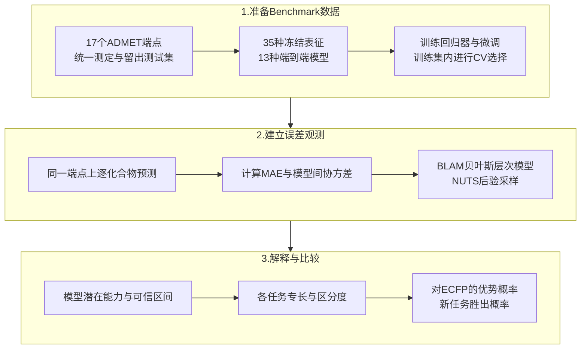
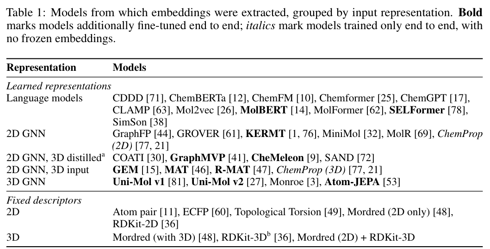
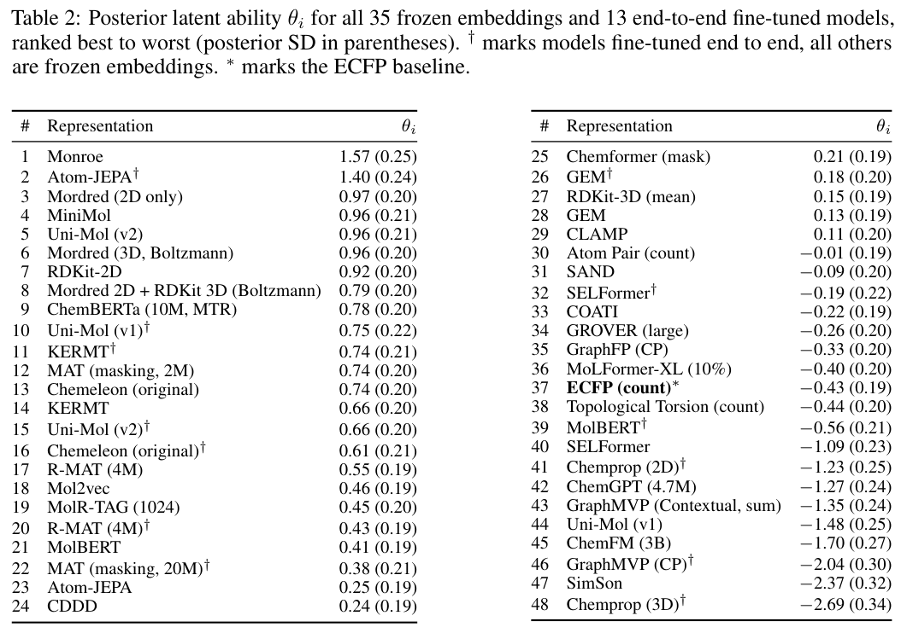
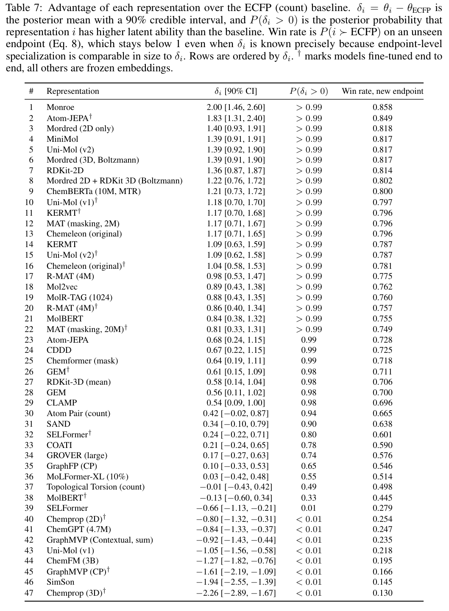
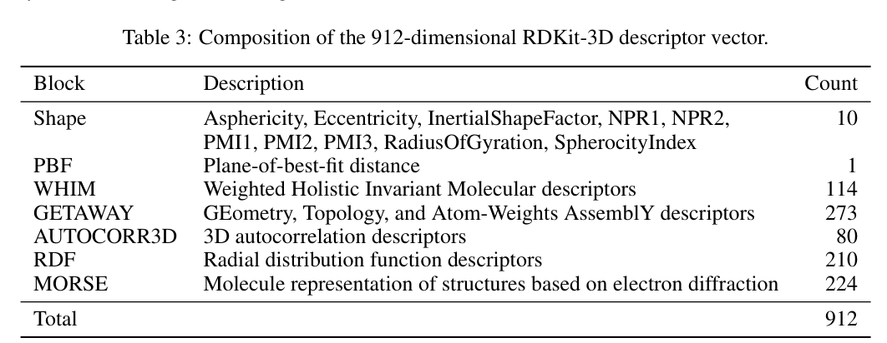
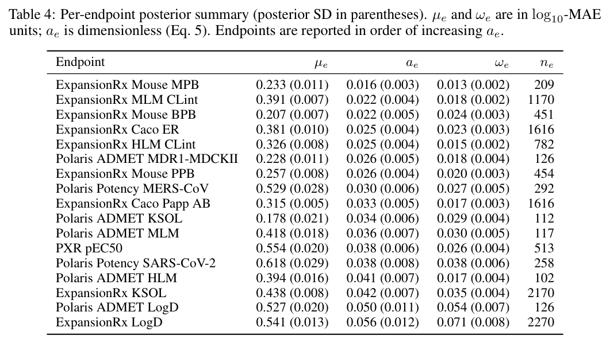
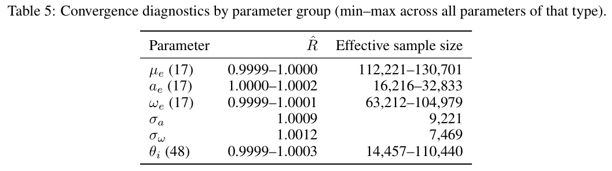
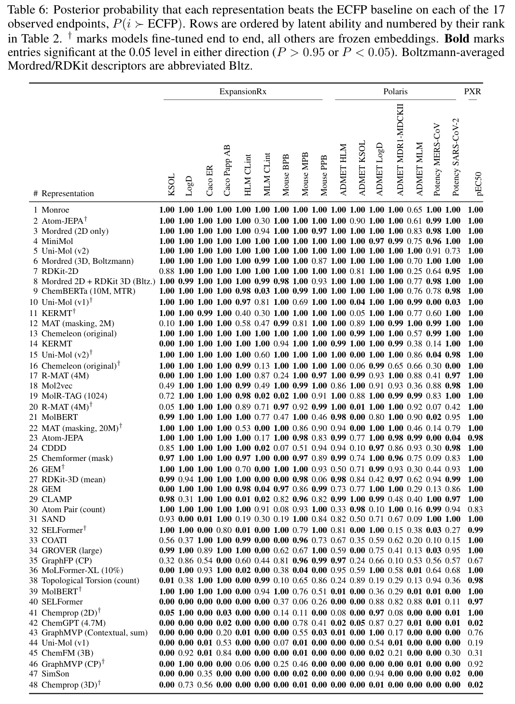

# 分子表征该如何公平比较？新统计模型重评48种方法的ADMET预测能力

## 本文信息

- **标题**：用于分子表征基准评测的潜在能力模型
- **发表平台**：ChemRxiv（预印本，尚未同行评审；已投稿至NeurIPS 2026 AI for Drug Discovery Workshop）
- **发表时间**：2026年11月4日
- **DOI**：[https://doi.org/10.26434/chemrxiv.15011649/v1](https://doi.org/10.26434/chemrxiv.15011649/v1)
- **单位**：Inductive Bio（美国）；麻省理工学院计算机科学与人工智能实验室（MIT CSAIL，美国）
- **作者**：Dassanayake, N.; McNutt, A. T.; Rich, A.
- **引用格式**：Dassanayake, N.; McNutt, A. T.; Rich, A. *A Latent Ability Model for Benchmarking Molecular Representations*. ChemRxiv, 2026, preprint. [https://doi.org/10.26434/chemrxiv.15011649/v1](https://doi.org/10.26434/chemrxiv.15011649/v1)
- **代码与数据**：
  - [完整Benchmark代码与模型配置](https://github.com/inductive-bio/ml-embedding-benchmark)
  - [独立的BLAM统计分析工具](https://github.com/nedassan/blam-analysis)
  - [OpenADMET–ExpansionRx数据集](https://huggingface.co/datasets/openadmet/openadmet-expansionrx-challenge-data)
  - [OpenADMET PXR数据集](https://huggingface.co/datasets/openadmet/pxr-challenge-train-test)
  - [数据获取、预处理与排除规则](https://github.com/inductive-bio/ml-embedding-benchmark/blob/main/docs/datasets.md)

## 摘要

> 随着化学基础模型不断涌现，研究者需要**标准化的Benchmark**来选择分子表征，并识别现有方法的不足。此前利用潜在能力对不同分子embedding的ADMET性质预测性能进行排名的研究存在明显问题，包括使用与实际应用不一致、存在偏倚的数据集，以及**夸大模型性能差异的统计显著性**。本文从基本原理出发，推导出Bayesian Bradley–Terry模型在比较$M$个模型、$E$个端点且各模型可交换的零假设条件下，其**估计方差相对于朴素估计的膨胀因子**为$(M+1)/3$；数值模拟表明，模型能力存在差异时仍有类似的方差膨胀现象。为此，我们提出一种**直接根据潜在能力建模预测误差差值**的新方法，并利用OpenADMET Polaris、ExpansionRx和PXR竞赛数据进行回顾性评测。我们比较了17个ADMET端点上的35种冻结embedding和13种端到端微调模型。由于端点间性能差异较大，**没有任何神经网络表征在假想的新端点上以超过95%的概率胜过ECFP**；与此同时，在47种待比较的模型设置中，有29种的潜在能力高于ECFP的后验概率超过95%。

### 核心结论

- **评测统计方法会改变对模型差异的信心**。传统Bayesian Bradley–Terry（BBT）将每项任务上的性能比较简化为胜负，舍弃了误差差值，还会因重复利用相关的成对比较而低估不确定性。
- **BLAM直接分析各模型的MAE**，并区分任务难度、任务区分度、模型整体潜在能力和针对特定任务的专长，同时考虑同一测试集上不同模型误差的相关性。
- **48种设置、17个端点的排名中，Monroe第一、端到端微调的Atom-JEPA第二、二维Mordred描述符第三**。经典描述符与预训练模型均进入前列。
- **29种设置的潜在能力高于ECFP具有超过95%的后验概率**；但预测一个全新ADMET端点时，排名第一的Monroe胜过ECFP的概率为85.8%，反映出任务间差异。

## 背景

近年来分子基础模型迅速发展，研究者面临一个很实际的问题：同样用于ADMET性质预测，ChemBERTa、Uni-Mol、COATI、Mordred和ECFP究竟应该优先选哪一个？不同论文经常使用不同数据、模型规模和训练协议，单看报道的最佳分数，很难形成可迁移的结论。

此前已有研究采用Bayesian Bradley–Terry模型，对不同分子表征在多数据集上的表现进行总体排名。这种方法把算法之间的比较看成一场场比赛：在某个数据集上，A的误差低于B，就记A赢一次。将众多任务的胜负汇总之后，便能估计各算法的潜在能力。

但ADMET任务有两个特点：实验性质往往受到测量噪声和实验条件影响；同时，很多模型对同一批化合物的预测误差高度相关。两个模型的MAE可能只差0.001，也可能差0.5，仅记录谁赢了会损失关键信息。尤其在模型数量很多时，所有模型两两比较产生大量相互依赖的结果。

本研究选择OpenADMET等盲测竞赛产生的数据。这些数据具有统一的测定协议和事先留出的测试集，更接近实际药物研发中面对新实验数据的情况。文章的主要创新在于**如何统计比较模型**，并据此重新审视分子表征的性能排名。

### 关键科学问题

- **跨任务的胜负能否可靠估计模型能力**？同一数据集上，$M$个模型虽然产生$M(M-1)/2$组胜负，但这些结果来源于同一组性能排序。需要明确重复计入相关信息会怎样影响后验不确定性。
- **如何把预测误差的大小纳入综合排名**？对于性质回归，MAE差异具有实际量纲，还可以与实验测定的不确定性比较，因此适合建立比单纯胜负更丰富的统计模型。
- **如何区分总体能力和某类任务上的优势**？某个表征总体平均表现优异，仍可能在溶解度或代谢稳定性等具体任务上落后。对新任务的胜出概率需要纳入这种端点间差异。

### 创新点

- 从复合似然的统计性质出发，推导BBT在可交换零假设下的方差膨胀因子，并使用Plackett–Luce模型进行数值验证。
- 借鉴双参数项目反应理论（Item Response Theory，IRT），建立连续误差版本的**Bayesian Latent Ability Model**（BLAM），直接拟合每个模型在每项任务上的MAE。
- 利用共享测试分子估计模型误差的协方差，进一步估计潜在能力、任务区分度以及在未见端点上的胜率。

## 研究内容

### 传统BBT为什么会过于自信？

Bradley–Terry模型用一个潜在强度描述每个模型。假设模型$i$和$j$的潜在能力分别是$\beta_i$、$\beta_j$，则$i$战胜$j$的概率为：

$$
P(i\succ j)=\dfrac{e^{\beta_i}}{e^{\beta_i}+e^{\beta_j}}=\sigma(\beta_i-\beta_j)
$$

BBT将每个ADMET端点上的模型排序拆成成对胜负，再统计各模型赢了多少次。例如比较48个模型，一项任务就能产生1128组成对结果，但实际上这些结果来自**同一个端点上的48个模型分数**。如果A优于B、B优于C，那么A优于C并不是一条独立的新证据。

从数学上看，BBT采用的是复合伪似然（Composite Pseudo-Likelihood）。各比较共享模型和端点，伪似然的曲率与实际估计量的采样方差之间存在差异。真实渐近协方差需要使用所谓的sandwich形式：

$$
\operatorname{Var}(\hat{\boldsymbol\beta})\approx H^{+}JH^{+},\qquad
H=-\mathbb E[\nabla^2\ell],\quad J=\operatorname{Var}(\nabla\ell)
$$

其中，$H$描述目标函数的曲率，$J$描述得分函数在重复数据下的实际波动，$H^{+}$表示广义逆。将相关的成对比较视作独立信息，相当于忽略了两者之间的差异。

本文证明：在每项任务产生一个完全随机、均匀分布的模型排序时，真实估计方差相对于朴素伪似然给出的方差为：

$$
\dfrac{\operatorname{Var}_{\mathrm{actual}}(\hat\beta)}{\operatorname{Var}_{\mathrm{naive}}(\hat\beta)}=\dfrac{M+1}{3}
$$

例如比较48个模型，方差之比为$49/3\approx16.33$，对应的标准差之比约为4.04。这里说的是估计方差的比值，**不能将16.33直接当作置信区间宽度的倍数**。这一精确关系针对可交换零假设；真实模型能力存在差异时，膨胀程度取决于具体分布。

作者进一步以10个模型、200项假想任务开展模拟：零假设下观测到的方差膨胀因子为3.662，接近理论值$11/3$；模型能力从−1.5连续变化至1.5时，模拟得到3.073，说明这一效应也出现在非可交换情形。

> BBT的关键统计问题是：**一项任务产生了大量成对比较，但这些比较共享同一份排序信息**。模型差距越接近实验误差，保留MAE差值和正确估计不确定性就越重要。

### BLAM如何同时学习模型能力和任务难度？

BLAM直接以模型$i$在端点$e$上的平均绝对误差作为观测对象，而每项任务只向似然函数贡献一个联合观测。这里的端点$e$就是一项具体的ADMET性质预测任务（例如溶解度、LogD），各自带有在统一测定协议下预先留出的测试集。它的基本形式为：

$$
y_{ie}=\mu_e-a_e\theta_i+u_{ie},\qquad u_{ie}\sim\mathcal N(0,\omega_e^2)
$$

| 变量 | 含义 | 如何理解 |
| --- | --- | --- |
| $y_{ie}$ | 模型$i$在任务$e$上的总体MAE | 模型在该性质上的真实平均误差 |
| $\mu_e$ | 任务难度 | 某项任务普遍容易或难以预测 |
| $\theta_i$ | 模型的潜在能力 | 数值越高，整体预测误差倾向越低 |
| $a_e\ge0$ | 任务区分度 | 该任务能多大程度区分强弱模型 |
| $u_{ie}$ | 模型对具体任务的特异性 | 某模型在某任务上超出或低于整体水平的表现 |
| $\omega_e$ | 任务特异性差异的尺度 | 不同模型的专长在该任务上有多分散 |

**潜在能力是一个由误差矩阵反推得到的隐变量**。在$y_{ie}=\mu_e-a_e\theta_i+u_{ie}$中，$a_e\ge0$使$\theta_i$越大对应MAE越低，它度量的是剥离任务难度与区分度之后、一个模型在全部端点上共享的系统性优势。

观测只有每个设置在每个端点上的MAE，也就是一张48行17列的误差矩阵，以及同一批测试化合物给出的模型间误差协方差；**每个设置只对应一个能力参数，与端点无关**，记作$\theta_i$。

把端点$e$上全部模型的MAE写成一个多元正态联合观测，**每个端点只贡献一个似然因子，因此不存在成对伪似然的方差膨胀**；NUTS采样得到$\theta_i$与其他参数的联合后验，排名用后验均值，每次采样内排序还能给出名次的后验分布。

**能力参数的零点与尺度无法仅凭观测确定**。平移会被$\mu_e$吸收，缩放与符号翻转会被$a_e$吸收，因此模型给$\theta$加先验约束：

$$
\theta\sim\mathcal N(0,P),\qquad P=I_M-\dfrac{1}{M}\boldsymbol1\boldsymbol1^\top
$$

这等价于$\sum_i\theta_i=0$，**潜在能力是以全体模型平均为0的相对量，本身不带MAE量纲**。只有乘上$a_e$换算成$\Delta_{ije}=a_e(\theta_i-\theta_j)$，才回到可与实验噪声比较的误差差值。

> **表2里的1.57和−2.69都没有单位**。$\theta_i$是零和约束下的相对位置，只能在这48个设置之间比较，换一批模型或端点就要重新估计；若想知道两个模型相差多少MAE，还得乘上端点的$a_e$换成误差差值。

例如某个溶解度端点的$\mu_e$较大，意味着大部分模型误差较高；$a_e$较大，则能力更强的模型通常能获得更明显的误差改善。即使两个模型的$\theta_i$不同，具体端点上的$u_{ie}$仍可能改变它们的胜负关系。

论文将每个性质变换到近似正态的尺度，通常是以10为底的对数尺度，随后计算MAE。**这里的MAE是对转换后的性质计算的绝对误差，不是对MAE再次取对数**。

### 同一批测试化合物如何帮助估计误差？

这一点是BLAM能够利用的另一项信息。假设两个模型都对同一批化合物进行预测，除了平均MAE，还可以获得每个化合物的绝对误差：

$$
A_{cie}=\left|\hat y_{cie}-y_{ce}^{\mathrm{exp}}\right|
$$

其中$c$为化合物索引。依据同一个测试集上的逐化合物误差，计算不同模型的MAE采样协方差矩阵$V_e$，并写成联合观测模型：

$$
\hat{\boldsymbol y}_e\sim\mathcal N_M\!\left(
\mu_e\boldsymbol1-a_e\boldsymbol\theta,\;
\omega_e^2I_M+V_e
\right)
$$

若两个模型在同一批困难分子上都会犯较大的错误，它们的MAE估计具有正相关性，比较误差差值时共同波动会部分抵消。论文附录B.4给出差值估计量的方差$\tau^2_{ije}=2\omega_e^2+v_{ie}+v_{je}-2c_{ije}$，其中$v_{ie}$、$v_{je}$是$V_e$的对角元，$c_{ije}$是两模型的采样协方差；正相关的$c_{ije}$使$-2c_{ije}$为负，差值方差随之减小。因此，使用共享测试分子的逐样本预测结果，比只汇总各自的MAE及标准差更有信息量。

> BLAM把问题拆成三个层次：**模型总体有多强、每项实验任务有多容易区分模型、某模型在特定任务上有多擅长**。这使综合排名和单任务比较可以放到同一个概率模型中分析。

### 从原始预测到排名的完整流程

模型后验通过NumPyro实现的NUTS（No-U-Turn Sampler）采样：16条链，每条2000步预热、4000步正式采样，合计64000个预热后的样本。**预热步用于让采样器自动调整步长与质量矩阵，因此前2000步的样本带初始偏差、须全部丢弃**；并行16条链则是为了借助Gelman-Rubin的$\hat R$收敛诊断，**只有当链间与链内方差一致时后验才足够可靠**。全部参数的$\hat R\le1.0012$，表明MCMC已达到充分收敛。

### 评测数据与模型设置

本研究的17个回归端点来自OpenADMET的三个盲测竞赛：ExpansionRx共9项、Polaris共7项、PXR共1项，覆盖溶解度、LogD、细胞通透性、血浆蛋白结合、肝微粒体清除率，以及抗病毒活性和PXR诱导等性质。**测试集由竞赛方在统一测定协议下预先留出，作者原样使用，没有在训练集内重新切分**，规模为102至2270个化合物。

表1按输入类型把表征分为六类：语言模型、二维图神经网络、预训练时蒸馏三维信息的二维模型、需要三维坐标输入的模型、三维图神经网络，以及确定性描述符；最后一类又分二维与三维两种。**蒸馏类模型只在预训练阶段用到构象，推理时仍然只需要二维分子输入**。三维描述符如RDKit-3D需先生成并优化构象，再按Boltzmann或均匀权重对构象系综取平均，得到912维向量。

**表1**：参与评测的分子表征及其输入类型。黑体标识额外进行端到端微调的模型，斜体标识仅开展端到端训练、没有冻结embedding结果的模型；其中部分模型的三维信息仅在预训练时使用。

**48个排名设置并不与表1的模型一一对应**。同一个模型若同时做了冻结与端到端两种训练，会在表2里占两行，两者的$\theta_i$分别估计。

- **冻结路线把预训练模型当成固定的特征提取器**。模型参数保持固定，只抽取分子向量（或直接使用ECFP、Mordred、RDKit等确定性描述符），再在训练split上拟合一个回归头，输出测试集上逐化合物的预测误差。这条路线共35个设置。
- **端到端路线更新的是模型自身的权重**。预训练模型连同回归输出一起在ADMET回归任务上继续训练，不外接回归头，因此**微调更新的是从分子嵌入到预测头的整个网络**。这条路线共13个设置，只覆盖具备条件的模型：
  - **只有原作者提供了现成回归微调方案的模型才被微调**，每个端点各微调一次，学习率沿用各模型方案的单一默认值，不做逐端点的超参搜索。
  - Chemprop的二维与三维版本是从头训练，并不加载预训练权重；SimSon与GROVER虽附有微调脚本，但未纳入本文结果。

五类回归头的超参都由训练集内的5-fold交叉验证决定，按搜索方式分成两组：

- **三种传统回归头各带一组网格超参**：RF在`min_samples_split`的2、4、6、8、10中搜索，固定200棵树、`max_depth=20`；Ridge在$[10^{-2},10^3]$上取10个对数间隔的正则系数$\alpha$；kNN在`n_neighbors`的1、3、5、7、9中搜索，特征标准化，计数型表征用Tanimoto-count距离、其余用余弦距离。
- **TabICL和TabPFN不设超参搜索**，用5-fold CV打分后在全部训练数据上拟合一次；输入标准化并截断到$[-6,6]$，TabPFN使用v3。

**CV评分指标是Spearman相关**，它同时决定两件事：为每个embedding选出最佳回归头，以及把同一家族的多个规模变体剪枝到CV最优的一个。某个embedding要在五个回归头都产出结果后才会纳入该端点的BLAM分析，微调家族则只跑单一变体。最终进入排名的是这些设置在留出测试集上的MAE，因而表2代表的是**特定模型配置、训练协议和评测数据下的表现**。

## 实验结果

### 48种模型设置的综合排名

BLAM对每个模型估计一个潜在能力$\theta_i$，数值越大表示该模型在这一组任务上的总体误差表现越好。原文Table 2给出全部48个设置的后验均值和标准差。

**表2**：35种冻结embedding和13种端到端训练模型的BLAM潜在能力排名。括号中为后验标准差，$\dagger$表示端到端微调，星号表示ECFP基线。排名由$\theta_i$的后验均值决定。

主要结果包括：

| 排名 | 模型或描述符 | 潜在能力$\theta_i$ | 模型方式 |
| ---: | --- | ---: | --- |
| 1 | Monroe | 1.57 | 冻结模型表征 |
| 2 | Atom-JEPA | 1.40 | 端到端微调 |
| 3 | Mordred（仅2D） | 0.97 | 传统描述符 |
| 4 | MiniMol | 0.96 | 冻结模型表征 |
| 5 | Uni-Mol v2 | 0.96 | 冻结模型表征 |
| 7 | RDKit-2D | 0.92 | 传统描述符 |
| 9 | ChemBERTa（10M，MTR） | 0.78 | 冻结模型表征 |
| 29 | CLAMP | 0.11 | 冻结模型表征 |
| 33 | COATI | −0.22 | 冻结模型表征 |
| 37 | ECFP（count） | −0.43 | 传统指纹基线 |

第一名Monroe是用于分子性质推断的基础模型；第二名Atom-JEPA为端到端微调版本。传统的Mordred二维描述符排名第3，RDKit-2D排名第7，说明描述符基线在这些ADMET回归任务上依然十分有竞争力。

CLAMP在这篇研究中位列第29，COATI位列第33。此前有工作在分类任务上比较了不同预训练分子表征，得到过不同的领先模型。**任务类型、数据来源、预处理、下游回归器和统计方法都会改变排名的含义**，不同Benchmark的结论需要结合完整评测协议理解。

> 传统描述符在ADMET回归上仍具竞争力；不同Benchmark的排名结论不可直接横比，须结合完整评测协议理解。

### 微调是否一定提高排名？

同一模型的冻结表征与端到端版本形成了有价值的对照：

| 模型 | 冻结版本$\theta$ | 微调版本$\theta$ | 观察 |
| --- | ---: | ---: | --- |
| Atom-JEPA | 0.25 | 1.40 | 微调后明显提升 |
| Uni-Mol v1 | −1.48 | 0.75 | 微调后明显提升 |
| Uni-Mol v2 | 0.96 | 0.66 | 冻结版本表现更好 |
| CheMeleon | 0.74 | 0.61 | 冻结版本略好 |
| KERMT | 0.66 | 0.74 | 微调版本略好 |

从这些结果可以看出，**预训练表征的质量与端到端微调后的最终性能需要分开评估**。模型是否受益于微调，取决于具体的预训练任务、微调方案及数据集；本文的微调仅使用各模型可用的方案，并未对每个任务全面搜索微调超参数。

### 29种模型的潜在能力优于ECFP，为什么新任务胜率还达不到95%？

BLAM提供两种不同的概率：

1. **潜在能力更强的概率**：$P(\theta_i>\theta_{\mathrm{ECFP}})$，比较在已有任务集合下推断出的总体能力差异。
2. **未来新端点的胜出概率**：$P(i\succ\mathrm{ECFP}\mid\mathrm{new\ endpoint})$，在能力差异之外，还考虑新任务自身的区分度和任务特异性表现。

论文发现，47种与ECFP比较的模型设置中，有29种的$P(\theta_i>\theta_{\mathrm{ECFP}})>0.95$，其中25种超过0.99。不过，没有任何一个神经网络表征在假想新端点上的预计胜率超过95%。

**表7**：各模型相对ECFP的潜在能力优势及其在未见端点上的预计胜率。第三列为潜在能力差异及90%可信区间，第四列为潜在能力更强的后验概率，最后一列为在新端点上取得更小MAE的预测概率。

以排名前三的设置为例：

| 模型 | 相对ECFP的潜在能力差异 | 潜在能力更强的概率 | 新任务胜率 |
| --- | ---: | ---: | ---: |
| Monroe | 2.00 | $>0.99$ | 85.8% |
| Atom-JEPA（微调） | 1.83 | $>0.99$ | 84.9% |
| Mordred（2D） | 1.40 | $>0.99$ | 81.8% |
| MiniMol | 1.39 | $>0.99$ | 81.7% |
| Uni-Mol v2 | 1.39 | $>0.99$ | 81.7% |

对于未知端点，论文依据后验分布采样该任务的区分度$a_{\mathrm{new}}$和特异性尺度$\omega_{\mathrm{new}}$，再计算：

$$
P(i\succ j\mid\mathrm{new})=
\Phi\!\left(\dfrac{a_{\mathrm{new}}(\theta_i-\theta_j)}{\sqrt2\,\omega_{\mathrm{new}}}\right)
$$

其中$\Phi$是标准正态累积分布函数。分母$\sqrt2\,\omega_{\mathrm{new}}$来自两模型特异性之差的波动。两个独立的$u_{ie}$、$u_{je}$相减，方差相加得$2\omega_e^2$，标准差即$\sqrt2\,\omega_e$。新端点改用采样得到的$a_{\mathrm{new}}$与$\omega_{\mathrm{new}}$。即便总体能力差异较为确定，新任务上的特异性偏差仍可能改变两个模型的实际排名。

> **“总体能力更强”与“下一个任务也会胜出”是两个问题**。Monroe相对于ECFP具有很高的潜在能力优势，但在随机抽取的新端点上，仍有约14.2%的概率落后于ECFP。

### 不同端点的区分能力差别有多大？

模型还估计了各端点的区分度$a_e$，数值越大，模型总体能力的差异越容易体现为MAE差值。原文Table 4中，ExpansionRx Mouse MPB的$a_e=0.016$，ExpansionRx LogD的$a_e=0.056$。它们相差约3.5倍，表明不同端点对模型排名的区分能力存在明显差异。

这一设计还有实际意义。模型间的潜在能力差异可以换算成特定端点上的预期MAE差距：

$$
\Delta_{ije}=a_e\delta_{ij},\qquad \delta_{ij}=\theta_i-\theta_{\mathrm{ECFP}}
$$

$\Delta_{ije}$与MAE同量纲，可直接与该端点实验测定的噪声标准差$\sigma_e$比较。论文另设实际等效阈值$\delta_e$，建议取$\delta_e>\sigma_e$；当$\Delta_{ije}<\delta_e$时，两个表征在该端点上的差别**落在实际等效区间内**。相比只看后验区间宽度，这个判据有明确的物理量纲。

> 端点区分度$a_e$将潜在能力差异换算成可与实验噪声直接对照的MAE差距，这正是判断一项改善在实际应用中是否具有实际意义的关键。

### 统计评测本身还需要哪些条件？

BLAM适合一批模型在多个回归任务的**共享测试集**上进行比较。需要保存每个模型在每个化合物上的预测结果，才能计算模型间的误差协方差。论文中大多数同一端点的模型对测试化合物覆盖高度重合，部分分子在不同端点之间也重复出现，后者的影响在附录中另行讨论。

另一方面，BLAM的潜在能力依赖于参与评测的任务集合。这里的17个端点覆盖若干常见ADMET指标，但对新的靶点活性、性质分布或实验方案，仍应重新进行针对性评估。模型排名反映了本次回归协议下的表现，尤其需要结合传统描述符、下游预测器和微调方案来理解。

> BLAM的排名依赖本次评测的任务集合与共享测试集；面对新靶点、新性质分布或新实验方案，仍需重新进行针对性评估。

## 关键结论与批判性总结

- **统计方法的贡献比榜单本身更重要**。BLAM将胜负比较改为对连续预测误差建模，能够更合理地估计跨任务能力及其不确定性，也允许进一步讨论各端点的实际误差差距。
- **传统描述符应作为强基线**。Mordred（2D）和RDKit-2D在本次ADMET任务中排名靠前，说明预训练模型需要通过一致的下游协议与确定性描述符比较。
- **同一模型的冻结embedding与微调表现可能差别很大**。Atom-JEPA与Uni-Mol v1的微调版本提升明显，Uni-Mol v2则是冻结版本更好，这也反映模型选择和训练协议的重要性。
- **实验意义仍应落实到每个端点的误差幅度**。研究提供了基于端点区分度和MAE差值定义实际等效区间的思路；将其与真实实验噪声联合使用，是比只看概率阈值更实用的下一步。
- **评测结论的适用范围仍受任务集合约束**。BLAM的排名来自本次17个ADMET端点与共享测试集，换用新靶点活性、新性质分布或新实验方案时仍需重新评估；微调也仅采用各模型可用的方案，未对每个任务穷搜超参数。

本文是2026年11月4日发布的预印本，统计方法与实验结果尚未经过正式同行评审。完整代码和独立的BLAM分析包已公开，便于在其他多端点回归Benchmark中试用和验证。

## 附录：原文其余数据表

原文没有单独编号的Figure，以下保留附录中的主要原始表格；正文已经展示Table 1、Table 2和Table 7。图片均从对应PDF页面裁切，保持论文原编号。

**表3**：RDKit三维描述符的912个特征组成。包括形状、PBF、WHIM、GETAWAY、三维自相关、径向分布函数和MORSE描述符。

**表4**：17个端点的拟合参数。依次列出任务难度$\mu_e$、区分度$a_e$、特异性尺度$\omega_e$和测试分子数；括号中为后验标准差。

**表5**：MCMC收敛诊断。展示不同参数组的$\hat R$及有效样本数，用于检查后验采样的稳定性。

**表6**：各模型在已观察17个端点上胜过ECFP的后验概率。此表反映已知任务的优势，与表7最后一列的未知任务预测胜率不同；黑体表示概率高于0.95或低于0.05。

## 软件使用：输入什么，得到什么？

BLAM与本次Benchmark的代码均已公开，分两个仓库维护：

- **完整Benchmark流程**：`ml-embedding-benchmark`负责准备OpenADMET的ExpansionRx、Polaris、PXR数据，训练冻结embedding上的回归器（RF、kNN、Ridge、TabICL、TabPFN）并跑端到端微调，最终输出每个模型在每个化合物上的预测值与测试集MAE。
- **独立的BLAM统计分析工具**：`blam-analysis`基于NumPyro实现NUTS后验采样，从各模型的MAE与逐化合物误差协方差出发，估计潜在能力$\theta_i$、任务难度$\mu_e$、区分度$a_e$、特异性尺度$\omega_e$，并给出对ECFP的优势概率与新端点胜率。

跑通BLAM本身只需准备一份每个模型×每个化合物的预测表，以及统一的共享测试集划分；关键在于**保留每个模型在每个化合物上的预测结果**，才能据此计算模型间的误差协方差。BLAM的排名与胜率依赖所选的任务集合与测试集，换用不同的端点或实验方案时需重新运行，不能直接套用本文的具体数值。

注意：数据获取、预处理与排除规则以`ml-embedding-benchmark`仓库`docs/datasets.md`为准；各端点的具体处理（如性质的对数变换尺度）也会影响最终MAE与排名，使用前应先核对。
