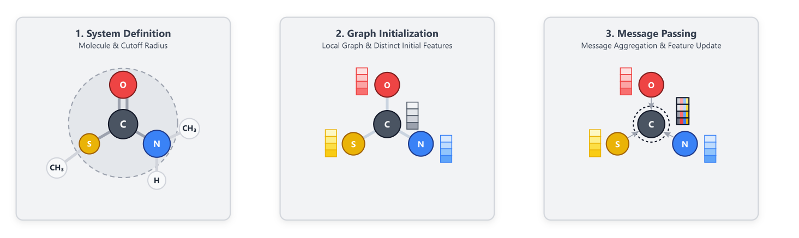
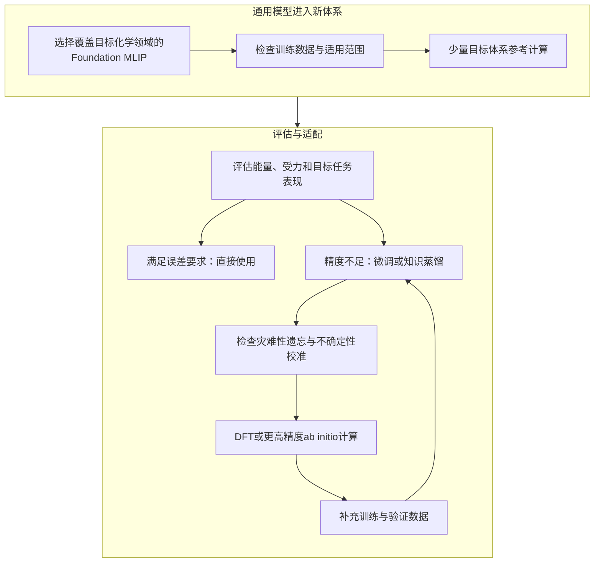

# Foundation MLIPs会取代DFT吗？计算化学的下一步在哪里？

## 本文信息

- **标题**：计算化学的新范式
- **作者**：Raphael T. Husistein、Markus Reiher
- **发表期刊**：Journal of the American Chemical Society
- **发表时间**：2026年10月20日
- **文章类型**：Perspective（观点文章）
- **DOI**：[https://doi.org/10.1021/jacs.6c06653](https://doi.org/10.1021/jacs.6c06653)
- **单位**：瑞士苏黎世联邦理工学院（ETH Zurich），化学与应用生物科学系
- **引用格式**：Husistein, R. T.; Reiher, M. A New Paradigm for Computational Chemistry. *Journal of the American Chemical Society* **2026**. [https://doi.org/10.1021/jacs.6c06653](https://doi.org/10.1021/jacs.6c06653)

## 摘要

> 计算化学已成为实验化学的重要工具，其核心任务之一，是为给定的分子结构确定势能，再据此研究反应机理、反应路径和反应速率。长期以来，密度泛函理论（Density Functional Theory，DFT）是计算势能最常用的方法。过去二十年中，机器学习原子间势（Machine Learning Interatomic Potentials，MLIPs）逐渐发展起来，展现出接近量子化学方法的精度和接近传统力场的计算效率。早期MLIPs需要针对特定体系生成大量量子化学训练数据，限制了它们的通用性。近年来，Foundation MLIPs通过大规模预训练获得了跨体系应用能力，使这一障碍显著降低。本文回顾MLIPs的基本原理、Foundation MLIPs的发展、计算性能及尚待解决的技术问题，并提出一个明确的前瞻性判断：**未来不到十年，Foundation MLIPs可能取代DFT，成为计算化学常规计算的首选方法**。

### 核心观点

- **Foundation MLIPs正在降低新体系使用机器学习势的门槛**：大规模、多领域预训练使部分模型能够直接用于新体系，具体任务仍可通过少量高精度数据进行微调。
- **MLIPs更可能接替DFT的常规计算角色**：传统力场在适用范围内仍然更快，MLIPs的优势在于以较高精度处理传统力场难以覆盖的化学环境。
- **通用模型的适用性取决于训练数据和物理覆盖范围**：长程静电、诱导、色散、总电荷、自旋、反应高能构型和不确定性估计仍是重要挑战。
- **未来训练数据可能从DFT拓展到更高精度的*ab initio*方法**：通过迁移学习，MLIPs有望逐步获得Coupled Cluster或多参考量子化学方法的精度，同时保留较高的推理效率。

## 背景：计算化学为什么需要更高效的势能面

化学反应、分子构象变化和材料相变，都可以从原子核构型对应的能量出发理解。固定原子核位置并求解电子结构，便可得到该构型的电子能量；当原子核位置连续变化时，这些能量构成**势能面**（Potential Energy Surface，PES）。稳定中间体、过渡态、反应路径和活化能都由势能面决定，因此高效、准确地计算势能是计算化学的基础。

DFT在20世纪90年代成为计算化学的主流方法，主要得益于它在计算成本和预测精度之间取得了实用平衡。实际计算需要选择交换-相关（exchange-correlation，xc）泛函，而常用泛函依赖近似形式和经验参数。不同泛函可能给出不同结果，误差还可能通过不同近似项之间的补偿而部分抵消，**针对某个具体体系的误差难以在常规计算中可靠量化**。

波函数理论提供了更系统的精度提升路线，例如Coupled Cluster方法和多参考电子结构方法，但计算成本通常更高。对大分子、复杂材料和长时间尺度动力学而言，直接使用高精度量子化学方法仍然受到体系规模和构型采样数量的限制。

MLIPs尝试在两者之间建立新的计算层：先利用量子化学数据学习势能面，再以机器学习模型快速预测新构型的能量和受力。早期模型需要针对每个目标体系重新生成大量训练数据，准备成本很高。**Foundation MLIPs的关键变化，是把大量体系的训练工作提前完成，让通用模型能够直接进入新任务的初始计算流程**。

## 1. MLIP如何表示分子与原子体系

MLIPs可以采用线性回归、高斯过程回归或神经网络等算法。近年来，神经网络模型已成为主流。为了处理原子数目不同的体系，同时保证预测符合物理对称性，MLIPs通常将体系总能量写成局部原子能量之和：

$$
E_{\mathrm{tot}}=\sum_{i=1}^{N}E_i\left(\{\mathbf r_j,Z_j\mid |\mathbf r_j-\mathbf r_i|<r_c\}\right)
$$

其中，$N$为原子总数，$\mathbf r_j$和$Z_j$分别表示邻近原子的位置和核电荷数，$r_c$为局部环境的截断半径。每个原子的能量由其截断范围内的化学环境决定，所有原子贡献相加得到体系总能量。

这种局部能量分解与电子结构的近视性（nearsightedness）有关：许多原子相互作用可以由局部环境有效描述。它使模型能够随原子数目扩展，但也带来一个直接限制：**只依赖局部邻域的模型难以区分局部结构相同、整体排布不同的体系**，长程静电、诱导和色散作用尤其容易受到影响。

### 局部环境如何转化为模型输入

传统神经网络势通常先计算描述符，再由神经网络预测原子能量。常见描述符包括：

- **原子中心对称函数**（Atom-Centered Symmetry Functions，ACSF）：通过径向和角向函数编码中心原子周围的邻居分布，构造对平移、旋转及同元素原子交换不变的表示。
- **原子位置平滑重叠**（Smooth Overlap of Atomic Positions，SOAP）：利用局部原子密度描述化学环境，再构造适合机器学习的表示。
- 另一类方法通过不同的数学展开方式表达局部原子环境，兼顾对称性与模型表达能力，典型代表包括：
  - **谱邻域分析势**（Spectral Neighbor Analysis Potential，SNAP）
  - **矩张量势**（Moment Tensor Potential，MTP）
  - **原子簇展开**（Atomic Cluster Expansion，ACE）

另一条路线是直接从数据中学习局部环境表示。图神经网络将原子视为节点，将截断距离内的原子连接视为边；节点通过消息传递聚合邻居信息，再更新自身表示。图1展示了这一过程。

**图1：分子图上的消息传递过程**。图1由三个面板组成，原子统一采用CPK配色（碳为黑色、氧为红色、氮为蓝色、硫为黄色、氢/$\ce{CH3}$为浅色），演示消息传递在分子图上的完整流程：

- **系统定义**（System Definition）：以中心原子为基准，按截断半径确定邻近原子，用虚线截断圆界定其局部环境。
- **图初始化**（Graph Initialization）：把分子表示为图，原子作为节点、近邻连接作为边，并为每个节点分配初始特征向量（图中以彩色小方块特征条表示）。
- **消息传递**（Message Passing）：每个节点将自身特征经边传递给邻居，再聚合来自邻居的信息更新表示；图中只展示碳原子的更新过程。

### 不变性与等变性

分子整体平移或旋转、以及相同元素原子交换，都不应改变体系能量，因此能量预测需要满足相应的不变性。力、偶极矩和极化率等量具有方向或张量属性，体系旋转后它们也应按相应规则旋转，这要求模型具备**等变性**（equivariance）。

不变模型可以先预测标量能量，再通过对坐标求梯度得到原子受力：

$$
\mathbf F_i=-\nabla_{\mathbf r_i}E_{\mathrm{tot}}
$$

等变模型则让内部特征随输入坐标按相同的对称规则变换。许多模型使用球谐函数表示张量特征，并通过Clebsch-Gordan张量积完成信息聚合；这种方法物理结构清楚，但训练和推理成本较高。笛卡尔张量表示在计算上更简洁，不过现有架构通常集中于一阶或二阶张量。

> **等变模型在低数据量场景中通常具有更好的数据效率**，但更复杂的架构也会增加计算负担。

近年来，PET、EScAIP和AllScAIP等Transformer模型通过放宽部分旋转等变性约束，同时保留局部性等物理先验，获得了有竞争力的精度和效率。不同架构在大规模训练下的最终表现仍取决于模型容量、硬件利用率和任务要求。

## 2. Foundation MLIPs的发展

Foundation Model这一概念最初来自自然语言处理：模型先在大规模、多样化数据上预训练，再通过微调适配具体任务。MLIP领域也采用了这一思路。本文对Foundation MLIPs的定义比较明确：**指经过大规模预训练、能够面向多个化学体系使用的MLIPs**；这一称呼本身并不预设模型已经具备可预测的Scaling Law或类似大语言模型的涌现能力。

早期通用模型MEGNet使用Materials Project数据库中约6万个晶体结构训练，覆盖元素周期表中的89种元素。随后，M3GNet、MACE-MP-0和eqV2等模型进一步扩大了参数规模、训练数据和模型架构的能力。

| 模型 | 论文列出的可训练参数量 | 主要特点 |
| --- | ---: | --- |
| MEGNet | 约16.1万 | 早期通用材料模型，训练数据约6万个晶体结构 |
| M3GNet | 约22.8万 | 扩展通用图神经网络势的元素和结构覆盖范围 |
| MACE-MP-0 | 约470万 | 基于MACE架构，主要使用材料数据集MPtrj训练 |
| eqV2-L | 约1.538亿 | 采用等变架构，显著扩大模型容量 |

随着训练数据覆盖面和模型规模增加，MLIPs开始用于稳定分子动力学、高通量材料发现和跨体系性质预测。MACE-MP-0在以材料为主的MPtrj数据上训练，却表现出一定的分布外迁移能力，例如能够对液态水开展定性稳定的MD模拟。后续研究还展示了它在硅沸石相对稳定性和二氧化硅高压相变等问题上的应用。

不过，**模型的训练领域会直接影响它适合处理的化学问题**。M3GNet和MACE-MP-0在部分表面能预测中出现系统性低估；对Ni、Ru表面吸附不同$\ce{N_xH_y}$物种的吸附能预测，也需要对相关模型进行额外微调。材料数据占主导的模型，不能与以广泛分子化学数据训练的模型直接互换。

### UMA：跨材料、分子与催化领域的联合训练

Universal Model for Atoms（UMA）将多类原子结构数据整合到一个模型中。基础训练数据集包括：

- **OMat24**：材料结构与相关性质数据。
- **OMol25**：覆盖多种元素、电荷态和自旋态的分子数据。
- **OC20**：催化与表面吸附体系。
- **OMC25**：分子晶体相关数据。
- **ODAC25**：金属有机框架等体系。

这些数据合计约5亿个结构。UMA通过额外的task标签标记化学领域及生成参考数据时使用的计算方法，使模型能够共享表示，同时根据指定任务输出相应性质。本文评估的更新版本UMA-S-1.2还纳入OC22、OC25、扩展后的OMol25以及聚合物数据集OPoly26。

UMA包含约1.5亿至14亿参数的不同版本。论文引用的结果显示，**最小版本在多个领域中也能达到与专用模型相当或更好的表现，无需额外微调**。在过渡金属配合物构象排序中，刚性配体通常能够获得较可靠的排序；对于柔性或流变（fluxional）体系，当构象能量差只有数kJ/mol、接近DFT本身的精度范围时，排序可靠性会下降。

## 3. 通用模型直接使用，还是针对体系微调

拿到一个Foundation MLIP后，实际使用时需要在通用性、预测精度、计算成本和维护风险之间做选择。本文将这一决策归纳为四个方面。

### 精度与任务容忍度

通用模型在许多体系中已经能够达到专用模型的精度，但仍需根据目标任务进行检查。例如，部分Foundation MLIPs对偏离平衡键长的双原子分子预测并不准确。

> **模型是否够用，应由具体任务允许的误差决定**；如果静态通用模型已满足精度要求，直接使用通常能显著减少数据准备和训练工作。

### 微调与灾难性遗忘

当通用模型精度不足时，可以利用目标体系的量子化学数据微调。但更新模型可能损害其原本掌握的其他体系性能，这种现象称为**灾难性遗忘**（catastrophic forgetting），背后涉及稳定性—可塑性权衡：模型需要吸收新知识，同时保留已有能力。

常见策略分为三类：

- **正则化方法**：在损失函数中加入约束，限制重要参数发生过大变化，或约束模型在旧数据上的预测。
- **回放方法**：微调时周期性地重新使用过去的训练数据，减少旧知识丢失。
- **参数隔离方法**：为不同任务分配相对独立的参数子集，降低新旧任务之间的干扰。

目前MLIP中较常见的做法是冻结网络的大部分层，**只更新最后几层**。这种方式可以保留冻结层中的已有知识，但新数据能够改变的模型部分有限。

另一种策略是**低秩适配**（Low-Rank Adaptation，LoRA）：冻结原始权重，在网络层中加入可训练的低秩矩阵，以较少参数完成适配。直接把标准LoRA用于等变MLIP可能破坏等变性，近期已有工作针对等变模型调整这一方法。

> Foundation MLIPs的**持续学习仍处于早期阶段**，稳定保留旧能力与吸收新知识的效果还需要系统评估。

### 训练成本与推理成本

静态通用模型适合化学空间广、训练数据准备困难的任务；代价是模型规模较大，推理速度可能慢于专用模型。对分子动力学而言，化学组成相对固定、推理次数又非常多，模型每一步的速度会直接影响可模拟的时间尺度。

**知识蒸馏**（Knowledge Distillation）提供了另一种方案：将通用模型作为Teacher，把它学到的势能面信息迁移给参数量更小的Student。这样可以用通用模型减少专用训练数据需求，再通过小模型提高目标化学领域的推理效率。

### 不确定性估计

模型预测值之外，还需要知道**预测有多可靠**。最常见的方案是**模型集成**（Ensemble）：使用不同数据划分或随机初始化训练多个模型，以模型预测之间的经验方差估计不确定性。其他方法包括Monte Carlo Dropout、均值—方差估计和训练损失轨迹分析，这些方法通常需要在训练阶段预先设计。PET-MAD是本文提到的少数在Foundation MLIP中直接集成不确定性估计的模型之一。

对于只发布单个静态通用模型的情况，可以采用事后不确定性估计：

- **梯度方法**：利用预测对输入或模型参数的敏感性近似估计不确定性，通常需要预先遍历训练集计算辅助量。
- **距离方法**：比较新结构与训练数据在模型特征空间中的距离，远离训练分布的结构会被标记为高风险；推理时仍需访问训练数据。

> 无论采用哪种方案，都需要用少量目标体系的参考量子化学计算进行校准。**不确定性数值需要与真实预测误差建立可靠对应，才适合用于主动学习和自动化计算流程**。

## 4. MLIPs的计算速度：比DFT快多少

不同方法对硬件的要求不同：传统DFT程序通常针对CPU优化，MLIPs则更适合GPU。为了给出直观参照，本文在Intel Core i7-14700K处理器的4核配置和NVIDIA RTX 4090 GPU上，对萘和紫杉醇分别进行了单点能量与受力计算。DFT使用PBE0泛函和`def2-SVP`基组，通过ASE调用NWChem；UFF则通过Open Babel计算。

**表1：萘和紫杉醇单点能量与受力计算的耗时，单位为毫秒**。 CPU列使用4核Intel Core i7-14700K，GPU列使用NVIDIA RTX 4090；UFF和PBE0未提供GPU结果。

| 方法 | 萘，4核CPU | 萘，GPU | 紫杉醇，4核CPU | 紫杉醇，GPU |
| --- | ---: | ---: | ---: | ---: |
| MACE-MH-1（omol） | 56.463 | 34.650 | 549.281 | 36.10 |
| GRACE-2L-OAM | 7.41 | 4.42 | 21.96 | 9.37 |
| MatterSim v1 5M | 21.00 | 25.24 | 225.37 | 30.40 |
| eqV2-M | 366.28 | 58.80 | 2830.68 | 108.25 |
| Orb-v3（omol） | 37.84 | 9.99 | 500.49 | 14.00 |
| SevenNet-MF-ompa（omat24） | 97.98 | 38.94 | 2021.57 | 39.82 |
| UMA-S-1.2（omol） | 111.46 | 48.70 | 951.23 | 48.02 |
| Nequix-MP-1 | 4.68 | 2.89 | 42.57 | 4.67 |
| PET-MAD-1.5-S | 27.93 | 23.73 | 180.31 | 23.77 |
| UFF | 0.01 | — | 0.11 | — |
| PBE0 | 30533.94 | — | 4137626.60 | — |

这组数据给出三个直观结论：

- **传统力场仍然最快**：UFF比本文测试的MLIPs快约40至40,000倍，具体倍数取决于模型、体系和硬件。
- **MLIPs相对DFT具有数量级优势**：本文测试条件下，DFT耗时约为MLIPs的80倍至近900,000倍；体系从萘增大到紫杉醇后，MLIP的速度优势更加明显。
- **GPU加速幅度因模型而异**：所测试MLIPs的GPU相对CPU几何平均加速约5.28倍；对于较大的紫杉醇体系，每个模型在GPU上的加速均高于萘体系。

不同MLIP的速度差异也很明显。以紫杉醇为例，CPU上eqV2-M比Nequix慢约66倍；萘体系中约慢78倍。论文将其与参数量差异联系起来：Nequix约70万个参数，eqV2-M约8600万个参数。

需要注意，**这是一组展示性单点计算对比，并非严格的性能Benchmark**。模型参数量、训练数据、精度水平、硬件优化和体系规模均不相同。论文的重点是说明MLIPs相对DFT的速度优势，以及它们与传统力场之间的定位差异。

> MLIPs更可能**接替DFT在常规计算中的角色**。已有成熟力场且精度足够时，传统力场仍然更高效；当研究涉及复杂化学环境、反应过程或传统力场缺少可靠参数时，MLIPs提供了更广泛的适用空间。

## 5. Foundation MLIPs仍需解决哪些问题

### 长程静电、诱导与色散

多数Foundation MLIPs使用约4.5至10 Å的固定截断半径。多轮消息传递能够逐层扩展信息范围，但信息传播仍受到截断半径和消息传递层数限制。对金属有机框架、生物大分子等体系而言，**长程静电、诱导和色散作用**可能显著影响能量，单纯依赖局部环境难以完整描述。

已有研究沿着两条路线改进长程相互作用：一类显式**预测电荷或Wannier中心**，再计算全局静电作用；另一类通过非局部描述符或注意力机制，让模型**直接学习**远距离原子间的关系。Latent Ewald Summation（LES）从总能量和受力中推断潜在电荷，无需训练数据提供显式电荷标签；电荷平衡（Qeq）方法则根据局部几何预测电负性和硬度，再通过全局能量最小化得到原子电荷。

MACE-POLAR-1和AllScAIP代表两种不同思路：

- **MACE-POLAR-1采用物理驱动路线**：扩展MACE架构，引入原子多极矩，并根据局部电场迭代更新；随后通过可学习的Fukui函数完成全局电荷与自旋平衡。
- **AllScAIP采用数据驱动路线**：先进行带距离截断的局部邻域注意力，再进行不设截断的全节点注意力，从数据中学习长程作用。

色散作用还需要单独考虑。半局域DFT泛函通常需要D3等经验色散修正；MLIP可以直接学习**包含色散修正的参考能量**，也可以在推理时**叠加D3、显式$r_{ij}^{-6}$项**，或预测多体色散（Many-Body Dispersion，MBD）所需的Hirshfeld缩放比、原子极化率和$C_6$系数。

引入长程相互作用会增加计算复杂度：Ewald求和通常为$\mathcal O(N\log N)$，AllScAIP的全局注意力为$\mathcal O(N^2)$，朴素MBD实现可达到$\mathcal O(N^3)$。**如何在物理完整性和计算效率之间取得平衡，是通用MLIP架构设计的重要问题**。

### 总电荷、自旋与磁性

不少Foundation MLIPs没有显式输入体系总电荷和自旋多重度。将这些信息作为全局输入在模型架构上并不困难，真正的要求是训练数据需要覆盖足够广的电荷态和自旋态。

对于磁性材料，仅有总自旋多重度仍然不够。反铁磁体系需要描述不同原子的局部磁矩；非共线磁性中的局部磁矩还是向量量，需要纳入消息传递过程。CHGNet能够预测共线磁矩，但磁矩没有作为输入，因此相同几何结构下不同自旋构型的区分仍然有限。**局部磁矩及未见自旋构型的泛化，是Foundation MLIPs向磁性体系扩展时的重要任务**。

### 激发态与光化学

本文讨论的Foundation MLIPs主要针对基态势能面，尚不能直接用于激发态和光化学过程。已有研究使用相关机器学习架构模拟激发态和非绝热动力学，但将这些能力**整合进通用Foundation MLIPs**仍是可行的研究方向。

### Hessian与真实模拟任务

MLIPs通常使用能量和原子受力训练，但过渡态搜索需要Hessian矩阵，即能量对原子坐标的二阶导数；振动频率计算也依赖Hessian信息。加入Hessian监督有望改善过渡态搜索和振动频率预测，**不过大规模生成DFT Hessian的成本很高**，训练时引入这类信息也会增加计算量。

近期方案包括沿随机方向计算Hessian的随机投影，以及先用低成本方法预训练Hessian信息、再选择性加入高精度结果。**这些方法能否在Foundation MLIP的训练规模下保持成本优势，仍需要进一步验证**。

此外，较小的力误差并不保证分子动力学轨迹稳定。MLIP Arena等Benchmark开始把评估扩展到更接近实际应用的任务。未来还需要比较模型在特定化学领域达到目标精度所需的微调数据量，即微调效率。

### 训练数据的覆盖与质量

- Foundation MLIPs的精度由训练数据覆盖范围决定。只包含平衡态附近结构的数据集，往往难以支持反应模拟，因为高能量、高受力构型覆盖不足。自动探索反应区域的算法，以及由**MLIP驱动分子动力学并结合主动学习补充训练数据**，是扩展反应化学覆盖范围的重要手段。
- **反应能垒对精度尤其敏感**：能垒进入反应速率的指数项，即使很小的能量误差也可能造成明显的速率偏差。OMol25训练的模型已经能够在一定程度上直接处理反应模拟；对于反应性聚合物和更复杂的表面反应，补充专用数据并微调仍然有帮助。
- 训练数据的质量控制同样关键。未收敛的量子化学计算、数值噪声、异常能量或受力可能在训练集中留下离群结构，也会让模型在双原子分子解离曲线等任务中出现非物理振荡。**数据规模需要与数据清洗、构型覆盖和参考计算质量同步提升**。

## 6. DFT之后：更高精度的量子化学数据如何进入MLIP

Foundation MLIPs通常使用DFT能量和受力作为训练标签，因此模型精度受到参考DFT方法的限制。若希望MLIP超过训练数据本身的精度，需要引入更高精度的*ab initio*参考数据。

一种可行路线是迁移学习：先使用大量DFT数据训练通用模型，再用规模较小、精度更高的波函数理论数据进行精修。对于电子相关较弱的体系，可以采用标准Coupled Cluster方法；对于强电子相关体系，则需要多参考方法。量子计算未来也可能为部分高精度参考数据提供新的来源。

> 这条路线将改变高精度量子化学的使用方式：**高成本方法负责生成训练和验证数据，Foundation MLIPs负责把这些精度扩展到更大的体系和更多构型**。当高精度势能面可以快速评估时，增强采样也有机会用于更复杂的分子过程，让聚合物、生物大分子和材料模拟获得更准确的微观能量描述。

## 关键结论与批判性总结

- **Foundation MLIPs正在成为DFT之外的重要势能面工具**：其通用预训练能力减少了针对每个体系从头构建训练集的需求，模型可以直接应用于部分新体系，也能通过微调适配更具体的任务。
- **MLIPs与传统力场的分工会继续存在**：传统力场在已参数化体系中仍然具有明显速度优势；MLIPs更适合承担传统力场缺乏可靠参数、需要更丰富化学环境描述的任务。
- **模型选择必须结合训练数据和目标应用**：材料、分子、催化、聚合物和生物大分子对训练构型及物理相互作用的要求不同。能量与受力误差还需要结合MD稳定性、反应能垒和不确定性校准评估。
- **更高精度训练数据将决定下一阶段的精度上限**：从DFT参考数据扩展到Coupled Cluster和多参考方法，再通过迁移学习将精度传递给通用模型，是本文提出的重要发展方向。

本文是一篇Perspective，核心贡献是梳理技术路线并提出前瞻性判断。“不到十年取代DFT”是作者对计算化学未来的预测，而非本文通过系统Benchmark已经证明的结论。文中的速度对比也仅用于展示数量级差异；模型在不同硬件、体系规模和应用任务中的表现仍需专门评测。

**对分子模拟研究而言，最值得关注的变化是高精度势能面可能逐渐成为大规模采样的常规基础**。如果通用MLIPs能够可靠描述长程相互作用、复杂电子态和反应区域，并提供可信的不确定性估计，增强采样、构象搜索和反应网络探索就有机会在更大的体系中使用接近量子化学精度的势能。
