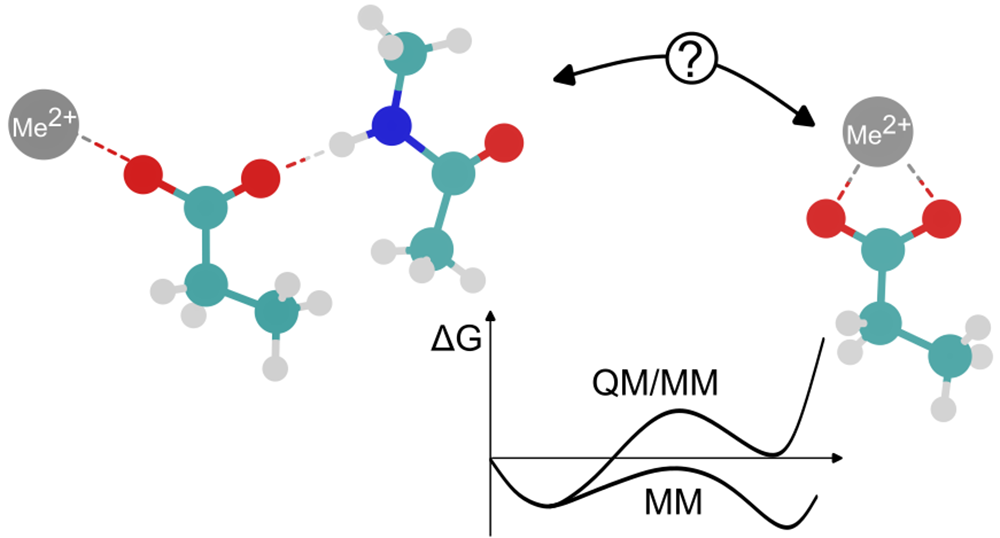
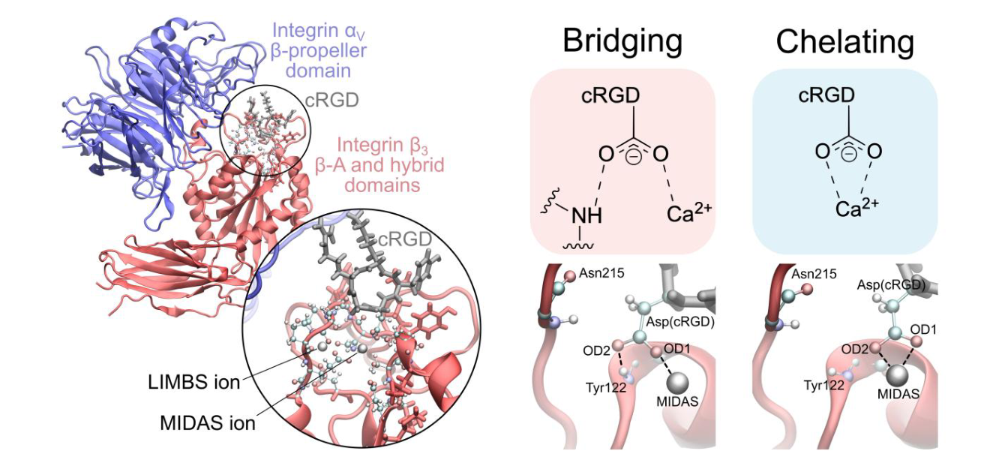
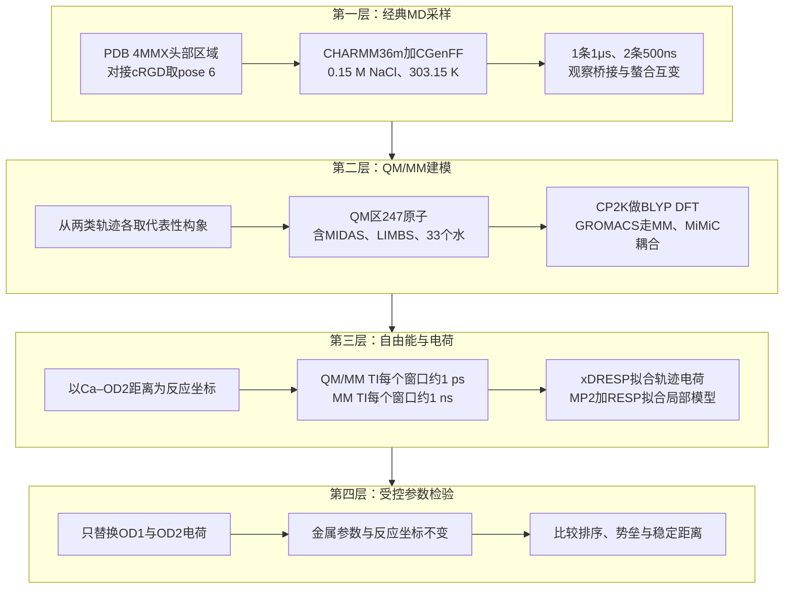
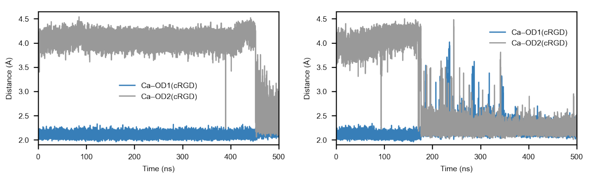
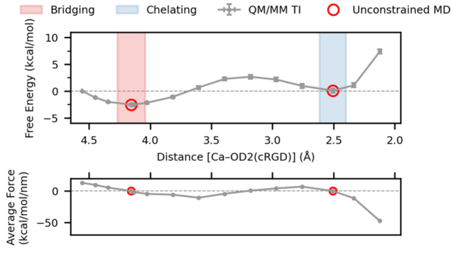
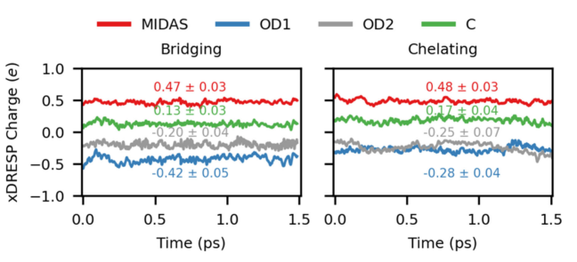
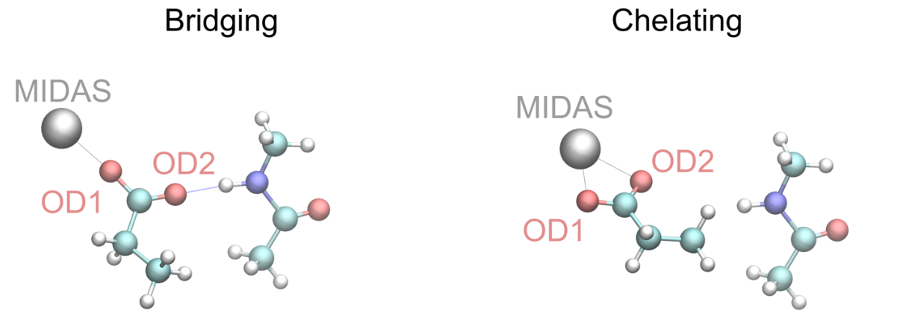
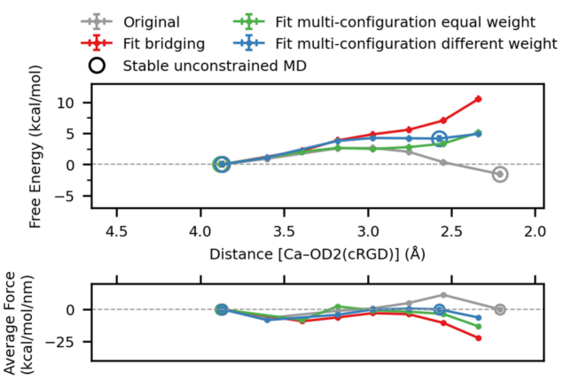
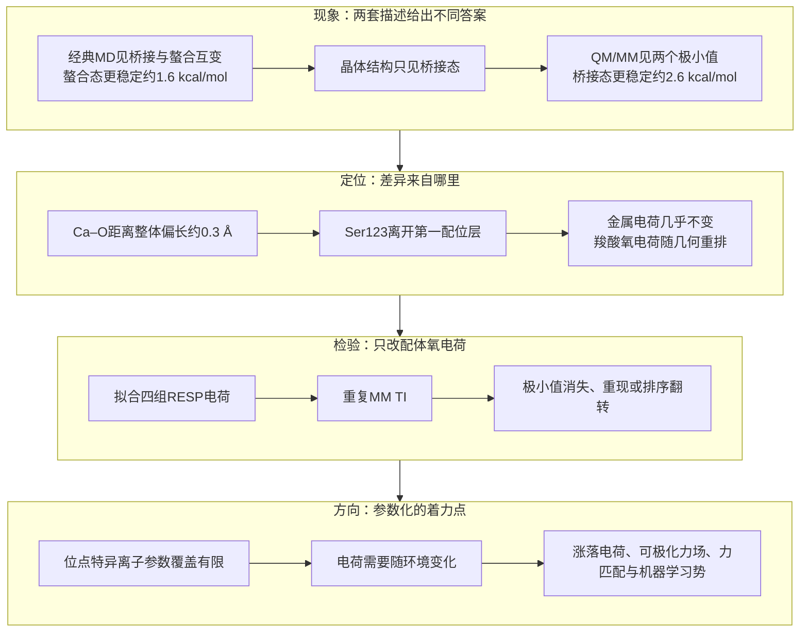

# 固定电荷力场为何误判钙离子配位稳定性？QM/MM揭示羧酸氧电荷的作用

## 本文信息

- **标题**：蛋白质中金属配位模式的固定点电荷力场局限性：整合素αVβ3中$\ce{Ca^{2+}}$的多层次研究
- **发表期刊**：Journal of Chemical Theory and Computation
- **发表时间**：2026年10月28日
- **单位**：瑞士洛桑联邦理工学院（EPFL）计算化学与生物化学实验室；意大利米兰比可卡大学材料科学系及BioNanoMedicine Center NANOMIB
- **引用格式**：Levy, A., Frigerio, G., Grollier, J., Siani, P., Di Valentin, C., & Rothlisberger, U. (2026). Limitations of Fixed-Point-Charge Force Fields for Metal Coordination Modes in Proteins: A Multilevel Study of $\ce{Ca^{2+}}$ in Integrin αVβ3. *Journal of Chemical Theory and Computation*. https://doi.org/10.1021/acs.jctc.6c01320
- **代码与数据**：https://doi.org/10.5281/zenodo.20844406

## 摘要

> 标准生物分子力场在描述**金属配位模式**时经常表现出局限。本文结合经典分子动力学与QM/MM分子动力学，研究整合素αVβ3中由$\ce{Ca^{2+}}$介导的cRGD结合。结果显示，不同的金属配位模式对应着**金属配位原子部分电荷的变化**；把这种变化纳入力场，会**显著改变自由能面**。这些结果说明，基于量子力学的多层次方法对于准确刻画生物分子体系中的金属配位模式具有价值。

### 核心结论

- **两种理论层级给出相反的稳定性排序**：原始CHARMM36m/CGenFF（CHARMM通用力场）预测双齿螯合态更稳定约1.6 kcal/mol，QM/MM则预测实验可见的桥接态更稳定约2.6 kcal/mol，**自由能排序整体反转**。
- **第一配位层的配位氧数也不同**：经典MD中$\ce{Ca^{2+}}$平均与约3个蛋白氧配位，QM/MM中只有约2个，**差别主要落在Ser123侧链是否留在第一配位层**。
- **配位几何改变的是配体氧的电子分布**：xDRESP分析中OD1的有效电荷从桥接态的−0.42 e变为螯合态的−0.28 e，而**金属离子本身的拟合电荷几乎不变**。
- **只改两个羧酸氧的固定电荷就能改变自由能面**：部分RESP电荷组合下螯合态的局部极小值直接消失，但**任何一组静态电荷都无法同时复现QM/MM的能量差、势垒与稳定距离**。

## 背景

固定点电荷原子力场用成对加和势描述原子间相互作用，能把体系推到几十万原子、微秒尺度，广泛用于生物分子模拟。电荷转移、极化、金属配位和阳离子–$\pi$相互作用则落在**这套函数形式能表达的自由度之外**。金属配位尤其棘手，静电、极化与配体竞争共同决定配位几何，而原子电荷在整段模拟里始终固定。PDB中约33%的结构含有金属离子，这类体系的可靠性直接关系一大批模拟结论。

整合素αVβ3是一个具体的检验场景。它是细胞表面黏附受体，在多种肿瘤中过表达，也是RGD肽靶向递送与抗肿瘤药物（如cilengitide）长期关注的对象。蛋白全长超过1600个氨基酸，多数配体与药物设计工作只能依赖固定点电荷力场。它的配体结合口袋里恰有一个二价金属位点，即**金属离子依赖性黏附位点**（Metal Ion-Dependent Adhesion Site，MIDAS），直接配位RGD基序中Asp的羧酸根；旁边还有更暴露于溶剂的邻近MIDAS位点（Adjacent to MIDAS，ADMIDAS），以及埋在蛋白内部的配体诱导金属结合位点（Ligand-Induced Metal Binding Site，LIMBS）。

实验与模拟在这里给出不同图景。X射线结构只给出桥接式配位。此前基于CHARMM36m/CGenFF的经典MD却看到两种模式在轨迹中互相转化。**晶体结构提供静态快照，无法判断螯合态在溶液中是否同样可访问**；若螯合态来自力场偏差，以它为基础的构象解释和自由能计算都会受影响。QM/MM把活性位点单独用量子力学处理、环境仍交给分子力学，正好提供了判别所需的理论层级。

**现有做法与金属配位描述能力的对照**

| 现有做法 | 能回答什么 | 在金属配位上的局限 |
| --- | --- | --- |
| X射线晶体结构 | 给出单一静态配位几何 | 无法给出溶液中不同配位态的相对稳定性 |
| 经典MD（固定点电荷） | 微秒尺度的构象转化与采样 | 电荷不随配位几何变化，可能稳定出实验不支持的构象 |
| 针对金属离子的位点特异参数 | 改善离子–配体距离或水合性质 | 只调整金属一侧，配体原子的电子响应仍在参数之外 |
| QM/MM MD | 显式处理配位位点的电子结构 | 计算代价高，可达时间尺度远短于经典MD |

## 研究内容

### 桥接式与双齿螯合式的几何差异

本文的计算集中在MIDAS的$\ce{Ca^{2+}}$上。两种模式的差别落在Asp羧酸根两个氧原子的空间排布：

- **桥接式**（bridging）：OD1直接与$\ce{Ca^{2+}}$配位；OD2则与整合素β链Tyr122的主链酰胺形成氢键，兼顾金属配位与蛋白接触。
- **双齿螯合式**（chelating）：OD1、OD2都直接与$\ce{Ca^{2+}}$配位，羧酸根以双齿方式配位金属离子。

要靠QM/MM的比较才能分清：**螯合态是溶液中的真实构象，还是固定电荷力场的偏差**。

**图1：整合素αVβ3与cRGD的模型体系及MIDAS的两种配位模式**。左图为模拟所用的头部区域，蓝色是αV亚基、粉红色是β3亚基，圆圈内以球棍模型标出QM/MM模拟采用的QM区，灰色球为MIDAS与LIMBS金属离子；右侧粉红底对应桥接式、蓝底对应螯合式，上下两排分别给出二维示意与无约束QM/MM MD的起始构型。

两种示意里OD1始终连着金属，变化集中在OD2：桥接时它转向Tyr122形成氢键，螯合时转而配位$\ce{Ca^{2+}}$。**同一个羧酸根在两种模式下承担不同的相互作用**。

### 多层次模拟流程：从经典MD到QM/MM TI

研究采用从长时间经典MD到短时间高精度QM/MM，再到自由能计算、电荷分析与参数检验的流程。**两种方法都从相近的蛋白与配体构象出发**，可以较直接地观察势能描述方式对配位结构的影响。

#### 经典MD：体系搭建与长时采样

体系从PDB结构4MMX出发，保留整合素αVβ3的配体结合头部区域，把环状RGD肽c(RGDyK)（文中简称cRGD）对接到结合口袋。SI说明，6个候选对接构象借助与已知RGD复合物（PDB 1L5G）的几何一致性筛选，最终采用pose 6。8个晶体金属离子统一建模为$\ce{Ca^{2+}}$，结合口袋中两分子晶体水保留；**只保留含结合位点的头部结构域以控制计算量**。蛋白用CHARMM36m，配体用CGenFF，水用CHARMM修订TIP3P模型；$\ce{NaCl}$浓度0.15 M，温度303.15 K。

三条独立轨迹分别为1条1 μs、2条500 ns，**累计经典MD采样约2 μs**。此体系去除了$\ce{Ca^{2+}}$的非键相互作用修正（NBFIX），沿用此前研究评估过的参数设置。长时轨迹里两套配位几何反复互变，构成后面所有比较的起点。

**图S3：两条500 ns经典MD中Ca–OD1和Ca–OD2的距离随时间变化**。左、右子图各对应一条500 ns重复轨迹，蓝线为Ca–OD1距离、灰线为Ca–OD2距离，纵轴为距离（Å）、横轴为时间（ns）；灰线从约4 Å降到2–3 Å对应向双齿螯合式的转变。

两条重复里OD2降到2–3 Å的时刻相差数百纳秒。跳变之后OD1与OD2都稳定在2.1 Å附近，**羧酸根由单齿接触变成双齿配位，金属与配体的连接并未断开**，这也是用Ca–OD2距离作反应坐标能区分两种模式的原因。

#### QM/MM建模与短时无约束采样

从经典轨迹中分别提取桥接态和螯合态结构，建立QM/MM模型。QM区共247个原子，包含MIDAS与附近LIMBS金属离子、相关配位残基以及33个水分子，由CP2K以BLYP DFT处理；其余体系仍由GROMACS用经典力场描述，两个子系统通过MiMiC框架耦合。电子结构只在这一小块区域内显式求解，**金属位点的极化与电荷转移由此进入模拟**。

经逐步退火、升温和平衡，两种配位态各运行约10 ps无约束QM/MM MD，**两种构象在这段时间内都保持稳定**。

#### 用热力学积分重建自由能面

比较两个局部稳定态，先要定义一条反应坐标。本文选取**钙离子到cRGD羧酸氧OD2的距离**，即$\xi = r(\ce{Ca^{2+}}, \mathrm{OD2})$。

$\xi$ 是金属到OD2的距离：桥接态里OD2朝向蛋白主链，约4 Å；螯合态里OD2也配位金属，约2.3 Å。沿这条坐标得到的自由能曲线上，谷深给出相对稳定性，峰给出势垒。它只描述配位几何的局部变化，不含cRGD结合或解离的绝对自由能。

沿该距离设置若干约束窗口，计算各个窗口的平均约束力，再经热力学积分重建自由能曲线。QM/MM TI每个窗口约采样1 ps，MM TI每个窗口约采样1 ns；**两个层级共用同一条反应坐标，得到的自由能差才能直接对照**。

### 结构差异与自由能排序的反转

先看结构。桥接态与螯合态在Ca–OD2距离上清楚分开，两种理论层级都保留了这一区分，**但QM/MM给出的Ca–O距离比经典MD整体偏长约0.3 Å**。逐项均值与标准差列在表1。

两个层级的差别在第一配位层更明显：经典MD中$\ce{Ca^{2+}}$平均与约3个蛋白氧配位，QM/MM中只有约2个。定位到具体残基上，**Ser123侧链氧在经典MD里距金属约2.3 Å，到QM/MM里移到4.3–4.6 Å**，不再属于第一配位层。两种方法统计配位数时用了各自匹配距离分布的截断值，MM为2.5 Å，QM/MM为2.8 Å。

同一层级下两种结合模式的蛋白配位几乎相同，表1里总配位氧数在桥接态与螯合态之间的差别（6.0对6.8、5.0对5.9）**只来自cRGD的配位氧数**：螯合态多一个氧配位金属。层级之间的蛋白配位差别则来自Ser123。

**表1：无约束MM与QM/MM MD中的Ca–O距离与配位氧数**

| 指标 | MM桥接态 | MM螯合态 | QM/MM桥接态 | QM/MM螯合态 |
| --- | ---: | ---: | ---: | ---: |
| Ca–OD1距离（Å） | 2.10 ± 0.04 | 2.2 ± 0.1 | 2.3 ± 0.1 | 2.5 ± 0.1 |
| Ca–OD2距离（Å） | 4.0 ± 0.1 | 2.3 ± 0.2 | 4.2 ± 0.1 | 2.6 ± 0.2 |
| 总配位氧数 | 6.0 ± 0.1 | 6.8 ± 0.4 | 5.0 ± 0.1 | 5.9 ± 0.4 |
| 来自蛋白的配位氧数 | 3.0 ± 0.1 | 2.9 ± 0.3 | 2.0 ± 0.1 | 2.0 ± 0.0 |
| 来自水的配位氧数 | 2.00 ± 0.04 | 2.0 ± 0.2 | 2.0 ± 0.1 | 2.1 ± 0.3 |
| 来自cRGD的配位氧数 | 1.0 ± 0.0 | 1.9 ± 0.3 | 1.0 ± 0.0 | 1.9 ± 0.3 |

表中数值为均值±标准差；MM列取自1 μs轨迹，按Ca–OD2距离3.5 Å划分桥接态与螯合态。

**QM/MM TI显示两个配位模式都是局部极小值，桥接态更稳定约2.6 kcal/mol**，与晶体结构中的桥接构象一致。桥接态向螯合态转变需跨越约5.2 kcal/mol的自由能垒，反向势垒约2.6 kcal/mol。

**图2：QM/MM TI得到的自由能曲线与平均约束力**。上图纵轴为自由能（kcal/mol），下图纵轴为平均约束力（kcal/mol/nm），横轴同为Ca–OD2距离（Å）；灰色方块线是QM/MM TI结果，红圈是无约束QM/MM MD给出的零力点，粉色与蓝色阴影分别标出桥接态、螯合态无约束距离的标准差范围。

> 两个局部极小值在两种方法里都存在，**变的是它们的相对高度**。固定点电荷力场给出的稳定性排序与实验相反，这类误差不会在单个构型的结构检查里暴露出来。

经典力场把螯合态排得更稳定，约1.6 kcal/mol。据QM/MM势垒用Eyring–Polanyi方程估算的转变时间约1 ns与10 ps，建立在无再穿越和恒定指前因子的假设上，**只作量级参考**；10 ps的QM/MM轨迹用于检验构象稳定性，转变速率需要更长的采样才能直接得到。

### 电荷分析：响应落在配体氧上

单看金属参数，容易把这些差异归因于$\ce{Ca^{2+}}$的电荷或范德华参数。QM/MM轨迹中的电子分布给出了另一条线索：**配位配体的原子电荷会随配位几何改变**。

MiMiC中的xDRESP方法利用QM区在周围MM原子位置产生的静电势，拟合原子中心的有效电荷或电多极矩。在这套电荷划分下，MIDAS $\ce{Ca^{2+}}$的拟合电荷在两种构象中几乎不动，数值分别为0.47 e和0.48 e，符号为正；**这两个数是特定划分方案下的有效原子电荷，与形式氧化态无关**。

相比之下，羧酸氧的有效电荷在两种配位状态下分化得更明显：

- **桥接态**：OD1为−0.42 e，OD2为−0.20 e，两个氧承担的角色不同，**电荷相差0.22 e**。
- **螯合态**：OD1为−0.28 e，OD2为−0.25 e，两个氧同时配位金属，**电荷趋于接近**。

OD1在两种状态下始终配位$\ce{Ca^{2+}}$，有效负电荷仍随整体几何变化；OD2从蛋白氢键受体变成配位原子时，两个氧的电荷分布一起重新调整。**原始CGenFF把OD1和OD2都设成−0.776 e**，固定且相同。

**图3：无约束QM/MM MD轨迹末段约1.5 ps的xDRESP原子电荷**。左图为桥接态、右图为螯合态，横轴为时间（ps）、纵轴为电荷（e）；红色为MIDAS的$\ce{Ca^{2+}}$，蓝色为OD1，灰色为OD2，绿色为羧酸碳，各条曲线旁以同色标出均值与标准差。

> 金属离子的拟合电荷几乎不动，**随配位几何重新分布的是配体羧酸氧上的电子密度**。参数化的着力点因此从离子一侧移到配位原子一侧。

**xDRESP与CGenFF电荷来自不同的参数化定义**，数值只适合比较同一xDRESP方法下的构象变化，两类电荷之差需要在同一套定义下重新计算才能解释。

### 受控参数实验：只替换两个氧原子的电荷

检验电荷分布能否改变自由能面，需要把变量收窄。本文构建桥接态和螯合态的局部模型，沿用CGenFF初始电荷所用的MP2水平与`6-31G(d)`基组，用Gaussian16优化几何、Multiwfn做RESP拟合，分别得到两种状态下OD1、OD2的电荷；**其余原子的点电荷一律保持CGenFF原值**。

**图S11：桥接态和螯合态用于电荷分析的局部模型**。左为桥接态、右为螯合态，灰色球是MIDAS金属离子，红色球为氧原子（OD1、OD2以红字标注），青色为碳、蓝色为氮、白色为氢；黑色线段表示Ca–OD配位，蓝色线段表示桥接态中的氢键。结构在MP2水平配合`6-31G(d)`基组优化。

两个模型只保留配位位点附近的原子，桥接态多出一条OD2与主链酰胺的氢键。**RESP拟合时两种构象的结构差别就落在这一点上**，电荷差异因此只能来自两个氧原子。

两种构象按不同比例参与RESP拟合，连同xDRESP轨迹电荷一起列在表2：

**表2：OD1与OD2氧原子的有效原子电荷**

| 电荷来源 | OD1（e） | OD2（e） |
| --- | ---: | ---: |
| 原始CGenFF | −0.776 | −0.776 |
| xDRESP桥接态 | −0.42 ± 0.05 | −0.20 ± 0.04 |
| xDRESP螯合态 | −0.28 ± 0.04 | −0.25 ± 0.07 |
| RESP仅拟合桥接态 | −1.147 | −0.405 |
| RESP桥接/螯合各占50% | −1.063 | −0.489 |
| RESP桥接25%/螯合75% | −0.972 | −0.580 |
| RESP仅拟合螯合态 | −0.844 | −0.708 |

表中xDRESP列取自QM/MM轨迹拟合，RESP列由静态局部模型拟合，两者参数化定义不同；RESP各行其余原子的电荷都固定为CGenFF原值。

用其中的RESP电荷参数重复MM TI，自由能面对电荷非常敏感：

- **原始CGenFF**：两个自由能极小值都存在，**螯合态更稳定约1.6 kcal/mol**。
- **只按桥接态拟合，或两种构象等权拟合**：螯合态的局部极小值消失，**自由能曲线上只剩一个谷**。
- **混合权重偏向螯合态**：桥接态25%、螯合态75%时重新出现两个局部极小值，桥接态更稳定，方向与QM/MM一致；但**预测能量差约5 kcal/mol，是QM/MM结果的两倍**，反向势垒和极小值对应距离也仍有偏差。

**图4：不同RESP电荷方案下的MM TI自由能曲线与平均约束力**。上图纵轴为自由能（kcal/mol）、下图纵轴为平均约束力（kcal/mol/nm），横轴同为Ca–OD2距离（Å）；灰色为原始CGenFF，红色为仅按桥接态拟合，绿色为两种构象等权拟合，蓝色为桥接态25%、螯合态75%的混合拟合，空心圆是无约束MM MD给出的零力点。

> **静态电荷调得动结论，却定不准数值**。只换两个氧原子的电荷，稳定性方向就能翻转；能量差、势垒和极小值位置仍对不上QM/MM。要补的是电荷随配位环境的响应，继续挑一组固定数值解决不了。

## 关键结论与批判性总结

### 创新点

- **用双层级热力学积分比较两种配位态**：以Ca–OD2距离为反应坐标，在QM/MM与MM层级分别做热力学积分（TI），比较两个局部极小值的相对稳定性，不再停留在结构观察。
- **用xDRESP把电子响应定位到具体原子**：这一基于QM静电势的电荷拟合方法可从QM/MM轨迹给出原子中心有效电荷，区分金属离子与配位配体氧在构象变化中的响应，指向固定点电荷力场给羧酸根的两个氧赋相同电荷这一参数化习惯。
- **用受控的电荷替换实验检验因果**：保持金属参数、Lennard-Jones参数和反应坐标不变，只替换OD1/OD2的约束静电势（RESP）电荷并重复MM TI，把自由能面的变化单独归因于静电描述。

### 潜在影响

- **结论落在相对稳定性上**：本文比较的是同一复合物内两种微观配位模式的自由能差。数kcal/mol的差别足以改变两者的平衡分布，并影响对配体识别、局部构象变化以及后续自由能计算的解释。
- **误差的物理来源不在金属离子一侧**：常见的位点特异离子参数开发因此难以覆盖这类效应；此前针对$\ce{Mg^{2+}}$的工作也观察到类似现象。
- **给其他金属体系留下一套可复用的检查流程**：对$\ce{Ca^{2+}}$结合蛋白、$\ce{Mg^{2+}}$–RNA体系或过渡金属位点，先用常规MD列出候选配位构象，再选代表性构象做QM/MM验证，比较原子电荷与配位距离，并用受控的参数替换检验自由能变化的来源。

### 局限性

- **只覆盖一套力场组合和一个体系**：结论来自CHARMM36m/CGenFF下的整合素αVβ3头部区域，**指向固定点电荷力场的内在局限**；向其他蛋白与金属种类的推广仍需各自的参考计算。
- **QM/MM时间尺度很短**：每种构象仅约10 ps无约束采样，TI每个窗口约1 ps，所得自由能面是特定体系与理论设置下的局部比较。
- **静电被单独隔离出来**：短程排斥作用主要由Lennard-Jones的 $\sigma$ 或`Rmin`参数决定，也会影响平衡配位距离；为单独考察静电，本文刻意保持这些参数不变，与QM/MM在距离上的残余偏差因此还留有其他来源。

### 后续方向

- **涨落电荷模型与可极化力场**：允许配位原子的电荷随环境调整，对应本文观察到的电子响应。
- **以QM/MM结果为参考的力匹配或机器学习势**：把高精度局部信息转成可在更长时间尺度上运行的势函数。
- **多层次框架的衔接**：MiMiC一类支持QM/MM、可极化MM与ML/MM切换的框架，可以把高精度区域限制在结合位点，兼顾计算代价与局部精度。
- **把配体原子纳入参数化**：羧酸根的两个氧赋相同电荷是固定点电荷力场的常见做法，**针对不对称配位模式重新审视这一赋值，可能比继续修金属离子参数更直接**。
