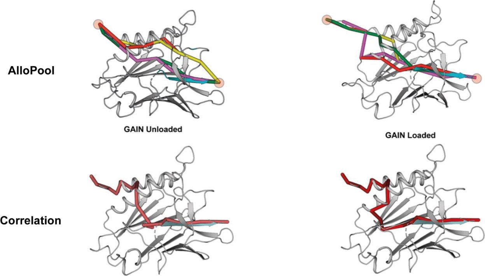
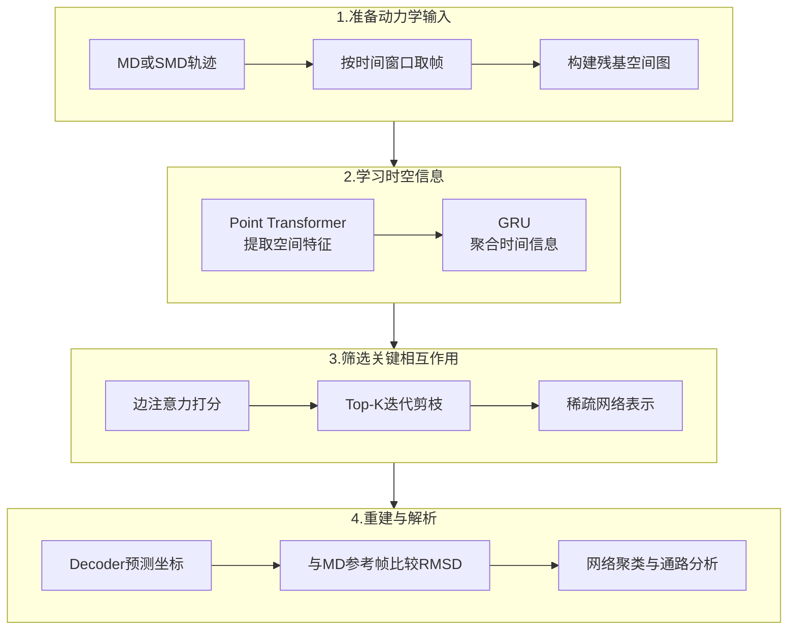
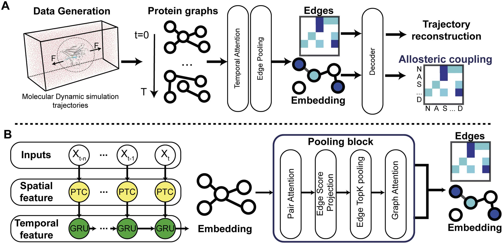
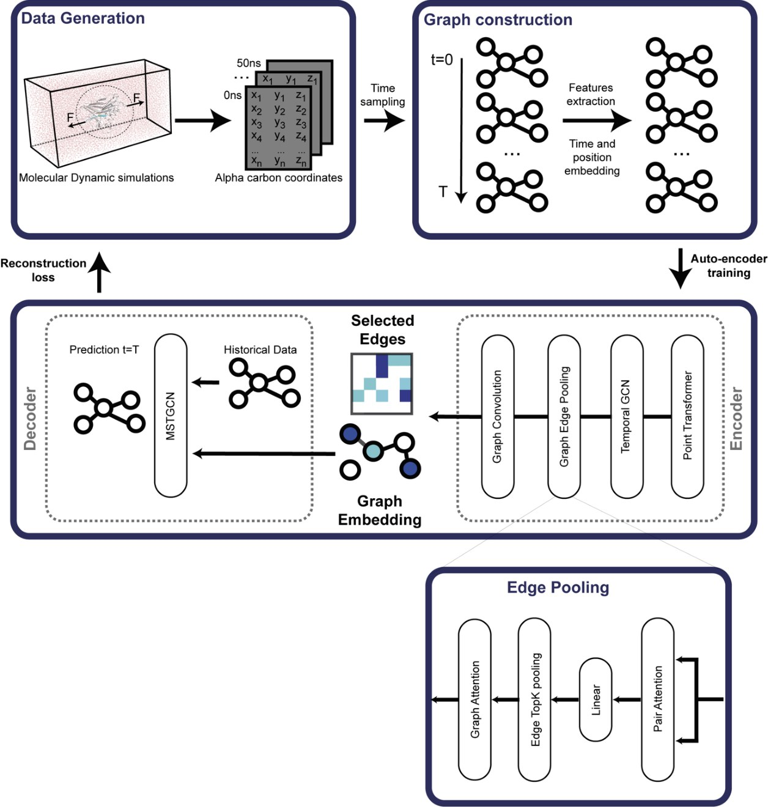
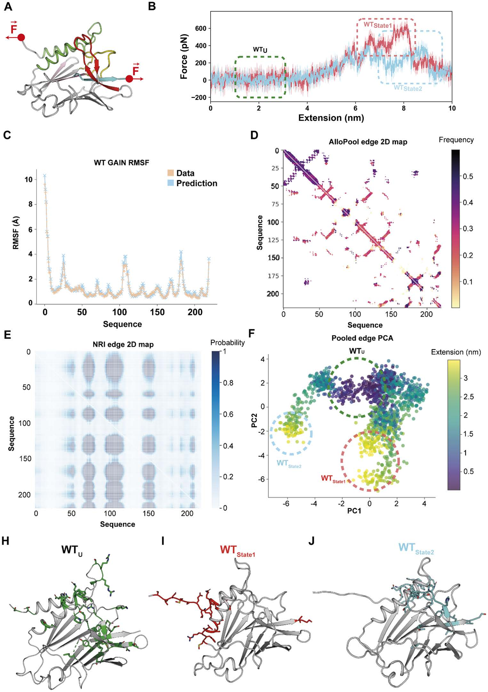

# AlloPool——从MD轨迹识别蛋白动态别构网络的深度学习工具

## 本文信息

- **标题**：AlloPool是一种从分子动力学模拟推断蛋白质别构调控的深度学习框架
- **作者**：Marfoglia, M., Pedraza-Joya, M. A., Guirardel, L., Chatzi Souleiman, A., & Barth, P.
- **发表期刊**：PLOS Biology
- **发表时间**：2026年9月21日
- **单位**：瑞士洛桑联邦理工学院（EPFL）跨学院生物工程研究所；瑞士洛桑路德维希癌症研究所
- **引用格式**：Marfoglia, M., Pedraza-Joya, M. A., Guirardel, L., Chatzi Souleiman, A., & Barth, P. (2026). AlloPool is a deep learning framework that infers protein allostery from molecular dynamics simulations. *PLOS Biology, 24*(9), e3004002. https://doi.org/10.1371/journal.pbio.3004002
- **代码与数据**：
  - 开源代码与基准测试：https://github.com/barth-lab/AlloPool
  - 示例轨迹、图表复现文件：https://doi.org/10.5281/zenodo.22148113

## 摘要

> 人工智能近年来显著推动了蛋白质结构预测与设计，但蛋白质功能还取决于构象动力学，使其能够访问不同的功能状态。由于缺少高分辨率实验数据，训练预测动力学与能量性质的机器学习模型仍然具有挑战。本文提出AlloPool，一种基于**图神经网络（GNN）**&#x7684;框架，通过迭代筛选残基间相互作用，从分子动力学模拟中识别控制蛋白构象动力学及其对化学或机械扰动响应的**最简、随时间变化的相互作用网络**。AlloPool将时间注意力与图聚合结合，从平衡和非平衡MD轨迹学习动态相互作用图，准确重建动力学轨迹，并识别与构象转换有关的相互作用网络。该方法在结合结构域、机械感受器、信号受体和酶等体系中得到验证，能够识别别构通讯通路、解析配体结合、机械力和突变的影响、发现短暂存在的动力学状态，并在轨迹重建方面优于现有机器学习方法。这一框架为理解蛋白质动力学，以及药物发现、合成生物学和蛋白质工程中的构象调控提供了新的分析工具。

### 核心结论

- **模型的主要产物是动态残基网络**：从MD轨迹中识别**对构象变化具有预测作用的残基间连接**，并用这些连接重建轨迹、分析构象状态和作用通路。
- **边筛选提升了轨迹重建能力**：在六个测试体系中，AlloPool的平均重建RMSD为0.64–0.95 Å，优于NRI的1.63–5.72 Å；**训练与推理效率也有所提升**。
- **动态网络与功能变化相联系**：方法覆盖机械去折叠、GPCR激活、配体效能、PDZ突变、蛋白折叠稳定性以及Pin1结构域间别构等场景。
- **当前实现按蛋白体系分别训练**：输入是已有MD轨迹的几何信息，**适合挖掘体系内的动力学机制和候选别构残基**。

### 创新点

- **把边筛选直接写进编码器**：时间窗口内的结构特征学习、GRU时序聚合、Attention边打分和Top-K迭代剪枝连成一套，用轨迹重建误差约束所保留的相互作用。
- **每个时间窗口给出自己的网络**：相比先算相关矩阵、再单独找通路的传统流程，边的去留由训练决定，状态分类与通路分析都建立在这批随时间变化的网络上。

## 背景：从MD轨迹里找出对运动关键的相互作用

蛋白质的别构（Allostery）通常表现为：配体结合、外力或突变发生在某个位置，却改变了远端区域的构象与功能。研究者可以用分子动力学（MD）模拟观察这种变化，但一条几十万帧的轨迹本身很难回答：**哪些残基间相互作用参与了构象转换**、它们在不同时间又怎样变化？

常见的动力学网络分析将残基视为节点、残基间接触视为边，再根据相关性、互信息（Mutual Information，MI）或者微扰响应扫描（Perturbation Response Scanning，PRS）寻找通讯通路。相关性能够识别协同运动，PRS则通常采用线性响应近似。然而，对机械去折叠和复杂构象转换等非线性过程，**固定网络或单一相关性统计难以反映状态切换时相互作用的变化**。

机器学习中的神经关系推断（Neural Relational Inference，NRI）能够从轨迹学习残基间的潜在联系。AlloPool沿着这个思路再引入**时间信息和迭代边筛选**，要求模型在保留较少残基连接的情况下尽可能准确地重建动力学。保留下来的边，是模型重建这段轨迹时用得最多的连接。

> 别构通讯的难点是**连边本身随构象状态更换**：残基在活化和失活过程中承担的连接可能差别很大，中间态的短暂耦合需要一个按时间窗口更新的图才能显出来。

以机械感受器GAIN结构域为例，两种做法给出的通路可以画在同一结构上：

**图S5：同一体系上AlloPool与相关性方法给出的通路对比**

- 上排：AlloPool在未受力与受力两种状态下给出的高分连接，**多条局部连接分散在结构各处，两种状态下换了一批**。
- 下排：相关性方法给出的通路，**基本是一条贯穿全蛋白的粗路径**，两种状态差别很小。
- 差别在于：相关性回答的是“哪些残基一起动”，边筛选回答的是“**哪些连接对预测下一帧运动是必需的**”，只有后者会因状态而异。

### 关键科学问题

- **如何识别随构象状态变化的残基网络**？同一蛋白在不同时间可能形成不同的接触和协同运动模式，**时间平均网络容易掩盖短暂中间态**。
- **如何从大量接触中筛出与运动有关的连接**？密集残基网络包含丰富的空间邻接信息，但**接触频繁的残基未必都对目标动力学预测有同样贡献**。
- **动态网络能否对应可验证的生物学效应**？有用的网络应当**与实验已知的激活状态、配体效能、机械稳定性和突变影响对得上**。

## 研究内容：AlloPool的工作原理

整套流程分四步：**从轨迹建图、学习时空特征、逐层筛边、重建坐标**。

图1给出这些步骤在模型里的实现：**上半部分把轨迹变成边，下半部分训练网络**。

**图1：AlloPool从模拟轨迹学习随时间变化的别构相互作用网络**

- A：将MD/SMD轨迹按时间采样并转换为残基图；编码器筛选关键连接，解码器根据稀疏网络重建轨迹中的原子位移，最终得到**描述动态耦合的边矩阵**。
- B：空间特征通过Point Transformer提取，时间序列由GRU聚合；**多个Pooling Block依次做边注意力打分、Top-K筛选和图特征更新**。

> 残基间通讯原本是个模糊的问题，这四步把它变成一个**可以用坐标重建误差直接检验的预测**：边的取舍由重建精度决定，别构通路再从网络里读出来。

### 1. 一帧轨迹怎样变成图？

每个残基对应一个节点，**边表示一段时间内经常靠近的残基对**。对每个时间窗口，若两个残基在至少30%的帧中距离小于15 Å，就将它们纳入初始边集合，先把大量相距遥远、没有直接接触基础的连接排除掉。

节点包含**13维几何和运动特征**，再附加64维位置编码：

| 输入信息  | 具体内容 | 作用|
| ----- | ---------------------- | ------------- |
| Cα碳坐标 | Cα的三维位置，3维 | 表示残基骨架的位置  |
| Cβ坐标  | Cβ的三维位置，3维；Gly以氢原子代替Cβ | 表示侧链方向附近的几何信息 |
| 主链二面角 | 主链二面角的正弦与余弦，共4维  | 用连续特征描述局部构象|
| 位移近似  | 连续帧间Cα坐标变化，3维 | 提供运动方向和幅度信息|
| 位置编码  | 64维绝对位置嵌入  | 保留残基在蛋白序列中的位置 |

残基图只描述蛋白本身：**配体、金属离子及其化学身份并未作为独立图节点进入当前模型**。它们对蛋白动力学的影响，只能通过不同结合状态下的MD轨迹间接体现。

### 2. 时间注意力与Edge Pooling怎样配合？

空间编码器使用Point Transformer提取每帧残基周围的结构信息，随后由门控循环单元（Gated Recurrent Unit，GRU）汇总时间窗口中的变化，**获得同时包含空间和时间信息的潜在图表示**。

每个Edge Pooling模块依次执行三件事：

1. **给边打分**：Pair Attention根据连接两端残基的表示，学习它们对轨迹重建的重要性，并生成边分数。
2. **保留高分连接**：通过Sigmoid和Top-K选择高分边，移除本轮评分较低的连接，逐层形成稀疏图。
3. **更新残基表示**：Graph Attention使用筛选后的边传播信息，使下一层继续评估更紧凑的相互作用网络。

> 最终，每个时间窗口都有一张经过压缩的作用网络。**每条边在多大比例的时间窗口里被保留，就是它的筛选频率**（pooling frequency），可用来标记重要残基、比较不同状态，以及建立可能的别构通讯通路。

完整架构见图S1：

**图S1：从MD轨迹到稀疏网络的完整架构**

- **数据生成与图构建**：MD模拟输出α碳坐标，按时间采样成帧序列；**每帧转为一张残基图**，并加入时间与位置编码。
- **编码器**：Point Transformer提取空间特征，时序GCN汇总时间信息，**Graph Edge Pooling负责逐层筛边**。
- **Edge Pooling内部**：Pair Attention先给边打分，经Linear映射后做Edge Top-k筛选，Graph Attention再在保留的边上更新节点表示。
- **解码器**：MSTGCN用历史帧预测下一帧，重建误差回传，**整条链路端到端训练，边的去留由重建精度决定**。

### 3. 模型怎样训练，结果又怎样分析？

解码器采用时空图卷积网络，**从压缩后的图表示预测目标帧的Cα坐标**。训练时使用Kabsch–Umeyama算法对齐预测结构与参考结构，并最小化两者的RMSD：

$$
\mathcal{L}(\theta)=\operatorname{RMSD}\!\left(\operatorname{KU}\left(\widehat{\mathbf X}_{\theta},\mathbf X\right)\right)
$$

因此模型可以在**只需要坐标重建监督、无需预先标注别构路径**的情况下学习网络。

选重建当目标，是因为位移是轨迹里稠密、又不需要人工标注的量：每一帧都在提供监督信号，而别构通路从来没有标签。

代价是模型只学下一帧需要保留哪些连接，不直接学能量或自由能。**它对状态稳定性的判断来自运动特征，而非热力学量**。

> 重建只是训练手段，**交付物是每个时间窗口一张稀疏、有向、带筛选频率的残基作用图**，不是某一条关键边。模型只预测下一帧的Cα位移，**不产生任何新构象**，不能替代MD或增强采样。

模型每一步都拿到真实的前一帧，只预测下一帧的位移。后面所有结果用的都是已经跑好的轨迹，比较的对象始终是不同状态之间边集的差异。

训练完成后，这批边可以按几种方式使用：**对各窗口的边矩阵**做主成分分析（PCA）和谱聚类，划分动力学状态；**把筛选频率转成路径权重**，在指定蛋白区域之间寻找高分连接路径；**取出最能区分状态的判别边**，映射回结构；或者**把边频率当作特征**，与配体效能、突变表型等实验量建立关联。

如果边$e$的筛选频率为$s_e$，路径$P$包含$n$条边，路径分数可写为：

$$
s_P=\left(\prod_{e\in P}s_e\right)^{1/n}
$$

路径分数就是各边筛选频率的**几何平均数**；连接强、整体分数高的路径会排在前面。排序结果可以解释，但仍需要与结构、实验或其他动力学分析对照，判断这些连接实际参与了怎样的物理过程。

### 4. MD数据和训练设置

本文使用GROMACS 2022.4和CHARMM36系列力场，在310 K、1 bar下生成平衡MD轨迹；膜蛋白置于POPC脂质双层。常规设置为**5条独立、每条200–400 ns的轨迹**，并保留一条独立重复轨迹用于测试；部分体系采用已有公开轨迹，需要施加外力的体系则另用拉伸分子动力学（Steered Molecular Dynamics，SMD）设置拉伸协议。

| 项目| 论文中的设置 |
| ---- | ------------------------------------ |
| 原始轨迹 | MD或SMD；一般每10 ps保存一次坐标 |
| 时间窗口 | 每次抽取5帧，文中说明按10帧间隔采样|
| 图边筛选 | 在窗口至少30%的帧内距离小于15 Å|
| 优化器  | Adam，初始学习率$10^{-4}$，weight decay为0.1 |
| 模型选择 | 保存训练epoch平均损失最小的checkpoint  |
| 模型评估 | 使用训练中未见过的一条独立测试轨迹  |

时间窗口的采样间隔存在一处出入：按“每10 ps保存一帧、每隔10帧选5帧”推算，首末帧间隔是400 ps，Methods则写窗口覆盖1 ns。**复现时以代码里的采样参数为准**。

## 结果概览

六组体系各自回答一类问题：

- 结果一：GAIN结构域的机械去折叠，先检验边集本身的重建能力。
- 结果二：SdrG与纤维蛋白原肽的复合物，追查力传递通路。
- 结果三：多巴胺D2受体的激活转换，划分活化、中间与失活态。
- 结果四：β1肾上腺素能受体的配体效能，与药理数据对齐。
- 结果五：PDZ3与Engrailed homeodomain的突变，看网络如何偏离结构预测。
- 结果六：Pin1的配体依赖性结构域间别构。

六组结果的做法一样：**先把模型训练好，再换掉一个变量，看边集怎么变**。结果一换的是对照方法，检验边集本身的质量；结果二、三换的是受力状态；结果四换的是配体；结果五换的是突变；结果六换的是结合肽段。各节所用的轨迹都是事先跑好的MD或SMD，模型负责读出每个时间窗口的边，**不生成任何新构象**。

> 训练只做了一件事：**为每个时间窗口筛出一张残基连接图**。六组结果的区别，一是换掉哪个变量，二是从这张图里取什么来算。

每张图用了边集的哪一部分、又得到什么：

| 图 | 用的是AlloPool的什么 | 得到什么 |
| --- | --- | --- |
| 图2F、图4A | 各窗口的**边矩阵**做PCA/聚类 | 按网络结构划分受力态、活化/中间/失活态 |
| 图2G–I、图4F–H | **最能区分状态的判别边** | 各状态的特征残基连接 |
| 图3C、图6E、图8E–G | 边频率当**路径权重** | 力传递、别构信号的传递通路排序 |
| 图5E–G | 边频率**当特征用** | 与配体效能做相关、回归 |
| 图6F–G、图7C–D、图8B–D | 不同突变体/配体态的**边集差异** | 突变、配体怎样改变网络 |
| 表1、图2C、图4C–E | 重建的坐标与RMSF | 检验模型是否学到动力学 |

机械感受器GAIN结构域的结果：

**图2：从SMD轨迹读出受力状态与判别边**

- A–C：施加拉力后结构逐步展开，**重建RMSF标出模型重点抓住的运动区域**。
- D：**每个时间窗口筛出一张边图**，纵轴是残基对、横轴是时间窗口、颜色是筛选频率；E是相关性方法给出的对照。
- F：对各窗口边图做PCA，**窗口沿时间聚成几组，对应不同的受力状态**；G–I给出区分这些状态的判别边。

SMD的力—伸长曲线、跨膜螺旋间距、Rosetta稳定性、实验结构和NMR通路，都是MD或外部方法给出的**验证量**，用来检验或解释边集，**不是AlloPool的产出**。

六组体系的具体结果、对应的图与表格，以及软件使用说明，见下&#x7BC7;**《AlloPool解读（下）：六组体系的具体结果》**（明天发）。

## 关键结论与批判性总结

AlloPool交付的是一组**可按时间窗口检索的残基作用网络**，轨迹重建只是训练它学会筛选连接的手段。

> 动态网络的产出更适合当作**待验证的机制假说**：它把几十万帧轨迹归纳成一组可以拿去做突变、做增强采样的残基，结论的强度由后续实验决定。

**潜在影响**：

- 别构分析从静态相关网络变成**随时间更新的相互作用图**，机械去折叠、受体激活这类**非平衡过程**能逐窗口看，这一点是PRS的线性响应近似覆盖不到的。
- 同一流程可用于**预测配体效能排序、定位别构位点、无监督划分功能状态**，为GPCR药理、药物设计和蛋白功能调控给出候选靶点与机制解释。

**局限性**：

- **模型依赖目标蛋白的MD采样**。当前网络不编码氨基酸身份与化学相互作用，需要针对不同蛋白和轨迹重新训练。**它适合解释已采样的动力学信息**，不具备跨体系泛化能力。
- **筛选频率高的边只是提示**。它可用来筛选别构通路、设计突变验证，却**不足以单凭边方向和相关性确认信号传递的因果方向**。
- **结构状态的覆盖仍由MD决定**。在L16A等案例中，即使没有采到实验中的螺旋脱离构象，动态网络也能提示局部失稳。**要得到新的状态分布和自由能差异，仍需增强采样及热力学分析**。

**未来方向**：

- 重新设计编码器与解码器，**引入序列、结构与理化信息**，并整合**蛋白语言模型嵌入**，让网络带上氨基酸身份和化学背景。
- 以**更高分辨率的表示**捕捉原子级动力学决定因素，并纳入**实验约束**校正网络中的虚假耦合。
- 引入**因果推断框架**强化方向性通讯通路的识别，把AlloPool从体系特异的分析工具做成一个**解码、预测并工程化蛋白构象动力学的通用框架**。
