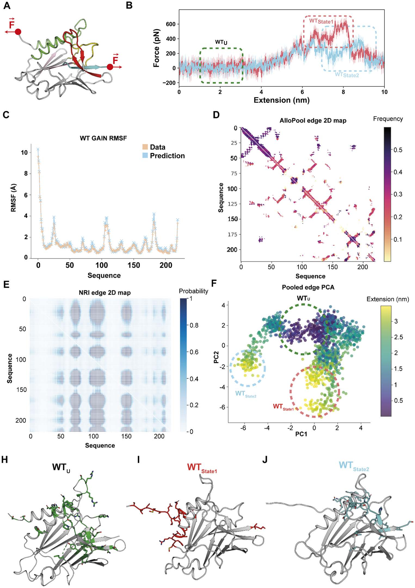
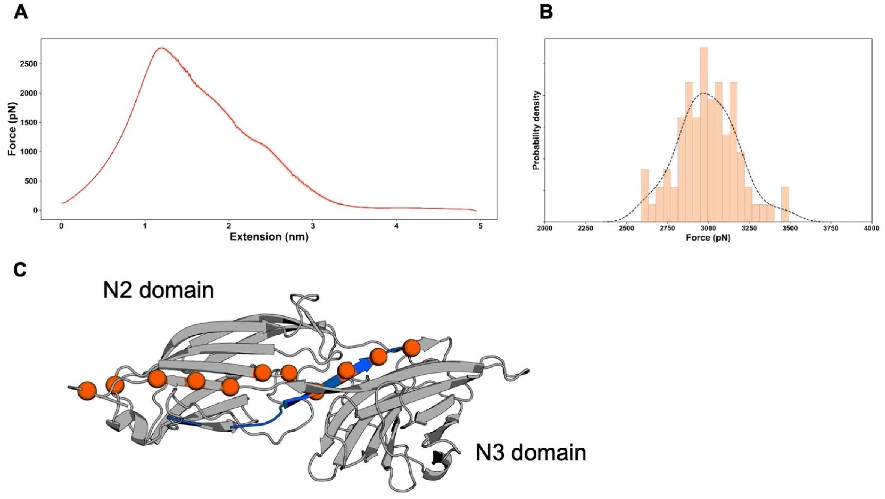
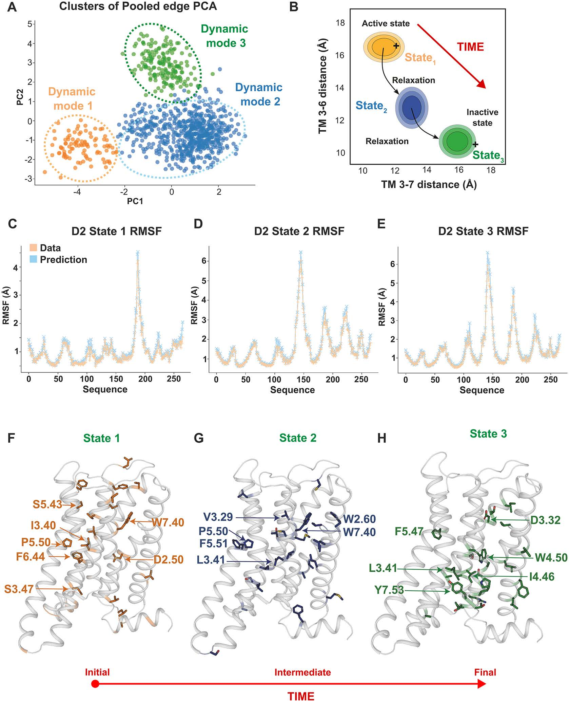
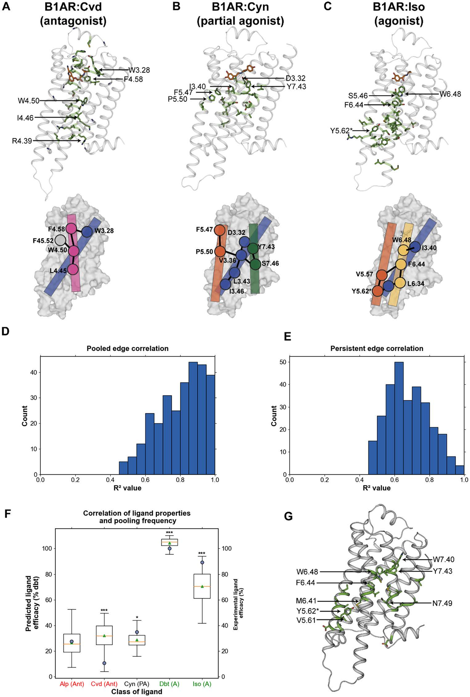
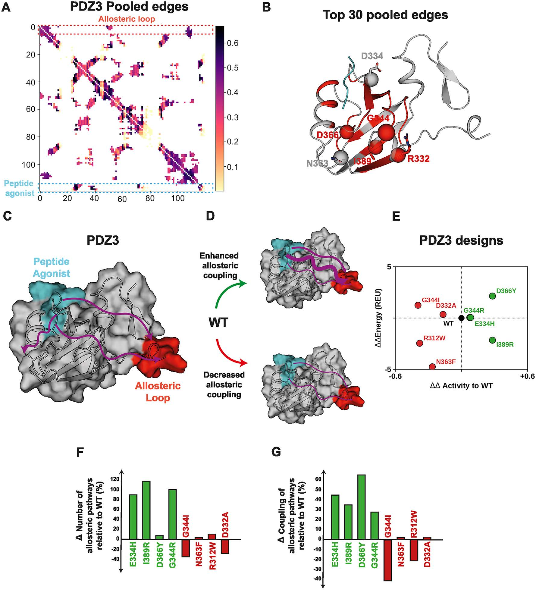
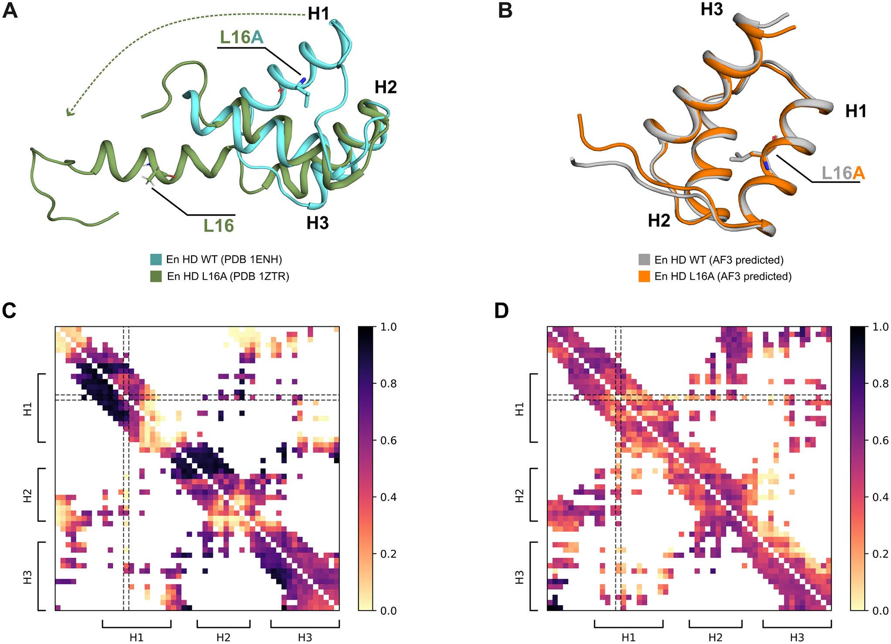
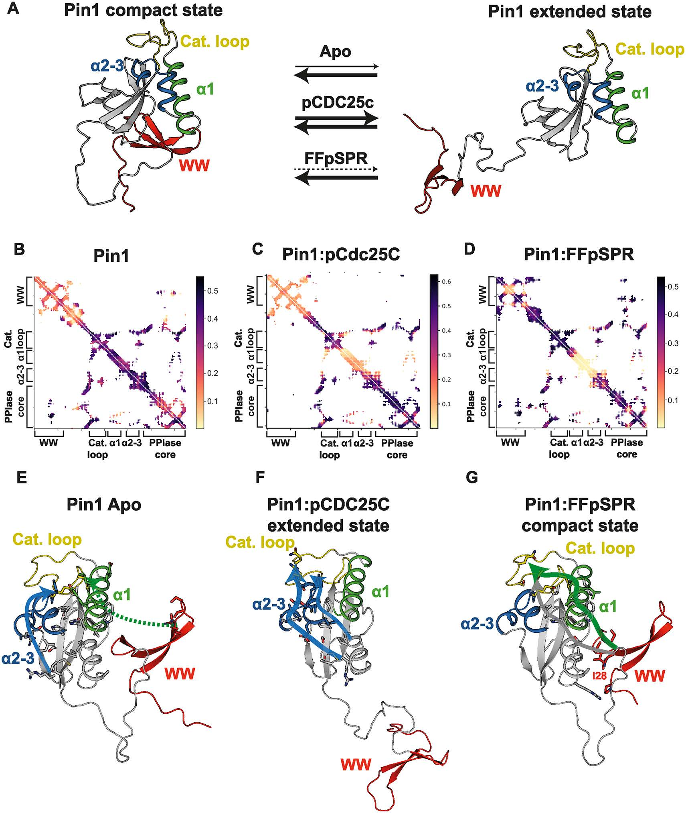

# AlloPool解读（下）：六组体系的具体结果

这是AlloPool解读的下篇。上篇讲清了框架、训练目标和交付物，这里按六组体系逐一看具体结果；方法与判据不再重复，需要时回看上篇。

## 本文信息

- **标题**：AlloPool是一种从分子动力学模拟推断蛋白质别构调控的深度学习框架
- **作者**：Marfoglia, M., Pedraza-Joya, M. A., Guirardel, L., Chatzi Souleiman, A., & Barth, P.
- **发表期刊**：PLOS Biology
- **发表时间**：2026年9月21日
- **单位**：瑞士洛桑联邦理工学院（EPFL）跨学院生物工程研究所；瑞士洛桑路德维希癌症研究所
- **引用格式**：Marfoglia, M., Pedraza-Joya, M. A., Guirardel, L., Chatzi Souleiman, A., & Barth, P. (2026). AlloPool is a deep learning framework that infers protein allostery from molecular dynamics simulations. *PLOS Biology, 24*(9), e3004002. https://doi.org/10.1371/journal.pbio.3004002

## 结果一：更少的边，反而能更准确地重建轨迹

第一组评测把AlloPool与神经关系推断模型NRI对照，覆盖Pin1、GAIN机械感受结构域、D2多巴胺受体以及β1肾上腺素能受体（B1AR）等多个体系。**重建误差在这里充当对边集的间接检验**：只留少量连接还能重建轨迹，说明留下的连接确实承载了运动信息；**AlloPool在六组比较中都获得了更低的重建RMSD（Cα/主链层面）**，并较准确地再现各残基的RMSF分布。

**表1：AlloPool与NRI在MD轨迹重建中的表现**。下表数据来自原文Table 1，RMSD单位为Å；VSD为RMSF数值的标准差，越低代表重建波动越小。

| 体系 | NRI RMSD | AlloPool RMSD | NRI VSD | AlloPool VSD | AlloPool RMSF Pearson $r$ |
| --- | ---: | ---: | ---: | ---: | ---: |
| Pin1 apo | 4.83 ± 0.41 | 0.95 ± 0.23 | 0.39 | 0.08 | 0.9990 |
| Pin1–FFpSPR | 1.63 ± 0.12 | 0.93 ± 0.17 | 0.24 | 0.04 | 0.9878 |
| Pin1–pCdc25C | 5.72 ± 0.32 | 0.82 ± 0.12 | 0.91 | 0.08 | 0.9982 |
| GAIN | 2.90 ± 0.24 | 0.89 ± 0.10 | 0.16 | 0.04 | 0.9939 |
| D2DR | 2.89 ± 0.42 | 0.89 ± 0.19 | 0.28 | 0.07 | 0.9975 |
| B1AR | 3.12 ± 0.18 | 0.64 ± 0.09 | 0.31 | 0.04 | 0.9967 |

在GAIN的消融实验中，完整模型的RMSD为0.89 Å；移除时间注意力后增至1.3 Å，移除Pair Attention后增至2.1 Å。两个模块都对准确重建构象变化有帮助，**负责选择关键残基连接的注意力模块影响更大**。

计算方面，NRI需要处理接近全连接的残基图，边数随残基数量呈平方增长；AlloPool从空间稀疏图开始，再逐层剪枝。论文在PDZ、Pin1和D2DR测试中报告**最高约50倍的训练或推理效率改善**，并降低内存需求。两种架构的层数不同，这里比较的是实际整体效率。

> 边数下降的同时重建误差也下降，说明**被剪掉的连接对这段轨迹的运动没有解释力**；稀疏网络里留下的，才是模型实际用到的动力学信息。

## 结果二：机械去折叠过程中，受力网络怎样变化？



**图2：AlloPool区分GAIN结构域在拉伸过程中的不同受力状态**

- A、B：在结构域两端施加拉力，SMD的力—伸长曲线显示两种不同的受力状态（红、蓝）。
- C–E：重建RMSF与MD结果接近；AlloPool的边图（D）比NRI的边概率图（E）更集中地标出特定残基连接。
- F：将各窗口筛选的边投影到PCA空间后，可区分未受力状态与两种受力状态；颜色同时反映伸长程度。
- H–J：不同状态对应不同的结构连接，涉及螺旋、环区、β链和Stachel肽。

GAIN（GPCR蛋白酶自水解诱导）是黏附类GPCR中的机械感受结构域。拉伸可能改变其结构并**释放具有激动作用的Stachel肽**（又称栓系激动剂）。这里的轨迹来自**事先跑好的全原子SMD**，拉伸速度覆盖1至10 Å/ns。模型在这批非平衡轨迹上训练，在构象大幅变化时仍保持准确的轨迹重建。

**拉伸状态改变后，筛选频率高的边也换成另一组**。这里的比较在同一条SMD轨迹内部完成，按拉伸程度切窗口即可。未受力状态中的关键连接主要涉及H1/H2螺旋、部分环区和Stachel肽；两个受力状态则表现出不同的螺旋间接触、疏水堆积及局部受力网络。由这些边连出的路径，**与常规相关性方法给出的部分力传递路径相吻合**。



**图3：细菌黏附蛋白SdrG与纤维蛋白原肽复合物的力传递网络**

- A、B：SMD的力—伸长曲线及不同重复下的界面断裂力分布，显示该复合物极高的机械稳定性，界面断裂力可超过2 nN。
- C：推断的高分力传递路径主要经过SdrG的N2、N3结构域及其连接区域；蓝色为结合的纤维蛋白原肽，橙色节点标出所识别的关键连接位置。

SdrG的结果展示了同一分析流程对另一类受力蛋白的适用性。该复合物能承受超过2 nN的拉力，文献将这种极端机械稳定性归因于**拉力沿整条纤维蛋白原肽分散、且肽被紧密限制在结合口袋内由广泛氢键网络固定**；AlloPool从已有SMD轨迹中还原出**承担机械应力传递的残基连接网络**，并把高载荷定位到N2、N3结构域的残基上，指认抗拉伸的机制由哪些子结构承担。

> 受力状态一换，关键连接整组换掉。AlloPool留下的边**还带方向与强弱差异，能反映力的流向**。相关性统计不分方向，PRS又把响应当作静止态涨落的线性外推，都难覆盖机械去折叠的强非线性。

## 结果三：GPCR的活化中间态可以从动态网络中识别



**图4：AlloPool识别多巴胺D2受体由活化态向失活态转变时的动力学状态**

- A、B：边矩阵的PCA与聚类给出三个动态模式，分别对应活化、中间和失活构象；TM3–6和TM3–7间距用于展示其结构状态。
- C–E：三个状态中，模型预测的RMSF与真实MD轨迹相符。橙色表示原始数据，蓝色表示预测。
- F–H：各状态特征性残基连接分别映射到受体结构；涉及PIF、W-toggle等已知GPCR活化相关微开关。

D2受体这条轨迹是常规平衡MD：从去除激动剂和G蛋白的活化构象开始，随后向失活构象弛豫。使用约2 μs累计轨迹训练后，AlloPool将不同时间窗口的边网络聚类，得到**活化态、过渡中间态和失活态**。这些分类与跨膜螺旋距离等常见结构指标吻合。

与先指定某个构象坐标作为分类标准相比，AlloPool根据学习到的边分布划分状态，再用结构指标解释每一类。想找**过渡过程中发生改变的远端残基耦合**，可以这样绕开预先指定的坐标。

> 这里的分类**不依赖预设的反应坐标**：轨迹先按网络结构自行聚类，再用跨膜螺旋间距辨认每一类。先由网络划分、再用结构指标解释，顺序上与先定坐标再投影的传统流程正好相反。

## 结果四：不同GPCR配体对应怎样的别构网络？



**图5：不同配体效能的β1肾上腺素能受体具有不同的残基耦合网络**

- A–C：按图内标签，拮抗剂卡维地洛（carvedilol，Cvd）、部分激动剂氰吲哚洛尔（cyanopindolol，Cyn）和激动剂异丙肾上腺素（isoprenaline，Iso）的受体结构及代表性高耦合残基；绿色为相关残基。
- D、E：每个残基横跨五个配体各算一个相关系数，两图分别是这些相关系数的分布，D对应AlloPool的筛选频率，E对应常规接触持续性。原文图注与正文在这两图的指标顺序上存在互换。
- F、G：挑出与效能相关最强（$R^2$>0.8）的残基，用其边向量做偏最小二乘回归，G为这些残基在结构上的位置。

研究者为五种不同效能配体结合的B1AR各跑一套平衡MD，分别训练独立模型。这是**五个独立体系之间的横向比较**，每个体系各训练一个模型。随着配体从拮抗剂转向激动剂，**网络由TM3–4附近逐渐扩展到TM3、TM5、TM6和TM7区域**，同时涉及PIF和W-toggle等激活微开关。

拿常规的接触持续性（contact persistency，即一对残基有多长时间待在一起）当对照。具体做法是：每个残基在一个配体体系里先汇总成一个值，接触持续性就是它和别的残基待在一起的总时长，AlloPool这边就是该残基所有边的筛选频率之和；五个配体体系给出五个值，再和这五个配体的实验效能配对求Pearson相关。这样每个残基得到一个$r$，图5D、5E画的就是全部残基这些$r$的分布。对照方法大多挤在低相关区，AlloPool的分布明显右移，原文称不少残基达到$R^2$>0.9。再用相关最强的残基，把它们的边向量拿去做偏最小二乘回归，估出的效能与实测接近，这些残基落在TM3、TM5、TM6，与已知的GPCR别构位点重合。

> 把网络边和药理效能排在一起，检验的是**动态耦合能否追踪已知的功能排序**。相关性靠同一受体已有的效能梯度才成立，换个受体仍要重新训练、重新验证，谈不上从零预测新配体。但是算**特征提取**？

## 结果五：突变怎样改变远端别构耦合？



**图6：AlloPool将PDZ3的远端突变与肽结合调控网络联系起来**

- A、B：WT筛选频率的二维分布，以及高耦合残基在结构上的位置。
- C、D：肽结合区域和远端别构环之间的示意连接，展示增强或减弱耦合的两种情形。
- E–G：Rosetta计算的突变体稳定性变化，以及不同突变体相对WT的路径数量和平均耦合强度变化；绿色和红色分别表示功能增强与减弱的突变体。

PDZ3结构域的肽结合发生在局部结合沟槽，却受到远端环区调控。AlloPool在WT中标出的高耦合残基与先前实验发现的别构热点重合；对八个功能变化较大的突变体分析后，**增强结合的突变通常具有更强或更多的跨区域连接路径**，功能降低的突变则呈相反趋势。

其中N363F伴随结构失稳，表明部分突变效应还涉及整体折叠稳定性。对这类体系，**单看路径数量可能难以区分局部别构调节与结构破坏**，两种信息需要结合判断。



**图7：Engrailed homeodomain的L16A突变可在螺旋脱离前改变动态连接网络**

- A：实验WT与L16A结构对比显示H1螺旋脱离三螺旋束。
- B：AlphaFold3对WT和L16A的预测构象十分接近，未呈现实验观察到的结构变化。
- C、D：利用各自MD轨迹得到的AlloPool边矩阵中，突变体H1与其他螺旋之间的连接减弱；深色表示更高的筛选频率。

Engrailed homeodomain的L16A突变让实验构象与WT相差约17.8 Å，AlphaFold2/3预测的两者结构RMSD却只有约0.339 Å。配套的累计约6 μs的MD模拟尚未出现实验中的大幅螺旋脱离，**AlloPool已经在H1与其余螺旋的相互作用网络中观察到弱化信号**。

> 该方法能够**从已采样的局部动力学中识别潜在结构失稳趋势**，用来追查突变怎样影响构象分布。即便MD尚未采样到实验中的螺旋脱离，H1与其他螺旋的耦合减弱已经先出现在边矩阵里，**动态网络比构象本身更早暴露失稳倾向**。

## 结果六：Pin1的配体依赖性结构域间别构



**图8：Pin1在不同配体结合状态下形成不同的结构域间作用网络**

- A：Pin1具有WW结构域与PPIase核心；apo和拮抗剂FFpSPR倾向紧凑状态，激动剂pCdc25C促进伸展状态。黄色为催化环，蓝色为α2–3，绿色为α1，红色为WW结构域。
- B–D：apo、pCdc25C结合态和FFpSPR结合态的筛选频率矩阵，用于比较结构域间的耦合变化。
- E–G：关键别构路径映射到蛋白结构。伸展状态中WW与核心区域耦合减弱，紧凑状态中WW、α1及催化环之间出现更密集的连接。

Pin1包含负责识别配体的WW结构域与具有催化活性的PPIase结构域。apo、FFpSPR结合态和pCdc25C结合态各有一套独立的平衡MD轨迹，模型分头从每套轨迹读出网络。结合不同肽段后，两者的相对构象和耦合模式发生变化。AlloPool识别出的状态特异性网络反映了**WW结构域如何通过跨结构域界面影响催化环**，主要路径与已有NMR研究给出的调控关系相符。

> 别构的核心是**跨结构域界面的耦合重心转移**：同一批残基在apo、拮抗剂与激动剂下连的对象不同，WW结构域与催化环的距离也跟着配体状态变，结构域间通讯就体现在这张网络的连边变化上。

## 【附录】软件使用：输入什么，得到什么？

AlloPool已经公开代码，训练阶段主要接收**蛋白结构文件（PDB/GRO）与对应的MD轨迹（XTC/DCD）**。基本使用思路是：准备多个轨迹重复、配置数据与训练参数、运行训练脚本，再从模型输出中提取筛选频率矩阵，进行PCA聚类或寻找连接通路。

```bash
# 获取项目及建立环境；仓库实际提供的环境文件名为allopool.yml
git clone https://github.com/barth-lab/AlloPool.git
cd AlloPool
conda env create -n allopool -f allopool.yml
conda activate allopool

# 配置好轨迹目录及JSON参数后训练
python train.py --load-args <config>.json --no-cache --dir <trajectory_dir>

# 训练完成后，先提取筛选边，再进行聚类
python examine_attn.py edge_pool <results_dir> --pers-thr 0.1
python examine_attn.py cluster_pca <results_dir> --pers-thr 0.1
```

仓库README给出了两个JSON配置文件的示例。当前README安装命令使用`environment.yml`，但仓库根目录实际文件为`allopool.yml`，因此以上按实际文件名书写。训练前需要保证轨迹和结构文件的原子组成一致，**应将输入限定为蛋白原子**，避免残留配体或溶剂原子造成拓扑不匹配。

输出可以分成三个层次：

- **坐标重建**：使用已有轨迹监督训练，评估网络表征能否解释测试轨迹中的运动，是**模型最直接、最量化的评估基准**。
- **动态状态与通路分析**：根据筛选频率变化聚类、定位关键残基，再结合结构或实验结果解释。**这是本文主要的机制应用**。
- **功能相关性**：将动态边特征与配体效能、突变表型等实验量建立联系，**目前以具体蛋白体系的回顾性分析为主**。

已有丰富MD轨迹、希望寻找关键别构残基及其时间依赖变化的研究，**可以把AlloPool当作传统接触网络、互信息和PRS之外的补充工具**。
