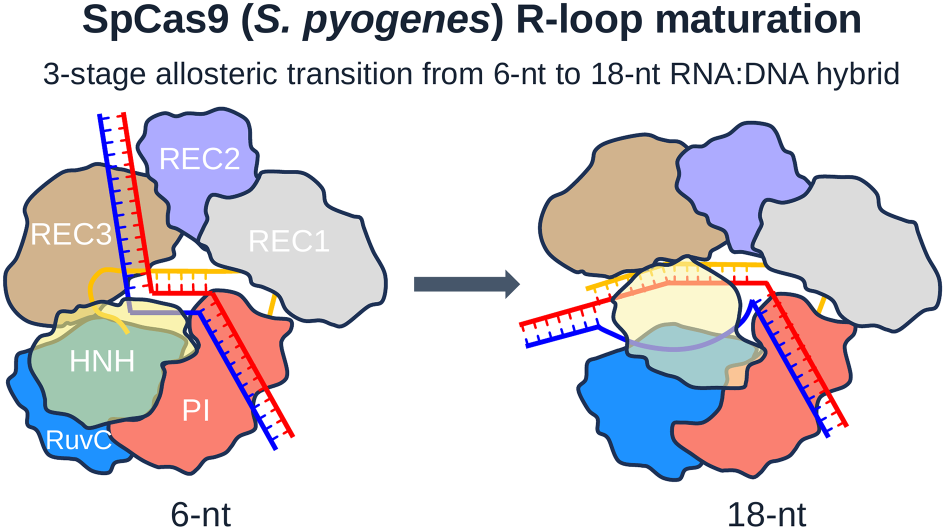
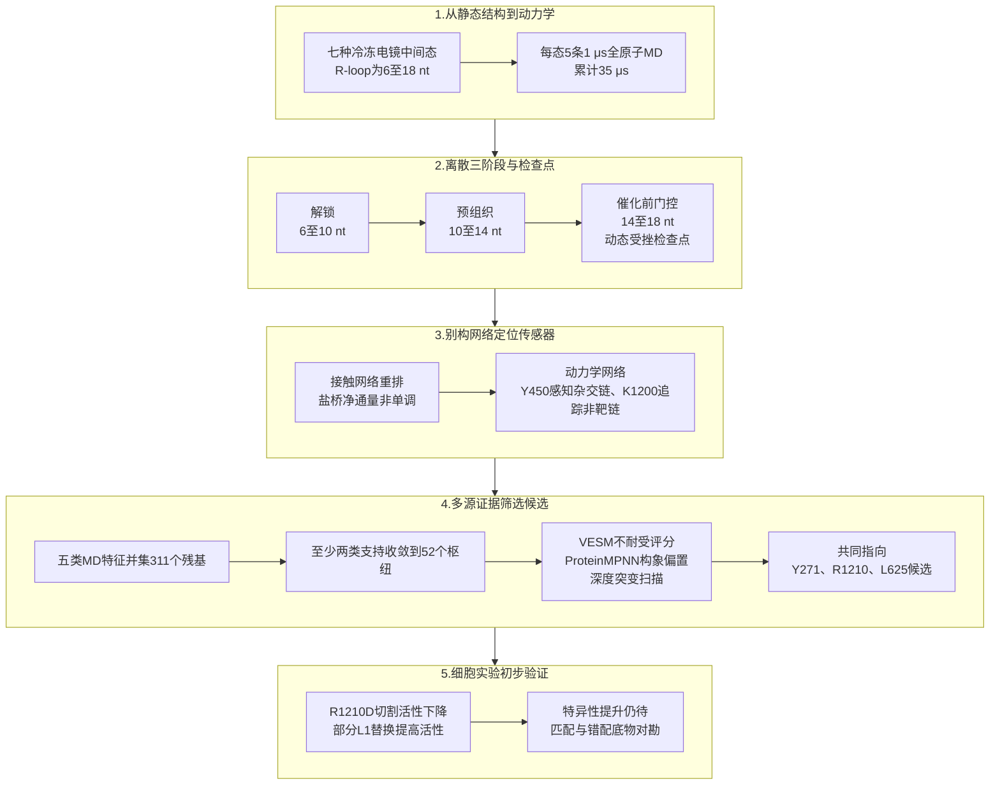
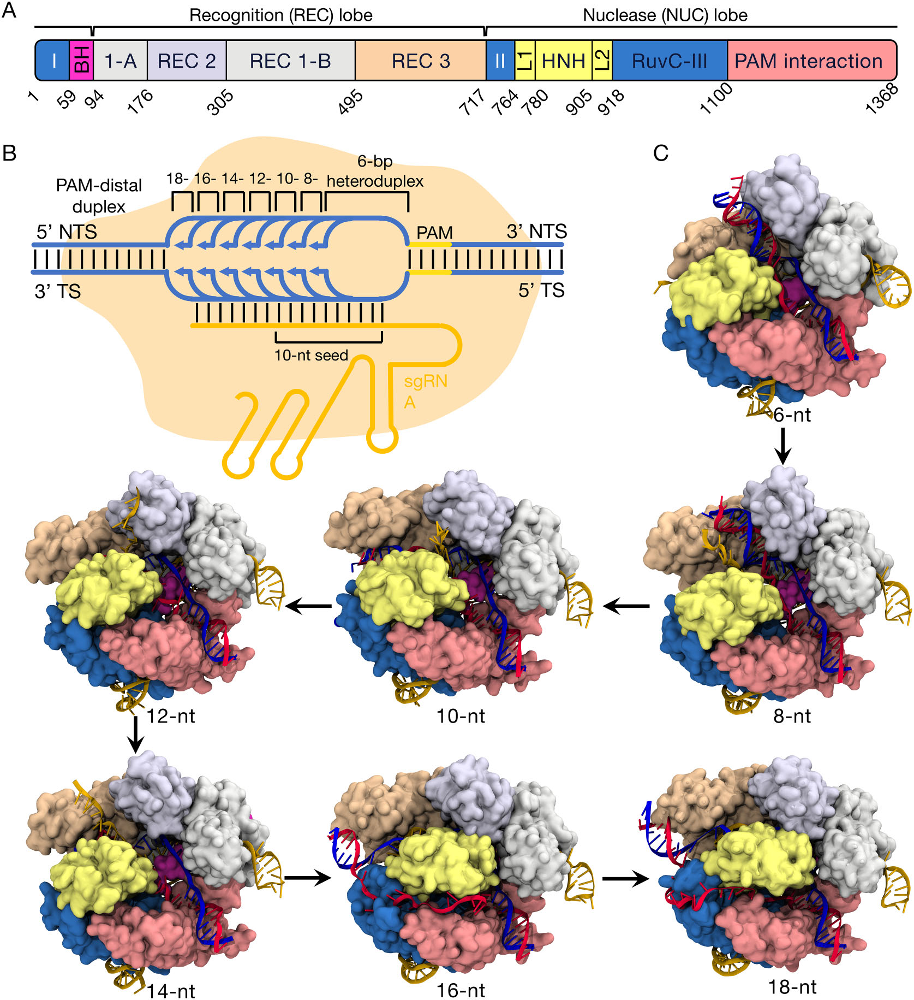
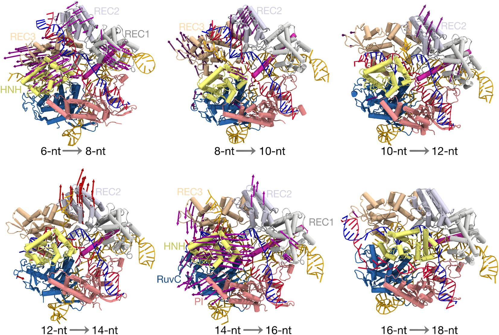
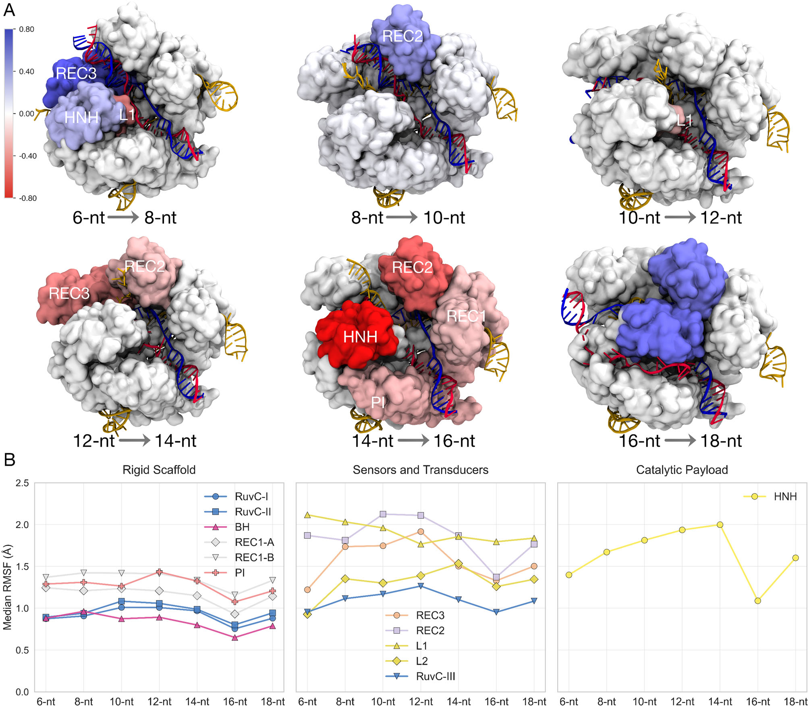
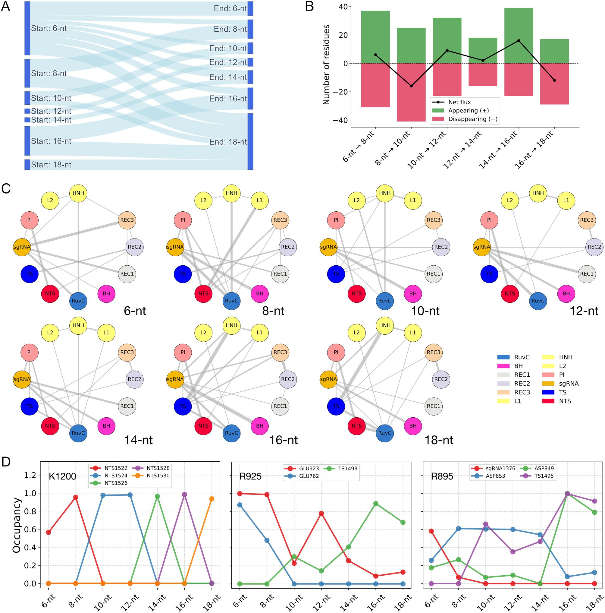
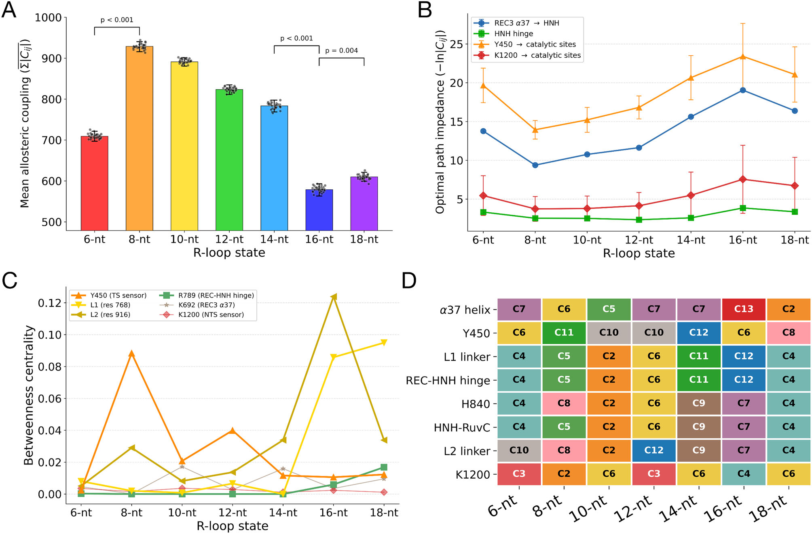
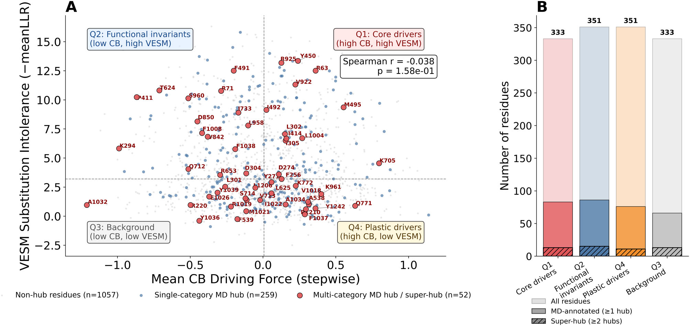
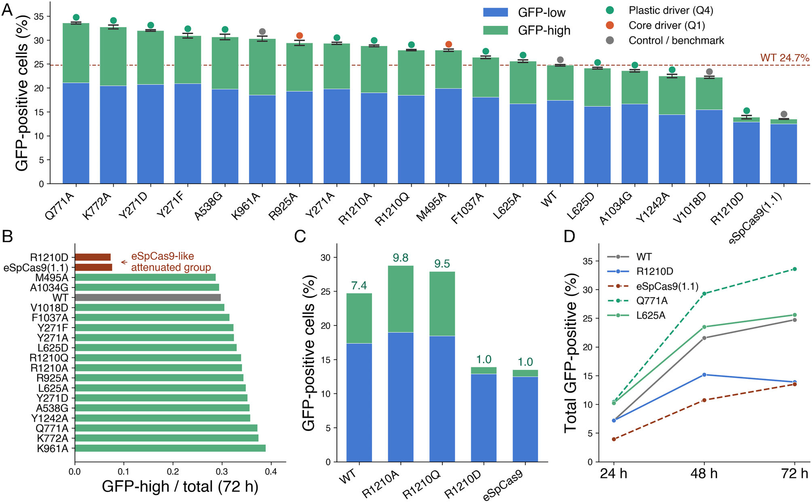

# Cas9如何决定何时切割DNA？MD揭示一个动态受挫的别构检查点

## 本文信息

- **标题**：CRISPR–Cas9中与构象校对一致的动态受挫别构检查点
- **发表期刊**：Nucleic Acids Research
- **发表时间**：2026年10月14日
- **DOI**：https://doi.org/10.1093/nar/gkag955
- **单位**：上海交通大学医学院、上海交通大学医学院附属同仁医院、宁夏医科大学（中国）
- **引用格式**：Huang, J., Wei, J., Chen, H., Qiao, X., Liu, N., & Lu, S. (2026). A dynamically frustrated allosteric checkpoint consistent with conformational proofreading in CRISPR–Cas9. *Nucleic Acids Research*, *54*(18), gkag955. https://doi.org/10.1093/nar/gkag955
- **代码与数据**：
  - 分析代码：https://github.com/HuangJianxiang-SJTU/Dynamically_frustrated_checkpoint
  - 轨迹与分析数据：https://doi.org/10.5281/zenodo.22689874
  - VESM：https://github.com/ntranoslab/vesm
  - Conformational Biasing：https://github.com/alicetinglab/ConformationalBiasing

## 摘要

> CRISPR–Cas9需要先让sgRNA与靶DNA形成并延长RNA:DNA杂交链（R-loop），才能激活负责切割靶链的HNH核酸酶结构域，但**从R-loop形成到催化激活之间的构象调控仍不清楚**。研究者基于七种实验捕获的R-loop中间态开展总计35 μs的全原子MD模拟，提出**解锁、预组织和催化前门控三个阶段**；18-nt状态下HNH与REC2的运动性重新增强，却尚未进入切割就绪构象，这一**动态受挫状态可能构成构象校对检查点**。结合深度学习、深度突变扫描和细胞切割报告实验，还识别出潜在的别构传感残基与可调节活性的位点。

## 背景

SpCas9是原型CRISPR–Cas9核酸酶：PI结构域先识别非靶链上的PAM，sgRNA再与靶链配对，从PAM近端向远端逐步延伸成R-loop，随后HNH与RuvC两个结构域分别切割靶链和非靶链。**R-loop的成熟程度决定Cas9是否承诺切割**，错配一旦让复合物停在非生产中间态，切割效率可下降百倍，这也是脱靶与保真度的核心问题。

但R-loop延伸如何把信号传给HNH，一直缺少动态解释。冷冻电镜已捕获R-loop长度从6-nt到18-nt的七种中间态，提出18-nt为催化前检查点；单分子FRET也看到HNH在对接与脱离之间摆动。问题是这些证据要么是静态快照，要么只比较端点态或单一扰动，说不清R-loop成熟是连续的构象景观，还是几个可区分的离散阶段；这一区分直接关系到保真度如何编码。

### 关键科学问题

- R-loop从6-nt延伸到18-nt，是否存在机制上可区分的**离散阶段**，而非一条连续变化的构象轨迹？
- 18-nt检查点附近，HNH已接近切割位置却未激活，这种表面稳定的状态是否藏着**动态受挫**，正是切割前校对的关键？

## 研究内容

全文证据链分四步：动力学模拟划分活化阶段，别构网络定位候选传感器，多源证据交叉筛选枢纽残基，细胞实验做初步功能验证。

### 1. 从静态结构到35 μs构象动力学

Cas9首先识别DNA上的原间隔序列邻近基序（PAM），随后sgRNA与靶链逐步配对形成R-loop。R-loop延伸会推动HNH向靶DNA的切割位置靠近，同时牵动REC2、REC3及L1/L2连接区域。冷冻电镜已经捕获6、8、10、12、14、16和18-nt七种中间态，但不同状态下蛋白如何运动，还需要动力学信息。

作者以七种冷冻电镜结构为起点，用AlphaFold3补齐未解析的内环与缺失核苷酸，每种状态做**5条独立、每条1 μs的全原子模拟**，累计35 μs。体系含1368个残基，用Amber24的pmemd.cuda运行：蛋白、RNA、DNA、水和离子分别采用ff19SB、OL3、bsc1、TIP3P和Joung–Cheatham参数；在300 K、1 atm的NPT系综下以2 fs步长推进，氢键由SHAKE约束，静电用PME处理（10 Å截断），每10 ps存一帧。

分析方法上，先用gmx rmsf计算主链均方根涨落（RMSF），相邻态的差值按结构域取中位数、以$\pm 0.2$ Å为效应量阈值，避免溶剂暴露的环区主导结果；再结合主成分分析（PCA）和DSSP二级结构比较各状态差异。

别构信号靠动力学网络追踪。每个状态把1368个残基作为节点，重原子在至少75%的帧里距离小于4.5 Å的两残基之间连边；用广义互相关矩阵（GCCM）量化残基运动的协同程度，再取$w_{ij}=-\ln\left|C_{ij}\right|$把相关强度转成边阻抗，相关越强的残基对阻抗越低，同向与反向运动都算有效的信号通道。

有了网络再找模块和枢纽。社区划分用加权的Girvan–Newman边介数分解，按阻抗权重逐条去边、保留模块度最高（$Q$为0.79–0.82）的划分，再用加权节点介数找瓶颈枢纽。为比较不同传递路线，枚举四条源-汇通路的最低价路径（Yen算法，$K=10$）：一条文献已验证的REC3→HNH通路、一条REC/HNH铰链通路作对照，另两条分别从传感残基Y450和K1200出发；相邻状态的GCCM差异用1000次bootstrap重采样检验。

**图1：SpCas9的结构域组成及R-loop从6至18-nt逐步延伸的七种实验捕获状态**。A为结构域分布，B为RNA:DNA配对示意，C为各中间态的三维结构。

### 2. Cas9活化可分为三个构象阶段

| 阶段 | R-loop长度 | 主要构象变化 |
| --- | --- | --- |
| 解锁（Unlocking） | 6–10 nt | DNA发生弯曲，REC2、REC3和HNH协同调整位置 |
| 预组织（Preorganization） | 10–14 nt | REC2逐步远离R-loop核心，为后续大幅运动做准备 |
| 催化前门控（Precatalytic gating） | 14–18 nt | HNH向靶链切割位点靠近，并出现先刚化、后重新松动的变化 |

这一划分有直接的动力学依据：对每对相邻状态的合并轨迹做主成分分析，PC1的主运动给出各阶段结构域位移的方向与幅度（图2）。

**图2：六次相邻状态转变的PC1豪猪图**。箭头指示沿主成分的运动方向、长度对应位移大小；解锁阶段以DNA弯曲与初始结构域调整为主，预组织阶段表现为REC2的潜在单向漂移，门控阶段对应HNH重定位。

后两个状态之间出现反转：14→16-nt时，HNH与REC2的RMSF分别下降约0.872和0.517 Å；16→18-nt时又分别增加约0.483和0.442 Å。**HNH虽然接近催化所需位置，却仍保留较大的构象活动空间**。这种兼具预激活结构和未完成催化承诺的状态称为“动态受挫”（Dynamic Frustration），描述的是运动与信号耦合特征；此时运动与别构耦合尚未稳定到能够切割的状态。

**图3：相邻R-loop状态间的结构域柔性变化**。A中蓝色代表RMSF增大、红色代表刚化；B将结构域分成相对稳定的骨架、传感与信号传递模块，以及HNH催化模块。

### 3. 别构网络如何传递R-loop成熟信号？

接触网络随R-loop成熟逐步重排：盐桥形成的净通量非单调，6→8-nt与14→16-nt出现成键爆发，8→10-nt与16→18-nt转为净流失。**K1200像一只随杂交链延伸同步滑动的探针**，它的非靶链盐桥伴侣每延伸2-nt沿骨架前进一个位置，从NTS1522一路换到NTS1530；Y450则在整个成熟过程中保持对seed区sgRNA的接触，6-nt堆叠、8-nt解堆叠放行延伸，此后转为持续的疏水锚定。

**图5：盐桥残基随R-loop延伸的动态切换**。（A）残基在各状态间的流动；（B）每步出现与消失的残基数及净通量；（C）七个状态下结构域间的盐桥网络；（D）K1200、R925和R895与核酸伙伴接触的占据率曲线。

动力学网络的通信结果与这两个候选传感器吻合：**Y450和K1200可能分别感知RNA:DNA杂交链变化与非靶DNA链的位移**，前者在8-nt附近出现短暂的网络中心性峰值。RuvC-III及L1连接区域也富集了二级结构切换残基。

**图6：不同R-loop状态的别构通信网络**。A为整体耦合强度，B为通信路径阻抗，C为关键残基的介数中心性，D为动力学社区分配。16-nt时整体耦合较弱，18-nt出现部分回升。

### 4. MD与AI共同筛选关键残基，实验验证了什么？

MD证据分五类：二级结构开关84个、GCCM方差枢纽54个、盐桥伴侣切换46个、疏水伴侣切换90个、介数枢纽89个，并集311个残基，其中至少两类共同支持的收敛到52个枢纽。研究将MD识别的动力学枢纽与两类AI结果结合：变体效应评分模型（Variant Effect Score Model，VESM）估计氨基酸替换的不耐受程度，ProteinMPNN的构象偏置分析（Conformational Bias）衡量序列对不同构象状态的兼容倾向，再参考已有深度突变扫描数据。三类证据共同指向Y271、R1210和L625三个未经表征的候选；对候选集中的残基统一排序，已发表的高保真位点K961、V1018和K1031落在前14位，相当于从第一性原理找回了已知的高保真聚类。

**图7：序列替换不耐受程度与构象偏好共同划分残基**。Q4代表构象选择性较强、相对允许替换的候选区域；红色边框标识由多个MD特征共同支持的枢纽残基。

细胞报告实验显示，R1210D的总GFP阳性比例从野生型的24.7%降至13.9%，GFP-high/总GFP阳性比例降至0.07，与已知高保真变体eSpCas9(1.1)的0.08接近。L1连接区域的部分替换则提高了报告体系中的切割活性。这些结果支持位点对活性的调控作用；**R1210D能否提高靶标识别特异性，仍须比较匹配与错配DNA底物**。

**图8：候选残基的细胞切割报告实验**。A为72 h的GFP阳性比例，B为GFP-high占比，C比较R1210不同替换的结果，D展示部分变体的时间变化。

## 关键结论与批判性总结

本文将R-loop成熟过程与Cas9的构象动力学联系起来：**从结构域运动、局部结构切换到别构网络重排，多个尺度的证据共同支持一个18-nt催化前检查点模型**。结合蛋白语言模型与实验突变数据，也为筛选功能相关残基提供了相互补充的线索。

需要注意，七种中间态来自不同错配DNA底物，状态差异同时包含R-loop长度与底物序列的影响；细胞实验也只直接测量一个匹配靶位点的切割表现。因此，“构象校对如何提高特异性”仍属于下一步需要直接验证的机制问题。
