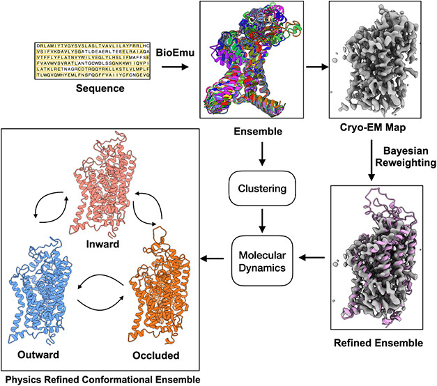
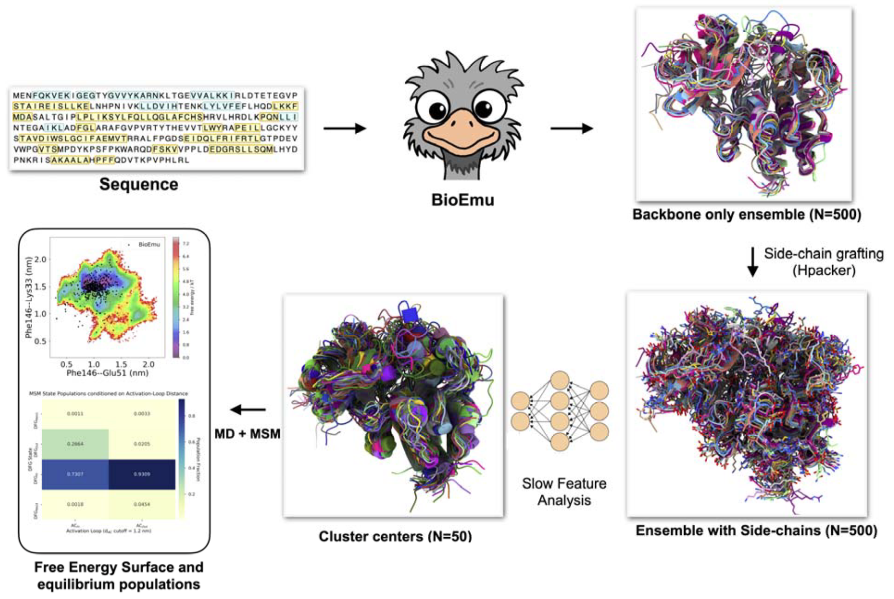
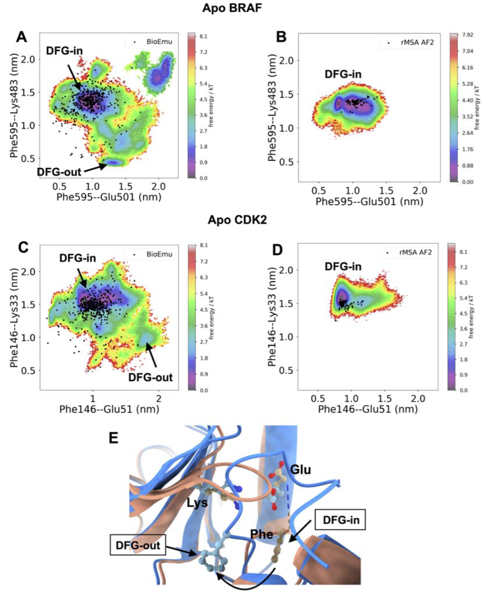
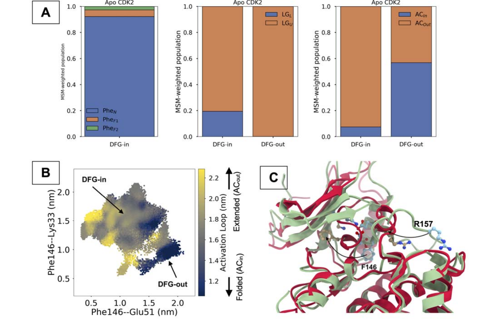
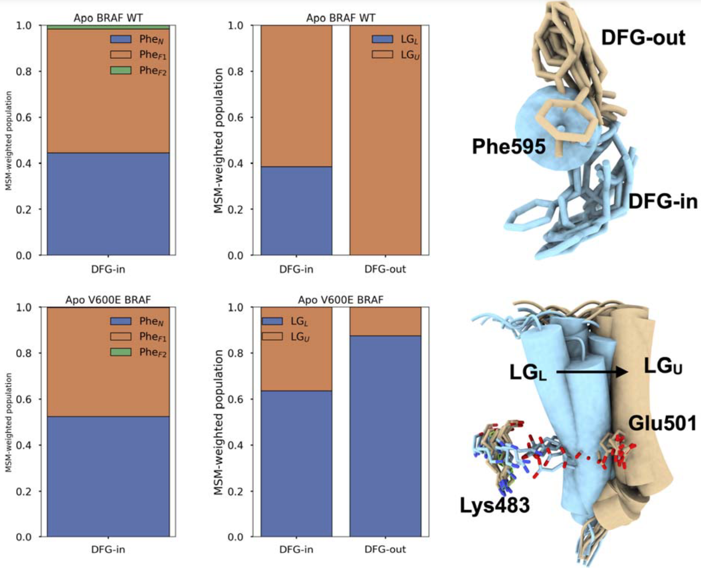
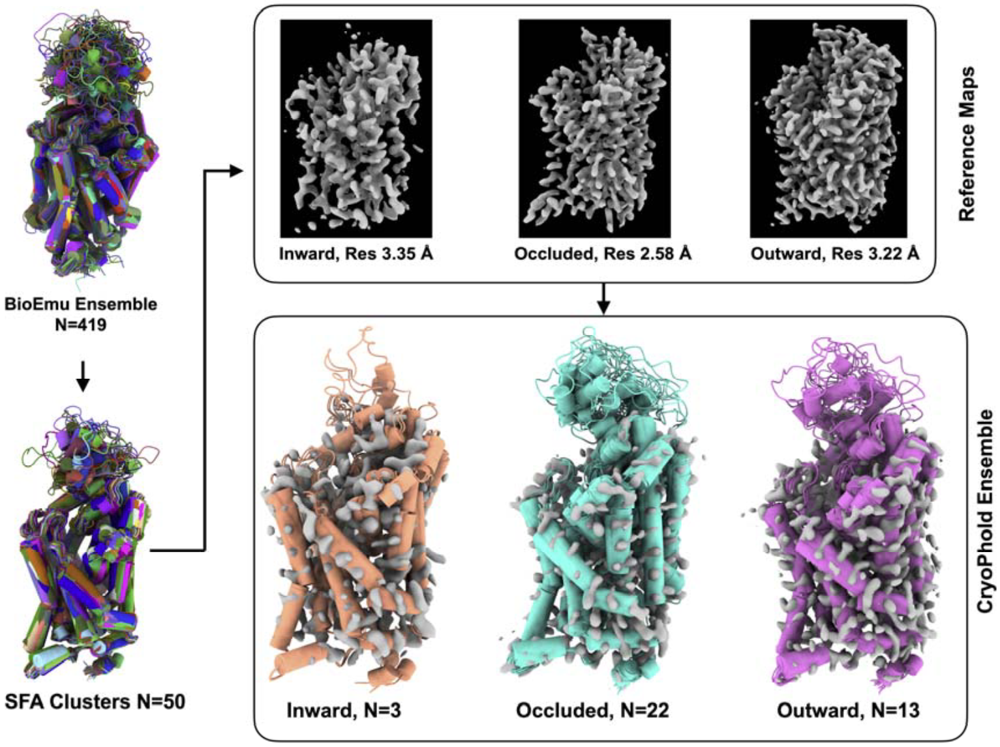
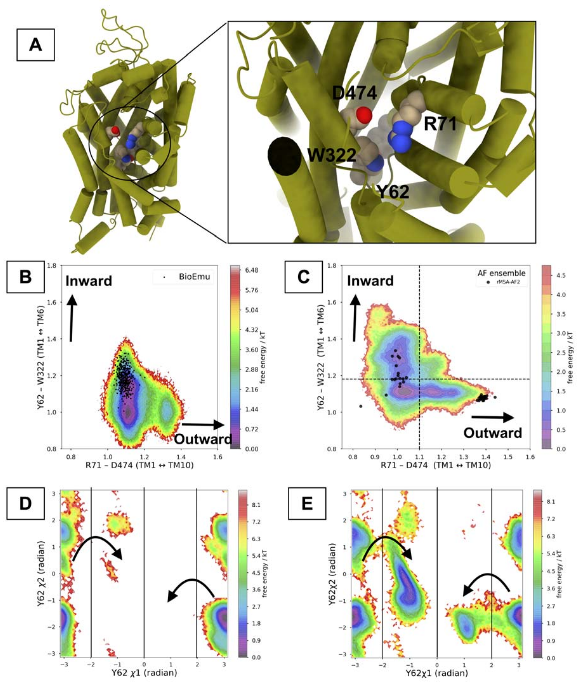
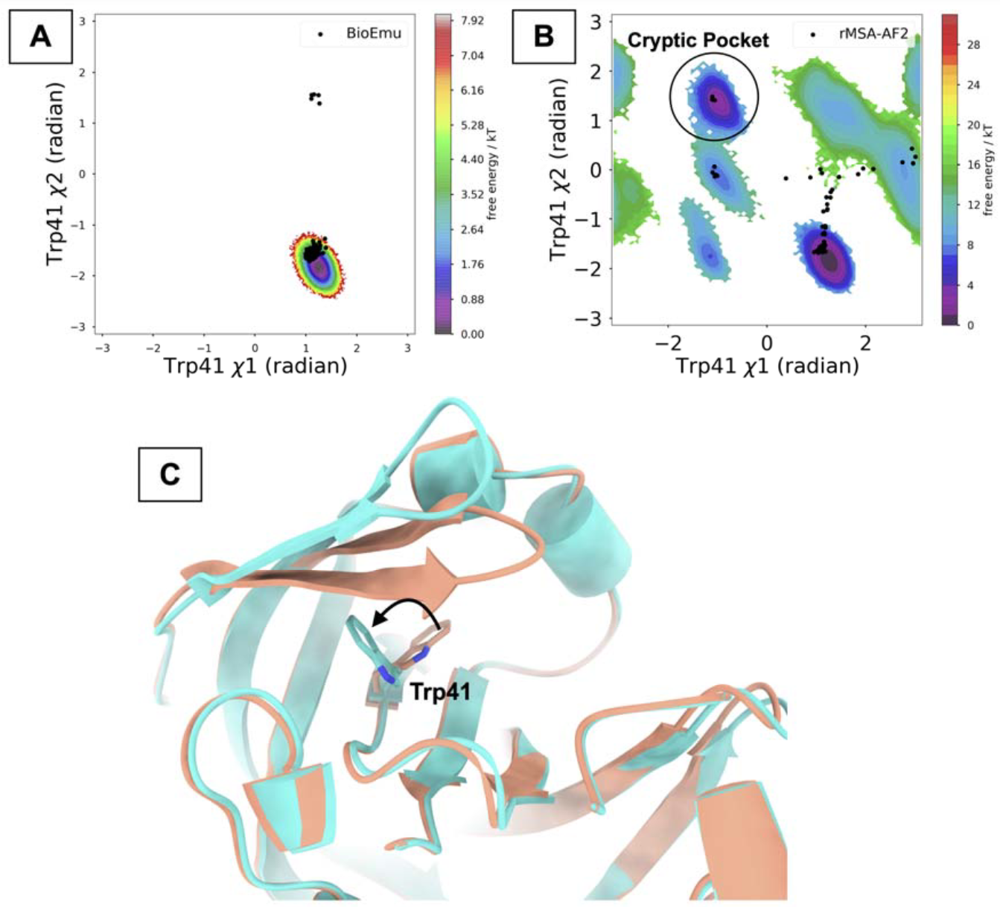

# BioEmu能把蛋白动力学采样推多远？激酶成功，转运体与隐蔽口袋暴露边界

## 本文信息

- **标题**：Accelerated sampling of protein dynamics using BioEmu augmented molecular simulation
- **作者**：Soumendranath Bhakat，Eva-Maria Strauch
- **发表时间**：2026年6月10日
- **单位**：AlloTec Bio Inc.（美国密苏里州圣路易斯）；Washington University in St. Louis School of Medicine, Division of Infectious Diseases（美国密苏里州圣路易斯）
- **DOI**：https://doi.org/10.1021/acs.jcim.6c01000
- **引用格式**（不加粗）：Bhakat, S., & Strauch, E.-M. (2026). Accelerated sampling of protein dynamics using BioEmu augmented molecular simulation. *J. Chem. Inf. Model.*, *66*(17), 7168–7178. https://doi.org/10.1021/acs.jcim.6c01000
- **源代码与相关工具**：
  - BioEmu：https://github.com/microsoft/bioemu
  - H-packer：https://github.com/gvisani/hpacker
  - CryoPhold：https://github.com/strauchlab/cryoPhold
  - MDML：https://github.com/svats73/mdml/tree/main

## 摘要

> 生成式模型（如BioEmu）能够产生蛋白质多样的构象系综，但判断哪些预测状态具有生理相关性、以及它们如何被占据，仍是一大挑战。具体而言，哪些构象对应功能态、中间态及其之间的转变能否被可靠识别，目前并不清楚。本文以**丝氨酸—苏氨酸激酶**BRAF与CDK2为对象研究这些问题，并考察疾病相关突变V600E如何相对于野生型改变亚稳态构象群体的分布。为量化构象群体，作者开发了一套工作流，将BioEmu生成的构象系综与短程分子动力学模拟、马尔可夫状态模型相结合，以估计符合**玻尔兹曼权重**的态群体。此外，作者还将BioEmu系综与实验冷冻电镜数据整合，构建生物分子的全原子构象系综。相比基于AlphaFold2简化多序列比对的方法（**rMSA-AF2**），BioEmu播种的分子模拟能更有效地采样功能重要的亚稳态，并捕获丝氨酸—苏氨酸激酶中突变诱导的群体迁移。然而，它在多个体系（包括甘氨酸转运蛋白1/GlyT1与plasmepsin-II/PlmII）上无法捕获构象异质性。在由**侧链构象异质性**主导动力学的体系（如PlmII的隐蔽口袋开放或GlyT1中亚稳态间的转变），从BioEmu生成系综出发的分子模拟并不能复现实验观测到的构象可变性。总之，这项工作提出了一个将生成式蛋白系综预测模型与统计力学重加权相整合的框架，可在规模化层面恢复玻尔兹曼加权构象系综，同时凸显出在解读AI生成的蛋白构象景观时，需结合**系统特异性评估**的重要局限。

### 核心结论

- **BioEmu加短程MD**在激酶体系里确实有效，能用**累计5 μs的模拟捕获DFGin 到DFGout 转变**，而对照的rMSA-AF2路线即使做到8 μs仍主要困在DFGin。rMSA-AF2仍然更受初始结构“覆盖率”的限制，而BioEmu给出的起始构象分布更开阔
- 这套方法不只找到“终态”，还能够解析**中间态、亚态和相对群体**，例如CDK2激活环折叠、伸展状态与BRAF的DFG-Phe旋转异构体分布。需要注意的是，原文对PheN 和PheF1 的 $\chi_1$ 标注前后并不完全一致，因此这里不再硬性对应具体角度，而是保留“不同DFG-Phe亚态及其相对权重”这一层结论
- 对V600E BRAF，方法成功恢复了**突变诱导的群体转移**，包括DFG-Phe旋转异构体分布的重新分配，以及 αC螺旋向更活性样构象偏移。文中的定量结果显示，V600E会让DFGin 宏观态内各亚态的群体比例发生明显变化，αC螺旋的“in”状态（LGL）群体也随之增加
- 把BioEmu与Cryo-EM贝叶斯重加权结合后，可以得到GlyT1的全原子先验系综，但采样仍然不完整，尤其是inward态与Y62翻转。关键缺陷在于：BioEmu v1.0只显式生成骨架，侧链通过H-packer后补，因此**很难完整覆盖Y62的 $\chi_1/\chi_2$ 二面角分布**，而这个残基的翻转又是从occluded向inward态转变的必要条件。这里真正暴露出来的是方法边界：**当动力学高度依赖侧链异质性时，只有骨架多样性往往不够**，BioEmu v1.0的优势会明显下降。

## 背景

蛋白质功能往往不是由单一静态结构决定的，而是由多个**亚稳态之间的相对群体与相互转化**共同决定。对药物研发来说，这一点尤其关键，因为变构口袋开放、激活环重排、跨膜转运开关、蛋白—蛋白相互作用界面暴露，很多都属于**低概率但功能关键的稀有事件**。这些构象转变直接调控蛋白的功能状态、配体结合亲和性和信号传导效率，因此理解蛋白的动力学景观对于精准药物设计至关重要。

传统无偏MD最大的问题是时间尺度。很多功能相关转变隔着很高的自由能垒，常规模拟在可接受的算力预算内根本跨不过去。增强采样方法虽然被开发出来应对这一限制，但主要分为两类：**沿着预定义集体变量施加偏置**的方法（如伞形采样、metadynamics）和**全局修改势能面**的方法（如温度加速、副本交换）。这些方法虽然强大，但存在关键缺陷：它们高度依赖**对反应坐标的先验知识**，而且得到的群体分布不是内在物理的，需要仔细的重新加权才能恢复无偏热力学。

近年来，基于AlphaFold2的方法（如AF2-RAVE、AF2-MSM和CryoPhold）通过**减少多序列比对**来诱导构象多样性。rMSA-AF2的核心思想是生成异质性的初始结构来启动下游的无偏MD模拟，从而加速构象探索。然而，这些方法的物理精修系综仍然**强烈依赖于初始系综的“覆盖率”**——如果初始覆盖没有捕捉到有意义的多样性，后续短MD模拟很难显著改善采样。

这几年生成式AI进入分子模拟领域后，一个自然的问题是：能不能让AI先把构象空间“撒开”，再由物理模拟去恢复真实分布？BioEmu走的是另一条路：它不是扰动静态结构预测器的输入，而是在分子动力学模拟数据上微调的生成式扩散模型，训练目标是重现统计上独立的平衡结构分布。这使得BioEmu相比rMSA-AF2能够实现**更广的构象空间覆盖**。不过，BioEmu生成的系综本身并不直接给出可信的状态群体，因此仍然需要结合物理模拟和MSM来恢复热力学意义。

本文的思路正是如此。不过本文不回避BioEmu的失效场景，在多个体系中做了认真比较，最后给出的结论是：**它在某些问题上很强，但也有非常具体、非常物理的失效场景**。

## 研究方法

**图1：BioEmu种子分子模拟的整体工作流**。整条路线可以概括为：**先用生成式AI扩大初始构象覆盖，再用物理模拟和统计力学恢复热力学意义**。下面按三个层次来看。

### 第一层：构象生成与降维

工作流从**蛋白质序列**开始，BioEmu v1.0首先生成约 **500** 个仅含骨架的单体构象。这些构象不是简单的随机采样，而是基于分子动力学训练数据的扩散模型输出，因此天然包含了平衡态的构象多样性。随后，H-packer负责补全侧链，把骨架系综转换成**全原子表示**。

为了从500个构象中挑选出最具代表性的结构用于后续模拟，本文对Cα–Cα 距离做**慢特征分析**（Slow Feature Analysis，SFA）。

SFA是一种无监督降维算法，目标是找到**变化最慢的特征方向**，这些方向通常对应于系统最缓慢、最功能相关的集体运动。数学上，SFA通过优化目标函数 $\min \Delta(\Omega(z)) = \mathbb{E}[(\dot{z})^2]$ 来提取慢特征，其中 $z$ 是提取的特征，$\dot{z}$ 是其时间导数。本文在前两个慢特征上进行K-means聚类（$K=50$），得到 **50** 个聚类中心。SFA与聚类使用的是 **MDML** 软件包。

对GlyT1，本文再把这 **50** 个聚类中心作为CryoPhold的先验，用于针对三张Cryo-EM图的贝叶斯重加权。**CryoPhold** 是一个结合AlphaFold2与Cryo-EM数据的框架，通过**贝叶斯重加权**将生成式AI输出的构象系综与实验密度图对齐，从而得到既符合物理原理又与实验一致的构象分布。

### 第二层：物理模拟与参数设置

这 **50** 个代表性结构分别启动 **100 ns** 无偏MD，总计 **5 μs**。分子模拟的具体参数设置如下：

- 使用 **Amber2022** 中的 `tleap` 进行体系准备，蛋白力场是 **AMBER ff14SB**，水模型是 **TIP3P**
- 使用截角八面体水盒，蛋白到盒边界最小缓冲为 **10 Å**
- 先做受限最小化，再做全体系无约束最小化
- Amber拓扑通过 **ACPYPE** 转到GROMACS格式，后续模拟在 **GROMACS 2022** 中进行
- 体系从 **0 K升温到300 K**，先进行 **500 ps NVT** 升温，再进行 **200 ps NPT** 平衡
- 生产模拟为无偏100 ns，轨迹每10 ps保存一次
- 温控采用velocity-rescale thermostat，压强控制采用Parrinello–Rahman barostat
- 非键相互作用截断为 **1.0 nm**，长程静电采用 `PME`，含氢键长通过 `LINCS` 约束

### 第三层：统计力学分析

所有轨迹最后交给MSM统一整合，输出**自由能面、宏观态群体和亚态分布**。MSM使用 `PyEMMA` 构建，激酶体系使用图2中的两个距离来区分DFG态，GlyT1则使用能区分inward、outward、occluded的距离变量来建模。

> BioEmu提供了**结构覆盖的广度**，而MSM则通过统计力学分析赋予这些结构**物理意义**，计算每个状态的热力学权重和动力学连通性。

如果只看BioEmu本身，它给出的是构象多样性，而不是严格的平衡分布。因此BioEmu输出在这里只是**更聪明的初始构象提案器**，而非最终答案。

后续的全原子MD提供局部物理松弛和能量精修，MSM则通过构建转移概率矩阵，将多条短程轨迹整合成**符合玻尔兹曼统计的群体分布与自由能面**。具体而言，MSM通过特征值分解得到长时间尺度的平衡分布，从而预测每个宏观态和亚态的相对群体。

这一点也解释了为什么本文坚持用对照组——比较的是：**同样是短程无偏MD，不同初始构象覆盖到底能把结果拉开多大差距**。

这种比较能够区分“方法本身的优势”和“初始条件的运气”。图1中的黑点投影直观展示了这一差异：BioEmu的500个初始构象在两个慢特征坐标上的分布明显比rMSA-AF2的80个构象更分散。

> 这里最要紧的一点是，**BioEmu的优势首先体现在起始构象分布更开阔**。后续无偏MD当然提供了局部松弛，但如果初始系综本身没有覆盖到相关区域，短程轨迹通常很难自己翻过高自由能垒。

从技术路线看，这篇工作的重点在于**把生成式构象采样、全原子MD和MSM顺畅接起来**，把结构多样性进一步落到可解释的热力学分布上。

## 研究结果

### 激酶测试：BioEmu的最佳表现出现在DFG翻转问题上

**图2：MSM加权自由能面解析BRAF与CDK2的DFGin 到DFGout 转变**

- A、C是BioEmu种子模拟得到的自由能面，分别对应apo BRAF与apo CDK2
- B、D是rMSA-AF2增强MD的对照结果
- 黑点是初始构象系综投影，用来直观看出**初始覆盖范围**
- E给出了DFGin 与DFGout 的代表性结构，salmon色对应DFGin，cyan色对应DFGout，重点看的是 **DFG-Phe、Lys、Glu** 的相对位置变化

这组结果非常直观。BioEmu种子模拟不只是跑出了更散的点云，而是真正在自由能面上覆盖到了**从DFGin 到DFGout 的过渡区域**。相比之下，rMSA-AF2的初始系综和后续模拟几乎都局限在DFGin 附近。

更直接的比较来自采样结果本身：**BioEmu路线总模拟时间是5 μs，对照路线是8 μs，但后者仍没能真正跨出DFGin 盆地**。这说明在这类问题上，初始构象覆盖确实比单纯延长短程模拟更重要。

### CDK2：不仅采到DFGout，还采到了更细的活化相关异质性

**图3：BioEmu增强模拟解析apo CDK2的DFG-Phe、αC螺旋与激活环亚态**

- A是DFGin 宏观态内不同DFG-Phe旋转异构体，以及 αC螺旋LGL／LGU和激活环ACin／ACout 的相对群体
- B把激活环距离投影到DFG相关的两个距离坐标上，显示 **DFGout 更偏向折叠激活环**
- C叠合了代表性DFGin 与DFGout 结构，突出显示**DFG-Phe翻转与激活环折叠**

图2说明BioEmu能把体系带到新的盆地，图3进一步表明：**它还能解析盆地内部的细致异质性**。

**图3B：激活环的延伸-折叠转移**：图3B将激活环距离（D145-CA–R157-CA）投影到区分DFGin 和DFGout 的两个距离坐标上。关键发现是：DFGout 态中折叠激活环（ACin）的群体明显高于DFGin 态。这意味着**从DFGin 到DFGout 的转变伴随着激活环从延伸态（ACout）向折叠态（ACin）的转移**。激活环是激酶功能调控的核心区域，其折叠状态直接影响底物结合和催化活性。这种耦合变化揭示了激酶活性-非活性转变的层级化特征：DFG基序的翻转与激活环的构象变化是协同发生的，共同构成了从活性样到非活性样构象转变的结构基础。

在apo CDK2里，本文不仅看到DFGin 与DFGout 两个终态，还看到了DFGin 内部的不同DFG-Phe亚态，以及 αC螺旋与激活环的耦合变化。尤其是从DFGin 到DFGout 时，激活环从ACout 向ACin 转移，这正是**从更活性样构象走向更非活性样构象**的重要标志。

因此，BioEmu的价值不只是“帮忙见到稀有终态”，还在于它能让后续MSM在更合理的初始覆盖上，恢复出**与功能转换相关的层级化构象景观**。

### V600E BRAF：群体转移而不是单一结构切换，才是更难也更有用的测试

**图4：V600E突变如何把BRAF系综推向更活性样构象**

- 左侧柱状图比较野生型与V600E在DFGin 宏观态内的PheN、PheF1、PheF2 群体
- 中间柱状图比较 αC螺旋在LGL与LGU两种构象下的群体变化
- 右侧结构示意图标出Phe595、Lys483、Glu501，并用蓝色与米色展示更偏DFGin／DFGout 或LGL／LGU的构象差异

在DFGin 宏观态内部，**V600E会重新分配DFG-Phe侧链旋转异构体的群体**，同时也让 αC螺旋更偏向“in”状态，也就是LGL。这里保留“群体重新分配”这一层结论，不再把单个亚态之间的对应关系写得过死。

这很重要，因为突变激活常常不是把蛋白从一个完全静止的构象“掰”到另一个，而是让整个系综在多个亚态之间**重新分配权重**。本文确实把这种“群体转移”用MSM权重给量化了出来，而不只是画一张构象示意图就结束。

### 把Cryo-EM和BioEmu接起来：GlyT1是更接近真实应用场景的测试

**图5：BioEmu先验系综经CryoPhold贝叶斯重加权后，得到GlyT1的全原子构象集合**

- 左侧是原始BioEmu系综和SFA聚类后的 **50** 个代表性结构
- 右上是三张Cryo-EM参考图，对应inward、occluded与outward三种状态，分辨率分别约为 **3.35 Å**、**2.58 Å** 和 **3.22 Å**
- 右下是重加权后的全原子CryoPhold系综，橙色、青绿色、紫色分别对应inward、occluded、outward

在GlyT1这部分，生成式先验、Cryo-EM约束和后续MD被接到了一起。这里不是直接拿BioEmu输出做解释，而是先通过Cryo-EM参考图做贝叶斯重加权，得到**更接近实验的全原子后验系综**。

从方法设计上看，这一步把 **BioEmu的广覆盖起点**、**Cryo-EM的状态约束** 和 **CryoPhold的重加权** 自然接了起来。

### 但问题也从这里开始：GlyT1并没有被完全采开

**图6：在GlyT1上，BioEmu系综的覆盖不足开始暴露出来**

- A标出GlyT1的关键热点残基，尤其是 **Y62、W322、R71、D474**，它们共同定义了状态转变相关的局部几何
- B是BioEmu种子模拟在TM1–TM6与TM1–TM10距离空间中的采样结果
- C是rMSA-AF2种子模拟的对照，明显覆盖到更多inward、occluded、outward区域
- D、E则比较了Y62的 $\chi_1/\chi_2$ 二面角采样，显示BioEmu路线对 **Y62翻转 的覆盖明显不足**

图6对应的结论很明确：**BioEmu并不是在所有体系里都比rMSA-AF2更强**。

**GlyT1的三种构象态定义**：GlyT1是一种膜转运蛋白，通过交替访问机制将甘氨酸从细胞外间隙转运到细胞内。这个过程涉及三种主要的构象态：

- **Occluded（封闭态）**：底物结合位点被封闭，既不向细胞外开放，也不向细胞质开放，通常结合甘氨酸
- **Inward（向内态）**：底物结合位点向细胞质侧开放，允许甘氨酸释放到细胞内，通常结合抑制剂ALX-5407
- **Outward（向外态）**：底物结合位点向细胞外间隙开放，允许甘氨酸结合，通常结合抑制剂SSR-504734和PF-03463275

这三种态之间的转变依赖于跨膜螺旋（TM1、TM6、TM10）的大尺度重排，以及关键残基Y62的侧链翻转。Y62就像一个“盖子”，它的翻转是从occluded向inward态转变的必要条件。

在GlyT1中，增强模拟虽然能较好采到outward与occluded，但对inward态以及Y62翻转的恢复并不充分。这个结果和前面激酶体系的成功形成鲜明对比，也说明GlyT1的关键动力学更依赖**局部残基闸门与侧链重排**，而不只是主链骨架的大尺度移动。

也就是说，对某些跨膜转运体来说，单纯把骨架铺得更开并不够。真正控制状态切换的，可能是像Y62这样的局部“盖子”残基，而这恰恰是BioEmu v1.0不擅长的地方。

### PlmII：隐蔽口袋开启再次证明，侧链问题绕不过去

**图7：在PlmII的隐蔽口袋开启问题上，rMSA-AF2反而明显优于BioEmu**

- A是BioEmu增强模拟得到的Trp41 $\chi_1/\chi_2$ 自由能面，基本只覆盖主态
- B是rMSA-AF2的对照结果，可以看到更多离散盆地，其中圈出的区域对应**隐蔽口袋开启相关状态**
- C给出Trp41翻转的结构示意，说明这个侧链运动与口袋暴露直接相关

如果说GlyT1已经让人开始怀疑“骨架覆盖是否足够”，那PlmII几乎就是把这个问题钉死了。PlmII的隐蔽口袋开启依赖 **Trp41侧链翻转**，而BioEmu生成的初始系综在这件事上的构象多样性太有限，所以后续MD也很难补救。一个核心区别是，**激酶DFG转变更多体现为主链与局部二级结构层面的构象重排**，而GlyT1的Y62、PlmII的Trp41都属于**关键侧链闸门残基**。BioEmu v1.0只显式生成骨架，侧链是后补的。

> 这一点也是全文里最重要的负面结论之一：**对由关键侧链翻转主导的构象开关，BioEmu v1.0的瓶颈不在后续采样，而在起跑线就没有把相关侧链异质性准备好**。

### 本文真正回答的问题：什么时候该用BioEmu，什么时候要谨慎

综合激酶、GlyT1和PlmII三类体系，本文把方法适用边界讲得很清楚，给出的是更细的经验判断。**在BRAF和CDK2这类激酶上，BioEmu的构象覆盖明显更广；但在GlyT1与PlmII上，rMSA-AF2反而给出了更好的功能相关采样**。真正要说明的是：**初始系综的质量必须和问题类型匹配**。

更适合BioEmu的情形通常有这些特征：

- 关键转变主要表现为**骨架层面的宏观构象重排**
- 稀有态虽然难采，但可以由较广的主链分布触达
- 后续短程MD加MSM足以把这些状态重新赋予物理权重

相对不利的情形则包括：

- 关键动力学由**局部侧链翻转**控制
- 功能相关状态依赖少数残基构象的精细组合
- 起始系综如果没有覆盖这些局部侧链模式，后续无偏MD很难在短时间内补齐

这也是摘要和讨论都强调的一点：BioEmu是很强的**构象覆盖工具**，并非自动恢复全部真实动力学的黑箱。

## 关键结论与批判性总结

### 本文最重要的价值

本文不回避边界案例，把GlyT1和PlmII这两个边界案例也放了进来。这样一来，方法什么时候有效、什么时候要谨慎，就说得更清楚了。

### 主要优点

- **成功案例很有说服力**：BRAF与CDK2的DFG转变确实被采
- 到了，而且对照组差距明显
- **不只看终态**：文章分析了中间态、亚态、群体分布和突变诱导的**群体转移**，信息密度很高
- **工作流具有可操作性**：BioEmu、H-packer、MDML、GROMACS、PyEMMA、CryoPhold串起来后，路线相对明确
- **对失败模式有清楚归因**：本文把问题聚焦到**侧链异质性不足**，这个解释既具体又有物理直觉

### 局限性

- **BioEmu v1.0不显式建模侧链**，这会直接限制对Y62、Trp41这类关键残基翻转的覆盖
- 当前流程**主要面向单体蛋白**，对蛋白—蛋白或蛋白—配体体系的适用性仍有限
- 虽然结果与已知机制一致，但很多系统仍缺少更直接的**实验定量验证**
- 成败在很大程度上取决于**初始系综是否覆盖到真正相关的局部自由度**，这意味着方法仍然需要系统特异性判断

### 对后续工作的启发

- **这项工作对药物发现最直接的启发**：如果目标体系的关键动力学主要由**骨架级别的大构象转变**主导，BioEmu这类模型可以显著提高稀有态触达率；但如果问题核心是**局部侧链翻转、闸门残基摆动或隐蔽口袋开启**，就不能指望只靠骨架多样性解决问题，必须考虑更强的侧链建模或额外实验约束
- 如果未来的生成模型能更好处理**全原子级别的侧链异质性**，这条路线的适用范围会明显扩大
- 把Cryo-EM、DEER、FRET等实验信息与生成模型输出做更紧的耦合，可能是提高可靠性的关键方向
- 对于隐蔽口袋和局部闸门问题，后续方法很可能需要从“只学骨架”走向**同时学习骨架与关键侧链坐标**

**BioEmu确实能显著改善一类问题，但它的边界也把下一步最需要补的地方暴露了出来**。
