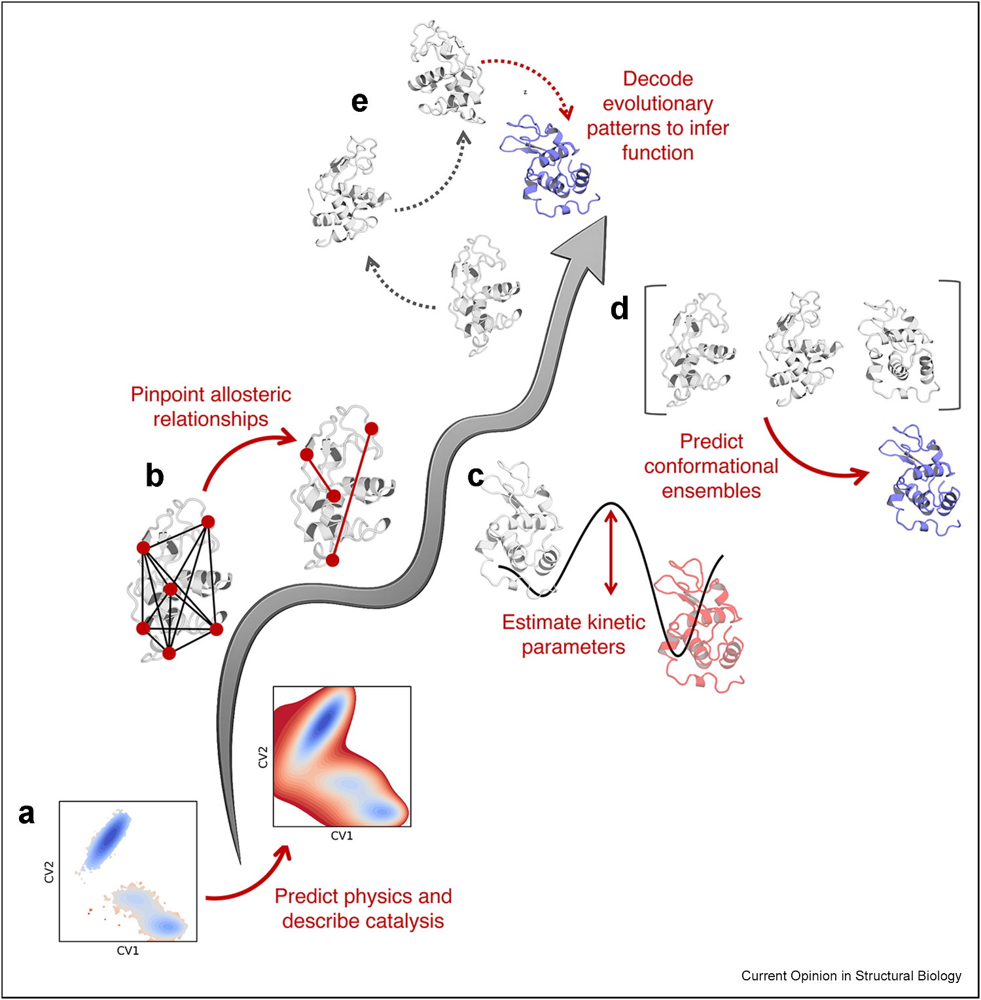
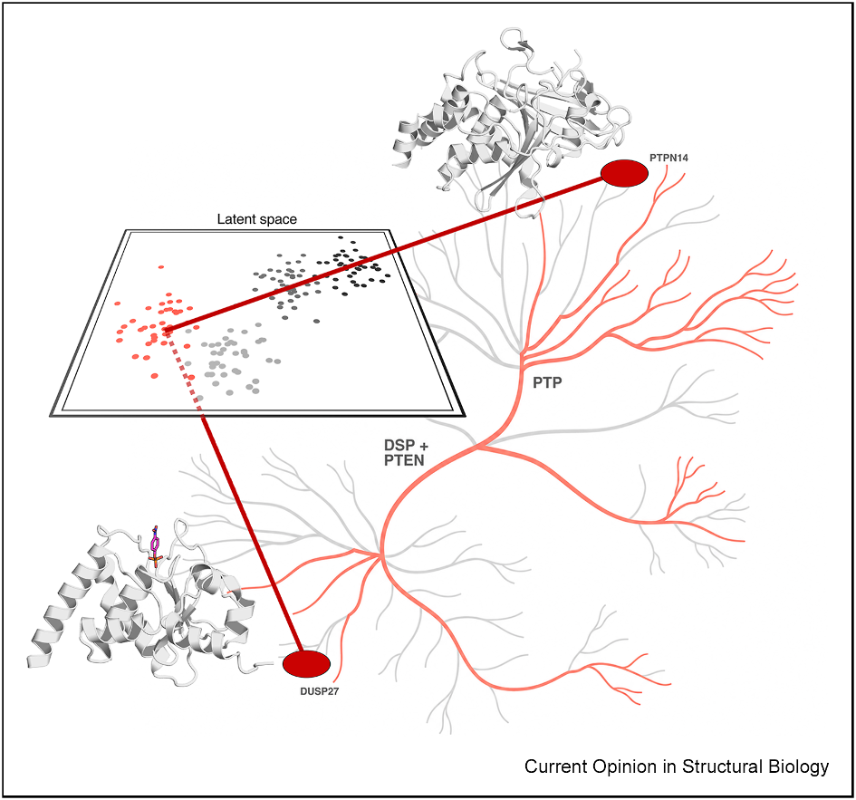
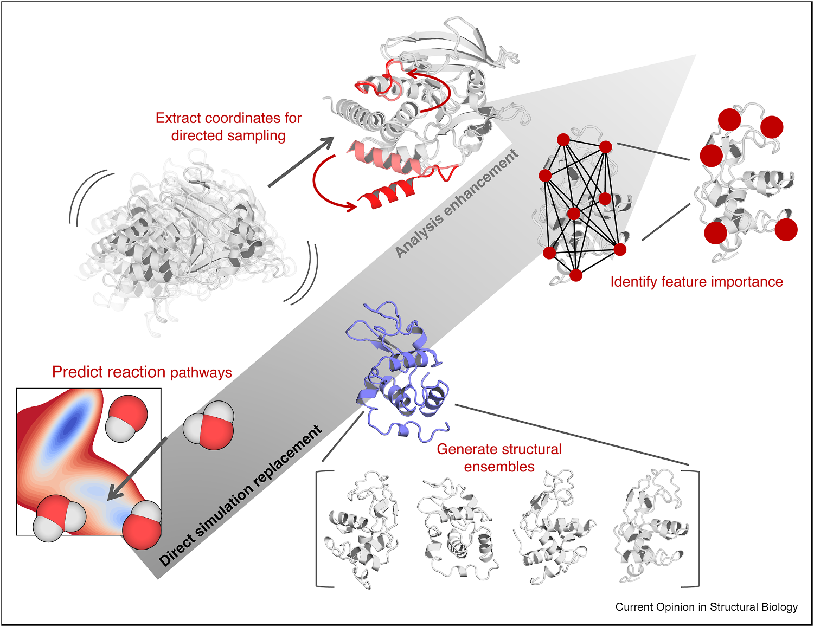
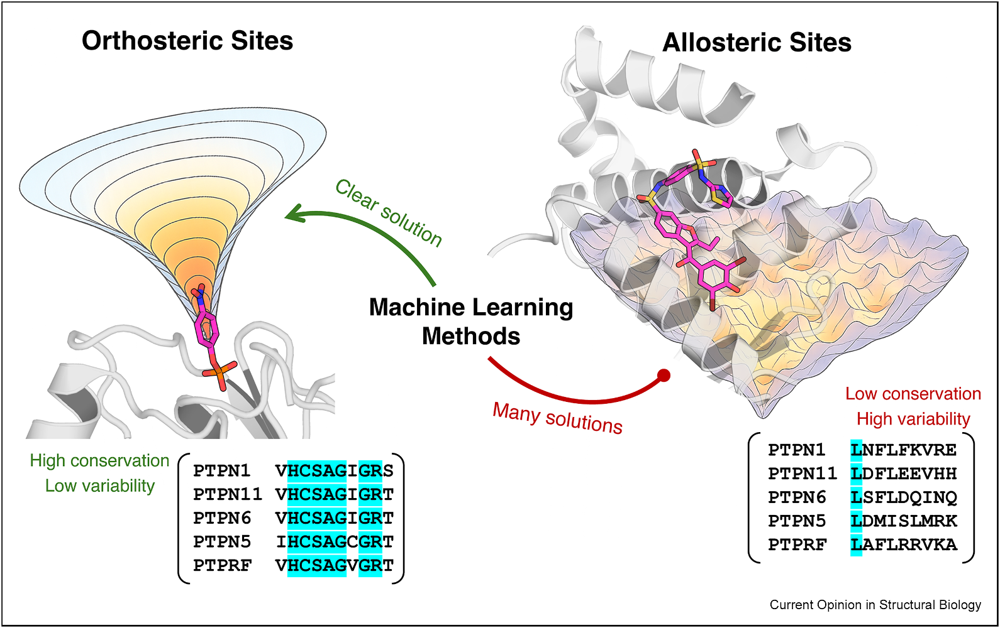

# 【综述】AI如何发现新酶、预测催化效率并解析酶反应与别构调控

## 本文信息

- **标题**：利用人工智能理解酶催化并发现新酶
- **发表期刊**：Current Opinion in Structural Biology
- **发表时间**：2026年10月29日
- **DOI**：https://doi.org/10.1016/j.sbi.2026.103422
- **单位**：美国佐治亚理工学院化学与生物化学学院、化学与生物分子工程学院；瑞典隆德大学化学系
- **引用格式**：Brownless, A.-L. R.; Kamerlin, S. C. L. Harnessing Artificial Intelligence to Understand Enzyme Catalysis and Discover New Enzymes. *Curr. Opin. Struct. Biol.* 2027, *102*, 103422. https://doi.org/10.1016/j.sbi.2026.103422

## 摘要

> 分子模拟始终是理解酶如何工作的核心手段，而人工智能和机器学习（AI/ML）方法的迅速发展，正在大幅拓展模拟能够研究的问题范围。相关方法与成功应用不断涌现，领域发展速度十分迅速。本文从更宏观的层面回顾AI/ML正在改变计算酶学的四个主要方向：**酶发现与功能注释、动力学参数预测、蛋白质动力学与酶反应机理研究，以及蛋白质别构调控解析**。同时，综述讨论了这些方向仍然面临的重要技术挑战，以及相应的解决思路。

### 核心观点

- **从蛋白序列和化学反应双向寻找酶**：对比学习、蛋白语言模型与多模态表征使新酶注释、底物匹配和未知催化反应的候选酶检索更高效。
- **从定性功能走向定量催化能力**：模型逐步预测$k_{\mathrm{cat}}$、$K_M$与$k_{\mathrm{cat}}/K_M$，并尝试纳入温度、pH、突变和实验条件。
- **AI加速计算化学与MD**：机器学习势能、ML/MM、自动发现集体变量及模拟数据分析，分别降低反应势能计算、增强采样和结果解读的成本。
- **蛋白构象与别构是共同的难题**：生成模型能够提供多种结构与可能的变化路径，物理能量、构象占比和实验观测量决定这些结果能否支撑机制结论。

## 从酶序列到催化机理，AI究竟解决哪些问题？

酶学研究的难点横跨多个尺度。发现一个具有目标功能的蛋白，首先要知道它可能催化什么反应；即使找到了候选酶，还需要判断催化效率、底物偏好与环境适应性。进一步解释其高效催化的来源，则涉及**活性位点电子结构、反应自由能面和蛋白质构象动力学**。

理解酶为什么高效、如何被调控，不只是学术问题。药物代谢酶决定化合物的清除与毒性，工业生物催化依赖少数酶完成苛刻条件下的转化，合成生物学则希望把天然不存在的反应交给工程酶。正因如此，**计算酶学长期是连接结构、机理与工程应用的枢纽**，也一直是AI最想攻下的阵地之一。

这些任务所需的数据与计算模型差异很大。例如，用大量酶序列训练的分类模型适合筛选潜在功能；基于量子化学数据训练的势能模型适合计算反应相关能量；从MD轨迹学习的表示则可帮助识别状态转换和远端耦合。把它们放在同一个用AI研究酶的统一框架下，关键是明确**输入是什么、输出是什么、结果如何验证**。

在AI方法进入之前，这几类问题往往依赖彼此割裂的昂贵手段。功能注释主要靠人工整理实验表征结果；动力学参数需要逐酶、逐条件地湿实验测定；反应机理依赖高等级量子化学与大量MD采样；构象与别构则受限于晶体结构往往只给出单一静态快照。不同尺度之间缺少统一表示，**找到一个候选酶和理解它为什么高效之间经常出现断层**，这也正是AI试图填补的地方。

**图1：AI用于计算酶学的主要方向**

- a：建立更高效的物理模型，描述酶催化过程和反应自由能面。
- b：预测别构位点、残基耦合及其对催化过程的影响。
- c：从蛋白与底物信息预测酶动力学参数。
- d：生成多种蛋白构象，描述或补充构象集合。
- e：通过序列和进化规律推断酶的功能及新的催化能力。

为便于理解，先把这些方法与各自的研究问题对应起来：

| 研究目标 | 主要输入 | 典型输出 | 需要重点验证的内容 |
| --- | --- | --- | --- |
| 酶发现与功能注释 | 蛋白序列、结构、底物或反应 | EC编号、反应类别、候选酶排名 | 未知反应和远缘序列上的命中率 |
| 催化参数预测 | 酶序列或结构、底物、实验条件 | $k_{\mathrm{cat}}$、$K_M$、催化效率 | 独立实验、突变体与条件迁移 |
| 催化机理模拟 | 原子坐标、参考量子化学能量和受力 | 势能、反应能垒、自由能面 | 电子结构精度与反应采样收敛 |
| 构象集合与别构 | 序列、静态结构、MD或实验观测 | 候选构象、动态路径、关键耦合残基 | 构象分布、动力学与实验一致性 |

## 一、发现新酶：在海量未知序列中寻找催化功能

宏基因组学积累了大量蛋白序列，其中许多尚无可靠功能注释。传统方法常借助序列相似性、保守基序和已知蛋白家族推断功能；面对远缘同源蛋白、底物谱很宽的酶或天然界中尚未表征的反应时，**序列相似不一定足以判断实际催化能力**。

机器学习的主要作用是把序列、三维结构和化学反应编码到可比较的表示空间。模型可以判断哪些蛋白与已知酶具有相似的功能模式，也可以反过来从目标化学反应检索潜在的催化序列。**两个方向合起来，等于给微生物“暗物质”提供了一条新的筛选路径**。

> 机器学习的价值，在于**让候选酶先被高效地筛出来，把后续湿实验的搜索空间压缩几个数量级**。

### 功能注释与反应条件检索

功能注释大致有两类研究路线。第一类沿用**酶学委员会编号**（Enzyme Commission，EC）等既有功能分类；第二类进一步表示底物和反应本身，以处理比EC类别更具体的化学问题。

| 代表方法 | 主要思路 | 对应任务 |
| --- | --- | --- |
| CLEAN、CLEAN-contact | 对比学习结合序列，后续方法还纳入结构信息 | 未知酶的功能注释与多反应能力识别 |
| ProteInfer、DeepECTransformer | 学习序列到EC功能标签的映射 | 酶类别预测 |
| EasIFA | 联合结构与反应信息的多模态模型 | 催化活性位点注释 |
| Horizyn | 蛋白与化学反应双编码对比学习 | 孤儿反应的酶检索与酶促反应探索 |
| Venus RXN | 以反应为条件进行多模态酶检索 | 根据目标反应寻找候选酶 |

Venus RXN工作报告，在训练集中未见过的反应上**Top-20检索命中率为76.5%**。这是“给定反应寻找候选酶”的检索指标，其意义与预测实际催化速率不同；该工作以预印本形式发表。

这类检索之所以不容易，部分原因在于反应本身比序列更难表示：同一反应可能有多种书写方式，立体化学与离去基团的差异会改变催化要求，而训练数据中的反应分布往往偏重于少数模式生物与已工业化过程。模型在分布内反应上表现好，一旦进入天然产物、非天然或环境微生物相关反应，**命中率更依赖表示是否真正抓住了化学反应的本质**。

这类工作最适合衔接高通量实验：先从大量蛋白序列中挑选少数候选，再用酶活实验确认底物范围、催化效率及操作条件。对于天然多功能酶或非天然反应，**模型提供的候选排序有助于缩小实验搜索空间**。

**图2：从进化关系中识别潜在的结构与功能联系** 图中以蛋白结构及系统发育关系为背景，示意机器学习如何借助低维的潜在表示识别传统序列比较难以直接显现的关联。该图根据本文引用的文献改绘，强调的是功能检索思路，并非某个具体模型的定量基准评测。

## 二、预测催化效率：$k_{\mathrm{cat}}$、$K_M$到底能学到多少？

新酶筛选进一步面临一个更难的问题：**它能催化反应，与它能高效催化反应之间还有很大距离**。酶动力学参数将功能描述推进到定量层面，但它们来自特定底物浓度、温度、pH及缓冲体系下的实验测量。

几个常见指标分别代表：

- $k_{\mathrm{cat}}$：在适用的动力学模型与饱和底物条件下，单位活性酶分子每单位时间完成的催化周转数，通常以$\mathrm{s^{-1}}$表示。
- $K_M$：米氏常数，由相应动力学模型的速率常数决定；在经典Michaelis–Menten条件下，是反应速率达到$V_{\max}/2$时的底物浓度。
- $k_{\mathrm{cat}}/K_M$：常用的催化效率指标，反映低底物浓度条件下的反应能力，尤其适合比较底物与酶变体。

### 模型如何连接酶与底物？

不同模型采用不同的输入组合。**CataPro将预训练蛋白表示与底物分子指纹结合**，预测酶动力学性质；DeepEnzyme和GraphKcat引入蛋白三维结构或催化口袋信息；CatPred则覆盖包括$k_{\mathrm{cat}}$、$K_M$和$K_i$在内的多个参数。

CataPro提供了一个有实验背景的案例：研究者利用模型筛选催化4-乙烯基愈创木酚向香兰素转化的酶，发现一个活性约为既有参考酶**19.53倍**的候选，随后通过计算引导的定向进化进一步提高约**3.34倍**。这里展示的是预测、候选筛选与实验改造相结合的流程。

深度突变扫描（Deep Mutational Scanning，DMS）数据也被用于学习突变效应，相关模型还扩展到温度依赖的$k_{\mathrm{cat}}$和酶的最适pH。**这类模型的发展意味着同一个序列的预测结果可以逐渐与实际工作环境结合**。

把温度与pH纳入预测之所以重要，是因为实验室里表现优异的酶，到了工业或治疗场景的极端温度、酸碱与盐浓度下可能完全失效。**模型若能给出参数随条件的连续变化，就能在设计阶段筛掉那些只在标准缓冲液里可用的候选**，而不必等到湿实验才暴露问题。

### 数据质量往往决定预测的上限

参数预测的困难集中在标签本身：同一种酶在不同实验条件下测得的参数可能有明显差异，公开数据库还可能存在反应匹配错误、错误注释或重复记录。对突变体及训练集中未覆盖的酶家族进行预测，**尤其考验泛化能力**。

实际评估时，建议将训练集内的随机划分与按序列同源性、底物骨架、酶家族或时间划分的测试结合起来，另外记录温度、pH和实验体系。**这样才能区分模型对已知系列的插值能力与寻找真正新酶时的表现**。

> **随机划分测到的是插值，按同源性或家族划分才接近外推**：评估设置本身决定了这个数字能否代表发现新酶的能力。

## 三、理解酶反应：AI怎样进入MD和QM/MM？

酶催化机理通常涉及多个时间与空间尺度。活性位点的成键、断键和电子重排需要量子化学描述；蛋白质局部柔性、溶剂重组、底物进入与产物释放，则要求大量构象采样。**高精度电子结构计算与充分采样的成本冲突**是这一方向的核心问题。

相关的AI方法可以分为几条相互补充的路线。**它们在科研流程中负责的环节不同，适用范围也应分别评估**。

> AI的价值不在于替代模拟，而是**把高价的量子化学计算集中到真正决定反应性的少数自由度上**。

| 方法路线 | AI承担什么工作 | 主要用途 |
| --- | --- | --- |
| 机器学习力场（MLFF/MLIP） | 从量子化学能量、力学习势能函数 | 更高效的结构优化与动力学模拟 |
| ML/MM | 用训练得到的机器学习势能表示反应相关区域，其他环境仍用经典MM | 加速含化学反应的酶模拟 |
| AI辅助增强采样 | 学习集体变量（CV）或辅助选择采样方向 | 探索稀有构象与反应路径 |
| MD轨迹的机器学习分析 | 提取关键特征、识别状态、建立网络 | 理解动力学与功能联系 |
| 谱学分析辅助 | 从数据中学习NMR谱与化学位移等关系 | 将实验观测与构象模型连接 |

### MLFF与ML/MM：把计算量集中在关键物理过程

机器学习力场利用量子化学参考数据学习原子构型到能量和力的映射。已有的模型包括ANI系列、MACE-OFF，以及针对氢键协同与长程静电作用改进的模型。**对于研究酶反应，尤其重要的是反应前、过渡态附近和产物区域的构型覆盖**，以及不同电荷态和溶剂环境的处理。

**ML/MM更接近传统QM/MM的工作分区**：把需要描述反应性的区域交给机器学习势能，其余蛋白与溶剂仍采用经典分子力学。这样可以将昂贵的QM计算转移到参考数据生成和模型验证阶段，再用训练好的势能执行更多模拟。精度则取决于参考电子结构方法、训练构型、区域之间的相互作用和电荷处理。

**静电嵌入**（Electrostatic Embedding）是ML/MM中的关键一环：蛋白与溶剂产生的电场会影响活性位点中的电荷分布和化学反应。针对ML/MM设计合理的静电耦合方案，有助于将局部势能模型用于真实酶环境；已有应用包括分支酸变位酶和Diels–Alderase等反应体系。

需要注意，MLFF在反应相关区域的可靠性高度依赖训练数据是否覆盖过渡态附近与不同电荷态的构型。如果参考数据主要来自平衡态或反应物，模型在反应路径关键区域可能出现系统偏差；**训练构型的覆盖范围因此比势函数形式更值得先检查**。

### AI辅助增强采样与MD分析

另一路线重点解决构象采样问题：机器学习从已有轨迹或构象中提取有助于区分状态的特征，用于CV选择、偏置采样或轨迹分析。对于底物结合、蛋白开合和别构激活等过程，**这能帮助研究者从高维原子坐标中找到少数关键自由度**。

值得区分的是，**采样效率、势能精度和热力学重加权是三个不同的问题**。改进CV可以更快到达重要状态，改进ML势能可以降低每一步计算成本，而自由能及状态分布的可靠性仍取决于对应方法的统计力学条件与采样质量。

> 一个环节变快，不等于整条链路的统计量变准：**采样、势能与重加权必须分别验证**，改进其中一项不会自动修好另外两项。

**图3：AI如何结合或替代部分传统模拟环节**

- 左侧：从模拟中提取合适的坐标，开展定向采样与反应路径探索。
- 右上：从构象数据中识别与酶功能相关的相互作用或结构特征。
- 右下：利用生成模型构建候选构象集合，补充传统模拟对构象空间的探索。
- 图中的两条路径分别强调**直接参与模拟和改进模拟分析两条路线**；生成的结构还需要与物理模型和实验结果相互检验。

## 四、构象集合与别构调控：从一张结构走向状态分布

AlphaFold等方法大幅提高了蛋白质结构预测的可及性，但许多酶的催化能力由**不同构象之间的平衡和相互转换**决定。开闭状态、催化环重排、别构位点结合以及亚基间耦合，都要求超越单一结构去研究构象集合。

### 从多结构预测到构象集合

构象集合的生成与约束有几种不同策略：

- **通过MSA扰动产生多样性**：AF-cluster利用多序列比对（MSA）子采样与聚类寻找替代构象；AFSample2利用MSA列掩蔽降低共进化约束；SF-cluster进一步引入局部能量受挫（Frustration）信息指导采样。
- **通过生成模型提出构象**：DiffEnsemble等扩散模型生成多个结构候选，ConforMix尝试在推理阶段增强模型对较难到达状态的采样。
- **用实验观测约束集合**：ExEnDiff在扩散生成过程中引入实验信息，改善构象集合与观测约束及目标分布的匹配。
- **生成有时间顺序的构象路径**：相关自回归与时空扩散方法尝试模拟蛋白结构随时间的演化；Gen-COMPAS结合生成式采样、committor相关信息与分子力学修正，探索复杂构象转换路径。

其中有个关键区分：

> **生成多样的结构、得到正确的平衡构象分布、重现真实转换动力学，是三个不同层次的目标**，不能混为一谈。构象长得合理，并不自动意味着它出现的概率正确，更不意味着状态间的转换速率正确。

因此，应用这类方法研究酶时，**建议根据研究问题选择验证指标**。构象集合可与SAXS、NMR等实验观测比较；构象转换路径可用额外MD、能量计算和关键状态的物理合理性进行检验；要报告自由能或动力学量时，还需要相应的统计力学处理。

具体到集合验证，NMR化学位移与弛豫、SAXS散射曲线等系综敏感信号，比单一结构更容易区分构象A还是构象B占主导；但如果实验本身只提供平均信息，模型也可能只是拟合了平均值而非真实分布。**好的验证通常要求实验约束与独立物理量共同出现**，而不是用同一个信号既训练又检验。

### AI怎样识别别构通路与隐藏口袋？

蛋白质别构涉及远端扰动如何影响活性位点或功能状态。可用工具包括**用于大型构象变化路径预测的DeepPATH**、分析GPCR动态耦合的DRUMBEAT，以及寻找潜在别构口袋的PASSer2.0和DeepAllo。

不同模型关注的对象也不同：口袋预测给出可能结合调节剂的位置，轨迹或网络分析给出构象变化中重要的残基耦合，结构生成模型则提出可能存在的状态。把这些信息组合起来，才更容易形成**从潜在调节位点到构象变化，再到催化功能改变**的可检验假说。

别构预测之所以困难，除了位点本身更模糊，还因为调节剂结合与功能状态改变之间不一定一一对应：同一个口袋在不同条件下可能产生激活或抑制，远端突变也可能通过多种路径影响活性。**同一个位点的功能后果因此不能只靠结构推断**，需要突变实验与动力学观测来确认。

> **结构只回答可能结合在哪里，不回答结合之后会发生什么**：别构位点从预测走向机制，还需要功能层面的实验验证。

**图4：正构与别构位点的识别难度示意** 左侧用较明显的漏斗形能量景观表示相对特异的正构结合模式；右侧以较平坦、多局部极小值的能量景观表示别构位点可能具有的多样性。图中还对比了两类位点的序列保守性与结构差异。这是解释别构预测困难的概念图，具体蛋白是否符合这种趋势仍需结合其物理与进化背景判断。

## 五、怎样判断AI给出的酶学结论是否可靠？

模型验证值得单独讨论。不同方向虽然都使用机器学习，但“准确”的定义差异很大：分类准确率衡量功能标签，参数误差衡量动力学性质，重建RMSD衡量结构接近程度，而**自由能与实际反应速率涉及更严格的物理统计要求**。

> **验证必须与目标物理量对齐**：声称预测自由能，就要用自由能的证据检验，而不是拿分类准确率替代。

### 数据、物理与实验应当相互约束

- **数据层面**：检查功能注释的可信度、酶和底物的对应关系、实验条件、重复样本及训练集与测试集之间的相似性。负结果发表不足还可能使训练数据偏向成功案例。
- **物理层面**：对于势能模型，用参考QM/DFT数据检查反应相关构型的能量与受力，检验训练外的电荷态和反应区域；对于构象生成模型，评估能量、状态分布及结构完整性。
- **实验层面**：利用酶活测定验证催化参数，利用NMR弛豫、SAXS等集合敏感的观测验证蛋白动力学。对酶功能与别构调控，还应尽可能引入突变和位点特异的实验对照。

还有一个容易忽视的陷阱：用模型自己学到的表示去验证同一个模型，往往得到过于乐观的结论。**真正有说服力的验证，应当把AI的输出交给它没见过的实验或独立的物理计算去检验**，例如用湿实验测得的$k_{\mathrm{cat}}$去核对预测值，或用从头MD采样检查生成模型给出的状态是否真实可达。

### 对方法选择的启发

若研究目标是寻找可能催化某反应的未知酶，优先考虑反应条件检索、功能注释与实验筛选的组合；若要比较同一酶不同突变体的催化能力，应明确$k_{\mathrm{cat}}$等标签的实验条件和数据外推范围；若要解释**催化机理、反应能垒或构象布居偏移**，则需要将机器学习与MD、增强采样、QM/MM或实验状态分布结合。

这也解释了为什么基于物理知识、能利用实验条件的AI模型更受关注：生物物理问题往往存在少量精确数据和大量间接数据，**利用已知的相互作用、守恒规律和实验约束可以使模型的结论更容易验证**。

## 关键结论与批判性总结

AI计算酶学目前较分散的方法可以归为四条路线：**找出具有目标功能的酶、预测其催化效率、计算反应与动力学、解释构象与别构调控**。其中前两条以序列、底物和实验数据为主，后两条更依赖三维结构、物理势能与构象采样。

这些路线如何配合，是比单条路线性能更值得回答的问题。

> 最有价值的发展，是让四类模型在同一流程中接力：**先用反应条件模型筛候选，再用动力学预测削减实验量，接着以MD和ML/MM研究关键候选的机理，最后用实验检验催化效率或别构假说**。这个流程是对现有方法的整合，并非一项已经完成的统一基准评测。

当前限制主要来自**实验标签的条件依赖、训练数据覆盖不足、构象分布的物理可信度，以及不同工具缺少统一验证协议**。AI可以帮助提出值得计算和实验检验的候选与机制，而定量生物物理结论依然需要与相应物理量直接对应的证据。

方法选择还有一点常被忽略：许多酶学AI模型在公开基准上表现良好，但公开数据本身存在条件标注不全、负样本偏少、远缘序列覆盖不足等问题，**外推到全新反应或新家族时性能往往会明显下降**。模型输出应被当作有待实验或物理计算验证的假说，而不是结论本身；把AI用于真正的研究决策前，最好先在小规模已知体系上确认它的适用边界。
