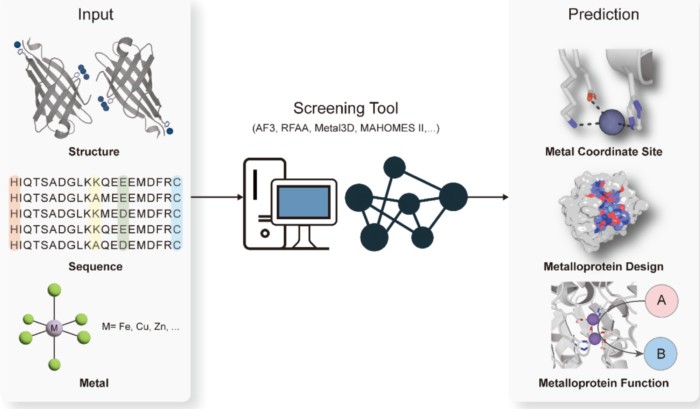
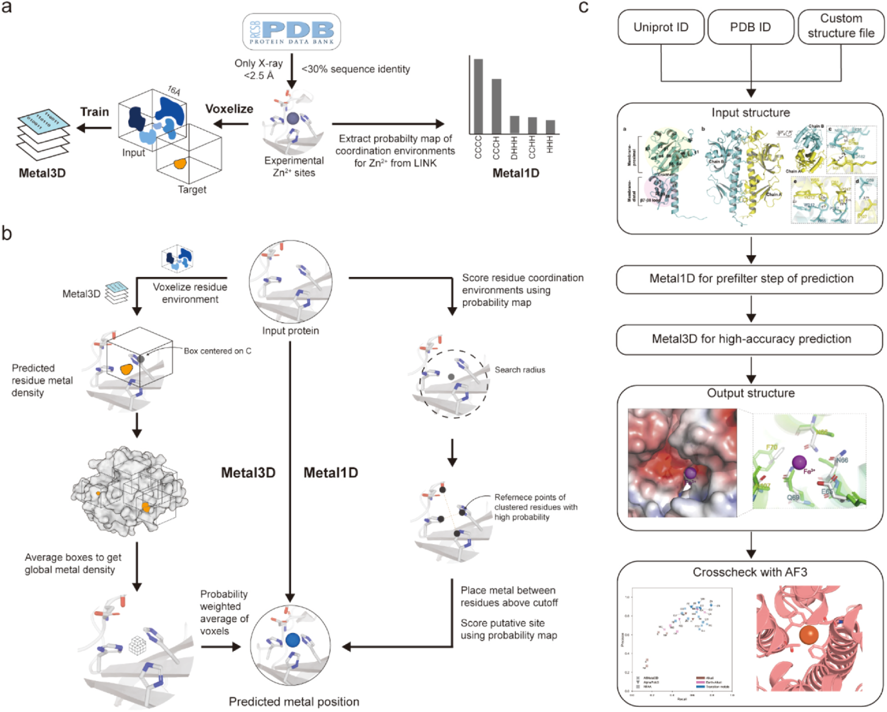
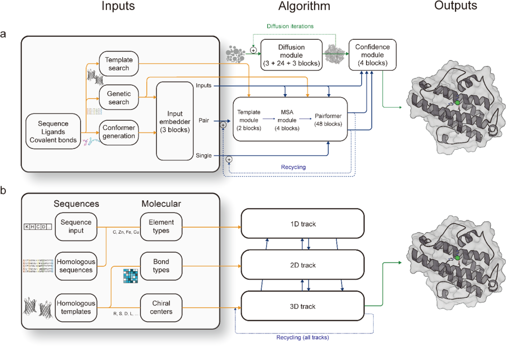
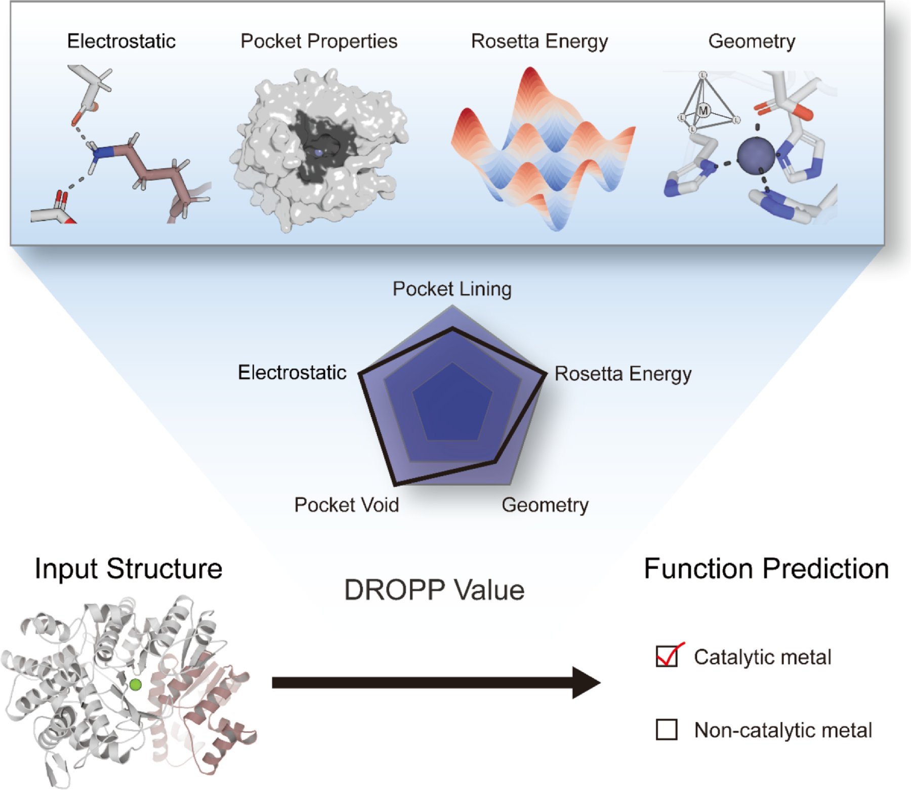
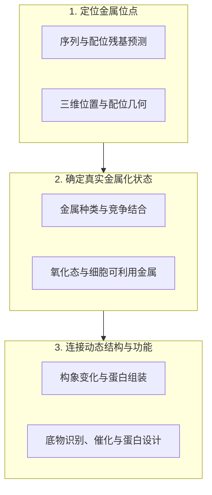

# 【综述】人工智能预测金属蛋白：从配位位点到催化功能，还有哪些难题？

## 本文信息

- **标题**：人工智能预测金属蛋白的近期进展与未来挑战
- **作者**：Soohyeong Kim、Wonseok Lee、Hugh I. Kim、Min Kyung Kim、Tae Su Choi
- **发表期刊**：*Molecules and Cells*
- **发表时间**：2025年2月10日
- **DOI**：https://doi.org/10.1016/j.mocell.2025.100191
- **单位**：韩国高丽大学化学系、生命科学部及韩国嘉泉大学药学院
- **引用格式**：Kim, S., Lee, W., Kim, H. I., Kim, M. K., & Choi, T. S. (2025). Recent advances and future challenges in predictive modeling of metalloproteins by artificial intelligence. *Molecules and Cells*, *48*(4), 100191. https://doi.org/10.1016/j.mocell.2025.100191
- **文章类型**：Minireview（短综述）。涉及模型的公开代码、网站和数据库集中列于文末工具表。

## 摘要

> 金属配位对于金属蛋白的结构与催化功能至关重要，而金属蛋白参与了生物体内广泛的生命过程。生物信息学的发展显著加深了我们对金属结合位点及其功能的理解。当前用于预测金属结合位点的计算模型能够整合蛋白质序列和结构数据，分析复杂的金属配位环境。本文综述了相关预测工具，并重点讨论金属结合位点建模仍面临的挑战，包括**动态金属结合位点的预测、具有生理功能的金属化状态的确定，以及复杂配位网络的设计**。解决这些问题有助于理解天然金属蛋白，也将促进具有新功能和精确设计特性的人工金属蛋白的开发。

## 研究背景：为什么金属蛋白难以预测？

金属蛋白（metalloprotein）在生命体系中十分常见。据本文引用的估计，**约30%–40%的蛋白质组由金属蛋白组成**。这些蛋白通过结合金属离子或金属辅因子完成结构稳定、物质运输、信号传导以及酶催化等任务。金属可以是维持蛋白折叠的结构组分，也可以直接参与底物活化和化学反应。

例如，锌离子可以稳定锌指蛋白的局部结构；钙调蛋白的EF-hand结构域在结合钙离子后发生构象变化，调节下游相互作用；部分含铁或含锰酶则借助金属中心活化氧气。看似都是金属结合，实际涉及的**配位几何、电子结构与蛋白质构象可能完全不同**。

金属蛋白研究过去依赖晶体学、光谱学和生化实验，逐个解析金属类型、配位残基及其功能。随着蛋白质结构数据库和人工智能模型的发展，人们可以从序列、三维结构或已知配位环境出发，**预测哪些残基参与结合、金属位于何处，以及该位点可能承担什么功能**。

问题在于，**这些任务所需的信息并不相同**。找出一组靠近金属的氨基酸，距离确定生理环境中究竟结合哪种金属、以什么氧化态存在、又如何催化特定反应，还有很长一段距离。

**图1：生物信息学预测金属蛋白结构与功能的总体思路。** 模型以蛋白质序列、三维结构和金属相关信息为输入，预测潜在金属配位位点，并为人工金属蛋白设计、催化与非催化功能判断提供依据。图中列出AlphaFold3、RoseTTAFold All-Atom、Metal3D及MAHOMES II等代表性方法。

### 先分清四种预测任务

| 预测问题 | 期望输出 | 代表方法 | 需要注意的区别 |
| --- | --- | --- | --- |
| 哪些蛋白或残基可能结合金属？ | 金属结合概率、候选残基或序列注释 | mebipred、bindEmbed21、MetalNet | 残基级预测未必能给出金属的精确三维位置。 |
| 金属离子应放在什么位置？ | 金属原子的三维坐标、候选配位构型 | Metal1D、Metal3D、AlphaFold3、RoseTTAFold All-Atom | 几何合理不等于该状态在细胞内稳定存在。 |
| 金属位点能否结合底物、参与催化？ | 蛋白–金属–配体结合模式，或催化/非催化分类 | MetalProGNet、MAHOMES II | 对接构象、结合评分与真实催化活性是不同指标。 |
| 哪种金属、哪种状态才具有生理功能？ | 金属种类、氧化态、占位及功能条件 | 仍是重要开放问题 | 还需考虑金属供给、竞争结合、构象变化和细胞环境。 |

## 一、从序列出发：哪些残基可能结合金属？

当目标蛋白没有可靠的三维结构时，序列预测通常是第一步。常见金属配位残基包括半胱氨酸（Cys）、组氨酸（His）、天冬氨酸（Asp）和谷氨酸（Glu）；其侧链分别可提供硫、氮或氧配位原子。蛋白主链及血红素等有机辅因子也可能参与配位，因此只检索Cys、His、Asp和Glu，**并不能覆盖全部金属结合位点**。

### bindEmbed21：让蛋白质语言模型寻找结合残基

bindEmbed21利用蛋白质语言模型ProtT5提供的序列嵌入（embedding）进行残基级预测。简单理解，语言模型先通过大量蛋白质序列学习氨基酸上下文关系，再将每个残基表示成一个特征向量；下游模型利用这些向量判断该位置**是否可能结合金属离子、核酸或小分子**。

- **输入与表征**：从蛋白序列得到每个氨基酸的ProtT5嵌入，嵌入携带局部序列环境及从预训练中学到的统计信息，**不要求先解析实验三维结构**。
- **残基级判别**：其机器学习分支bindEmbed21DL使用卷积神经网络处理嵌入，**输出各残基的结合预测**；这一网络结构可在项目代码中查到。
- **同源信息补充**：还可以结合已知同源蛋白的结合位点，利用序列相似性转移注释，**形成机器学习与同源推断的组合**。

它适用于大规模序列筛选，但预测结果主要回答**哪些残基可能参与结合**，无法单凭这些概率还原完整配位几何，也不能据此确定细胞中的实际金属种类。对于训练数据稀少的金属类型，模型的适用性同样需要重新评估。

### mebipred：用手工特征识别蛋白的金属结合潜力

mebipred更强调从序列中构建可直接用于分类的特征。综述介绍的模型从已知金属蛋白数据中建立正负样本，提取**220项序列特征**，包括氨基酸组成、理化性质及与金属结合相关的五肽模式，然后输入多层感知机进行预测。

其优势是对短序列片段也能估计金属结合潜力，适合宏基因组学中的初步筛选；但结果受训练集的金属类型和注释质量影响，稀有金属的预测可能较弱。对未知蛋白做高通量注释，与解析某个活性位点的精确配位结构，**是两种不同的使用场景**。

### MetalNet及MetalNet2：利用残基之间的共进化联系

MetalNet将序列分析与金属配位残基之间的**三维接触关系联系起来**。模型围绕常见的Cys、His、Glu、Asp残基对，学习它们形成金属结合簇时的关系模式，并利用这些模式识别新的金属结合区域。

金属中心往往由序列上相距很远的多个残基共同组成。共进化分析可以从大量同源序列中寻找**倾向于共同变化的残基关系**，为推断这些残基是否在空间上接近提供线索。这也解释了为什么单纯检索局部序列模体可能遗漏真正的结合位点。

MetalNet在未被注释为金属蛋白的CitX中识别出潜在锌结合区域，涉及C145、C148、C155和H161；随后的实验观察到这些残基与锌离子的相互作用，并发现加入锌离子后蛋白结构刚性增强。这一案例说明，模型**可用于发现已有数据库没有记录的金属蛋白**。

后续的MetalNet2扩展了数据集，并改进了金属种类识别及真核蛋白上的适用性。两者主要面向高通量序列注释，其对CHED（Cys、His、Glu、Asp）残基模式的依赖**仍可能限制其他配位基团的覆盖范围**。

## 二、从三维结构出发：金属离子应该放在哪里？

知道哪些残基可能结合金属，还需要解决空间定位问题。以一个锌结合位点为例，即使His和Cys都被正确识别，它们侧链的取向与空间距离**也会影响金属离子是否能形成合理的配位构型**。

经典几何判据会比较潜在配位原子之间的距离和方向。深度学习则尝试**直接学习已知金属蛋白中的局部原子环境**，利用其统计规律寻找候选金属位置。

### Metal1D与Metal3D：快速几何搜索和三维概率密度预测

Metal1D和Metal3D出自同一系列研究，但采用了不同策略。Metal1D利用统计配位几何**快速筛选**候选簇，Metal3D则学习局部三维环境并**预测金属出现的空间概率密度**。

Metal1D汇总实验结构中配位残基与金属之间的几何关系，在待预测蛋白中搜索满足距离与残基类型条件的候选簇，再对可能的金属结合位置打分。这种方法**计算相对直接，但在不规则、复杂或非典型配位环境下可能遗漏位点**。

Metal3D把每个候选残基周围的原子环境划分成三维体素（voxel），相当于把蛋白质附近的一小块空间转换成三维网格。卷积神经网络**学习每个网格点附近出现金属的可能性**，然后将不同残基贡献的局部概率密度组合，得到整个蛋白的金属位置分布。

- **训练数据**：以PDB中有实验金属坐标的结构为基础，**学习配位原子与金属位置之间的空间关系**。综述图2展示了针对锌结合位点的训练和预测流程。
- **局部预测**：网络根据残基附近的三维环境产生金属概率密度图，能够利用周围原子的空间分布，**不依赖一套固定的配位模板**。
- **全局整合**：把多个局部预测合并后寻找概率密度较高的空间区域，**推断候选金属离子的三维坐标**。

可以把Metal1D理解为寻找符合已知配位规则的原子组合，Metal3D则是在实验结构中学习复杂的空间模式。它们都依赖合理的输入蛋白结构；如果金属结合前后**存在大幅构象变化，输入结构本身就可能缺少形成配位位点所需的信息**。

**图2：Metal1D与Metal3D的训练、预测及组合应用。**

- **a**：使用PDB中的实验锌结合结构训练Metal3D，**同时提取金属配位环境的统计规律用于Metal1D**。
- **b**：Metal3D将残基周围空间体素化，生成局部金属概率密度，并汇总成全蛋白的预测分布；Metal1D依据候选配位残基的几何聚类和打分定位金属。**图中两条路径最终都给出候选金属位置**。
- **c**：展示先用Metal1D快速筛选、再用Metal3D提高定位精度，并**与AlphaFold3结果交叉比较**的流程。原图综合改绘自Dürr等人的研究。

在人的碳酸酐酶II案例中，研究者利用已有的锌离子解离常数（$K_d$）数据分析突变影响。**第一配位层的突变明显降低了Metal3D预测的金属结合概率**，第二配位层突变的影响则不显著。这表明模型对直接配位环境较敏感，但其输出的位点概率不应直接等同于实验测得的 $K_d$ 或结合自由能。

### 第一配位层和第二配位层为什么要区分？

第一配位层（primary coordination sphere）包含直接与金属形成配位作用的原子，例如His的咪唑氮或Asp的羧酸氧。它们**很大程度上决定配位数、配位几何和局部电子环境**。

第二配位层（secondary coordination sphere）则由不直接配位金属、但与第一配位层和底物发生相互作用的残基构成。这些残基**可通过氢键、静电作用、疏水环境和局部柔性改变金属位点的性质**，尤其在催化过程中影响底物定位与过渡态稳定。

因此正确放置一个金属原子，**只是预测催化功能的起点**。几何上相似的两个位点，仍可能因第二配位层不同而具有截然不同的反应能力。

### MetalProGNet：把金属蛋白、配体和相互作用放进同一张图

催化位点常有开放或易交换的配位位置，用于容纳底物。MetalProGNet将蛋白质、金属离子和小分子配体表示为图，用图神经网络**学习它们的相互作用**。

图中原子构成节点，化学键或空间相互作用构成边。网络分别处理分子内部的共价连接，以及蛋白质、金属和配体之间的非共价相互作用，再聚合这些信息，**预测金属蛋白与小分子的结合性质和可能的结合模式**。

综述介绍，MetalProGNet在4-羟基苯丙酮酸双加氧酶、stromelysin和pirin等有配体结合晶体结构的测试体系上进行了评估，用于分析金属附近配体的结合位置。它更适合讨论**已知金属蛋白结构中的配体识别问题**；预测正确的结合姿势，并不自动证明催化路径和反应速率正确。

## 三、AlphaFold3与RoseTTAFold All-Atom：金属进入整体结构预测

传统金属位点定位模型往往需要先提供可靠的蛋白三维结构。如果输入结构尚不存在，可以借助蛋白结构预测模型建立候选构象；更进一步，**联合折叠（cofolding）方法可以把金属离子和其他分子直接纳入结构建模**。

### AlphaFill：为已有预测结构补充缺失的辅因子

AlphaFold2通常预测蛋白质本身的结构，未直接把配体或金属辅因子放入输出结构。AlphaFill采用不同思路：寻找与目标蛋白序列和结构相似的已知实验复合物，再将其中的金属、配体或辅因子**转移到AlphaFold模型对应位置**。

AlphaFill的核心是基于已知结构信息进行移植，**而非从头计算金属配位的化学能量**。对于有合适实验模板的蛋白，它可以快速为结构模型补充潜在功能组分。综述提到，该工具曾利用已知结构为ABL1蛋白酪氨酸激酶补充ATP及两个镁离子，形成可供后续研究的候选活性状态。

### AlphaFold3与RoseTTAFold All-Atom：把金属纳入联合建模

AlphaFold3能够联合建模蛋白质、核酸、小分子配体和金属离子等组分。它利用原子级输入表示与分子关系信息，经由Pairformer等模块**整合相互作用特征**，再通过扩散模型逐步生成和优化三维原子坐标。

与先预测蛋白骨架、再单独放入金属的方法相比，这类联合预测允许模型在结构生成阶段考虑金属与蛋白之间的相互作用。不过，网络给出的坐标是结构预测结果，**不能直接当作金属氧化态、质子化状态、结合热力学或催化活性的验证**。

RoseTTAFold All-Atom（RFAA）把蛋白、核酸、修饰残基、小分子和金属纳入原子级建模。其整体架构**沿用RoseTTAFold的多轨道信息交换思路**，结合一维的序列及元素特征、二维的成键关系和三维的结构与手性信息。

模型在不同信息轨道之间反复更新，使序列、化学连接和空间结构相互约束。它可以生成金属结合复合物的候选结构，但对配位距离、几何构型及电子状态的可靠性**仍需结合化学知识或独立方法检查**。

**图3：AlphaFold3与RoseTTAFold All-Atom的模型架构示意。**

- **a**：AlphaFold3以序列、配体与共价连接等信息为输入，结合模板、遗传信息搜索、Pairformer、扩散模块和置信度模块**生成复合物结构**。
- **b**：RoseTTAFold All-Atom将序列、元素类型、键连接和手性等信息映射到一维、二维和三维轨道，**反复交换与更新信息**，生成包含金属等组分的结构。

综述列举了这些模型**在金属蛋白研究中的早期应用**：AlphaFold3被用于分析AKT中的锌结合残基His13、His89和Glu91；另一项研究则用AlphaFold3预测了鲍曼不动杆菌细菌铁蛋白（Ftn）与类铁蛋白bacterioferritin的亚铁氧化酶中心结构，发现Ftn亚基呈双核铁中心配位，而bacterioferritin亚基仅结合单个铁原子；AlphaFold和RoseTTAFold系列模型也用于研究分枝杆菌BlaRMab蛋白的锌结合区域，涉及His191、His195和Glu232。

这些例子说明联合结构预测可为金属位点提出具体假设，但不同方法之间的精度比较**需要在同一数据集和统一指标下进行**。本篇是工具与挑战综述，没有提供覆盖全部模型的统一性能基准，不能仅凭某个案例判断哪种算法普遍最好。

## 四、从结构到功能：这个金属位点真的负责催化吗？

金属蛋白**即使具有明确的结合位点，也不一定是金属酶**。有些金属提供结构稳定性；有些在活性中心参与催化；同一种金属甚至可能支持不同类型的化学反应。

一个典型例子是乌头酸酶（aconitase）。它含有铁硫簇；尽管铁硫簇通常参与电子转移氧化还原反应，乌头酸酶中的铁硫簇却催化柠檬酸与异柠檬酸之间的异构化（非氧化还原）反应。仅凭金属的化学身份，**无法推断它在特定蛋白中的催化机制**。

### MAHOMES I/II：区分催化与非催化金属位点

MAHOMES（Metal Activity Heuristic Of Metalloprotein and Enzymatic Sites）系列方法**专门回答金属结合位点是否具有酶催化功能**。它从已知三维结构中提取物理化学描述符，并学习催化位点与非催化位点之间的差异。

MAHOMES涉及五类特征：口袋内壁（Pocket lining）、口袋空腔（Pocket void）、静电性质（Electrostatics）、Rosetta能量（Rosetta energy）和配位几何（Coordination geometry）。综述还介绍了DROPP（distribution overlap of a physicochemical property）评分，**用于评价候选位点与不同功能类别在性质分布上的相似程度**。

这些特征的作用各有不同：配位几何刻画金属周围原子的排列；口袋形状与可接近性关系到底物能否进入；静电环境和Rosetta能量特征则为局部相互作用提供补充信息。判断催化功能需要关注整个活性口袋，**而不只是直接接触金属的几个原子**。

**图4：MAHOMES II如何判断金属位点是否具有酶催化功能。** 模型从已知金属蛋白结构提取静电性质、口袋特征、Rosetta能量及配位几何信息，利用物理化学特征和DROPP相关分析，将金属位点分类为催化或非催化位点。图中的雷达图展示不同类别特征的综合描述，输出为位点功能分类。

综述强调，催化位点与非催化位点的差异并不总是由第一配位层决定。**水分子进入活性中心的条件、参与反应的残基相互作用网络，以及可稳定过渡态的局部构象柔性**，可能更能解释两者的功能区别。

MAHOMES II需要输入含有金属位点的三维结构。因此，它**适用于分析已经获得结构的候选位点**，而不属于直接从一条未知蛋白序列推断完整催化反应的模型。

### 生理性位点与偶然结合位点，也需要分开

晶体结构中出现金属，**不代表它就是蛋白在细胞里使用的生理性辅因子**。金属可能来自结晶条件、纯化过程或其他实验环境。综述介绍的相关判别工作指出，生理性金属位点常具有较高的配位残基保守性、较低的溶剂可及性，以及更多共同参与配位的残基。

在该研究报告的数据中，生理性位点平均涉及约2–4个配位残基，偶然结合位点通常约1–2个。这是用于辅助分类的统计特征，**不能机械地把配位残基数量当成生理功能的判定标准**，因为不同蛋白、金属与实验状态之间可能存在例外。

此外，综述还提到针对疾病相关金属结合位点突变的多通道卷积神经网络模型。相关研究以1,256个疾病相关突变和261个良性相关突变为样本，综合局部空间相互作用、序列特征及金属类型进行分类，**为研究金属结合位点突变与疾病的关系提供了另一条技术路线**。

## 五、当前模型究竟还缺什么？

对金属蛋白的预测可以沿着“位置、金属身份、功能状态”逐层推进。其中**后两项尤其依赖实验条件、蛋白构象和细胞环境**，仅有一张静态结构通常不够。

### 挑战一：结合位点可能接受多种金属，怎样判断实际使用哪一种？

蛋白质金属结合位点具有一定的**金属结合非专一性**（metal-binding promiscuity）。例如，$\ce{Mg^{2+}}$与$\ce{Ca^{2+}}$、$\ce{Na^+}$与$\ce{K^+}$都可能竞争某些相近环境中的结合位点；对过渡金属而言，还要考虑Irving–Williams系列所反映的二价金属配合物稳定性差异。

但配位结构相容**并不保证生理金属化状态正确**。决定蛋白实际结合哪种金属的因素包括该位点对不同金属的选择性、金属在细胞内的可利用量，以及金属装配相关的生物学过程。

对于含有多个金属中心的蛋白，预测任务更复杂。以含Mn/Fe双金属中心的氧化酶和Cu/Zn超氧化物歧化酶SOD1为例，不同金属分别承担不同的化学或结构作用。模型需要判断**金属分配、局部配位几何与氧化态**，而非只是在两个相邻位置各放一颗金属离子。

### 挑战二：金属结合位点会随着蛋白运动出现或消失

某些配位残基在游离蛋白结构中彼此相距较远，**只有经历构象变化才接近并形成完整位点**。这在柔性较强的蛋白区域和内在无序蛋白（intrinsically disordered protein，IDP）中尤为常见。

综述以α-突触核蛋白为例，介绍其N端Met1、Asp2和His50参与的铜结合模式。远隔序列位置通过构象重排形成配位环境，说明预测一个静态构象中的金属位置，**可能遗漏仅在特定构象中出现的结合位点**。

类似问题还存在于蛋白–蛋白界面。某些金属结合位点由两个或多个蛋白亚基共同构成，例如γ-碳酸酐酶和胰岛素等蛋白组装体。**若四级结构预测不可靠**，界面上的金属配位位置也很难正确确定。

这也为分子模拟提供了明确的研究任务：考察候选配位残基在构象集合中的接近概率、配位几何变化与构象转变路径，并结合金属结合后的结构与能量变化进行验证。这属于依据综述所指出问题提出的计算研究思路，**不代表本文已经通过分子动力学模拟解决了这些挑战**。

### 挑战三：能设计一个金属结合位点，还不等于能设计出金属酶

在蛋白表面**构建简单金属结合位点已有成功案例**。例如，在α螺旋上布置序列间隔为$i$和$i+4$的两个组氨酸，可以使侧链在空间上形成合适的配位位置，供进一步引入金属中心。

真正具有酶催化活性的金属位点则往往位于蛋白内部，需要精确安排底物结合空间、第一配位层、氢键网络、局部静电环境与柔性。过渡态稳定性对催化尤为重要，结构中有金属、底物能够结合，**都不能保证该蛋白有可观的催化效率**。

因此，人工金属酶设计**需要将结构预测与功能评价联系起来**，特别是金属选择性、底物取向、第二配位层和反应机制。这也是MAHOMES一类位点功能判别方法具有研究价值的原因。

### 挑战四：细胞中的金属供应会改变最终产物

蛋白在体外更偏好某种金属，**不代表它在细胞表达时一定会结合这种金属**。综述引用了一个2025年的研究：原本与锰相关的蓝细菌cupin蛋白在大肠杆菌表达时，由于宿主细胞金属池的差异，出现了非预期的$\ce{Fe^{2+}}$错误金属化（mis-metalation）。

这意味着结构预测和结合倾向只是金属化过程的一部分。将来若希望在不同宿主中设计或表达人工金属蛋白，**需要同时考虑蛋白结合位点的选择性与宿主细胞的金属稳态**，否则即使设计结构正确，实际装配的金属辅因子也可能不同。

## 六、实用工具汇总：怎样按任务选择方法？

原文共提到两个金属配位位点数据库：MESPEUS与MetalPDB（https://metalpdb.cerm.unifi.it/），均可**查询已解析结构中的金属位点及其局部环境**。

**表1：综述涉及的金属蛋白预测、功能分析及设计工具。**

| 工具 | 主要用途 | 入口 |
| --- | --- | --- |
| MESPEUS | 查询实验金属配位环境与结构统计信息 | https://mespeus.nchu.edu.tw/ |
| Metal3D | 从蛋白三维结构预测金属原子位置 | https://github.com/lcbc-epfl/metal-site-prediction |
| Metal1D | 根据配位几何快速搜索候选金属位点 | https://github.com/lcbc-epfl/metal-site-prediction |
| MetalProGNet | 金属蛋白–小分子相互作用与结合性质预测 | https://github.com/zjujdj/MetalProGNet |
| AlphaFill | 为AlphaFold模型移植已知配体与金属辅因子 | https://alphafill.eu/ |
| MetalNet | 基于序列共进化预测金属结合位点 | https://github.com/wangchulab/MetalNet |
| MetalNet2 | MetalNet后续版本，扩展金属位点注释能力 | https://github.com/wangchulab/MetalNet2 |
| bindEmbed21 | 基于ProtT5嵌入和同源信息预测结合残基 | https://github.com/Rostlab/bindPredict |
| mebipred | 基于序列特征预测金属结合潜力 | https://services.bromberglab.org/mebipred/home |
| Variational autoencoder | 变分自编码器辅助金属蛋白与蛋白折叠设计 | https://github.com/psipred/protein-vae |
| AlphaFold3 | 联合预测含金属及其他分子的复合物结构 | https://alphafoldserver.com/ |
| RoseTTAFold All-Atom | 原子级生物大分子–金属复合物结构预测 | https://github.com/baker-laboratory/RoseTTAFold-All-Atom |
| MAHOMES II | 判断已知金属位点是否属于酶催化位点 | https://mahomes.ku.edu/ |
| Multichannel-CNN | 分析金属位点疾病相关突变的空间与序列特征 | 原仓库链接已失效 |
| DeepCys | 基于结构预测半胱氨酸残基的功能类别 | https://github.com/vam-sin/deepcys |

表中Multichannel-CNN的Bitbucket地址取自Koohi-Moghadam等人2019年论文的Code availability声明，本次核对返回404，已改注为失效；其余项目**建议以各自的最新说明为准**。

实际使用时，可以根据已有数据选择起点。如果只有蛋白序列，可以先用bindEmbed21、mebipred或MetalNet2筛选候选位点；如果已有可靠的蛋白三维结构，可以优先检查Metal1D/Metal3D给出的空间位置；如果研究对象是**含金属的蛋白–配体复合物**，则应考虑MetalProGNet或联合结构预测方法。

进一步分析催化作用时，MAHOMES II**能够辅助判断候选金属中心是否具有酶催化特征**。对真实金属种类、价态、结合热力学和反应路径的判断，还需要结合相关实验信息和适当的物理化学计算。

## 七、总结与思考

这篇综述展示了金属蛋白计算研究的几条技术路线：序列模型可以为未知蛋白寻找潜在结合残基；Metal1D和Metal3D等方法进一步定位金属；AlphaFold3和RoseTTAFold All-Atom使包含金属的复合物结构预测更加方便；MAHOMES则开始尝试**判断金属中心是否承担催化功能**。

这些模型目前解决的问题层次不同，因此很难简单选出一种适用于所有金属蛋白的最佳算法。金属位置的几何精度、金属种类选择、体内实际金属化状态、结合自由能与催化功能，**需要分别建立证据**。结构预测可以缩小搜索范围，但未必能够替代对电子结构、构象变化和细胞金属稳态的分析。

从计算生物物理角度看，综述指出的几个困难**值得进一步研究**：金属诱导的构象变化、蛋白–蛋白界面形成的瞬态配位位点、第二配位层对催化的调节，以及不同金属在竞争结合下的选择性。这些问题可以与构象采样、分子动力学、自由能计算或量子化学研究相结合，但**具体方案仍需针对金属类型和目标过程设计**。

最值得区分的两个问题，是蛋白**有没有能力结合某种金属**，以及它在真实生理条件下**究竟会结合什么金属、发挥什么功能**。前者已有越来越多可用的预测工具；后者仍涉及结构、热力学、动力学和细胞环境等多个层面，也是本文认为未来需要重点解决的方向。
