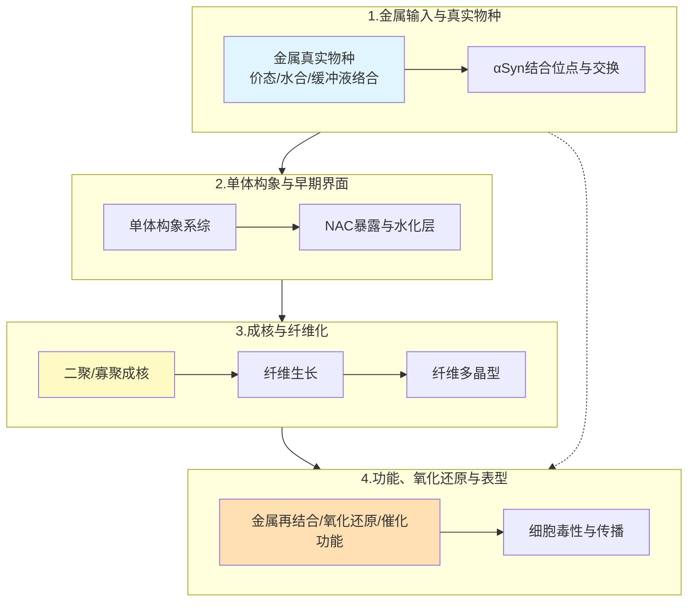

# 【深度研究】α-突触核蛋白与金属离子相互作用：研究现状与计算模拟

## 摘要

截至2026年10月，α-突触核蛋白（α-synuclein, αSyn）与金属离子的相互作用领域正在发生一个**研究范式转变**：问题已经从某种金属是否加速αSyn聚集转向不同金属如何在毫秒—小时—天的多时间尺度上重新分配αSyn构象系综，改变水化层、长程接触、早期二聚体/寡聚体结构，并最终选择不同的纤维多晶型和功能状态。2025–2026年的JACS、Advanced Science、ACS Chemical Neuroscience和Journal of Inorganic Biochemistry等工作尤其体现了这一趋势。

最重要的新认识有四点。第一，不能再用统一的**金属使αSyn变紧/变松，所以促进聚集**解释所有结果。例如，2025年Byrd等发现$\ce{Zn^{2+}}$使N端乙酰化αSyn单体构象系综明显压缩，并使硫黄素T（ThT）测得的聚集半时间约缩短5倍；但同年Zacharopoulou等发现$\ce{Ca^{2+}}$促进聚集时，αSyn出现中等程度伸展，同时水化层水分子交换减慢。2026年的时间分辨小角X射线散射（TR-SAXS）进一步发现$\ce{Fe^{3+}}$在亚秒—秒尺度快速将αSyn的回转半径（$R_g$）压缩至约31 Å，而$\ce{Cu^{2+}}$反而产生更伸展、更异质的早期构象。这说明“金属→聚集”的中间变量至少同时包括构象系综、NAC暴露、长程N/C端接触、离子桥联、水化动力学和早期蛋白—蛋白界面。

第二，**金属效应高度依赖实验上下文**。2022年Atarod等报道$\ce{Zn^{2+}}$、$\ce{Cu^{2+}}$、$\ce{Ca^{2+}}$和$\ce{Mg^{2+}}$均可加快纤维化；而2025年Graves等在另一套条件下发现多数二价离子的动力学效应较弱，$\ce{Zn^{2+}}$是最明显的浓度依赖促进者，$\ce{Fe^{3+}}$和$\ce{Al^{3+}}$则表现出**低浓度促进、高浓度抑制的双相行为**。2026年Nair等更直接证明，同一种$\ce{Cu^{2+}}$**在pH 5可延迟较大组装体形成，在pH 3却促进高阶组装**；$\ce{Fe^{3+}}$和$\ce{Zn^{2+}}$同样强烈依赖pH和剂量。因而目前文献中相当一部分相互矛盾很可能来自pH、离子强度、蛋白乙酰化状态、金属/蛋白化学计量比、搅拌方式以及金属真实物种的差异。

第三，Cu体系正在从铜促进聚集的粗略描述**走向配位化学问题**。$\ce{Cu^{2+}}$、$\ce{Cu^{+}}$、N端乙酰化、膜结合和纤维状态对应完全不同的配位环境与氧化还原性质。2024年Walke等证明$\ce{Cu^{2+}}$不但能在纤维形成过程中掺入，还能后加到已经形成的αSyn纤维中；2026年Arcos-López等利用X射线吸收谱（XAS）和电子结构计算进一步解析$\ce{Cu^{+}}$：**Met1和Met5的硫是主要锚点，Asp2提供羧酸氧，第四配体在非乙酰化αSyn中来自N端**，而在N端乙酰化蛋白中来自乙酰羰基。膜环境又能形成由两个αSyn链的Met1/Met5共同配位的1:2 $\ce{Cu^{+}}$:αSyn复合物，并改变Cu的氧化还原活性。

第四，建立从“金属物种/配位自由能 → αSyn构象系综 → 二聚/成核自由能 → 聚集动力学与纤维多晶型”的因果链，是**当前计算工作明显不足**的方向。尤其是$\ce{Mn^{2+}}$机制、Cu(I)/Cu(II)氧化态转换、$\ce{Fe^{2+}}$/$\ce{Fe^{3+}}$—pH耦合、多个金属竞争结合、金属进入已形成纤维后的结构/催化功能，以及亚秒TR-SAXS构象变化对应的原子级路径。

## 文献图景、最新热点与尚未解决的问题

### 近年的研究主线

2020年前后的工作已经建立了一个基本框架：αSyn是由140个氨基酸组成的内在无序蛋白（intrinsically disordered protein, IDP），其带负电的C端与N端/NAC区（非淀粉样组分区，约61–95位残基）之间存在瞬时长程相互作用；**金属通过结合特定位点或屏蔽电荷，可以重新分配这一构象系综**。Moons等利用非变性离子迁移谱—质谱（native IM-MS）观察到不同价态金属产生不同的结合化学计量与整体构象效应；Ramis等的粗粒化分子动力学（MD）模拟则提出$\ce{Cu^{2+}}$和$\ce{Ca^{2+}}$可破坏原本遮蔽疏水NAC区的长程接触，并增加NAC暴露。Ramis等论文DOI为10.1016/j.ijbiomac.2020.12.018。

随后研究逐渐从“平均结构”进入“构象系综”。Gonzalez-Garcia、Fusco和De Simone在2023年利用酰胺氢交换核磁共振（NMR）、化学位移扰动和$\ce{^{15}N}$弛豫系统比较$\ce{Ca^{2+}}$、$\ce{Cu^{2+}}$、$\ce{Cu^{+}}$、$\ce{Mn^{2+}}$和$\ce{Zn^{2+}}$，发现**不同金属并不存在统一的结构响应**：$\ce{Ca^{2+}}$和$\ce{Zn^{2+}}$改变C端保护因子，而$\ce{Cu^{+}}$和$\ce{Zn^{2+}}$又在不同区域引起动力学改变。DOI：10.3389/fchem.2023.1167766。

2024年以后，研究进入更精细的“金属特异性系综”阶段。Savva和Platts用MD研究$\ce{Cu^{2+}}$桥联αSyn二聚体，发现**Cu介导的链间桥可稳定二聚体**，使N端和NAC区出现更持久的链间接触和β结构。DOI：10.1039/D3CP04697D。同年，Walke等发现**铜不仅作用于单体**，成熟αSyn纤维本身也能够结合$\ce{Cu^{2+}}$，并改变纤维螺距、二级结构、蛋白酶敏感性和铜的电化学/活性氧（ROS）性质，意味着“金属—纤维”可能是一种独立于“金属—单体”的状态。DOI：10.1002/pro.4956。

2025年出现了两个非常关键的结果。Byrd等将非变性质谱（native MS）、IM-MS、NMR、MD与ThT统一在相同或接近条件下，证明**结合数量、单体压缩程度与聚集加速高度对应**；$\ce{Zn^{2+}}$主要接触富含酸性残基的C端，同时涉及His50，可能通过动态桥联N端和C端而压缩蛋白链。N端乙酰化αSyn加入$\ce{Zn^{2+}}$后$t_{50}$约缩短5倍。DOI：10.1021/jacs.5c11056。

与此同时，Zacharopoulou等得到一个方向不同但同样重要的结果：2 mM $\ce{CaCl2}$加速20 μM αSyn聚集，其效应甚至高于150 mM $\ce{NaCl}$/$\ce{KCl}$；然而$\ce{Ca^{2+}}$使αSyn形成约30 Å和约60 Å两类构象，同时使整体系综相对于无盐条件更偏伸展，并显著降低水化层水分子交换速度。作者因而提出，**聚集不仅由蛋白自身构象控制，水化层动力学同样可能是关键变量**。DOI：10.1021/jacs.4c13473。

2026年则进一步**把时间分辨率推进到亚秒尺度**。Sternke-Hoffmann等通过微流控TR-SAXS，以0.18 s时间分辨率追踪至3.64 s，比较$\ce{Mn^{2+}}$、$\ce{Fe^{3+}}$、$\ce{Cu^{2+}}$和$\ce{Zn^{2+}}$。$\ce{Fe^{3+}}$先诱导伸展随后迅速压缩至约31 Å并保持；$\ce{Cu^{2+}}$形成更加伸展、异质的构象；$\ce{Mn^{2+}}$和$\ce{Zn^{2+}}$变化更温和。这是目前最直接显示亚秒尺度金属诱导构象变化过程的实验之一。DOI：10.1002/advs.202512293。

同年，Nair等系统扫描pH 7、5、3以及$\ce{Fe^{3+}}$、$\ce{Cu^{2+}}$、$\ce{Zn^{2+}}$，进一步证明**金属效应必须与pH和金属真实物种一起讨论**。例如20 μM αSyn条件下，5或50 μM $\ce{Cu^{2+}}$在pH 5可降低或延迟寡聚体积累，而在pH 3却稳定更大的组装体；$\ce{Zn^{2+}}$主要在酸性环境促进寡聚化；$\ce{Fe^{3+}}$也表现出pH和剂量依赖。DOI：10.3390/biom16020326。

另一条支线：αSyn淀粉样纤维（amyloid）在体外能催化酯/磷酸酯键水解，即“**淀粉样催化**”（amyloid catalysis）；2026年Buratti、Kumar和Wittung-Stafshede进一步证明这种催化受金属调控：$\ce{Zn^{2+}}$存在下形成的纤维失去ATP去磷酸化能力和ATP类似物结合能力，而$\ce{Cu^{2+}}$存在下形成的纤维保留ATP水解活性。DOI：10.1016/j.jinorgbio.2025.113112。

> 这意味着，**金属可能不仅决定聚不聚集，还决定聚集后的材料/催化性质**。

### 当前最重要的争议

最突出的争议是金属到底促进还是抑制聚集。Atarod等在100 μM αSyn、500 μM二价金属等条件下观察到$\ce{Zn^{2+}}$、$\ce{Cu^{2+}}$、$\ce{Ca^{2+}}$、$\ce{Mg^{2+}}$均促进聚集；其中$\ce{Zn^{2+}}$显著缩短滞后时间（lag time），并形成较短纤维。DOI：10.1038/s41598-022-15472-4。但Graves等2025年的系统实验发现**多数二价离子对整体聚集动力学的影响较弱**，$\ce{Zn^{2+}}$最突出，而$\ce{Fe^{3+}}$和$\ce{Al^{3+}}$呈双相效应。DOI：10.1021/acschemneuro.5c00160。

这两组结果并不矛盾。结合2025–2026年的pH、离子强度和N端乙酰化工作，更合理的解释是：

$$
\text{Observed aggregation effect}
=f(\text{metal identity},\;[\text{metal}],\;pH,\;I,\;\text{PTM},\;\text{redox},\;\text{mixing},\;\text{protein state})
$$

> 其中**金属本身只是一个变量**。

第二个争议是**压缩是否等于更易聚集**。$\ce{Zn^{2+}}$数据支持“压缩→聚集加速”；$\ce{Ca^{2+}}$数据则说明“适度伸展+水化动力学改变→聚集加速”；$\ce{Cu^{2+}}$在2026年TR-SAXS中甚至产生早期伸展和异质性。因此比$R_g$更能区分这些路径的变量可能包括NAC区SASA（溶剂可及表面积）、N/C端接触概率、金属介导跨区桥联、β-hairpin倾向、链间接触可及性和局部水化自由能。

第三个争议是**金属促进毒性还是可能具有保护作用**。$\ce{Cu^{2+}}$—单体可参与氧化还原循环和ROS化学，但Walke等发现当Cu进入成熟纤维后，**其羟基自由基生成能力反而低于游离Cu或部分单体复合物**，提示纤维对Cu的封存有可能在某些情况下是保护性的。这说明必须区分“游离Cu”、“Cu—单体”、“Cu—寡聚体”、“Cu—纤维”四种化学状态。

### 真正的数据缺口

当前最大的缺口是如下因果链的定量刻画：

目前B、C、F各自已有不错的实验数据，但B→C→D→E的定量自由能联系仍很弱。

> **尤其缺少某个金属配位事件究竟把成核自由能降低了多少的研究**，这正是增强采样和自由能计算能够补上的环节。

## 各金属离子的机制：结合位点、配位与聚集效应

### 铜：最成熟，但远没有做完

Cu体系的关键问题是化学状态之间的转换：

$$
\ce{Cu^{2+}}\!-\!αSyn_{\rm monomer}
\rightleftharpoons
\ce{Cu^{+}}\!-\!αSyn_{\rm monomer}
\rightarrow
Cu\!-\!αSyn_{\rm oligomer}
\rightarrow
Cu\!-\!αSyn_{\rm fibril}
$$

这些状态的配位环境和氧化还原活性并不相同。2024年Walke等给出的$\ce{Cu^{2+}}$单体模型中，非乙酰化N端位点可由Met1的N端氮、去质子化主链酰胺、Asp2羧酸氧以及His50等构成；而对于N端乙酰化蛋白，**高亲和N端模式被显著削弱，His50附近变得更加重要**。

而$\ce{Cu^{+}}$完全不同。2026年的XAS+密度泛函理论（DFT）结果支持四配位$\ce{Cu^{+}}$：Met1和Met5的硫原子是主要锚点，Asp2羧酸氧参与；非乙酰化αSyn的第四配体是N端基团，而N端乙酰化αSyn（Ac-αSyn）则改为乙酰羰基。也就是说，**在非乙酰化重组αSyn上建立的Cu模型不能直接外推至体内主要的N端乙酰化状态**。

膜环境又会改变这套配位化学。Bacchella等发现膜模拟环境下可以形成$\ce{Cu^{+}}$:αSyn约1:2的复合物，由两个αSyn螺旋链中的Met1/Met5参与配位，形成氧化还原惰性较强的状态；而Calvo等此前又发现膜插入可以显著增强某些αSyn–$\ce{Cu^{2+}}$复合物对多巴胺的氧化反应。因此**膜是否让Cu变活跃还是变钝化取决于Cu的氧化态和具体配位结构**，不能混为一谈。DOI分别为10.3390/biom13020287和10.1016/j.freeradbiomed.2020.07.006。

QM/MM（量子力学/分子力学）在此尤其适用，因为Cu(I)/Cu(II)切换本质上涉及电子结构、配位数、姜-泰勒（Jahn-Teller）效应和配体交换，经典固定电荷MD无法可靠描述。

### 锌：当前最适合做系综—自由能—实验闭环

$\ce{Zn^{2+}}$是目前最清晰的计算切入口。2025年的JACS工作已经给出了非常清楚的实验约束：N端乙酰化αSyn、native MS结合化学计量、IM-MS构象压缩、NMR残基映射、MD以及聚集$t_{50}$在同一个框架里被关联起来；Zn主要与C端负电残基发生瞬时作用，也可涉及His50，**其跨区域桥联被认为是αSyn压缩的重要来源**。

但该工作仍没有回答一个关键问题：

> 哪一个具体的$\ce{Zn^{2+}}$桥联拓扑真正降低了αSyn二聚/成核的自由能，目前尚不清楚。

可能的桥联拓扑包括：

$$
{\rm CTD-CTD},\quad
{\rm His50-CTD},\quad
{\rm NAC-CTD},\quad
{\rm interchain\ bridge}
$$

目前尚不清楚这些拓扑各自的形成概率、寿命与$\Delta G$贡献，以及对NAC区溶剂可及表面积和二聚平均力势（PMF）的影响；式中CTD指C端区。

$\ce{Zn^{2+}}$还有方法学创新点：Ding和Huang于2024年提出DP/MM（深度势能/分子力学混合模型），用机器学习势修正MM对Zn配位环境的描述，**能够改善配位几何并允许水交换**。其训练数据来自Cys4、Cys3His1等典型锌配位组，因此直接套到αSyn这种Asp/Glu/His丰富、动态配位的IDP体系之前需要验证。DOI：10.1021/acs.jpclett.3c03158。

### 钙：不要只做结合，要做水化层

$\ce{Ca^{2+}}$比较特别。NMR已经较好地定位了其C端作用区，涉及104、107、112、119、123、124、126、127、129、130、135、136、137等多个残基，**配位分散且动态，区别于EF-hand式刚性口袋**。

2025年的工作提示，$\ce{Ca^{2+}}$机制可能至少包含两层：

$$
\text{C-terminal charge neutralization}
\rightarrow
\text{long-range contact redistribution}
$$

以及

$$
\ce{Ca^{2+}}\text{-dependent hydration cage}
\rightarrow
\text{slower water exchange}
\rightarrow
\text{changed association free energy}
$$

后者目前研究最少。多数αSyn MD仅分析$R_g$、均方根涨落（RMSF）和接触图（contact map），而水停留时间、水存活概率、局部扩散系数、四面体序参量、水分子取向、优先相互作用系数以及不同区域的脱溶剂化自由能等**水化层相关量的系统分析尚不充分**。实验上已有氢氘交换质谱（HDX-MS）、小角X射线/中子散射（SAXS/SANS）与聚集动力学等手段可用于检验。

### Mn：目前研究最不充分的离子之一

相比Cu、Zn、Ca，$\ce{Mn^{2+}}$研究明显不足。2023年的多金属NMR研究已经纳入$\ce{Mn^{2+}}$，但顺磁效应使得部分峰强和弛豫变化难以简单解释为纯构象变化；2026年的TR-SAXS显示$\ce{Mn^{2+}}$会产生相对温和、逐步的构象重排，但**其精确结合位点、配位拓扑、对二聚自由能以及最终纤维多晶型的作用尚未形成清晰机制**。这意味着一个尚未解决的问题是：

> $\ce{Mn^{2+}}$能改变早期αSyn构象，但**其聚集机制远不如Zn/Cu清楚**。

### 铁：最需要把配位化学做干净

Fe体系的现象很清楚，难点在化学物种。$\ce{Fe^{3+}}$在中性pH下强烈水解，又容易受到磷酸盐、柠檬酸等缓冲组分影响；因此某些所谓“$\ce{Fe^{3+}}$—αSyn作用”实际上可能包含Fe羟基物种、胶体、缓冲液络合物和真正蛋白结合物的混合贡献。Nair等2026年的研究也明确提醒，**金属效应反映蛋白构象与金属可用性的共同改变**。

另一方面，$\ce{Fe^{3+}}$的现象同样突出：2026 TR-SAXS观察到其在数秒内把αSyn推向约31 Å的紧凑态；2025 Graves等观察到低浓度$\ce{Fe^{3+}}$促进纤维延伸、高浓度反而抑制/改变聚集。

> **这种非单调响应说明单一配位位点模型不足以描述其作用**。

$\ce{Fe^{2+}}$的直接证据则更少。现有数据中，$\ce{Fe^{2+}}$直接配位αSyn的残基分辨信息明显少于Cu/Zn，而铁依赖的脂质过氧化和αSyn聚集之间又具有重要的细胞关联。Angelova等在神经元相关体系中证明αSyn聚集、铁依赖自由基、脂质过氧化和$\ce{Ca^{2+}}$失衡可以形成相互强化的病理回路，但其$\ce{Fe^{2+}}$结合位点**尚缺乏残基分辨的直接证据**。DOI：10.1038/s41418-020-0542-z。

### 金属体系比较

| 金属 | 主要实验支持的αSyn作用区域 | 配位/结构认识 | 单体构象效应 | 聚集/纤维效应 | 氧化还原 | 当前确定性 |
|---|---|---|---|---|---|---|
| $\ce{Cu^{2+}}$ | 非乙酰化N端Met1/Asp2附近；His50；较弱C端位点 | N端可涉及N端胺、去质子化主链N、Asp2羧酸O；**His50位点几何随乙酰化改变** | 可产生压缩、伸展或链间桥联，**强烈依赖环境** | 可促进特定二聚/纤维路线；**还能进入成熟纤维** | 强；可$\ce{Cu^{2+}}$/$\ce{Cu^{+}}$循环并生成ROS | 高，**但环境依赖极强** |
| $\ce{Cu^{+}}$ | Met1、Met5、Asp2；N端 | 四配位；**Met1/Met5-S为核心锚点** | **乙酰化和膜环境显著改变配位** | 与$\ce{Cu^{2+}}$不能等同 | 强烈依赖配位；某些膜态$\ce{Cu^{+}}$复合物氧化还原惰性 | 很高，**2026 XAS/DFT支持** |
| $\ce{Zn^{2+}}$ | C端酸性残基为主，His50也参与；**Asp121附近是重要热点** | **以动态、交换性强的多位点配位为主** | 明显增加紧凑构象，**可能桥联N/C端** | 2025年N-acet αSyn $t_{50}$约缩短5倍；**效应受pH控制** | 非氧化还原金属 | 高 |
| $\ce{Ca^{2+}}$ | C端约104–140，**多Asp/Glu残基** | 以羧酸氧/水为主的动态配位，**具体瞬时几何未完全确定** | 中等伸展，**并减慢水化层水交换** | **可显著加速成核/生长并改变纤维多晶型** | 非氧化还原 | 高 |
| $\ce{Mn^{2+}}$ | 可能偏C端酸性区域，**但位点分辨不如Ca/Zn** | **高分辨配位几何尚不充分**；顺磁性增加实验解释复杂度 | 2026年TR-SAXS显示**较慢、较温和的区域性压缩** | **聚集机制数据明显少于Cu/Zn/Ca** | 可参与细胞氧化应激，但αSyn结合本身机制未明确 | 中—低，**研究明显不足** |
| $\ce{Fe^{3+}}$ | **高分辨、统一的残基级配位模型尚缺失**；酸性C端被普遍怀疑参与 | **水解与缓冲液络合极其重要**，实验中的$\ce{Fe^{3+}}$未必等于自由$\ce{Fe^{3+}}$ | 2026年TR-SAXS显示**最快速、最持久压缩** | **低剂量可促进、高剂量可改变/抑制纤维**；强pH依赖 | $\ce{Fe^{3+}}$/$\ce{Fe^{2+}}$循环与ROS潜力高 | 中，**化学物种问题严重** |
| $\ce{Fe^{2+}}$ | 直接位点证据比$\ce{Fe^{3+}}$和Cu/Zn少 | **未形成统一模型** | 未明确 | 有膜体系和细胞环境下促寡聚/损伤证据，**但与直接αSyn配位需区分** | 强 | 偏低；**机制认识明显不足** |
| $\ce{Mg^{2+}}$ | **弱的C端/静电作用** | **以水合离子为主** | 较弱 | **文献结果依实验条件而变** | 无 | **适合作为二价离子/离子强度对照** |

## 计算研究方法现状

### 全原子与粗粒化MD

αSyn作为IDP最大的经典MD问题**在于系综的可靠性**。Pedersen、Flores-Canales和Schiøtt对多种IDP力场进行了独立验证：ff19SB/TIP4P-D与a99SB-disp/TIP4P-disp能较好再现αSyn整体尺寸和长程距离，其中a99SB-disp对二级结构的平衡也较好；ff19SB/OPC和ff03CMAP/TIP4P-D在其测试中更易产生过紧的系综。DOI：10.1002/prot.26409。

一般IDP力场研究也提示CHARMM36m相对于a99SB-disp可能系统性强化某些蛋白—蛋白和盐桥作用；例如2024年的系统自由能比较发现其极性/带电残基配对总体更强。DOI：10.1021/acs.jpcb.4c04777。

> 在高度带电的αSyn体系中，**单一力场结果不宜被视为真值**。

Martins和Galamba于2024年同时比较Martini3、SIRAH2、Amber99SB和CHARMM36m，指出粗粒化模型能够显著扩展聚集采样尺度，但**蛋白—水相互作用以及蛋白—蛋白粘性的标定会直接决定聚集结果**。DOI：10.1021/acs.jcim.4c00965；该工作此前亦有2024年ChemRxiv版本。

因此粗粒化模拟最适合回答链数、尺寸与聚集路径等问题，不适合独立回答$\ce{Zn^{2+}}$究竟由Asp121单齿还是双齿配位这类问题。

### 增强采样

现有αSyn研究已经证明**REMD能显著扩展构象空间**。例如Jain等对35–97核心区开展了总计约18 μs的显式溶剂REMD并获得多盆地自由能景观。DOI：10.1021/acs.jcim.0c01278。

增强采样方面，REST2（溶质回火副本交换）、well-tempered元动力学与伞形采样（umbrella sampling）的组合**比简单温度REMD更适合金属αSyn体系**。

常用集合变量（collective variable, CV）包括：

$$
R_g,\quad R_{ee},\quad SASA_{\rm NAC},\quad
d_{\rm N-C},\quad
N_{\rm contacts}^{NAC-CTD},
\quad CN_{\rm metal},
\quad N_{\beta}
$$

> 2025–2026年实验已清楚证明，**相同的聚集加速可对应不同的构象响应**（Zn诱导压缩、Ca诱导伸展、Cu诱导异质化），因此仅用$R_g$作为CV，**不足以区分这些路径**。

### 金属参数化是整个项目最容易出问题的地方

普通12-6 Lennard-Jones模型能够描述自由水合离子，**但对高电荷密度金属的极化、电荷转移、配位数变化和配体交换往往不足**。12-6-4模型显式增加诱导相关项，可以改善某些结合自由能和配位距离，但参数需要针对金属、配体原子类型和水模型进行验证。Johannissen和Hay的工作显示，通过螯合剂重新校准12-6-4参数，可显著改善$\ce{Ca^{2+}}$等离子的结合能和配位性质。DOI：10.1021/acs.jctc.1c00898。

因此不同金属需要分层处理：

| 金属 | 常用最低模型 | 高精度模型 | 最主要风险 |
|---|---|---|---|
| $\ce{Ca^{2+}}$ | 与所选水模型匹配的12-6-4或验证过的非键参数 | 极化MD/QM/MM局部验证 | **过度羧酸结合** |
| $\ce{Mn^{2+}}$ | 12-6-4 + EPR（电子顺磁共振）/NMR/SAXS校验 | QM/MM局部配位 | **顺磁实验与模型映射困难** |
| $\ce{Zn^{2+}}$ | 12-6-4 / 配体特异（ligand-specific）参数 | DP/MM或局部ML/MM | **过度固定四配位**或错误His/$\ce{COO^-}$亲和力 |
| $\ce{Cu^{2+}}$ | QM衍生的成键（bonded）/哑铃（dummy）模型仅适合固定配位态 | QM/MM | **经典模型无法可靠描述配体交换和Jahn–Teller** |
| $\ce{Cu^{+}}$ | 专门$\ce{Cu^{+}}$参数，**不得与二价态混用** | QM/MM/DFT（密度泛函理论） | **氧化态切换** |
| $\ce{Fe^{3+}}$/$\ce{Fe^{2+}}$ | 仅用于筛选的非键模型 | QM/MM、DFT + 物种分布（speciation）分析 | **水解、变价、自旋态** |

特别是Zn，2024年的DP/MM已证明ML修正可同时改善Zn蛋白配位几何和水交换，但原模型的训练化学空间与αSyn的Asp/Glu/His动态桥联环境存在差距，**能否直接套用尚未得到验证**。

### DFT与QM/MM

Cu和Fe体系尤其需要进入电子结构层面。对于$\ce{Cu^{+}}$/$\ce{Cu^{2+}}$**可先建立30–100原子的团簇（cluster）模型**，通常包括Met1/Met5、Asp2、His50或其肽段模型、必要主链酰胺，以及1–3个第一/第二配位层水分子。通常以至少两个泛函交叉校验，例如TPSSh与B3LYP-D3(BJ)；几何优化可从def2-SVP起步，最终使用def2-TZVP单点。$\ce{Cu^{2+}}$为开壳层体系，需要检查自旋污染和不同几何构型。对$\ce{Fe^{3+}}$/$\ce{Fe^{2+}}$**必须系统扫描可能的自旋态**。

已有工作中QM区通常取约60–150 atoms，并从全原子MD的多个代表构象采样；**验证指标包括EXAFS（扩展X射线吸收精细结构）键长、EPR参数、XANES（X射线吸收近边结构）趋势、配位数和实验突变结果**。2026年的$\ce{Cu^{+}}$ αSyn研究正是“XAS + electronic structure”的典型范例。

### 机器学习势与反应势

从2020–2026年的文献看，**目前还没有已成熟用于全长αSyn–Cu/Fe氧化还原聚集的通用机器学习反应势**。现有工作集中在局部ML/MM（机器学习势/分子力学混合）。

Zn方向已有DP/MM先例；Cu/Fe方向的主动学习数据集通常令**QM层只覆盖金属及第一、第二配位层残基，MM层描述剩余IDP和水**。

> 综合这些工作，**αSyn–金属领域仍有大量未解决问题**。相对饱和的是加Cu/Zn然后做ThT+普通MD这一类；而2025–2026年凸显且**仍明显不足的是动态配位自由能、毫秒构象系综、金属竞争交换、水化层耦合、氧化态/乙酰化耦合等方向**，以及金属结合态纤维（metal-bound fibril）的功能化学。一个核心的未解问题是：定量回答“哪一个原子级金属事件，把哪一步聚集自由能改变了多少，以及实验怎样直接验证它”。

## 参考文献

以下列出本文涉及的重点文献：

1. Sternke-Hoffmann R, Dos Santos Pinto M, Wang X, Luo J. 2026. *Time-Resolved SAXS Reveals Distinct Millisecond Metal-Induced Conformational Dynamics of Monomeric α-Synuclein*. Advanced Science. DOI: 10.1002/advs.202512293。最新的金属诱导亚秒构象动力学基准，为动力学系综模拟提供直接对照。

2. Byrd EJ, Rowlinson B, Crossley JA, Brockwell DJ, Ross JF, Radford SE, Sobott F. 2025. *$\ce{Zn^{2+}}$ Binding Shifts the Conformational Ensemble of α-Synuclein Monomers toward Accelerated Amyloid Formation*. JACS. DOI: 10.1021/jacs.5c11056。native MS + IM-MS + NMR + MD + ThT的完整范例。

3. Zacharopoulou M, et al. 2025. *Local Ionic Conditions Modulate the Aggregation Propensity and Influence the Structural Polymorphism of α-Synuclein*. JACS. DOI: 10.1021/jacs.4c13473。$\ce{Ca^{2+}}$、水化层与构象系综研究的核心论文。

4. Arcos-López T, Lim H, Hedman B, Hodgson KO, Vela A, Fernández-Outón CO, Solomon EI, Quintanar L. 2026. *Impact of N-terminal acetylation on Cu(I) coordination by alpha synuclein protein*. Journal of Inorganic Biochemistry. DOI: 10.1016/j.jinorgbio.2026.113229。$\ce{Cu^{+}}$配位化学的核心文献。

5. Walke G, Kumar R, Wittung-Stafshede P. 2024. *Copper ion incorporation in α-synuclein amyloids*. Protein Science. DOI: 10.1002/pro.4956。把问题从“金属—单体”推进到“金属—纤维”。

6. Gonzalez-Garcia M, Fusco G, De Simone A. 2023. *Metal interactions of α-synuclein probed by NMR amide-proton exchange*. Frontiers in Chemistry. DOI: 10.3389/fchem.2023.1167766。比较Ca、Cu、Mn、Zn的最佳残基级实验之一。

7. Savva L, Platts JA. 2024. *Computational investigation of copper-mediated conformational changes in α-synuclein dimer*. PCCP. DOI: 10.1039/D3CP04697D。直接与“金属介导早期二聚/成核”相关。

8. Nair A, Mitta P, Lucas L, Ferreon JC, Ferreon ACM. 2026. *Modulation of α-Synuclein Oligomer and Aggregate Populations by pH and Metal Ions*. Biomolecules. DOI: 10.3390/biom16020326。研究pH×metal耦合的重要新工作。

9. Graves NJ, Jaafar AK, Gambin Y, Sierecki E. 2025. *Divalent and Trivalent Metallic Ions Differentially Affect Alpha-Synuclein Aggregation*. ACS Chemical Neuroscience. DOI: 10.1021/acschemneuro.5c00160。揭示二价/三价和浓度依赖差异，也是理解旧文献矛盾的重要论文。

10. Buratti FA, Kumar R, Wittung-Stafshede P. 2026. *Metal ions control amyloid catalysis*. Journal of Inorganic Biochemistry. DOI: 10.1016/j.jinorgbio.2025.113112。代表“金属改变聚集体功能而不只是形成速率”的新方向。

11. Atarod D, Mamashli F, Ghasemi A, et al. 2022. *Bivalent metal ions induce formation of α-synuclein fibril polymorphs with different cytotoxicities*. Scientific Reports. DOI: 10.1038/s41598-022-15472-4。不同二价离子、形貌和细胞毒性的系统对照。

12. Bacchella C, Camponeschi F, Kółkowska P, et al. 2023. *Copper Binding and Redox Activity of α-Synuclein in Membrane-Like Environment*. Biomolecules. DOI: 10.3390/biom13020287。Cu、膜和氧化态三者耦合。

13. Calvo JS, Mulpuri NV, Dao A, Qazi NK, Meloni G. 2020. *Membrane insertion exacerbates the α-Synuclein-Cu(II) dopamine oxidase activity*. Free Radical Biology & Medicine. DOI: 10.1016/j.freeradbiomed.2020.07.006。Cu氧化还原化学的重要生化依据。

14. Ramis R, Ortega-Castro J, Vilanova B, Adrover M, Frau J. 2021（online 2020）. *$\ce{Cu^{2+}}$, $\ce{Ca^{2+}}$, and methionine oxidation expose the hydrophobic α-synuclein NAC domain*. International Journal of Biological Macromolecules. DOI: 10.1016/j.ijbiomac.2020.12.018。早期粗粒化机制研究，提出NAC暴露。

15. Bell R, Thrush RJ, Castellana-Cruz M, et al. 2022. *N-Terminal Acetylation of α-Synuclein Slows down Its Aggregation Process and Alters the Morphology of the Resulting Aggregates*. Biochemistry. DOI: 10.1021/acs.biochem.2c00104。设计生理相关αSyn模型时必须考虑。

16. Pedersen KB, Flores-Canales JC, Schiøtt B. 2023. *Predicting molecular properties of α-synuclein using force fields for intrinsically disordered proteins*. Proteins. DOI: 10.1002/prot.26409。αSyn力场选择的重要基准。

17. Martins GF, Galamba N. 2024. *Wild-Type α-Synuclein Structure and Aggregation: A Comprehensive Coarse-Grained and All-Atom Molecular Dynamics Study*. Journal of Chemical Information and Modeling. DOI: 10.1021/acs.jcim.4c00965。全原子/粗粒化多尺度选择的重要参考；2024年亦有ChemRxiv版本。

18. Jain K, Ghribi O, Delhommelle J. 2021. *Folding Free-Energy Landscape of α-Synuclein (35–97) Via Replica Exchange Molecular Dynamics*. Journal of Chemical Information and Modeling. DOI: 10.1021/acs.jcim.0c01278。增强采样路线参考。

19. Ding Y, Huang J. 2024. *DP/MM: A Hybrid Model for Zinc–Protein Interactions in Molecular Dynamics*. Journal of Physical Chemistry Letters. DOI: 10.1021/acs.jpclett.3c03158。对后续αSyn–Zn机器学习势与ML/MM混合方法尤其重要。

20. Johannissen LO, Hay S. 2022. *Chelator-Based Parameterization of the 12-6-4 Lennard-Jones Molecular Mechanics Potential for More Realistic Metal Ion–Protein Interactions*. Journal of Chemical Theory and Computation. DOI: 10.1021/acs.jctc.1c00898。金属参数化与自由能计算的代表性工作。

21. Gong X, Zhang Y, Chen J. 2024. *Likely Overstabilization of Charge–Charge Interactions in CHARMM36m(w): A Case for a99SB-disp Water*. Journal of Physical Chemistry B. DOI: 10.1021/acs.jpcb.4c04777。理解IDP力场中电荷相互作用偏差的重要参考。

22. Angelova PR, Choi ML, Berezhnov AV, et al. 2020. *Alpha synuclein aggregation drives ferroptosis: an interplay of iron, calcium and lipid peroxidation*. Cell Death & Differentiation. DOI: 10.1038/s41418-020-0542-z。将αSyn、铁、$\ce{Ca^{2+}}$和脂质过氧化连接到细胞病理。

23. Moons R, Konijnenberg A, Mensch C, et al. 2020. *Metal ions shape α-synuclein*. Scientific Reports. DOI: 10.1038/s41598-020-73207-9。native IM-MS金属结合和构象响应的重要基础工作。

24. Savva L, Platts JA. 2023. *How Cu(II) binding affects structure and dynamics of α-synuclein revealed by molecular dynamics simulations*. Journal of Inorganic Biochemistry. DOI: 10.1016/j.jinorgbio.2022.112068。$\ce{Cu^{2+}}$单体增强采样MD的重要先行工作。

25. Greener JG. 2024. *Differentiable simulation to develop molecular dynamics force fields for disordered proteins*. Chemical Science. DOI: 10.1039/D3SC05230C。代表IDP力场通过可微模拟/机器学习优化的新趋势。