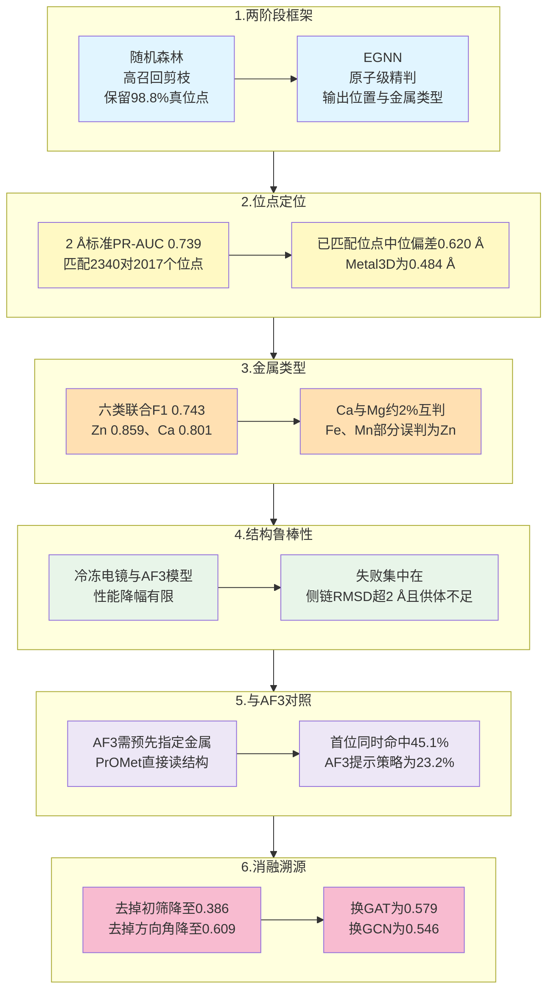
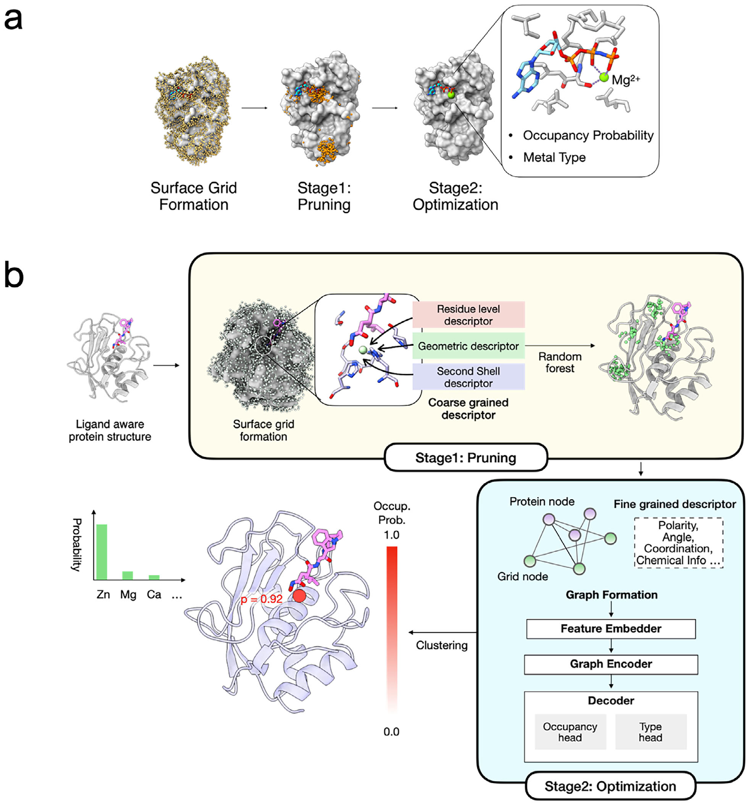
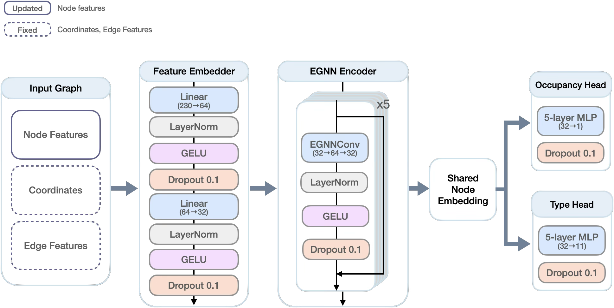
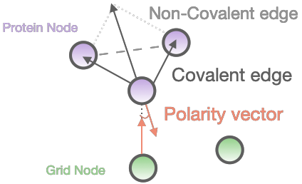
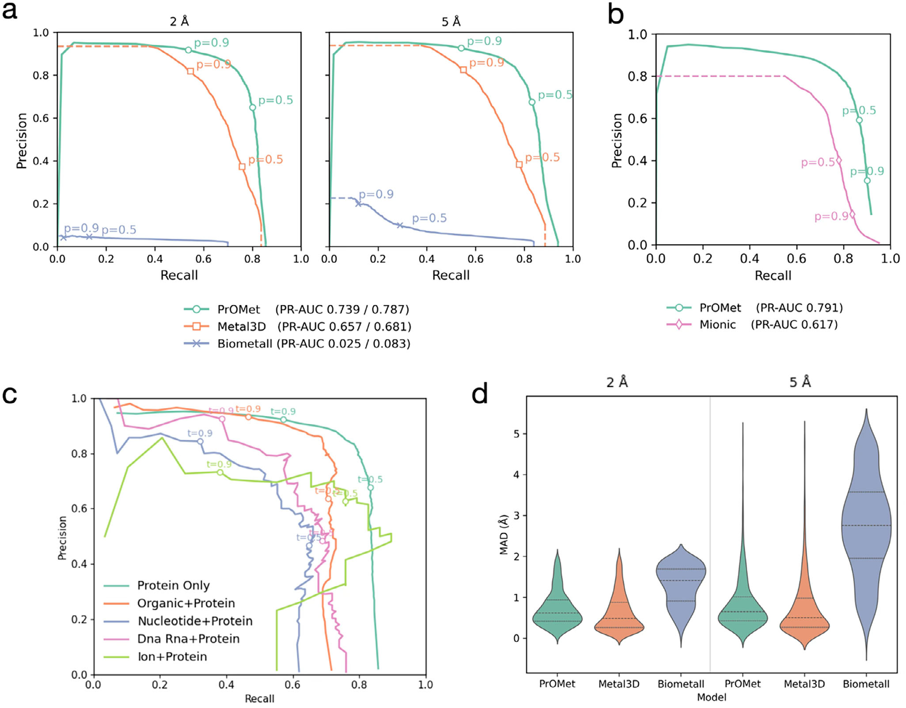
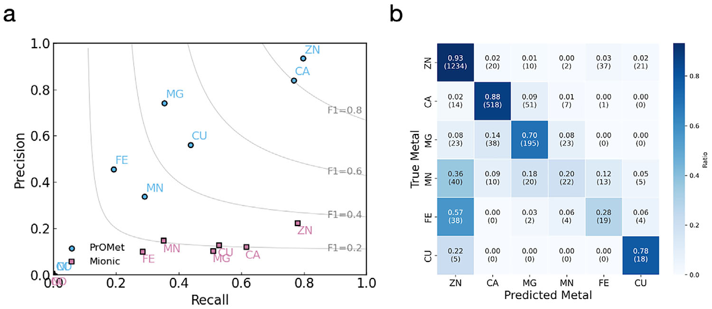
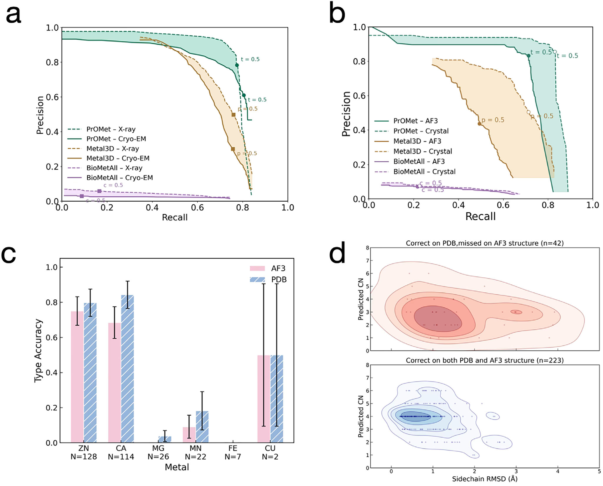
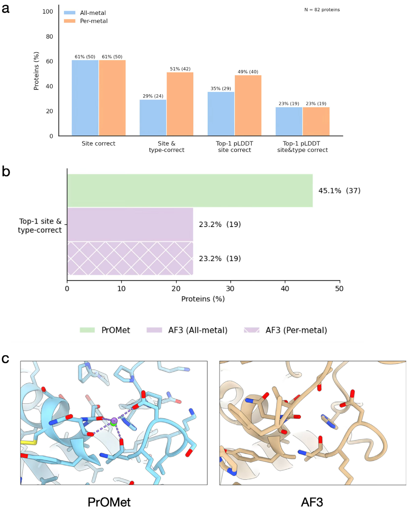
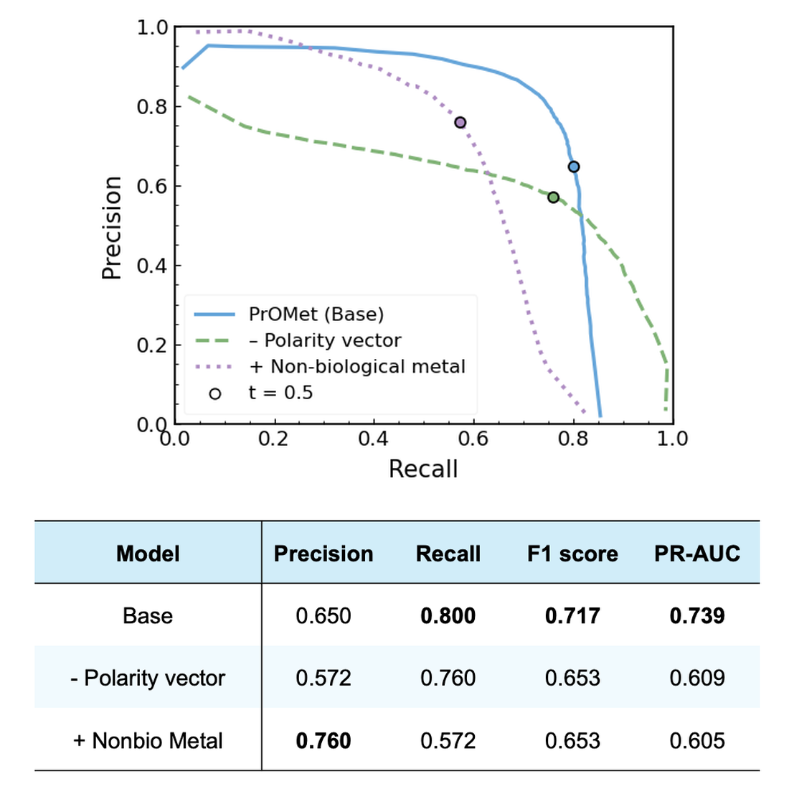

# PrOMet——预测蛋白金属结合位点及离子类型的两阶段深度学习工具

## 本文信息

- **标题**：PrOMet：准确且稳健地预测金属结合位点及其类型
- **发表期刊**：Advanced Science
- **发表时间**：2026年10月11日
- **DOI**：https://doi.org/10.1002/advs.78003
- **单位**：首尔国立大学化学系（韩国）；Galux公司（韩国）；韩国科学技术研究院生物医学研究部（韩国）
- **引用格式**：Park, G., Seok, C., & Park, H. (2026). PrOMet: Accurate and Robust Metal-Binding Site and Type Prediction. *Advanced Science*, e78003. https://doi.org/10.1002/advs.78003
- **代码与数据**：
  - PrOMet源代码、预训练权重与命令行说明：https://github.com/qkrgangeun/PrOMet
  - 训练脚本与数据划分文件：仓库 `training/` 与 `data/splits/` 目录

## 摘要

> 金属离子与蛋白的结合对许多生物功能至关重要，但相比其他生物分子相互作用，金属结合位点与离子类型的预测仍研究不足。尽管深度学习已有进展，计算方法在这一领域的成效有限；即便是已报道的最优方法，在高分辨率晶体结构上也只达到中等定位精度，用于中等分辨率数据时表现更差。作者认为主要困难来自金属结合本身的性质：候选位点遍布整个蛋白表面，而真实结合依赖原子级的配位几何。本文提出基于结构的金属结合位点与类型预测器PrOMet，采用**先剪枝后优化**（Prune-and-Optimization）策略，由两个层级相连的机器学习模型构成。该策略在有效缩小搜索空间的同时，对AlphaFold模型和中等分辨率冷冻电镜结构保持稳健。PrOMet优于包括基于结构和基于语言模型在内的既有方法，金属离子定位的PR-AUC为0.739，Zn、Ca、Mg、Mn、Fe、Cu六类金属类型分类的平均F1为0.743。PrOMet可用于蛋白结构中不确定金属位置与类型的归属，也能服务于金属酶设计研究。

### 核心结论

- **两阶段设计是性能关键**：随机森林先以高召回筛掉约97%的初始网格，仍保留98.8%真实位点附近的候选点；随后5层EGNN在原子级配位几何上重新打分。去掉初筛后，PR-AUC从0.739掉到0.386。
- **定位与类型可以一起输出**：2 Å标准下定位PR-AUC为0.739，优于Metal3D的0.657和BioMetAll的0.025；Zn、Ca的联合预测F1分别为0.859和0.801，远高于序列方法M-Ionic的0.343和0.193。
- **配位对象不限于蛋白自身**：蛋白—配体、蛋白—核酸界面上的金属位点同样能被识别，这是既有位点预测方法少有覆盖的情形。
- **对不完美坐标有容忍度**：在筛选过的AlphaFold3模型和中等分辨率冷冻电镜结构上性能下降较小；未知金属类型时选择结合位置的能力明显强于AF3的提示式放置。

## 背景

蛋白里常见的金属离子由His、Cys、Asp、Glu等残基的N、S、O原子配位，也可能同时接触ATP等配体、RNA或DNA。PDB中超过三分之一的结构含金属离子，它们参与催化、结构稳定、电子传递与信号调控。但在中低分辨率图谱里辨认金属并不容易，金属与水分子、附近原子的散射差别有限，结构解析常常只能靠配位几何和化学经验去猜，后续的功能分析与金属酶改造都受制于这一步。

这个任务难在同时包含两个尺度。候选位点散布在整条蛋白表面，甚至落在蛋白—配体、蛋白—核酸界面上，搜索范围大而信号稀疏；判定是否真实结合，却要看几埃内供体原子的种类、距离、朝向和空间排布。全域扫描要求宽而快，原子级判别要求准而细，单一尺度的模型很难两头兼顾。

既有方法大致分三路，各有各的适用面。序列方法从残基级配位偏好出发，规模上占优但缺三维上下文；结构几何方法按骨架motif匹配，解释性好，却难以描述全原子环境；三维深度学习自动提取特征，不过训练范围往往限定在单一金属。再往下还有模板匹配，依赖已有的同源金属结构。此外有两个共性短板：多数工具只给位点、不判类型；对配体或核酸共同配位的情形、以及对低精度结构，覆盖都不够。

| 方法路线 | 代表方法 | 主要思路 | 主要短板 |
| --- | --- | --- | --- |
| 序列预测 | M-Ionic | 从序列学残基级配位偏好，再折算成位点 | 缺三维结构，坐标精度低 |
| 结构几何规则 | BioMetAll | 用骨架预组织匹配典型配位motif | 只看骨架，氧富集、环境多样的位点吃亏 |
| 结构深度学习 | Metal3D | 三维深度学习直接定位位点 | 仅用Zn晶体结构训练，不判类型 |
| 模板匹配 | MIB2 | 借用同源已知金属结构 | 依赖模板库，新蛋白泛化差 |

> 金属结合位点预测同时包含**两个尺度的问题**：在整个蛋白表面搜索少数候选位置，再在几埃范围内辨认精细的配位几何。PrOMet据此把任务拆成**粗筛与精识别**两步。

### 关键科学问题

- **候选空间怎么压缩而不漏掉真实位点**：整条蛋白表面可以采样出上万个网格点，真实金属位点只有个位数量级。初筛必须做到高召回，一旦把真实位点附近的空间删掉，后面的精细模型再好也无法挽回，所以第一阶段的目标是**宁可多留，也不能漏**。
- **方向性信息怎么进入模型**：配位不只看距离，供体孤对电子的指向决定了几何是否合理。常规图神经网络只传递距离与节点特征，缺少角度与朝向，模型难以区分“距离相近但供体朝向不同”的两个候选点。
- **定位与类型能否一次给出**：多数工具把位点存在性与金属种类拆成两个问题，实际上两者由同一套配位化学决定。把占据概率和类型分布放在同一网络上联合学习，才有可能在未知金属时同时回答“在哪里”和“是哪一种”。
- **结构噪声与异质界面**：输入可能来自冷冻电镜或AlphaFold模型，侧链位置本身有偏差；配位对象也可能是配体或核酸。方法需要在坐标不完美、配位环境不典型的条件下仍然可用。

### 创新点

- **把双尺度难题拆成两级串联的模型**：随机森林用可解释的化学描述符做高召回剪枝，EGNN在全原子图上做精细判别。消融显示两级缺一不可，去掉初筛后PR-AUC从0.739跌到0.386，重训也救不回来。
- **用polarity vector把孤对电子朝向编码进图**：以共价键单位方向向量之和的反方向近似原子朝向，再配合网格—原子的相对方位角，用$\sin\theta$和$\cos\theta$表达。这一项是输入特征里最关键的，去掉后PR-AUC降到0.609。
- **在同一框架内联合输出占据概率与金属类型**，并把蛋白—配体、蛋白—核酸界面的金属位点纳入评测，覆盖范围比只做蛋白内部的工具更宽。
- **数据层面同时做两件事**：用不少于3个配位原子的规则滤掉晶体学假位点，又把冷冻电镜到中低分辨率的结构混进训练集，让模型学到的是对坐标噪声的容忍度。

## 研究内容

> 下文按一条逐步加压的验证链展开：定位、判型、鲁棒性、对标AF3、消融溯源。**每个环节都在回答上一环引出的问题**，数据细节在各自小节里给出。



### 两阶段框架：先剪枝，再精识别

> PrOMet把任务拆成两级：**先靠可解释的化学描述符做高召回剪枝，再在全原子图上做精细判别**。两级分别对应宽而快的全域搜索与准而细的局部识别。

第一级用随机森林从几万个候选网格点里留下少数可能的位置，第二级用等变图神经网络在这些位置附近读原子环境，同时给出占据概率和金属类型。图1给出了这个框架的全貌。



**图1：PrOMet的整体工作流程**。（a）从蛋白结构生成表面候选网格，经筛选和优化输出金属结合位置及类型；（b）第一阶段用局部化学与几何描述符训练随机森林，第二阶段将原子与网格共同建图，通过EGNN预测各位置的金属占据概率和种类。颜色说明：橙色标出（a）中被随机森林保留的网格，（b）里绿色为候选网格节点、紫色为蛋白原子节点，占据概率用红白渐变表示，红色越深代表概率越高；两类描述子在流程框里分别用粉、绿、蓝、紫底色区分。

#### 生成表面候选网格

程序以蛋白及已有配体的三维坐标为输入，在原子范德华球附近构建可能容纳金属的空间网格点，删除严重空间冲突和冗余位置，相邻保留网格之间至少相隔0.6 Å。每个点代表一个待评估的金属中心坐标，随后需要判断该点周围是否具备合理的配位环境。

网格只落在蛋白表面，这个设定本身就有取舍。它让搜索规模可控，也意味着埋在内部、需要构象变化才暴露的位点不会进入候选；对于这类情形，方法的结果只能理解为“在给定构象下是否可行”。

#### 随机森林：高召回剪枝

第一阶段采用Balanced Random Forest，对每个网格计算几组容易解释的特征：

- **第一配位层**：统计2.5、2.8、3.0、3.2和3.5 Å内的蛋白N/O/S供体、His/Cys/Asp/Glu相关原子、主链羰基氧，以及配体或辅因子提供的供体原子。
- **局部几何与暴露程度**：包括到最近非极性碳和主链原子的距离、蛋白骨架预组织程度、局部相对溶剂可及性（用Shrake–Rupley算法算绝对SASA，探针半径1.4 Å，再按同残基类型的最大值归一化）。
- **第二配位层**：统计3.2–5.0 Å内的邻近残基、常见金属配位残基和主链氧，以近似描述周围的结构支撑与相互作用环境。

概率低于默认阈值0.5的网格被去除。独立测试中，这一步保留了98.8%的真实金属位点附近候选点，只留下原始网格的2.76%，使后续原子级计算更集中。这里的98.8%是**候选位点覆盖率**，表示每个真实金属周围2 Å内仍有至少一个网格点，并非最终定位准确率。

作者比较过其他树模型和简单的深度网络。LightGBM的召回与过滤比与随机森林几乎持平（覆盖率98.7%，保留2.52%），3层MLP则明显逊色。在这个“高召回优先”的过滤问题上，树模型的取舍更合适，随机森林作为简单稳妥的默认选择被采用；阈值在0.4–0.7之间下游表现相对稳定。

#### EGNN：原子类型、距离与配位方向的联合判断

第二阶段将保留的网格点与蛋白、配体原子一起作为图节点，每个节点连接空间中最近的16个邻居。节点特征包括原子类型、所属氨基酸、二级结构、SASA、部分电荷等；边特征记录距离、连接类别、共价键关系和方向角。



**图S1：第二阶段EGNN结构**。输入特征经过嵌入网络和5层EGNN编码器，再由两个预测头分别输出金属占据概率与金属类型。该实现只更新节点特征，原子及候选网格的三维坐标在信息传递中保持固定。

其中最有特点的是**polarity vector**（极性方向向量）。对于一个蛋白原子，作者取其各共价键单位方向向量之和的反方向，得到一个近似的空间指向；网格节点与蛋白原子的相对方向也纳入编码。最终用$\sin\theta$和$\cos\theta$描述方向夹角，使模型能区分“距离相似，但供体朝向不同”的候选位置。这个构造是几何近似：箭头方向由局部键方向推出来，粗粒度地代表孤对电子的大致朝向，精细的电子结构差异无法从键方向恢复。



**图S23：极性方向特征的几何定义**。紫色节点为蛋白原子，绿色节点为候选网格；实线和虚线分别表示共价与非共价连接。箭头表达以局部键方向近似构造的空间取向，是几何描述符，并非直接通过量子化学求得的孤对电子方向。

EGNN联合学习金属占据概率和金属类别。占据标签采用随网格到真实金属距离衰减的软标签，在距离2 Å时赋值0.5；金属分类还使用类别加权损失及邻近真实位点的辅助监督。预测后将附近高分网格用DBSCAN聚类（`eps=2 Å`，`min_samples=2`），以概率加权的网格中心作为金属坐标，以簇内最高分网格的类别预测决定金属类型。

同任务的编码器对照很直接：EGNN的PR-AUC为0.740，图注意力网络GAT为0.579，图卷积GCN为0.546。GAT优于GCN说明自适应加权邻居有用，但两者都赶不上显式建模几何关系的模型。坐标在消息传递中保持固定，意味着几何信息完全靠初始特征和边属性带进去。

### Benchmark设置

数据集来自BioLiP（2025年2月19日版本），收录含Mg、Zn、Mn、Ca、Fe、Ni、Co、Cu、K的蛋白—金属复合物。最初的候选金属有12种，作者去掉了Cd、Hg这两种毒性金属，以及容易受缓冲液干扰的Na。每个条目保留除水以外的全部配体，让模型能看到配位环境里的其他分子。

划分方式做了两层处理。先按发表时间切分，再用MMseqs2按30%序列一致性聚类，把与训练集同簇的测试条目剔除，保证测试蛋白与训练蛋白的序列相似度不超过30%。

| 项目 | 设置 |
| --- | --- |
| 数据来源 | BioLiP（2025-02-19） |
| 纳入金属 | Mg、Zn、Mn、Ca、Fe、Ni、Co、Cu、K |
| 训练/验证/测试 | 16,196 / 926 / 968个PDB条目 |
| 序列去冗余 | MMseqs2，30%一致性，覆盖度0.8 |
| 时间切分 | 训练/验证界2019-01-01，验证/测试界2021-03-31 |
| 位点筛选 | 3 Å内配位原子不少于3个 |

生物学位点的筛选标准来自一次阈值标定。作者在已标注“生物/非生物”位点的数据集上统计3 Å内的配位原子数（N、O、S、Se），发现3个是两类分开最明显的位置：用这个阈值，1,921个生物位点中识别出1,617个，2,823个非生物位点中排除掉1,770个。晶体学假位点因此被压掉不少，训练目标也更贴近真实配位模式。

数据集并不强行给每个蛋白家族指定唯一的金属身份。同一蛋白高度相似的不同条目可能标注不同金属，这些情况被保留，因为其中既有真实的金属替换，也有实验条件或占位率差异。作者用95%一致性、90%覆盖度聚类后统计，4,166个簇中有473个簇内部金属组成不一致，约一成。

> **同一蛋白家族不强行统一金属标签**，把真实的金属替换和实验条件差异留在了数据里。这更贴近观测，也让精确的金属选择性难以从数据中直接读出。

### 位点定位：找回更多位点，坐标误差另算



**图2：金属结合位点定位效果**。（a）以2 Å和5 Å为正确匹配阈值的PR曲线；（b）结合残基层面的比较；（c）按配位环境是否包含非蛋白分子分组；（d）在已成功匹配的位点中，比较预测坐标与实验坐标的偏差。颜色说明：（a）中绿色为PrOMet、橙色为Metal3D、蓝色为BioMetAll；（c）中青、橙、蓝、粉、黄绿分别为纯蛋白、有机配体、核苷酸、DNA/RNA、离子参与的配位环境；（d）的小提琴图用同样三色对应三种方法。

| 指标 | PrOMet | Metal3D | BioMetAll |
| --- | ---: | ---: | ---: |
| 2 Å定位PR-AUC | 0.739 | 0.657 | 0.025 |
| 5 Å定位PR-AUC | 0.787 | 0.681 | 0.083 |
| 2 Å内匹配位点数 | 2,340 | 2,017 | 384 |
| 已匹配位点的中位坐标偏差 | 0.620 Å | 0.484 Å | 1.412 Å |

在默认概率阈值0.5、2 Å定位标准下，PrOMet的精确率为65.0%，召回率为80.0%；Metal3D分别为37.2%和75.8%。PrOMet能够找回更多真实金属位点，而在**已经定位成功的位点内部**，Metal3D的中位坐标偏差略小。这两类指标衡量的任务不同，应结合解读：前者关乎“有没有找到”，后者关乎“找到之后准不准”。

按5 Å阈值衡量，匹配位点数为2,444对2,072，趋势一致。残基层面与序列方法M-Ionic对比，PR-AUC为0.791对0.617，说明优势不只体现在金属中心坐标，也体现在它周围的配位残基上。

Metal3D主要使用Zn结合结构训练，在Zn专属对照中两者最佳F1相近（PrOMet为0.83，Metal3D为0.82），说明跨金属的整体优势与训练数据覆盖范围有关。差距最明显的是碱土金属：Ca、Mg的配位环境氧多、构型多样，靠骨架motif匹配的方法很难覆盖。

> **找回位点与定位精度是两件事**：PrOMet在2 Å标准下匹配到更多真实位点，但在已经定位成功的位点内部，Metal3D给出的中位坐标偏差更小。两个指标衡量的任务不同，比较时应分开看。

非蛋白界面的分组评测值得单独看。蛋白—配体、蛋白—核酸界面上的位点性能略低，作者归因于这类训练数据较少；但这部分能跑通，本身就是既有工具少见的能力。文中给的例子是AAA+ ATPase RuvAB复合物（PDB 7PBR/7PBP）的$\ce{Mg^2+}$位点：这个靶标在CASP15中只有少数团队预测正确，$\ce{Mg^2+}$的占据还依赖核苷酸状态。PrOMet只在结合ATPγS的亚基上给出$\ce{Mg^2+}$，在ADP结合的口袋里判定缺失，复现了环上的实验占据模式；加入RuvA后（7PBP）结果不变，说明模型读的是局部环境，对motif的记忆不构成主要依据。

### 金属类型：不止找位置



**图3：位置与金属类型联合预测**。（a）与序列方法M-Ionic比较，要求预测位置在真实金属5 Å以内、且最高概率金属类别正确；（b）类型预测的混淆矩阵，显示$\ce{Ca^2+}$与$\ce{Mg^2+}$等相近离子之间的混淆。颜色说明：（a）中蓝色圆点为PrOMet、粉色方块为M-Ionic，颜色相同的金属标签表示同一离子；（b）的混淆矩阵按蓝色深浅表示比例高低，颜色越深代表该真实—预测组合占比越高，格内数字为该类的数量。

联合评测的口径是：预测位点落在真实金属5 Å内、且概率最高的金属类别与标注一致，才算一次正确。这个标准比单看定位严格，只有PrOMet和M-Ionic能参与比较，Metal3D与BioMetAll只出位点、不给类型。

对于较常见金属，PrOMet的联合预测F1明显高于M-Ionic，例如Zn为0.859（M-Ionic为0.343），Ca为0.801（M-Ionic为0.193）。M-Ionic本身是从残基预测折算成坐标的，它的坐标精度天然吃亏，这个对比更应理解为任务层面“专门方法对序列方法”的差别，只看模型优劣会失真。

从混淆矩阵能读出几种错误模式：

- **同类互换有规律**：Ca与Mg之间有约2%的互相错判，说明模型抓到的是化学相似性，错判也落在化学上说得通的方向。
- **Zn被高估**：Mn位点有36%被判成Zn，Fe位点有57%被判成Zn，这与训练集中Zn条目最多直接相关。
- **Cu反而稳**：样本少但正确率约78%，作者归因于His/Cys富集的配位和特征性的几何畸变，这类局部环境比较难与其他金属混淆。

> 类型预测的错误集中在**化学上相近或训练样本失衡的离子对**：Ca与Mg互相错判，Mn与Fe被高估成Zn，都指向训练数据的类别分布。Cu凭借独特的配位环境反而稳住。

### 结构不完美时的鲁棒性



**图4：结构输入质量对预测的影响**。（a）X-ray与cryo-EM结构；（b）实验晶体结构与AlphaFold3预测结构；（c）不同金属的类型预测准确率；（d）局部侧链RMSD及有效配位原子数量与预测成败的关系。颜色说明：（a）和（b）中绿、橙、紫色系分别对应PrOMet、Metal3D、BioMetAll，实线为晶体结构输入、虚线为冷冻电镜或AF3结构输入；（c）中粉色柱为AF3、蓝色斜线柱为PDB实验结构；（d）的上图用红色系表示在PDB正确而AF3漏掉的位点，下图用蓝色系表示两者都正确的位点，颜色越深代表密度越高。

基于结构的方法有一个天然软肋：输入坐标一旦不准，几何判断就会跟着歪。作者因此把测试集按结构来源拆开，分别看结晶与冷冻电镜两种情形。

在cryo-EM结构中，各种方法都有性能下降，PrOMet的降幅与Metal3D大致相当，PR曲线仍保持在高位。对AlphaFold模型的测试更严格一些：先筛出口袋结构可靠的子集，条件是金属只结合单链、全局骨架RMSD不超过5 Å、位点5 Å内局部侧链RMSD不超过3 Å，最终得到200个靶标。在这些模型上，PrOMet相对晶体结构的下降较小，Metal3D掉得更明显。

失败案例的分布很有信息量。当配位侧链的RMSD超过2 Å、同时预测到的配位数低于3时，出错最集中；反过来，只要局部畸变发生但仍有几个供体原子留在原位，判断通常还能保持正确。

> 模型依赖的是**供体的数量与位置是否合理**，对单个原子的坐标精度并不苛求。这也是它在坐标有偏差的结构上仍能工作的原因。

### 与AlphaFold3的正面对照



**图5：与AF3提示式放置金属的比较**。（a）AF3同时输入七种金属与逐种输入时的预测结果；（b）PrOMet与AF3的最高排名位点及类型命中率；（c）在TsCWBD–GH24结构中，PrOMet识别出AF3漏掉的K结合位点。颜色说明：（a）中蓝色为一次性输入全部金属、橙色为逐种输入；（b）中绿色为PrOMet、浅紫为AF3一次性提示、斜线浅紫为AF3逐个提示；（c）左侧青色、右侧米黄色的蛋白骨架分别对应PrOMet与AF3的结果，品红色小球标出钾离子位置，红、蓝小球为周围的氧、氮原子。

AF3本身能预测蛋白—金属复合物，但它需要用户指定金属的种类和数量。作者设计了两个任务来分清两者的分工：一是能否把“不结合金属”的蛋白正确判为阴性，二是在已知位点上能否给出正确的金属类型。

负例任务用了316个没有标注金属的蛋白，统一提示AF3放置一个Zn。结果AF3倾向于高置信度地放上去：45个案例的金属pLDDT不低于80，10个不低于90。这说明AF3给出的金属位置本身不能当作结合证据。同一个集合上，PrOMet在概率阈值0.8时对26个蛋白（8.2%）给出了位点，假阳性同样存在；作者逐例看图后认为，多数错误与组氨酸互变异构状态的误判有关，剩余位点在几何上仍像可以配位的位置。

正例任务用了82个单金属蛋白。AF3无论是一次性输入七种离子，还是逐个尝试，最高排名同时满足位点和类型正确的比例都是23%；PrOMet在同一集合上达到45.1%。逐个提示能改善类型判别（全体结果中位点加类型正确从29%升到51%），但最终的最高排名命中率没有变化，说明pLDDT排序不足以区分金属种类。

> 两项对照划出了分工：**AF3需要预先指定金属，给出的高pLDDT金属位置本身不能当作结合证据**；PrOMet在未知金属类型时直接判断位置与种类，更适合作为结构预测之后的化学核查。

计算代价的差距也很大：同一个结构中，PrOMet的完整推理（特征计算加网络前向）为1.53 s，AF3同时输入七种金属需126.0 s，逐个输入则要139.6 s乘以7。

一个具体例子能说明互补关系。真菌GH24溶菌酶的TsCWBD–GH24结构（PDB 8B2S）在SH3样结构域的口袋里有一个$\ce{K^+}$，五个配位原子中有三个是主链羰基。这种偏主链的配位在数据里少见，AF3的两种提示方式都没有放置金属；PrOMet以AF3骨架为输入，位置和类型都判对了。

### 消融实验：哪些设计真正有效

| 模型设置 | PR-AUC | 说明 |
| --- | ---: | --- |
| 完整PrOMet | **0.739** | 随机森林＋EGNN＋方向性特征 |
| 去掉随机森林初筛 | 0.386 | 假阳性显著增加 |
| 去掉初筛并重训EGNN | 0.205 | 排除“训练集已被预筛”的质疑后仍然差 |
| 移除极性方向角特征 | 0.609 | 配位方向信息带来明显增益 |
| EGNN改为GAT | 0.579 | 图注意力未达到EGNN效果 |
| EGNN改为GCN | 0.546 | 进一步下降 |

去掉初筛后精确率塌到7.8%，召回率却还有81.4%，典型的“什么都报”。有人会质疑这是训练集本身被预筛过造成的偏差，作者因此在未筛选的数据上重训EGNN，结果PR-AUC只有0.205，说明两级过滤对效率与精度都是必需的，不只是省算力。

训练数据的构成同样关键：

| 训练设置 | cryo-EM测试集PR-AUC | X-ray测试集PR-AUC |
| --- | ---: | ---: |
| 全量数据（含cryo-EM与中低分辨率） | 0.774 | 0.753 |
| 只用高分辨率结构 | 0.646 | 0.716 |
| 不做位点标签过滤 | 0.664 | - |

把低分辨率结构混进训练集，看起来像是给模型喂噪声，实际效果是让它学会容忍坐标偏差：cryo-EM测试集上从0.646提到0.774，X-ray上也没有损失。标签过滤的作用方向不同，去掉后精确率升、召回率降，F1整体下降，说明滤掉晶体学假位点是在教模型“哪些配位不算真的”。



**图S16：方向性特征与训练数据构成的消融实验**。完整模型的PR曲线优于去除polarity vector的版本；增加非生理金属标签则提高了某一阈值下的精确率，但召回率下降。

只在Zn数据上训练时，$\ce{Ca^2+}$和$\ce{Mg^2+}$的PR-AUC分别掉了0.39和0.27，其余金属基本稳住。这解释了PrOMet与Metal3D差距的主要来源：差距不在网络结构，而在训练集是否覆盖了碱土金属。

类别权重的调整几乎没有效果。带逆频率加权与不加权的整体F1为0.743对0.746，类别平衡F1为0.401对0.398。

> **决定少数金属表现的是训练样本的绝对数量和配位环境多样性**，损失函数里加多少权重作用有限。两阶段架构与数据覆盖才是PrOMet优势的主要来源。

## 关键结论与批判性总结

PrOMet的核心是把这个任务的双尺度性质变成架构：用可解释的化学描述符把搜索空间压小，再用等变图网络在原子级几何上做精判。消融结果支持这个拆法是性能的主要来源，模型容量起不到决定性作用。

> 对未知金属结合位点，最有用的输出是**可能在哪里、可能是哪种金属，以及哪些候选值得进一步检查**。PrOMet给了这些信息，但真实的配位状态、金属选择性和结合稳定性仍要交给实验、结构分析或物理模拟来判定。

### 潜在影响

- 结构解析中可以用它核查已存档结构里可疑的金属归属，尤其是中低分辨率图谱中与水分子难以区分的情形。
- 金属酶从头设计需要先确定在哪里放金属、放哪一种，这类工具可以直接生成候选，减少后续试错。
- 它把“AI结构预测”和“专门的金属位点预测”分工讲清楚了：AF3擅长给结构，化学细节的判断仍需要专门的模型。

### 存在的局限性

- 少数金属（Mn、Co、K）训练样本有限，单类性能与不确定度估计都不可靠；Zn被系统性高估也来自同一原因。
- 模型用的是静态结构，反映给定构象下的局部配位可能性。侧链重排、构象变化和长程别构这些与金属结合相关的动态过程，它抓不到。
- 位点过滤要求至少3个配位原子，这会漏掉低配位位点，以及由小分子或核酸主导配位的情形，后者恰恰是它宣称拓展的方向之一。
- 数据集按实验标注保留金属身份，同一蛋白家族并不强行统一。这更贴近真实观测，但也让“金属选择性”这类问题无法从数据中直接读出。

### 未来可能的研究方向

- 建立覆盖少数金属和非蛋白配位环境的大规模标准化Benchmark，让类别间的比较更有意义。
- 引入构象系综或MD采样的结构作为输入，把静态快照扩展成对动态配位环境的判断。
- 与金属结合自由能计算衔接：先用它提出候选位点与离子类型，再用自由能方法比较不同金属的竞争结合。
- 处理组氨酸互变异构、质子化状态这类决定配位能力的细节，负例中的错误大多集中在这里。

## 软件使用

作者开源了PrOMet，支持Linux和conda，CUDA GPU可选；EGNN在CPU上也能跑，耗时主要在特征计算和随机森林。

```bash
# 安装环境与程序
git clone https://github.com/qkrgangeun/PrOMet.git
cd PrOMet
conda env create -f environment.yml
conda activate promet
pip install -e .

# 下载随机森林权重并预测PDB文件
promet download-weights
promet predict examples/6wi8.pdb -o results/
```

输入可以是单个PDB、一个PDB目录，或列出路径的文本文件。输出有三类文件：

- `<name>_sites.csv`：每行一个位点，含金属类型、概率、坐标、簇内网格数，以及10类金属各自的概率列。
- `<name>_sites.pdb`：把预测位点写成HETATM（链Z），位点概率放在B-factor列，和输入结构一起在PyMOL或VMD里看。
- `<name>_grids.npz`：仅在`--save-grids`时输出，保存筛选后的网格坐标与随机森林/EGNN概率，便于换阈值重新聚类。

常用参数：

- `-t/--threshold`：聚类前的网格概率阈值，默认0.5。调低会得到更多位点，召回升、精度降。
- `--rf-threshold`：第一阶段剪枝阈值，默认0.5，论文报告0.4–0.7范围下游表现稳定。
- `--device`与`--n-jobs`：分别控制推理设备和随机森林使用的CPU线程数。

几处使用上的限制值得先知道。随机森林权重约1.8 GB，加载需要数GB内存，并对`scikit-learn`与`imbalanced-learn`的版本敏感，环境文件里锁死了版本。输入结构中已有的金属会在预测前移除，避免直接复制答案，其他配体、辅因子和核酸保留作环境信息；氢和水被忽略；超过5万个重原子的结构直接跳过。速度方面，3,000原子的蛋白在8核CPU上约10 s。

也可以走Python接口，一次加载模型、批量预测：

```python
from promet import PrOMet

model = PrOMet(device="cuda")
pred = model.predict("examples/6wi8.pdb", threshold=0.5)
for site in pred.sites:
    print(site.metal, round(site.probability, 3), site.position)
```

最后是标签口径。论文的数据集使用9种金属标签（Zn、Ca、Mg、Mn、Fe、Cu、Co、Ni、K），仓库的推理输出列出10类，多出Na。对Na这类不在论文主要Benchmark里的类别，结果需要单独核对。
