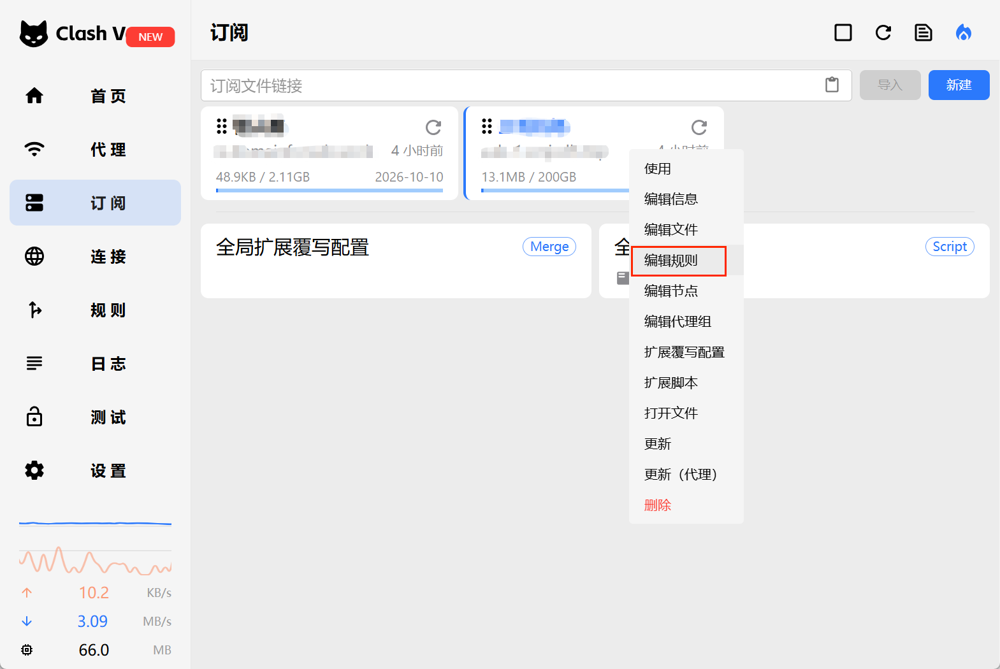
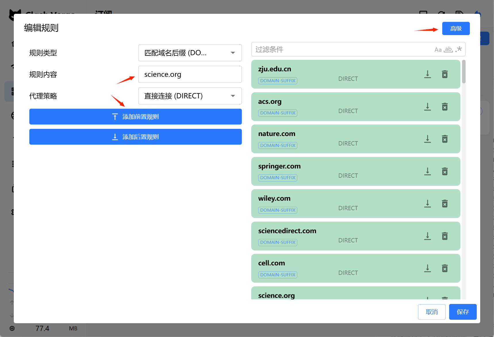
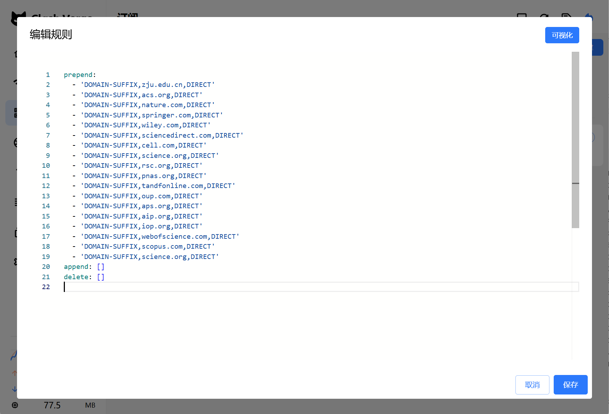

# 开着代理，学校买的期刊打不开？问题出在分流规则

> 一个容易被忽略的细节：很多学术数据库是看**公网 IP** 来识别你属于哪所机构的。当你开着代理客户端，代理会把期刊网站的访问请求一起送到代理出口，出版社看到的就不是浙江大学的 IP，机构订阅自然也就用不上了。下面把这件事拆开讲，并给出一套用「前置直连」正确分流的规则。

## 为什么挂着代理，学校买的期刊反而打不开

学术图书馆把电子资源交给读者，绝大多数走的是 **IP 识别**（IP authentication）：图书馆把本校校园网的一段段 IP 地址报给出版社和数据库厂商，只要请求来自这些 IP，就放行。美国图书馆协会（ALA）的资料显示，大学图书馆约 **70% 到 80%** 的电子资源都靠这种方式授权，剩下的才用统一身份认证等方式补充。

好处是校内体验极度顺滑，人在校园网里打开 ScienceDirect、Web of Science 几乎无感，连登录都不用；代价是它**只看 IP，不看你是谁**。

一旦电脑上挂了代理客户端又没做分流，代理就会把原本该走校园网的那部分流量一起带去代理出口。出版社看到的就成了代理服务器的出口 IP，浙江大学替你买的机构订阅自然也就用不上了，页面回到付费墙，根因是**出口 IP 变了**（订阅本身没失效）。

## 思路：给校园网和期刊域名加“前置直连”规则

Clash Verge Rev 新版提供了可视化的**规则编辑器**，不必再去手改订阅配置文件，那样每次更新订阅都会把手动改动覆盖掉。正确做法是：在规则里把 `zju.edu.cn` 以及常用出版社域名指定为**直接连接**（DIRECT），并且用「**添加前置规则**」让它们先于订阅原有规则生效；其余网站仍按订阅原来的策略分流。

入口在「订阅」页，在订阅卡片上右键，选择「**编辑规则**」：



下面这张表是解决浙江大学域名的最小配置：

| 设置项 | 取值 |
| --- | --- |
| 规则类型 | 匹配域名后缀（DOMAIN-SUFFIX） |
| 规则内容 | `zju.edu.cn` |
| 代理策略 | 直接连接（DIRECT） |
| 添加位置 | 添加前置规则（↑） |

编辑器长这样：



> 务必选「添加前置规则」：前置规则会先于订阅配置里的规则执行，否则原来的代理规则会把刚加的直连盖掉

### 1. 浙江大学域名怎么设

在 Clash Verge Rev 的规则编辑器里，把规则类型改成「匹配域名后缀（DOMAIN-SUFFIX）」、代理策略选择「直接连接（DIRECT）」、点击「添加前置规则」即可。这等价于在配置里写入：

```
DOMAIN-SUFFIX,zju.edu.cn,DIRECT
```

注意选 `DOMAIN-SUFFIX`：**前者会同时匹配主域名及其全部子域名**，能覆盖 `*.zju.edu.cn` 下的各类校内服务；默认的 `DOMAIN` 只匹配完整域名，对这类需求不够用。设置后点击右下角「保存」。

### 2. 常用学术期刊与数据库也建议直连

很多出版社通过访问者的公网 IP 来确认机构订阅权限，所以常用数据库同样建议加进前置直连，避免被代理带偏。下面这份清单覆盖了浙大已购的主要出版平台：

| 出版社或数据库 | 直连域名 |
| --- | --- |
| ACS（JCIM、JPCB 等） | `acs.org` |
| Nature Portfolio | `nature.com` |
| Springer | `springer.com` |
| Wiley | `wiley.com` |
| Elsevier / ScienceDirect | `sciencedirect.com` |
| Cell Press | `cell.com` |
| AAAS（Science） | `science.org` |
| Royal Society of Chemistry | `rsc.org` |
| PNAS | `pnas.org` |
| Taylor & Francis | `tandfonline.com` |
| Oxford Academic | `oup.com` |
| American Physical Society | `aps.org` |
| American Institute of Physics | `aip.org` |
| IOP Publishing | `iop.org` |
| Web of Science | `webofscience.com` |
| Scopus | `scopus.com` |

不需要逐条手填。编辑器右上角有一个「高级」入口，点开后能切换到 YAML 文本模式，把下面这些规则批量粘到已有的 `prepend:` 下面即可（保留原有规则，以及 `append:`、`delete:` 等字段）：

```yaml
prepend:
  - 'DOMAIN-SUFFIX,zju.edu.cn,DIRECT'
  - 'DOMAIN-SUFFIX,acs.org,DIRECT'
  - 'DOMAIN-SUFFIX,nature.com,DIRECT'
  - 'DOMAIN-SUFFIX,springer.com,DIRECT'
  - 'DOMAIN-SUFFIX,wiley.com,DIRECT'
  - 'DOMAIN-SUFFIX,sciencedirect.com,DIRECT'
  - 'DOMAIN-SUFFIX,cell.com,DIRECT'
  - 'DOMAIN-SUFFIX,science.org,DIRECT'
  - 'DOMAIN-SUFFIX,rsc.org,DIRECT'
  - 'DOMAIN-SUFFIX,pnas.org,DIRECT'
  - 'DOMAIN-SUFFIX,tandfonline.com,DIRECT'
  - 'DOMAIN-SUFFIX,oup.com,DIRECT'
  - 'DOMAIN-SUFFIX,aps.org,DIRECT'
  - 'DOMAIN-SUFFIX,aip.org,DIRECT'
  - 'DOMAIN-SUFFIX,iop.org,DIRECT'
  - 'DOMAIN-SUFFIX,webofscience.com,DIRECT'
  - 'DOMAIN-SUFFIX,scopus.com,DIRECT'
```

贴完之后，编辑器里的样子如下，`append:`、`delete:` 保持原样即可：



如果编辑器里已经有 `prepend:` 这一行，就不要再复制它，只追加下面的规则条目。以后遇到别的期刊无法识别校园网，再按该期刊的实际域名补一条即可。

这里有个容易踩的坑：`google.com`、`scholar.google.com` 和所有 `.edu` 域名都不要一股脑设成直连，Google Scholar 在很多网络环境下本身需要代理，学术域名也不只用于期刊订阅，**盲设直连反而可能让该走代理的流量断掉**。

### 3. 关键区分：DIRECT 不等于“校园网”

把规则设成 DIRECT，只是让流量**不经过代理**，但**从哪个出口出去，取决于你当时连的是什么网络**。这张表说清楚几种常见场景：

| 你当前的网络环境 | 设置 DIRECT 之后 |
| --- | --- |
| 正连着浙江大学校园网 | 期刊流量直接使用校园网出口，通常能恢复 IP 识别 |
| 使用普通家庭宽带 | 流量走家庭宽带，并不会自动变成浙大校园网 IP |
| 校外连接浙江大学 RVPN | 是否从校园网出口访问，取决于 RVPN 的路由与资源授权 |
| 使用浙江大学 WebVPN / CARSI | 通过学校指定的身份认证入口访问，不单纯依靠本机 DIRECT |

校外实际访问时，**优先考虑 WebVPN**；CARSI 与 RVPN 各支持部分数据库，情况不一，且**不要同时运行 WebVPN 和 RVPN，以免访问失败**。

## 加完直连还是打不开？先查「虚拟网卡模式」和代理绕过

规则加对了，某个校内站点却只能在关掉代理后才正常？最典型的是浙江大学邮件系统 `zjuem.zju.edu.cn`：直接连时它解析到校内地址、返回 200，一旦开着「虚拟网卡模式」就打不开，DIRECT 规则明明已经命中也没用。这一节按三步走：先弄清「虚拟网卡模式」为什么会搅局，再决定是关掉它、还是用「系统代理绕过」让校内流量根本不进 Clash，最后看校外 aTrust 场景怎么处理。

### 看清「虚拟网卡模式」的干扰

Clash 里的 TUN 在中文版界面叫「**虚拟网卡模式**」，入口不一定写 TUN，常放在「首页」或「设置 → 系统设置」里，和「系统代理」开关放在一起。它的工作方式与普通规则不同：TUN 在系统层装了一块虚拟网卡、接管全部流量，而普通 Rules 模式只处理遵循系统代理的那部分程序。

所以即便把 `zju.edu.cn` 设成了 DIRECT，开着「虚拟网卡模式」时，虚拟网卡会先把请求截走，再交给 Mihomo 的 DNS 与网络栈处理，Mihomo 的 DNS 解析异常或路由问题照样可能让校内站点打不开。官方仓库里也有人报告过类似现象：规则命中 DIRECT，关掉 TUN 后网站立刻恢复。

动手之前，可以先在「连接」页面清掉旧记录、重新打开站点、搜一下域名，看看流量到底走了哪条策略：

|「连接」页面看到的情况|说明|
| --- | --- |
|策略是 DIRECT，但连接超时|规则已生效，问题出在 Mihomo 的 DNS 或虚拟网卡路由|
|仍显示某个代理节点|前置规则没生效，或请求用了别的域名|
|完全找不到这条连接|流量没进 Clash，或 DNS 在建连前就失败了|

> 排查的第一步，先在「首页」关掉「虚拟网卡模式」，只保留**系统代理 + Rules 模式**，再看站点能否打开。平时主要用浏览器的话，这种配置就够用了。

### 更省心的办法：用「系统代理绕过」代替反复加规则

不少校内站点，与其在 Clash 规则里反复加 DIRECT，不如让它**直接绕过 Clash**。两者区别在于：DIRECT 规则只是让流量走直连出口，仍要经过 Mihomo 的 DNS 和虚拟网卡；而「系统代理绕过设置」让遵循 Windows 系统代理的浏览器、命令行等程序跳过 Clash，用你本已验证正常的校园网连接，从根上不经过 Clash 的任何环节。

配置位置（v2.5.x 中文版）：「设置」→「系统设置」区域 → 找到「系统代理」这一项，点它旁边的**齿轮图标**→ 弹出的「系统代理设置」里找到「代理绕过设置」：


保留默认条目，再新增 `*.zju.edu.cn` 与 `zju.edu.cn`，点「新建」确认加入列表后保存。这样一来，浏览器访问浙大站点时根本不进 Clash，也就绕开了「虚拟网卡模式」和 Mihomo DNS 的干扰。

### 校外用 aTrust（RVPN）时同样适用

校外只要 aTrust 已经连上、并提供了通往浙大内网的路由，浏览器绕过 Clash 之后，仍会经 aTrust 访问校内资源，通常正常。也因此建议保持**系统代理开、虚拟网卡模式关、Rules 模式**：官方仓库里有人反馈过 aTrust 与「虚拟网卡模式」发生路由冲突，切到普通系统代理模式后恢复。至于 aTrust 本身采用应用级代理而非完整 VPN 路由的情况，个别站点可能需要实测确认。

## 怎么确认规则真的生效了

在 Clash Verge Rev 的「连接」页面访问 `pubs.acs.org` 或 `www.sciencedirect.com`，确认这条连接的策略显示为 `DIRECT`；再去出版社页面看是否出现了浙江大学的机构访问标识，或者说可以直接看到全文。

> **两个条件同时成立，才能确定期刊确实通过校园网拿到了机构认证：连接策略是 DIRECT，且出版社页面显示了浙江大学的机构访问提示，少一个都不算稳**

建议长期使用 Rules 模式：学术出版社直连，Google Scholar 等其他网站继续按订阅原有规则分流，基本不用再频繁手动切换。
